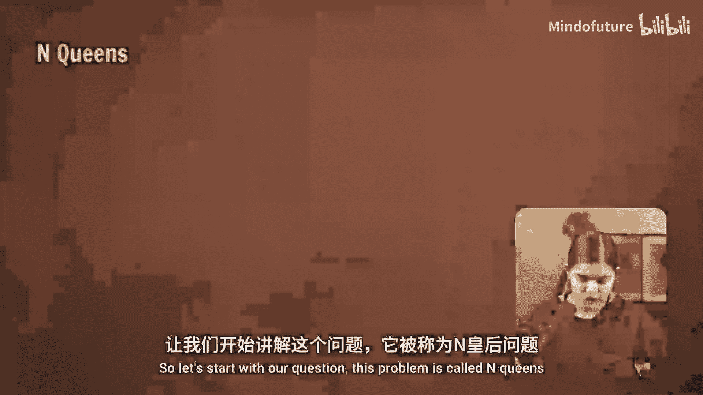
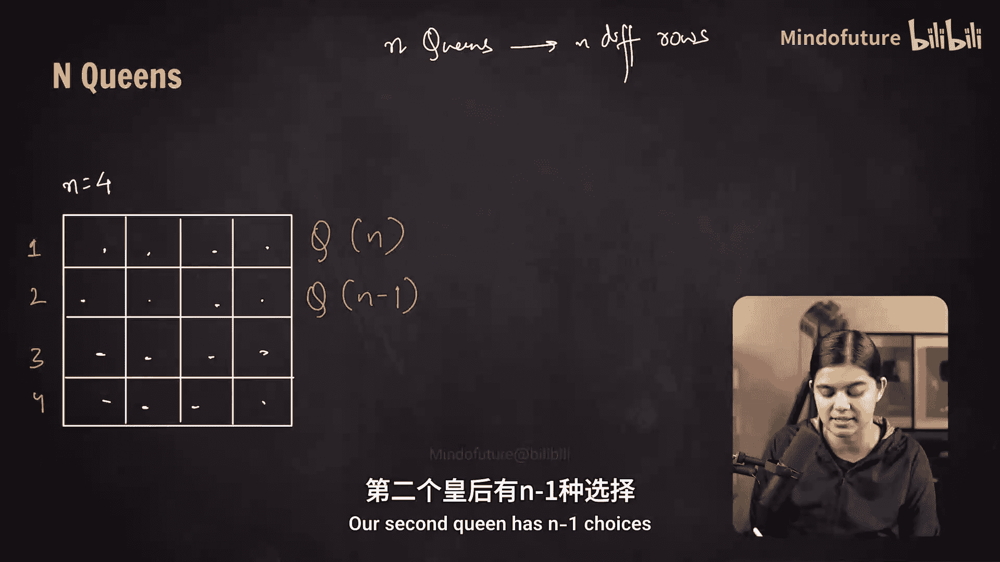

# 045：N皇后问题与回溯法 🏰




在本节课中，我们将学习一个经典的递归与回溯问题——N皇后问题。我们将深入理解回溯法的核心概念，并编写代码来解决这个LeetCode上的困难题目。

---

## 概述

N皇后问题要求在一个N×N的棋盘上放置N个皇后，使得它们彼此之间无法相互攻击。皇后在象棋中可以攻击同一行、同一列以及两条对角线上的任何棋子。因此，我们需要找到所有可能的皇后布局，确保任意两个皇后都不在同一行、同一列或同一对角线上。

## 问题理解与逻辑

首先，我们理解棋盘和皇后的规则。棋盘是N×N的网格。皇后的攻击范围覆盖其所在的行、列以及两条对角线。

我们的目标是：在每一行放置一个皇后，并且确保新放置的皇后与之前放置的所有皇后都不冲突。

**核心思路**是使用回溯法：
1.  从第一行（`row = 0`）开始尝试。
2.  在当前行中，遍历每一列（`col = 0` 到 `n-1`），尝试将皇后放在该位置。
3.  在放置前，检查该位置是否安全（即不与之前放置的皇后冲突）。
4.  如果安全，则在该位置放置皇后，并递归地处理下一行（`row + 1`）。
5.  如果递归调用成功找到了一个完整解（即所有行都成功放置了皇后），则记录当前棋盘布局。
6.  如果递归调用失败（即下一行无法找到安全位置），或者当前列的所有位置都不安全，则进行“回溯”：撤销当前行在当前列的放置（将棋盘该位置恢复为空），然后尝试当前行的下一列。
7.  当第一行的所有列都尝试完毕后，算法结束，我们就找到了所有可能的解。

## 代码实现框架

以下是解决N皇后问题的主函数框架：

```cpp
void solveNQueens(int n, vector<vector<string>>& ans) {
    vector<string> board(n, string(n, '.')); // 初始化棋盘，所有位置为‘.’
    backtrack(board, 0, n, ans); // 从第0行开始回溯
}

void backtrack(vector<string>& board, int row, int n, vector<vector<string>>& ans) {
    if (row == n) { // 所有行都已成功放置皇后，找到一个解
        ans.push_back(board);
        return;
    }
    // 尝试在当前行的每一列放置皇后
    for (int col = 0; col < n; col++) {
        if (isSafe(board, row, col, n)) { // 检查位置是否安全
            board[row][col] = 'Q'; // 放置皇后
            backtrack(board, row + 1, n, ans); // 递归处理下一行
            board[row][col] = '.'; // 回溯，撤销放置
        }
    }
}
```

## 安全检查函数

安全检查是算法的关键。对于一个给定位置 `(row, col)`，我们需要检查三个方向：

1.  **垂直方向（列）**：检查当前列 `col` 在 `0` 到 `row-1` 行是否已有皇后。
2.  **水平方向（行）**：由于我们每行只放一个皇后后立即进入下一行，所以同一行不会出现两个皇后，此行检查可省略。但为了逻辑清晰，可以检查当前行 `row` 在 `0` 到 `col-1` 列是否已有皇后（虽然我们的放置方式不会触发此情况）。
3.  **对角线方向**：有两条对角线需要检查。
    *   **左上对角线**：行索引和列索引同时递减。检查从 `(row-1, col-1)` 开始，直到棋盘边界，看是否有皇后。
    *   **右上对角线**：行索引递减，列索引递增。检查从 `(row-1, col+1)` 开始，直到棋盘边界，看是否有皇后。

以下是安全检查函数 `isSafe` 的实现：

```cpp
bool isSafe(vector<string>& board, int row, int col, int n) {
    // 检查同一列上方是否有皇后
    for (int i = 0; i < row; i++) {
        if (board[i][col] == 'Q') return false;
    }
    // 检查左上对角线是否有皇后
    for (int i = row - 1, j = col - 1; i >= 0 && j >= 0; i--, j--) {
        if (board[i][j] == 'Q') return false;
    }
    // 检查右上对角线是否有皇后
    for (int i = row - 1, j = col + 1; i >= 0 && j < n; i--, j++) {
        if (board[i][j] == 'Q') return false;
    }
    return true; // 位置安全
}
```

## 完整代码与执行

将上述 `solveNQueens`、`backtrack` 和 `isSafe` 函数组合起来，就构成了N皇后问题的完整解决方案。当 `n=4` 时，程序会找到并输出所有不互相攻击的皇后布局。

例如，`n=4` 的一个有效解是：
```
[“.Q..”, “…Q”, “Q…”, “..Q.”]
```
这表示在第0行第1列、第1行第3列、第2行第0列、第3行第2列放置皇后。

## 总结

本节课我们一起学习了如何使用回溯法解决经典的N皇后问题。我们掌握了以下核心步骤：
1.  **递归框架**：按行放置皇后，递归探索每一行的每一列。
2.  **回溯思想**：当当前路径无法得到解时，撤销上一步操作，尝试其他可能性。
3.  **状态检查**：实现 `isSafe` 函数来确保皇后放置位置的安全性，包括列冲突和对角线冲突的检查。



通过这个例子，我们深刻理解了回溯算法“尝试-失败-回退-再尝试”的精髓。这是一个解决约束满足问题和组合优化问题的强大工具。与此类似的问题还有“N骑士”问题等，你可以尝试用学到的回溯法思路去解决它们。

继续练习，保持探索，你会在算法学习的道路上越走越远。