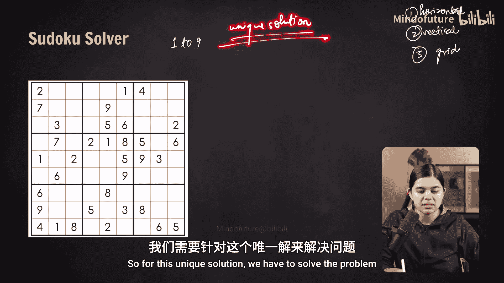
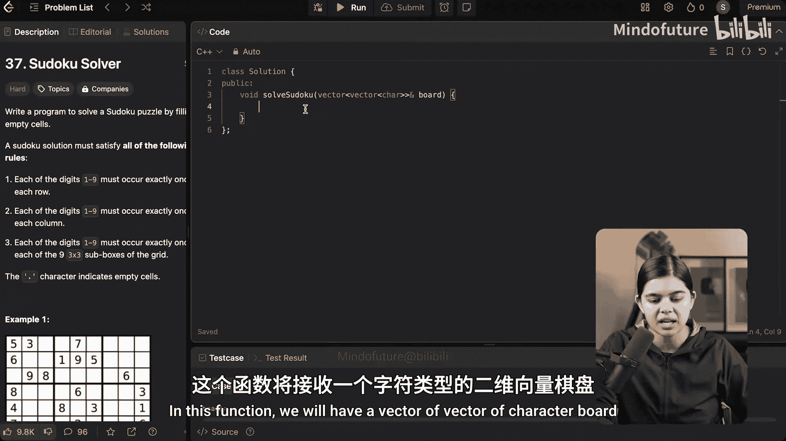
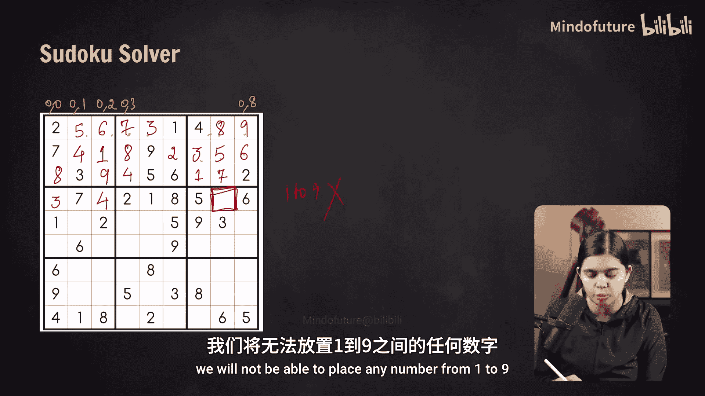
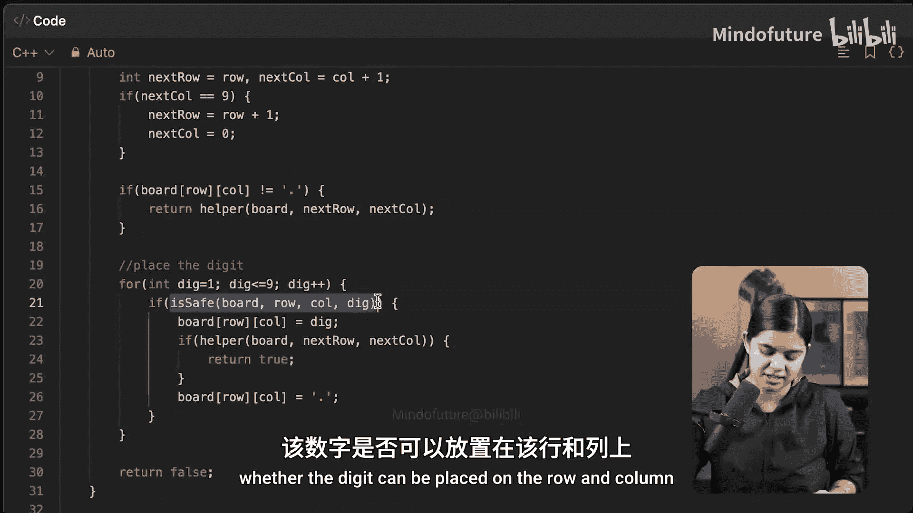
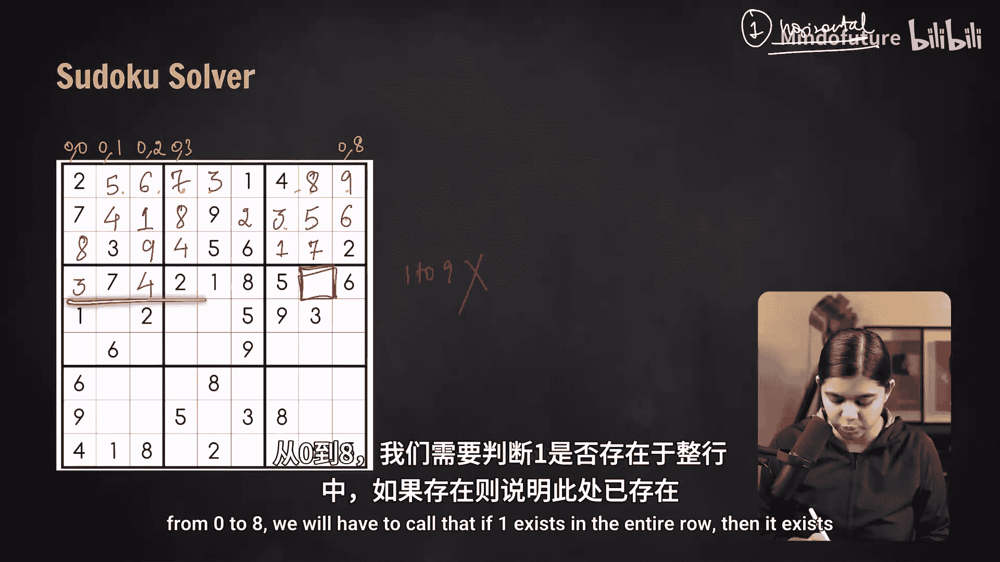
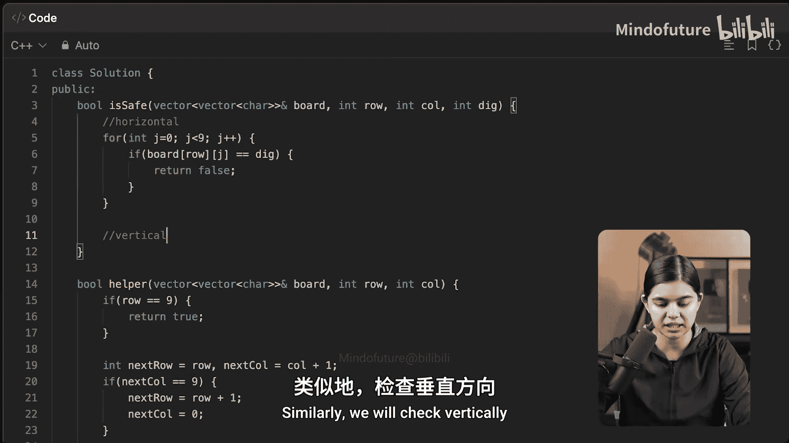
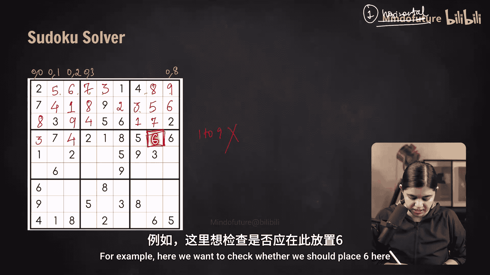
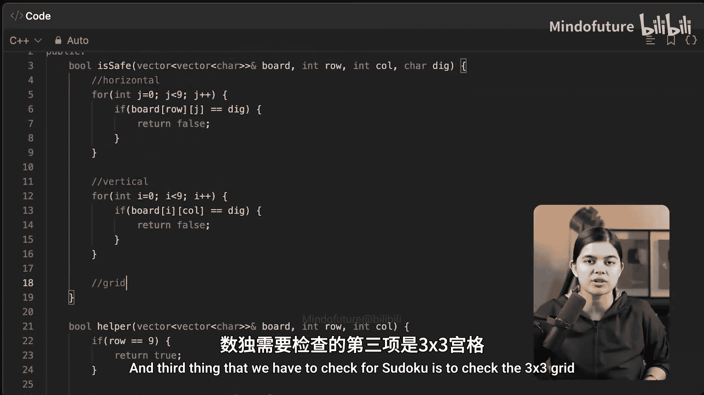
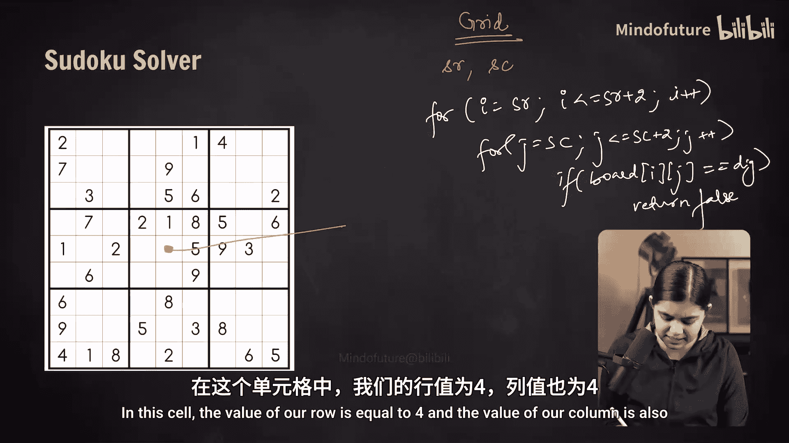
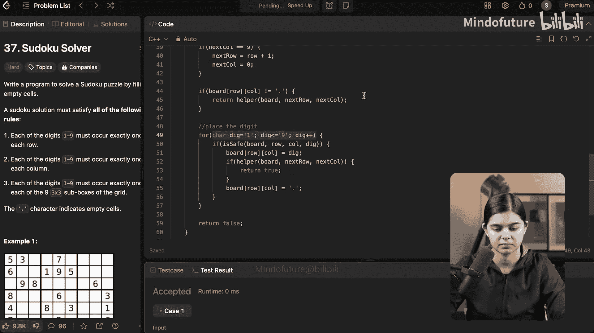

# 046：数独求解器问题 - 使用回溯法






在本节课中，我们将学习如何使用递归和回溯算法解决一个经典的难题：数独求解器。这是一个LeetCode上的困难题目，编号为37。我们将从理解问题规则开始，逐步构建解决方案，最终实现一个能够填充并解决任何有效数独谜题的程序。

## 概述

数独是一个9x9的网格，部分单元格已预先填入数字（1-9）。我们的目标是填充所有空白单元格（用 `‘.’` 表示），使得网格满足以下三个规则：
1.  每一行必须包含数字1-9，且不重复。
2.  每一列必须包含数字1-9，且不重复。
3.  每个3x3的子网格必须包含数字1-9，且不重复。

我们将使用回溯法来系统地尝试所有可能的数字组合，直到找到唯一解。

## 核心思路与伪代码

解决此问题的核心是递归和回溯。基本思路是遍历网格中的每个单元格，如果它是空的，我们就尝试填入一个安全的数字（1-9），然后递归地解决剩下的网格。如果后续递归失败（即找不到解），我们就回溯，撤销当前选择，尝试下一个数字。

以下是解决函数的主要逻辑框架：

```cpp
bool solveSudoku(vector<vector<char>>& board) {
    return helper(board, 0, 0); // 从左上角(0,0)开始
}

bool helper(vector<vector<char>>& board, int row, int col) {
    // 基础情况与递归逻辑将在这里实现
}
```

在 `helper` 函数中，我们需要处理几种情况。



### 处理已填充的单元格

如果当前单元格 `(row, col)` 已经有一个数字（不是 `‘.’`），我们不需要尝试填充它，直接跳到下一个单元格继续求解。

```cpp
if(board[row][col] != ‘.’) {
    // 计算下一个单元格的位置并递归调用
    return helper(board, nextRow, nextCol);
}
```

### 到达网格末尾

当我们成功处理完最后一行最后一列的单元格（即 `row == 9`）时，意味着整个网格已被正确填充，我们找到了一个解，应返回 `true`。

```cpp
if(row == 9) {
    return true; // 所有单元格已成功填充
}
```

### 尝试填充数字

对于空白单元格，我们循环尝试数字1到9。对于每个数字，首先检查将其放入当前单元格是否安全（即不违反数独规则）。如果安全，则放入该数字，然后递归调用以解决剩余的网格。如果递归调用返回 `true`，说明我们找到了解，可以一路返回 `true`。如果返回 `false`，说明当前选择导致死路，我们需要**回溯**：将当前单元格重置为 `‘.’`，然后尝试下一个数字。





```cpp
for(char digit = ‘1’; digit <= ‘9’; digit++) {
    if(isSafe(board, row, col, digit)) {
        board[row][col] = digit; // 做出选择
        if(helper(board, nextRow, nextCol)) {
            return true; // 如果后续递归成功，返回成功
        }
        board[row][col] = ‘.’; // 回溯，撤销选择
    }
}
// 如果1-9所有数字都尝试过且都不行，返回false
return false;
```

## 实现安全检查函数





`isSafe` 函数是算法的关键，它检查将数字 `digit` 放入位置 `(row, col)` 是否违反数独的三条规则。



### 检查行和列

我们遍历当前行和当前列，检查 `digit` 是否已经存在。

```cpp
// 检查行
for(int j=0; j<9; j++) {
    if(board[row][j] == digit) return false;
}
// 检查列
for(int i=0; i<9; i++) {
    if(board[i][col] == digit) return false;
}
```

### 检查3x3子网格



这是稍微复杂的一部分。我们需要确定当前单元格属于哪个3x3子网格，然后遍历该子网格中的所有单元格。

每个子网格的起始行和起始列可以通过以下公式计算：
*   `startRow = (row / 3) * 3`
*   `startCol = (col / 3) * 3`


例如，对于位置 `(4, 4)`：
*   `startRow = (4 / 3) * 3 = 1 * 3 = 3`
*   `startCol = (4 / 3) * 3 = 1 * 3 = 3`
因此它属于以 `(3, 3)` 为左上角的子网格。

确定起始点后，我们遍历这个3x3区域：

```cpp
int startRow = (row / 3) * 3;
int startCol = (col / 3) * 3;
for(int i=startRow; i<=startRow+2; i++) {
    for(int j=startCol; j<=startCol+2; j++) {
        if(board[i][j] == digit) return false;
    }
}
```

如果以上所有检查都通过，则说明放置是安全的，函数返回 `true`。

## 完整代码实现

结合以上所有部分，以下是完整的C++解决方案：

```cpp
class Solution {
public:
    void solveSudoku(vector<vector<char>>& board) {
        helper(board, 0, 0);
    }

    bool helper(vector<vector<char>>& board, int row, int col) {
        // 基础情况：已处理完所有行
        if(row == 9) {
            return true;
        }
        // 基础情况：已处理完当前行的所有列，转到下一行
        if(col == 9) {
            return helper(board, row+1, 0);
        }
        // 如果当前单元格已有数字，跳过
        if(board[row][col] != ‘.’) {
            return helper(board, row, col+1);
        }

        // 尝试填入数字1-9
        for(char digit = ‘1’; digit <= ‘9’; digit++) {
            if(isSafe(board, row, col, digit)) {
                board[row][col] = digit; // 放置数字
                if(helper(board, row, col+1)) { // 递归解决下一个单元格
                    return true; // 如果成功，返回true
                }
                board[row][col] = ‘.’; // 回溯
            }
        }
        return false; // 无解
    }

    bool isSafe(vector<vector<char>>& board, int row, int col, char digit) {
        // 检查行
        for(int j=0; j<9; j++) {
            if(board[row][j] == digit) return false;
        }
        // 检查列
        for(int i=0; i<9; i++) {
            if(board[i][col] == digit) return false;
        }
        // 检查3x3子网格
        int startRow = (row / 3) * 3;
        int startCol = (col / 3) * 3;
        for(int i=startRow; i<=startRow+2; i++) {
            for(int j=startCol; j<=startCol+2; j++) {
                if(board[i][j] == digit) return false;
            }
        }
        return true; // 安全
    }
};
```

## 算法复杂度分析



该回溯算法的时间复杂度在最坏情况下非常高，因为我们需要尝试所有可能的数字组合。对于一个有 `N` 个空格的数独，每个空格有最多9种选择，因此时间复杂度可以近似为 **O(9^N)**。然而，由于数独规则的限制（行、列、子网格约束），实际尝试的分支会远少于这个上界。空间复杂度主要为递归调用栈的深度，即 **O(N)**。

## 总结

本节课中，我们一起学习了如何使用递归和回溯法解决LeetCode上的数独求解器问题。我们首先理解了问题的规则，然后设计了递归函数来遍历和填充网格。我们实现了关键的安全检查函数 `isSafe`，用于确保每次放置数字都符合数独的三大规则。最后，我们整合代码并分析了算法复杂度。回溯法是解决此类约束满足问题的强大工具，通过“尝试-失败-回溯”的机制系统地搜索所有可能的解。掌握这个问题的解法，对于深入理解递归和回溯思想非常有帮助。