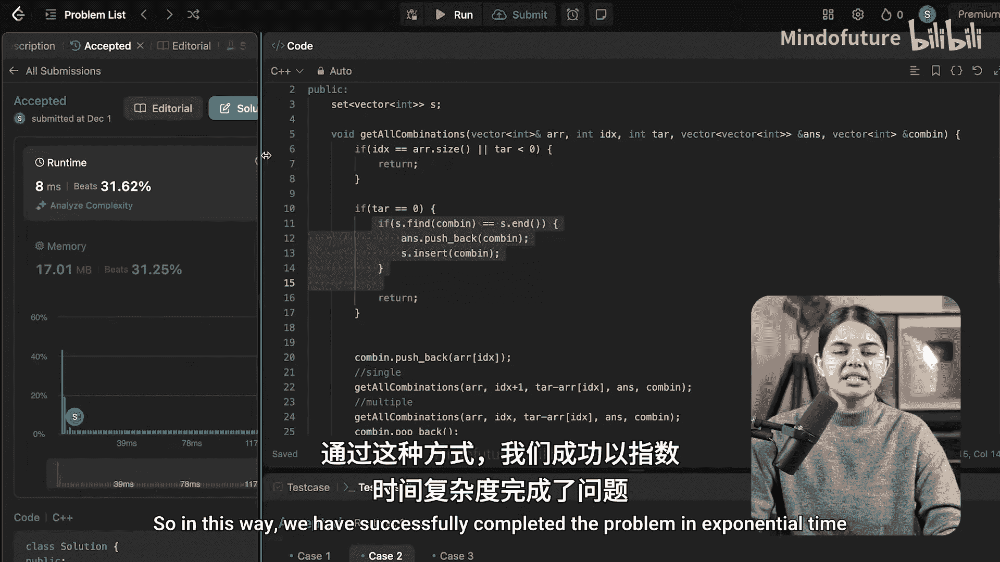

# 048：组合总和问题（递归与回溯）🎯


在本节课中，我们将学习一个重要的递归与回溯问题——**组合总和**。我们将通过一个具体例子，详细解析如何生成所有可能的数字组合，使其总和等于给定的目标值。理解这个问题对于掌握递归、回溯以及如何处理重复元素等核心概念至关重要。

---

## 问题概述与示例 📋

组合总和问题要求我们：给定一个**无重复元素**的整数数组 `candidates` 和一个目标整数 `target`，找出 `candidates` 中所有可以使数字和等于 `target` 的**不同组合**。`candidates` 中的**同一个数字可以无限制重复被选取**。

例如，给定数组 `candidates = [2, 3, 5]` 和目标值 `target = 8`，所有可能的解为：
*   `[2, 2, 2, 2]`
*   `[2, 3, 3]`
*   `[3, 5]`

我们的任务是编写一个函数，返回所有这些组合的列表。

---

## 核心思路：为每个元素做出选择 🤔

解决此问题的关键在于理解，对于数组中的**每一个元素**，在构建组合时我们都有几种选择。

上一节我们介绍了问题的定义，本节中我们来看看如何通过“选择”来构建解。

对于数组中的任意一个元素，我们面临三种基本选择：

1.  **包含一次**：将当前元素加入当前组合，然后**移动到下一个元素**继续决策。
2.  **包含多次**：将当前元素加入当前组合，但**停留在当前元素**，以便后续可以再次选择它。
3.  **不包含**：跳过当前元素，**直接移动到下一个元素**。

通过递归地应用这些选择，我们可以探索所有可能的组合路径。

---

## 递归树的可视化 🌳

让我们以 `candidates = [2, 3, 5]`, `target = 8` 为例，可视化递归过程。我们从索引 `i = 0`（元素 `2`）开始。

以下是决策树的简化表示：
*   在根节点，我们对元素 `2` 做出三种选择。
*   选择“包含一次”后，我们移动到元素 `3`，并对它做同样的三种选择。
*   选择“包含多次”后，我们仍停留在元素 `2`，可以再次对它做选择。
*   选择“不包含”后，我们直接移动到元素 `3`。

在递归过程中，我们需要维护两个关键状态：
*   `target`：剩余需要达到的目标和。每次包含一个元素，我们就从 `target` 中减去该元素的值。公式表示为：**`新target = 原target - candidates[i]`**。
*   `combination`：当前正在构建的组合列表。

---

## 递归的终止条件（Base Case）🚩

递归不能无限进行下去，我们需要定义明确的终止条件。

当我们在递归树中探索时，遇到以下两种情况就应该返回（回溯）：
1.  **`target == 0`**：这意味着当前 `combination` 中的数字和正好等于原始目标值。我们找到了一个有效解，需要将其保存到最终答案列表中。
2.  **`target < 0`**：这意味着当前路径上选择的数字和已经超过了目标值。由于题目说明所有数字都是正数，继续向下探索只会让和更大，因此这条路径不可能产生有效解，应该立即剪枝返回。

---

## 回溯的关键步骤 🔄

回溯是递归算法中清理“现场”的重要步骤。在我们尝试了某条路径（例如选择包含某个元素）并返回后，在尝试其他选择之前，必须撤销之前选择造成的影响。

具体到代码中，当我们通过 `combination.push_back(candidates[i])` 将元素加入当前组合后，在从该递归分支返回时，需要执行 `combination.pop_back()` 将该元素移除。这样才能保证 `combination` 状态正确，以便尝试“不包含”或其他选择。

---

## 算法伪代码与实现 🖥️

基于以上思路，我们可以勾勒出算法的骨架。

以下是核心递归函数的伪代码描述：
```cpp
// 辅助递归函数
void getCombinations(vector<int>& candidates, int target, int index, vector<int>& current, vector<vector<int>>& result) {
    // 基础情况1：找到有效组合
    if (target == 0) {
        result.push_back(current);
        return;
    }
    // 基础情况2：已超出目标值，或已遍历完数组
    if (target < 0 || index >= candidates.size()) {
        return;
    }

    // 选择1：包含当前元素一次，然后处理下一个元素
    current.push_back(candidates[index]);
    getCombinations(candidates, target - candidates[index], index + 1, current, result);
    current.pop_back(); // 回溯

    // 选择2：包含当前元素多次，仍处理当前元素
    current.push_back(candidates[index]);
    getCombinations(candidates, target - candidates[index], index, current, result); // 注意index不变
    current.pop_back(); // 回溯

    // 选择3：不包含当前元素，直接处理下一个元素
    getCombinations(candidates, target, index + 1, current, result);
}
```
在实际编写代码时，我们通常会将“包含一次”和“包含多次”的逻辑合并，通过循环或更简洁的递归调用来实现。同时，需要初始化并调用这个辅助函数。

---

## 处理重复组合与优化 💡

由于我们允许数字重复使用，并且对每个元素独立做决策，上述方法可能会产生顺序不同但元素相同的重复组合（例如 `[2,3,3]` 和 `[3,2,3]`）。

为了保证结果的唯一性，一个简单的方法是在将组合加入最终结果列表前，先对其进行排序，然后使用集合（`set`）进行去重。但更高效的方法是在递归时控制搜索起点，避免生成重复的路径，这通常通过传递一个 `startIndex` 参数来实现。

---

## 总结与要点回顾 📝

本节课中我们一起学习了如何用递归与回溯解决**组合总和**问题。

我们掌握了以下核心要点：
*   **问题核心**：为数组中的每个元素定义“包含一次”、“包含多次”和“不包含”的选择。
*   **递归状态**：通过 `target` 和当前 `combination` 来定义递归的当前状态。
*   **终止条件**：当 `target == 0`（找到解）或 `target < 0`（路径无效）时返回。
*   **回溯操作**：在递归调用返回后，使用 `pop_back()` 撤销选择，这是回溯算法的精髓。
*   **去重处理**：需要注意并处理可能产生的重复组合，确保结果唯一。



理解这个问题是学习更复杂回溯问题（如排列、子集、N皇后等）的坚实基础。通过清晰地定义选择、状态和终止条件，你可以将这种模式应用到许多类似的搜索问题中。