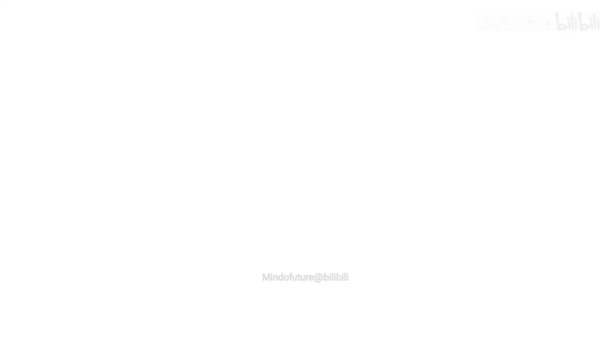
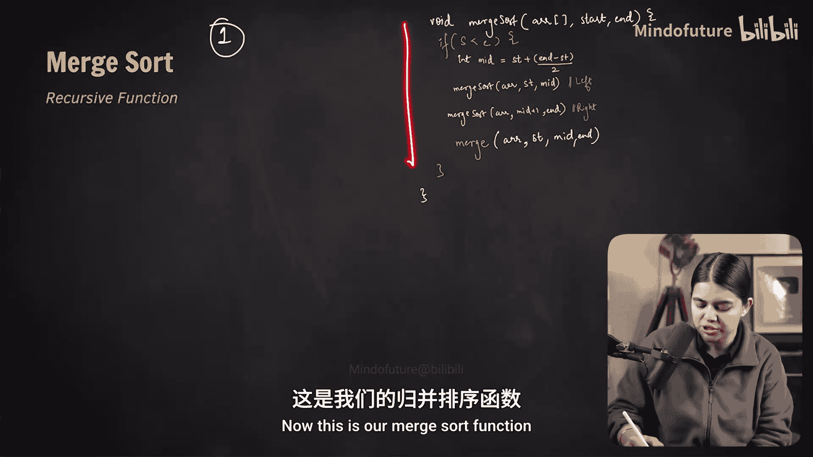

# 050：归并排序算法 - 递归与回溯 🧩



在本节课中，我们将要学习一个非常重要的递归算法——归并排序。我们将通过分析其不同步骤，来彻底理解整个递归过程及其在C++中的实现。

## 概述 📋

归并排序算法主要分为两个步骤。第一步是**分**，即递归地将数组分成两个相等的部分。第二步是**治**，即将已排序的子数组合并成一个完整的有序数组。

上一节我们介绍了递归的基本概念，本节中我们来看看如何应用递归来实现归并排序。

## 第一步：分（Divide）✂️

算法的第一步是反复地将数组分成两个相等的部分。

以下是“分”步骤的详细过程：
1.  找到数组的中间索引 `mid`。
2.  将数组分为左半部分（从 `start` 到 `mid`）和右半部分（从 `mid+1` 到 `end`）。
3.  对左半部分和右半部分**递归地**调用相同的“分”函数。
4.  重复此过程，直到每个子数组只包含一个元素（此时认为它已排序）。

这个过程可以用以下递归函数框架表示：
```cpp
void mergeSort(vector<int>& arr, int start, int end) {
    if(start < end) {
        int mid = start + (end - start) / 2; // 防止溢出
        mergeSort(arr, start, mid);   // 递归排序左半部分
        mergeSort(arr, mid+1, end); // 递归排序右半部分
        // 合并步骤将在后面添加
    }
}
```

## 第二步：治（Merge）🤝

当数组被分割成单个元素后，我们需要将这些小部分合并回有序的较大数组。这是算法的核心“治”步骤。

以下是“合并”两个已排序子数组的步骤：
1.  创建两个指针 `i` 和 `j`，分别指向左子数组和右子数组的起始位置。
2.  创建一个临时数组 `temp` 来存放合并后的结果。
3.  比较 `arr[i]` 和 `arr[j]`，将较小的元素放入 `temp`，并移动相应指针。
4.  重复步骤3，直到其中一个子数组的所有元素都被处理完。
5.  将剩余子数组的所有元素直接复制到 `temp` 的末尾。
6.  最后，将 `temp` 数组中的有序元素复制回原数组 `arr` 的对应位置。

合并步骤的伪代码如下：
```cpp
void merge(vector<int>& arr, int start, int mid, int end) {
    vector<int> temp;
    int i = start, j = mid + 1;

    // 合并两个有序子数组
    while(i <= mid && j <= end) {
        if(arr[i] <= arr[j]) {
            temp.push_back(arr[i++]);
        } else {
            temp.push_back(arr[j++]);
        }
    }

    // 复制左半部分剩余元素
    while(i <= mid) temp.push_back(arr[i++]);
    // 复制右半部分剩余元素
    while(j <= end) temp.push_back(arr[j++]);

    // 将排序好的元素复制回原数组
    for(int idx = 0; idx < temp.size(); idx++) {
        arr[start + idx] = temp[idx];
    }
}
```

## 完整代码实现 💻

将“分”与“治”的步骤结合起来，就得到了完整的归并排序算法。

```cpp
#include <iostream>
#include <vector>
using namespace std;

void merge(vector<int>& arr, int start, int mid, int end) {
    vector<int> temp;
    int i = start, j = mid + 1;

    while(i <= mid && j <= end) {
        if(arr[i] <= arr[j]) {
            temp.push_back(arr[i++]);
        } else {
            temp.push_back(arr[j++]);
        }
    }
    while(i <= mid) temp.push_back(arr[i++]);
    while(j <= end) temp.push_back(arr[j++]);

    for(int idx = 0; idx < temp.size(); idx++) {
        arr[start + idx] = temp[idx];
    }
}

void mergeSort(vector<int>& arr, int start, int end) {
    if(start < end) {
        int mid = start + (end - start) / 2;
        mergeSort(arr, start, mid);
        mergeSort(arr, mid + 1, end);
        merge(arr, start, mid, end); // 调用合并函数
    }
}

int main() {
    vector<int> arr = {12, 31, 8, 17, 32, 35};
    mergeSort(arr, 0, arr.size() - 1);

    for(int val : arr) {
        cout << val << " ";
    }
    cout << endl;
    return 0;
}
```

## 复杂度分析 📊

理解了算法流程后，我们来分析其时间和空间复杂度。

*   **时间复杂度**：归并排序的时间复杂度是 **O(n log n)**。
    *   **推导**：数组被递归地分成两半，深度为 **log₂ n** 层。在每一层，合并所有子数组的总工作量是 **O(n)**。因此，总时间复杂度为 **O(n log n)**。
*   **空间复杂度**：需要额外的临时数组来合并，因此空间复杂度是 **O(n)**。



## 总结 🎯

本节课中我们一起学习了归并排序算法。
1.  我们首先了解了算法的两个核心阶段：**分**与**治**。
2.  然后，我们详细探讨了如何用递归实现“分”的步骤，以及如何合并两个有序子数组的“治”的步骤。
3.  接着，我们整合代码，实现了完整的归并排序。
4.  最后，我们分析了算法的时间复杂度 **O(n log n)** 和空间复杂度 **O(n)**。

归并排序是一种高效、稳定的排序算法，其 **O(n log n)** 的性能使其在处理大规模数据时非常有用。理解其递归和合并的过程，对于掌握更复杂的算法思想至关重要。