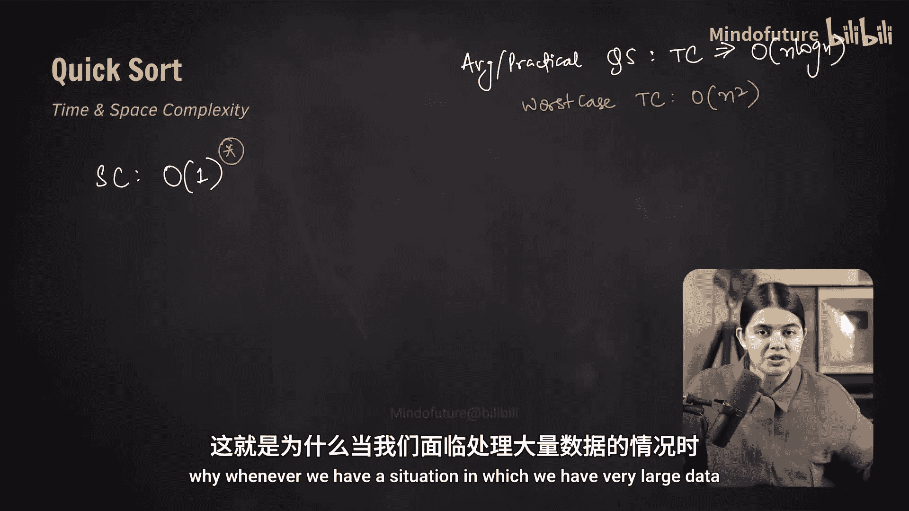

# 052：快速排序算法 🚀

在本节课中，我们将学习一种基于递归的重要排序算法——快速排序。我们将涵盖其核心思想、实现步骤、代码编写以及时间和空间复杂度分析。


## 概述

快速排序是一种高效的排序算法，其核心思想是“分而治之”。它通过选择一个“基准”元素，将数组划分为两个子数组，然后递归地对子数组进行排序。接下来，我们将详细探讨其工作原理。

## 算法核心思想

快速排序的核心在于“基准”和“分区”这两个概念。其目标是按升序或降序排列数组。为简化说明，我们以升序为例。

以下是快速排序的基本步骤：
1.  从数组中选择一个元素作为“基准”。
2.  执行“分区”操作：重新排列数组，使得所有小于基准的元素移到其左侧，所有大于基准的元素移到其右侧。等于基准的元素可以放在任一侧。分区完成后，基准元素就位于其最终的正确位置。
3.  递归地将快速排序算法应用于基准左侧的子数组和右侧的子数组。


## 分区过程详解

上一节我们介绍了快速排序的宏观步骤，本节中我们来看看关键的“分区”过程是如何具体实现的。

分区函数接收数组以及起始和结束索引作为参数。其目标是围绕一个选定的基准元素重新排列数组的一部分，并返回基准元素的最终索引位置。这个最终索引被称为“基准索引”，它标志着左侧子数组的结束和右侧子数组的开始。

以下是分区过程的具体逻辑：
*   选择基准元素。一种常见的简单实现是选择最后一个元素作为基准。
*   初始化一个索引 `i`，它指向最后一个已确认的小于基准的元素的位置。初始时，`i = start - 1`。
*   使用另一个索引 `j` 遍历从 `start` 到 `end-1` 的元素。
*   在遍历过程中，如果 `array[j]` 小于或等于基准值，则将 `i` 增加1，然后交换 `array[i]` 和 `array[j]` 的值。这确保了 `i` 及其左侧的所有元素都小于等于基准。
*   遍历完成后，`i+1` 的位置就是基准元素应该放置的正确位置。交换 `array[i+1]` 和 `array[end]`（即基准元素）。
*   函数最后返回基准元素的最终索引 `i+1`。

通过这个过程，数组被划分为 `[小于基准的元素, 基准, 大于基准的元素]` 三部分。

## 代码实现

理解了分区原理后，现在我们可以着手实现完整的快速排序算法。代码主要包含两个函数：`quickSort` 主函数和 `partition` 辅助函数。

**1. 分区函数实现**

```cpp
int partition(vector<int>& arr, int start, int end) {
    int pivot = arr[end]; // 选择最后一个元素作为基准
    int i = start - 1;    // 指向小于基准区域的最后一个元素

    for (int j = start; j < end; j++) {
        // 如果当前元素小于等于基准
        if (arr[j] <= pivot) {
            i++; // 扩大小于基准的区域
            swap(arr[i], arr[j]); // 将当前元素交换到该区域
        }
    }
    // 将基准元素放到正确位置
    swap(arr[i + 1], arr[end]);
    return i + 1; // 返回基准索引
}
```

**2. 快速排序主函数实现**

```cpp
void quickSort(vector<int>& arr, int start, int end) {
    // 递归基：当子数组只有一个或零个元素时，已经有序
    if (start >= end) {
        return;
    }
    // 1. 分区操作，获取基准索引
    int pivotIndex = partition(arr, start, end);

    // 2. 递归排序左半部分 (start 到 pivotIndex-1)
    quickSort(arr, start, pivotIndex - 1);

    // 3. 递归排序右半部分 (pivotIndex+1 到 end)
    quickSort(arr, pivotIndex + 1, end);
}
```

**3. 调用示例**

```cpp
int main() {
    vector<int> arr = {5, 2, 6, 4, 1, 3};
    quickSort(arr, 0, arr.size() - 1);

    for (int num : arr) {
        cout << num << " ";
    }
    // 输出：1 2 3 4 5 6
    return 0;
}
```

## 复杂度分析

在实现了算法之后，分析其性能至关重要。快速排序的复杂度在不同情况下差异显著。

*   **时间复杂度**
    *   **平均情况**：`O(n log n)`。这是最常见的情况，每次分区都能大致将数组对半分。
    *   **最佳情况**：`O(n log n)`，与平均情况相同。
    *   **最坏情况**：`O(n²)`。当每次选择的基准都是当前子数组中的最小或最大元素时发生（例如数组已完全有序或完全逆序）。此时分区极度不平衡，递归树深度为 `n`。
        *   总操作数近似为 `n + (n-1) + ... + 1 = n(n+1)/2`，即 `O(n²)`。

*   **空间复杂度**
    *   主要是递归调用栈所占用的空间。
    *   **平均情况**：`O(log n)`，对应递归树的深度。
    *   **最坏情况**：`O(n)`，对应深度为 `n` 的递归树。

## 总结

本节课中我们一起学习了快速排序算法。我们从其“分治”核心思想入手，详细剖析了“分区”这一关键步骤的工作原理。随后，我们逐步实现了 `partition` 函数和递归的 `quickSort` 函数，并提供了完整的可运行代码示例。最后，我们讨论了算法的时间与空间复杂度，特别指出了其平均高效 (`O(n log n)`) 但在特定情况下会退化 (`O(n²)`) 的特点。理解快速排序对于掌握高效排序技术和应对技术面试都至关重要。



