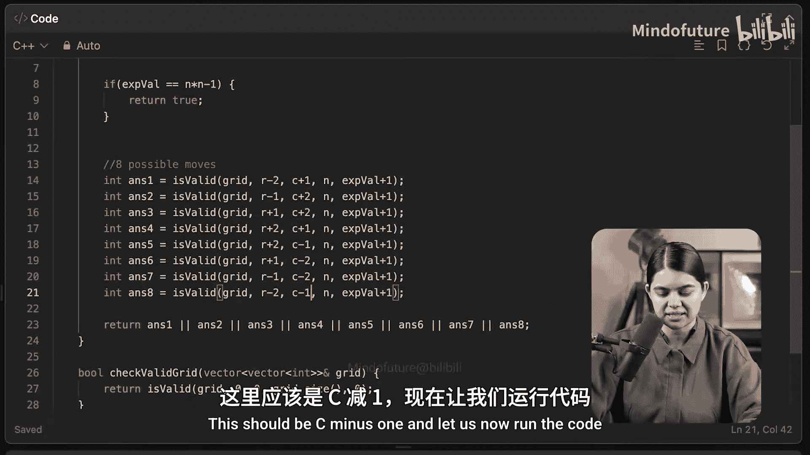

# 054：骑士巡游问题 - 回溯法


## 概述
在本节课中，我们将学习一个重要的递归与回溯问题——**骑士巡游问题**。我们将分析问题描述，理解骑士的移动规则，并最终实现一个函数来验证给定的棋盘路径是否是有效的骑士巡游路径。这个问题对应于LeetCode第2596题。

---

## 问题描述
假设我们有一个 `n x n` 的棋盘。棋盘上有一个骑士，它必须按照国际象棋中骑士的移动规则，访问棋盘上的每一个格子恰好一次。题目会给出一个 `n x n` 的网格 `grid`，其中 `grid[r][c]` 表示骑士访问该格子的顺序（从0开始）。我们的任务是编写一个函数，检查这个给定的访问顺序是否是一个有效的骑士巡游路径。

骑士在国际象棋中的移动规则是“日”字形，即每次移动可以朝八个可能的方向前进。

## 骑士的移动规则
上一节我们介绍了问题，本节中我们来看看骑士具体的移动规则。骑士可以从当前位置 `(r, c)` 移动到以下八个位置之一：

以下是骑士的八个可能移动方向（用行`r`和列`c`的变化表示）：
1.  `(r - 2, c + 1)`
2.  `(r - 1, c + 2)`
3.  `(r + 1, c + 2)`
4.  `(r + 2, c + 1)`
5.  `(r + 2, c - 1)`
6.  `(r + 1, c - 2)`
7.  `(r - 1, c - 2)`
8.  `(r - 2, c - 1)`

我们可以将这些移动存储在两个数组中，方便在代码中遍历：
```cpp
int dr[8] = {-2, -1, 1, 2, 2, 1, -1, -2};
int dc[8] = {1, 2, 2, 1, -1, -2, -2, -1};
```

## 解题思路：回溯法
理解了移动规则后，我们需要设计算法来验证路径。我们将使用**回溯法**。核心思想是从起始位置（即 `grid` 中值为 `0` 的格子）开始，递归地尝试所有可能的下一步移动，检查它是否指向 `grid` 中标记的下一个顺序值。

我们将实现一个递归辅助函数 `isValidHelper`。

### 函数参数与返回值
该函数需要以下参数：
*   `grid`: 给定的棋盘。
*   `r`: 当前所在的行。
*   `c`: 当前所在的列。
*   `n`: 棋盘的尺寸。
*   `expectedValue`: 当前格子**应该**具有的顺序值。

函数返回一个布尔值：从当前位置 `(r, c)` 开始，是否能完成剩余的有效巡游路径。

### 递归的基准情况
在编写递归逻辑前，我们先定义基准情况。

以下是需要返回 `false` 的情况：
1.  当前位置 `(r, c)` 超出了棋盘边界（`r < 0 || c < 0 || r >= n || c >= n`）。
2.  当前位置 `grid[r][c]` 的值不等于我们期望的 `expectedValue`。这意味着路径在此处已经出错。

以下是需要返回 `true` 的情况：
当 `expectedValue` 等于 `n * n - 1` 时，说明我们已经成功访问了棋盘上所有 `n * n` 个格子（从0到 n²-1），巡游完成。

### 递归步骤
如果上述基准情况都不满足，说明我们当前处于一个有效的中间步骤。那么，我们需要尝试所有八种可能的下一步移动。

对于每一种移动 `i`（从0到7）：
1.  计算下一个位置 `(nr, nc) = (r + dr[i], c + dc[i])`。
2.  递归调用 `isValidHelper(grid, nr, nc, n, expectedValue + 1)`。

如果这八个递归调用中**有任何一個**返回 `true`，则说明从当前步骤出发存在一条有效路径，整个函数应返回 `true`。如果所有尝试都返回 `false`，则说明此路不通，返回 `false`。

### 主函数
在主函数 `checkValidGrid` 中，我们需要：
1.  找到棋盘上值为 `0` 的起始位置 `(start_r, start_c)`。
2.  调用 `isValidHelper(grid, start_r, start_c, n, 0)` 并返回其结果。

## 代码实现
根据以上思路，我们可以将伪代码转化为实际的C++代码。



```cpp
class Solution {
public:
    // 骑士的八个移动方向
    int dr[8] = {-2, -1, 1, 2, 2, 1, -1, -2};
    int dc[8] = {1, 2, 2, 1, -1, -2, -2, -1};

    bool isValidHelper(vector<vector<int>>& grid, int r, int c, int n, int expectedValue) {
        // 基准情况1: 超出边界
        if (r < 0 || c < 0 || r >= n || c >= n) {
            return false;
        }
        // 基准情况2: 当前格子值不等于期望值
        if (grid[r][c] != expectedValue) {
            return false;
        }
        // 基准情况3: 已成功访问所有格子
        if (expectedValue == n * n - 1) {
            return true;
        }

        // 尝试所有八种可能的移动
        for (int i = 0; i < 8; ++i) {
            int nr = r + dr[i];
            int nc = c + dc[i];
            if (isValidHelper(grid, nr, nc, n, expectedValue + 1)) {
                return true; // 找到一条有效路径
            }
        }
        // 所有移动尝试都失败
        return false;
    }

    bool checkValidGrid(vector<vector<int>>& grid) {
        int n = grid.size();
        if (grid[0][0] != 0) return false; // 根据题意，必须从左上角(0,0)且值为0开始
        return isValidHelper(grid, 0, 0, n, 0);
    }
};
```

## 复杂度分析
*   **时间复杂度**：在最坏情况下，每个格子都有8种可能的下一步选择。对于 `n x n` 的棋盘，递归树可能非常庞大，时间复杂度为 **O(8^(n²))**。这是一个理论上的上界，由于 `grid` 提供了确定的路径，实际递归分支会很快被 `grid[r][c] != expectedValue` 条件剪枝。
*   **空间复杂度**：主要空间消耗来自递归调用栈。在最坏情况下，递归深度等于需要访问的格子数，即 **O(n²)**。

## 总结
本节课中我们一起学习了如何利用**回溯法**解决**骑士巡游问题**。我们首先分析了骑士独特的移动规则，然后设计了递归函数，明确了返回 `true` 和 `false` 的基准情况，最后通过尝试所有可能的下一步移动来验证给定路径的有效性。虽然这个问题在LeetCode上被标记为中等难度，但它是巩固递归和回溯基础思想的经典练习题。理解并实现这个算法，将帮助你更好地应对更复杂的回溯问题。