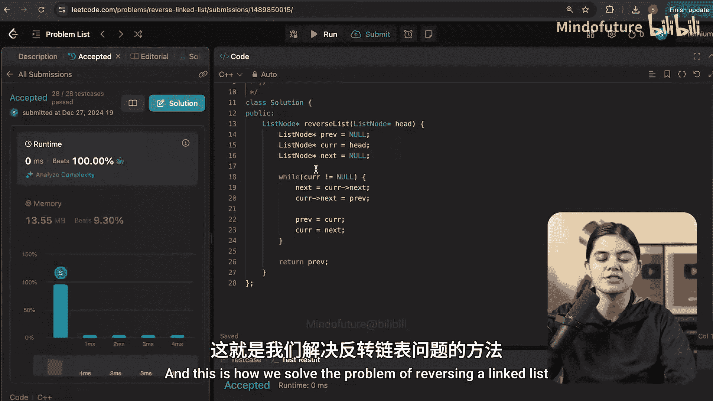

# 057：反转链表 🔄


在本节课中，我们将学习如何解决一个经典且重要的数据结构问题：反转一个单链表。我们将详细讲解其核心逻辑，并通过代码实现来巩固理解。

## 概述

反转链表是面试和算法练习中的常见问题。其核心在于改变链表中每个节点的指向，将原本指向下一个节点的指针改为指向前一个节点。我们将使用一种迭代方法，通过三个指针来高效地完成这个操作。

## 问题描述

给定一个单链表的头节点 `head`，请反转该链表，并返回反转后的新头节点。

**示例：**
输入：`1 -> 2 -> 3 -> 4 -> 5`
输出：`5 -> 4 -> 3 -> 2 -> 1`

## 核心思路与算法

上一节我们概述了问题，本节中我们来看看具体的解决思路。关键在于使用三个指针来追踪节点的位置，并逐步改变它们的指向。

以下是反转链表的核心步骤：

1.  **初始化三个指针**：
    *   `previous`：指向已经反转好的部分的最后一个节点，初始为 `nullptr`。
    *   `current`：指向当前待处理的节点，初始为链表的头节点 `head`。
    *   `next`：临时保存 `current` 节点的下一个节点，防止链表断裂。

2.  **迭代过程**：
    在 `current` 不为空时，重复以下步骤：
    *   保存 `current` 的下一个节点到 `next`。
    *   将 `current` 的 `next` 指针指向 `previous`，完成反转。
    *   将 `previous` 指针移动到 `current` 的位置。
    *   将 `current` 指针移动到 `next` 的位置。

3.  **循环结束**：
    当 `current` 变为 `nullptr` 时，表示所有节点都已处理完毕。此时 `previous` 指针指向的就是新链表的头节点。

这个过程的**时间复杂度**是 **O(n)**，其中 n 是链表的长度，因为我们只遍历了一次链表。**空间复杂度**是 **O(1)**，因为我们只使用了固定的几个指针。

## 代码实现

理解了算法逻辑后，现在让我们将其转换为实际的 C++ 代码。

```cpp
/**
 * Definition for singly-linked list.
 * struct ListNode {
 *     int val;
 *     ListNode *next;
 *     ListNode() : val(0), next(nullptr) {}
 *     ListNode(int x) : val(x), next(nullptr) {}
 *     ListNode(int x, ListNode *next) : val(x), next(next) {}
 * };
 */
class Solution {
public:
    ListNode* reverseList(ListNode* head) {
        // 初始化三个指针
        ListNode* previous = nullptr;
        ListNode* current = head;
        ListNode* next = nullptr;

        // 遍历链表
        while (current != nullptr) {
            // 1. 保存下一个节点
            next = current->next;
            // 2. 反转当前节点的指针
            current->next = previous;
            // 3. 移动 previous 和 current 指针
            previous = current;
            current = next;
        }
        // 循环结束后，previous 就是新的头节点
        return previous;
    }
};
```

## 总结

本节课中我们一起学习了如何反转一个单链表。我们掌握了使用三个指针（`previous`， `current`， `next`）的迭代方法，该方法逻辑清晰且效率高（O(n) 时间， O(1) 空间）。记住这个“保存、反转、移动”的三步循环，你就能轻松解决此类问题。



建议你在理解的基础上，在白板或纸上画图模拟这个过程，并尝试用这个思路解决其他链表相关问题来巩固知识。