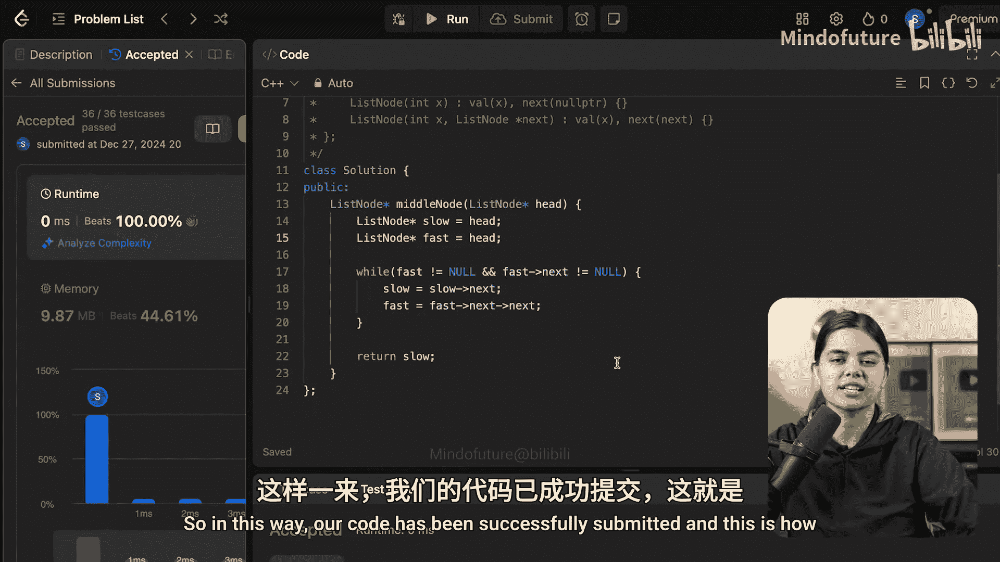

# 058：链表的中间节点


在本节课中，我们将学习如何解决一个重要的经典链表问题：**寻找链表的中间节点**。这是一个在面试中常见的问题，对应力扣（LeetCode）上的第876题。我们将探讨两种不同的解题思路，并重点介绍一种高效且巧妙的“快慢指针”方法。

## 问题概述

题目要求是：给定一个单链表的头节点 `head`，返回链表的中间节点。链表可能包含奇数个节点，也可能包含偶数个节点。

*   如果链表有奇数个节点（例如 `1->2->3->4->5`），则中间节点是 `3`。
*   如果链表有偶数个节点（例如 `1->2->3->4->5->6`），根据题目要求，我们需要返回**第二个中间节点**，即 `4`。

我们的目标是实现一个函数 `ListNode* middleNode(ListNode* head)` 来完成这个任务。

## 方法一：朴素解法

首先，我们来看一种直观的解法。思路很简单：先遍历一次链表，计算出链表的总长度（节点数），记为 `n`。然后，根据 `n` 是奇数还是偶数，计算出中间节点的位置，最后再遍历一次链表找到该节点。

以下是具体步骤：
1.  初始化一个计数器 `count = 0` 和一个临时指针 `temp = head`。
2.  使用 `while` 循环遍历链表，直到 `temp` 为空。在循环中，`count++` 并移动 `temp` 指针。
3.  循环结束后，`count` 即为链表长度 `n`。
4.  计算中间节点的索引 `mid`。对于需要返回第二个中间节点的要求，公式为：`mid = n / 2 + 1`。
5.  重置 `temp = head`，再次遍历链表 `mid - 1` 次，此时 `temp` 指向的就是中间节点。
6.  返回 `temp`。

这种方法需要遍历链表两次，时间复杂度为 **O(2n) = O(n)**，空间复杂度为 **O(1)**。虽然可行，但效率不是最优。

## 方法二：快慢指针法

上一节我们介绍了需要两次遍历的朴素解法，本节中我们来看看一种更巧妙的“快慢指针”方法，它只需要一次遍历。

这种方法的核心思想是使用两个指针 `slow` 和 `fast`，它们都从链表头 `head` 开始移动。
*   **慢指针 `slow`**：每次向后移动 **1** 个节点。
*   **快指针 `fast`**：每次向后移动 **2** 个节点。

由于快指针的速度是慢指针的两倍，当快指针到达链表末尾时，慢指针**恰好位于链表的中间**。这个规律对于奇数长度和偶数长度的链表都适用。

让我们通过例子来验证：
*   **奇数链表 `1->2->3->4->5`**：
    *   初始：`slow` 在 `1`，`fast` 在 `1`。
    *   第一步：`slow` 移动到 `2`，`fast` 移动到 `3`。
    *   第二步：`slow` 移动到 `3`，`fast` 移动到 `5`。
    *   此时 `fast` 到达末尾，`slow` 指向中间节点 `3`。
*   **偶数链表 `1->2->3->4->5->6`**：
    *   初始：`slow` 在 `1`，`fast` 在 `1`。
    *   第一步：`slow` 移动到 `2`，`fast` 移动到 `3`。
    *   第二步：`slow` 移动到 `3`，`fast` 移动到 `5`。
    *   第三步：`slow` 移动到 `4`，`fast` 移动到 `null`（`6` 的 `next`）。
    *   此时 `fast` 为空，`slow` 指向第二个中间节点 `4`。

以下是实现快慢指针法的关键步骤：
1.  初始化两个指针：`slow = head;`，`fast = head;`。
2.  使用 `while` 循环，条件是 `fast != NULL && fast->next != NULL`。这个条件确保了 `fast` 指针可以安全地移动两步。
3.  在循环体内：
    *   慢指针前进一步：`slow = slow->next;`
    *   快指针前进两步：`fast = fast->next->next;`
4.  循环结束时，`slow` 指针指向的就是链表的中间节点。
5.  返回 `slow`。

以下是核心代码：
```cpp
ListNode* middleNode(ListNode* head) {
    ListNode* slow = head;
    ListNode* fast = head;

    while (fast != NULL && fast->next != NULL) {
        slow = slow->next;          // 慢指针走一步
        fast = fast->next->next;    // 快指针走两步
    }

    return slow; // 慢指针所在位置即为中间节点
}
```
这种方法的时间复杂度为 **O(n)**（只需一次遍历），空间复杂度为 **O(1)**，比朴素解法更高效。

## 总结

本节课中我们一起学习了如何寻找链表的中间节点。我们首先分析了一个需要两次遍历的朴素解法，然后重点掌握了一种更优的“快慢指针”法。快慢指针法通过一次遍历就能定位中间节点，代码简洁且效率高，是解决此类问题的经典技巧。理解并熟练运用这种双指针技巧，对于解决更多复杂的链表问题（如检测循环）非常有帮助。



