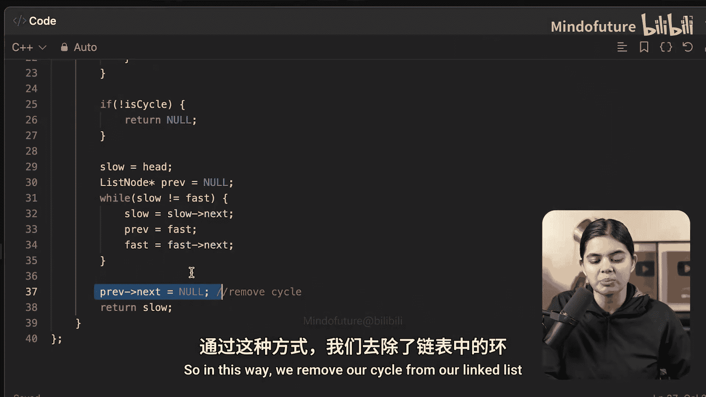

# 059：检测和移除链表中的环


## 概述
在本节课中，我们将学习一个重要的链表概念：如何检测并移除链表中的环或循环。我们将把问题分为两部分：检测环的存在，以及找到环的起始节点并将其移除。

---

## 检测链表中的环

上一节我们介绍了链表环的基本概念，本节中我们来看看如何检测一个链表中是否存在环。

核心思路是使用**快慢指针法**。我们创建两个指针，`slow`和`fast`，都从链表头部开始。`slow`指针每次移动一步，`fast`指针每次移动两步。如果链表中存在环，这两个指针最终一定会相遇。如果`fast`指针到达了链表末尾（`nullptr`），则说明链表中没有环。

以下是检测环的逻辑步骤：

1.  初始化两个指针 `slow` 和 `fast`，都指向链表头节点 `head`。
2.  进入一个循环，条件是 `fast != nullptr` 且 `fast->next != nullptr`。
3.  在循环内，`slow` 指针移动一步：`slow = slow->next`。
4.  `fast` 指针移动两步：`fast = fast->next->next`。
5.  检查 `slow` 和 `fast` 是否指向同一个节点。如果是，则链表存在环，返回 `true`。
6.  如果循环正常结束（`fast` 到达末尾），则链表无环，返回 `false`。

**代码描述**
```cpp
bool hasCycle(ListNode *head) {
    if (head == nullptr) return false;
    
    ListNode *slow = head;
    ListNode *fast = head;
    
    while (fast != nullptr && fast->next != nullptr) {
        slow = slow->next;          // 慢指针移动一步
        fast = fast->next->next;    // 快指针移动两步
        
        if (slow == fast) {
            return true; // 相遇，存在环
        }
    }
    return false; // 快指针到达末尾，无环
}
```

通过这种方法，我们可以高效地判断链表是否有环。

---

## 寻找环的起始节点

在确认链表存在环之后，下一个常见的问题是找到环开始的节点。

方法如下：在快慢指针相遇后，将其中一个指针（例如`slow`）重新指向链表头部。然后让`slow`和`fast`指针都以**每次一步**的速度移动。当它们再次相遇时，相遇的节点就是环的起始节点。

以下是寻找环起始节点的步骤：

1.  首先使用快慢指针法确认链表有环，并记录相遇点。
2.  将 `slow` 指针重新指向链表头 `head`。
3.  `fast` 指针保持在相遇点。
4.  同时移动 `slow` 和 `fast` 指针，每次各移动一步。
5.  当 `slow` 和 `fast` 再次相遇时，所在的节点即为环的入口节点。

**代码描述**
```cpp
ListNode *detectCycle(ListNode *head) {
    ListNode *slow = head;
    ListNode *fast = head;
    bool hasCycle = false;
    
    // 第一步：检测环
    while (fast != nullptr && fast->next != nullptr) {
        slow = slow->next;
        fast = fast->next->next;
        if (slow == fast) {
            hasCycle = true;
            break;
        }
    }
    
    // 如果没有环，返回 nullptr
    if (!hasCycle) return nullptr;
    
    // 第二步：寻找环的起点
    slow = head; // 慢指针回到头部
    while (slow != fast) {
        slow = slow->next; // 两者都每次移动一步
        fast = fast->next;
    }
    return slow; // 或 fast，此时它们指向环的起点
}
```

这个方法的正确性可以通过数学公式推导来理解。

---

## 数学推导与证明

设：
*   `x` = 从链表头到环入口节点的距离。
*   `y` = 从环入口节点到快慢指针第一次相遇点的距离。
*   `D` = 环的总长度。
*   在相遇点，慢指针走过的总路程为 `S_slow = x + y`。
*   快指针走过的总路程为 `S_fast = x + y + n * D`，其中 `n` 是快指针在环内绕的圈数。
*   因为快指针速度是慢指针的两倍，所以 `S_fast = 2 * S_slow`。

由此得到方程：
`x + y + n*D = 2*(x + y)`
化简可得：
`x = n*D - y`
这个公式意味着，**从链表头到环入口的距离 `x`，等于从相遇点再走 `(n*D - y)` 步**。而 `(n*D - y)` 正好是从相遇点走到环入口的距离（可能绕环 `n-1` 圈）。这解释了为什么将指针重置后，以相同速度移动会再次在环入口相遇。

---

## 移除链表中的环

找到环的起始节点后，移除环就变得简单了。核心是找到环入口节点的前一个节点，并将其 `next` 指针设置为 `nullptr`。

以下是移除环的步骤：

1.  使用前述方法找到环的入口节点 `cycleStart`。
2.  初始化一个指针 `prev`，从 `cycleStart` 出发，在环内移动。
3.  移动 `prev`，直到 `prev->next` 再次等于 `cycleStart`。此时 `prev` 就是环入口节点的前驱节点。
4.  将 `prev->next` 设置为 `nullptr`，从而断开环。

**代码描述**
```cpp
void removeCycle(ListNode *head) {
    ListNode *cycleStart = detectCycle(head);
    if (cycleStart == nullptr) return; // 无环，直接返回
    
    ListNode *prev = cycleStart;
    // 在环内遍历，找到 cycleStart 的前一个节点
    while (prev->next != cycleStart) {
        prev = prev->next;
    }
    // 断开环
    prev->next = nullptr;
}
```

通过以上步骤，我们就能成功移除链表中的环。

---



## 总结
本节课中我们一起学习了关于链表环的三个核心问题：
1.  **检测环**：使用快慢指针法，判断链表是否有环。
2.  **寻找环起点**：在确认有环后，通过重置指针并同步移动来找到环的入口节点。
3.  **移除环**：找到环入口的前驱节点，断开其 `next` 指针以移除环。

理解这些算法及其背后的数学原理，对于解决相关的面试和竞赛题目至关重要。