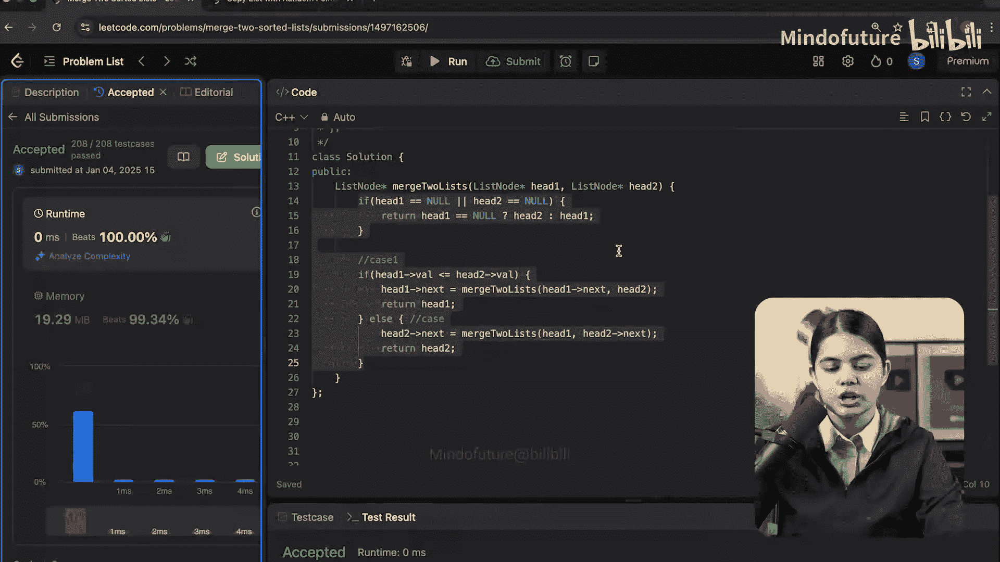

# 060：合并两个有序链表 📚


在本节课中，我们将学习如何解决一个经典的链表问题：合并两个有序链表。我们将通过递归的方法，一步步构建解决方案，并分析其时间复杂度。

---

## 概述

我们有两个已经按升序排列的链表。我们的目标是创建一个新的链表，它包含两个输入链表中的所有节点，并且这个新链表也必须是有序的。我们将通过递归比较两个链表的头节点值来实现这个功能。

## 核心逻辑

核心思想是递归地比较两个链表当前头节点的值。值较小的节点将成为新链表的下一个节点，然后我们递归地处理剩余的部分。

以下是解决问题的递归思路：

1.  **基础情况**：如果其中一个链表为空，则直接返回另一个链表。
2.  **递归情况**：
    *   比较 `list1` 和 `list2` 的头节点值。
    *   如果 `list1` 的值小于或等于 `list2` 的值，那么 `list1` 的节点将是结果链表的一部分。我们递归地合并 `list1->next` 和整个 `list2`，并将结果连接到 `list1` 节点之后。
    *   反之，如果 `list2` 的值更小，则 `list2` 的节点成为结果的一部分。我们递归地合并整个 `list1` 和 `list2->next`，并将结果连接到 `list2` 节点之后。

## 代码实现

现在，让我们将上述逻辑转化为实际的 C++ 代码。

```cpp
/**
 * Definition for singly-linked list.
 * struct ListNode {
 *     int val;
 *     ListNode *next;
 *     ListNode() : val(0), next(nullptr) {}
 *     ListNode(int x) : val(x), next(nullptr) {}
 *     ListNode(int x, ListNode *next) : val(x), next(next) {}
 * };
 */
class Solution {
public:
    ListNode* mergeTwoLists(ListNode* list1, ListNode* list2) {
        // 基础情况：如果其中一个链表为空，返回另一个
        if(list1 == NULL) return list2;
        if(list2 == NULL) return list1;

        // 递归情况：比较两个头节点的值
        if(list1->val <= list2->val) {
            // list1 的值更小，它将成为当前节点
            // 递归合并 list1->next 和 list2，并将结果接在 list1 后面
            list1->next = mergeTwoLists(list1->next, list2);
            return list1; // 返回 list1 作为当前子链表的头
        } else {
            // list2 的值更小，它将成为当前节点
            // 递归合并 list1 和 list2->next，并将结果接在 list2 后面
            list2->next = mergeTwoLists(list1, list2->next);
            return list2; // 返回 list2 作为当前子链表的头
        }
    }
};
```

## 复杂度分析

*   **时间复杂度**：**O(n + m)**，其中 `n` 和 `m` 分别是两个链表的长度。在最坏情况下，我们需要遍历两个链表中的所有节点。
*   **空间复杂度**：**O(n + m)**，递归调用栈的深度最多为 `n + m`。



## 总结

本节课我们一起学习了如何使用递归方法合并两个有序链表。我们首先分析了问题的核心逻辑，即通过比较头节点值来决定下一个节点，并递归处理剩余部分。接着，我们将伪代码转化为可运行的 C++ 代码。最后，我们分析了算法的时间复杂度和空间复杂度，均为 **O(n + m)**。掌握这种方法对于理解递归和链表操作至关重要。