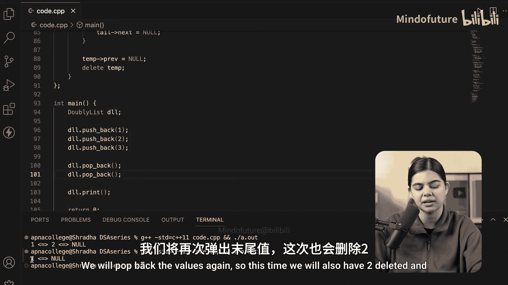

# 062：双向链表教程 🧩


在本节课中，我们将详细学习**双向链表**的概念。我们将了解其结构，并学习如何实现其核心功能，包括在链表头部和尾部插入节点，以及从头部和尾部删除节点。

---

## 双向链表的结构

上一节我们介绍了单向链表，本节中我们来看看双向链表。双向链表中的每个节点不仅包含指向下一个节点的指针，还包含指向前一个节点的指针。这使得我们可以从两个方向遍历链表。

每个节点的结构可以用以下**代码**描述：
```cpp
class Node {
public:
    int data;        // 节点存储的数据
    Node* next;      // 指向下一个节点的指针
    Node* prev;      //指向前一个节点的指针

    // 构造函数
    Node(int value) {
        data = value;
        next = nullptr;
        prev = nullptr;
    }
};
```

双向链表本身是一个类，它包含指向链表头部和尾部的指针。以下是双向链表类的结构：
```cpp
class DoublyLinkedList {
public:
    Node* head; // 指向链表第一个节点的指针
    Node* tail; // 指向链表最后一个节点的指针

    // 构造函数
    DoublyLinkedList() {
        head = nullptr;
        tail = nullptr;
    }

    // 其他成员函数（如插入、删除、打印等）将在这里实现
};
```

---

## 实现基本功能

现在我们已经定义了结构，接下来我们将实现双向链表的核心操作。

### 在链表头部插入节点（Push Front）

`push_front` 函数用于在链表的开头添加一个新节点。需要考虑链表为空和不为空两种情况。

以下是实现 `push_front` 的步骤：
1.  创建一个新的 `Node` 对象。
2.  如果链表为空（`head == nullptr`），则将 `head` 和 `tail` 都指向这个新节点。
3.  如果链表不为空：
    *   将新节点的 `next` 指针指向当前的 `head`。
    *   将当前 `head` 节点的 `prev` 指针指向新节点。
    *   将链表的 `head` 指针更新为指向新节点。

让我们在 `DoublyLinkedList` 类中实现这个函数：
```cpp
void push_front(int value) {
    Node* newNode = new Node(value); // 步骤1：创建新节点

    if (head == nullptr) { // 情况1：链表为空
        head = newNode;
        tail = newNode;
    } else { // 情况2：链表不为空
        newNode->next = head; // 新节点指向原头节点
        head->prev = newNode; // 原头节点指回新节点
        head = newNode;       // 更新头指针
    }
}
```

### 在链表尾部插入节点（Push Back）

`push_back` 函数用于在链表的末尾添加一个新节点。其逻辑与 `push_front` 类似。

以下是实现 `push_back` 的步骤：
1.  创建一个新的 `Node` 对象。
2.  如果链表为空（`head == nullptr`），则将 `head` 和 `tail` 都指向这个新节点。
3.  如果链表不为空：
    *   将当前 `tail` 节点的 `next` 指针指向新节点。
    *   将新节点的 `prev` 指针指向当前的 `tail`。
    *   将链表的 `tail` 指针更新为指向新节点。

让我们在 `DoublyLinkedList` 类中实现这个函数：
```cpp
void push_back(int value) {
    Node* newNode = new Node(value); // 步骤1：创建新节点

    if (head == nullptr) { // 情况1：链表为空
        head = newNode;
        tail = newNode;
    } else { // 情况2：链表不为空
        tail->next = newNode; // 原尾节点指向新节点
        newNode->prev = tail; // 新节点指回原尾节点
        tail = newNode;       // 更新尾指针
    }
}
```

### 打印链表（Print）

为了验证我们的操作，我们需要一个能打印链表所有节点数据的函数。

以下是实现 `print` 函数的步骤：
1.  创建一个临时指针 `temp`，从 `head` 开始。
2.  使用循环遍历链表，直到 `temp` 变为 `nullptr`。
3.  在循环中，打印当前节点 `temp` 的数据。
4.  将 `temp` 移动到下一个节点（`temp = temp->next`）。

让我们在 `DoublyLinkedList` 类中实现这个函数：
```cpp
void print() {
    Node* temp = head; // 从头部开始
    while (temp != nullptr) {
        std::cout << temp->data << " "; // 打印数据
        temp = temp->next; // 移动到下一个节点
    }
    std::cout << std::endl;
}
```

---

## 实现删除功能

学会了插入节点，接下来我们看看如何从链表中删除节点。

### 删除链表头部节点（Pop Front）

`pop_front` 函数用于删除链表的第一个节点。需要处理链表为空、只有一个节点和多个节点的情况。

以下是实现 `pop_front` 的步骤：
1.  检查链表是否为空。如果为空，则无法删除，直接返回或给出提示。
2.  创建一个临时指针 `temp` 指向当前的 `head` 节点（即待删除节点）。
3.  将 `head` 指针移动到下一个节点（`head = head->next`）。
4.  如果新的 `head` 不是 `nullptr`（即链表删除后不为空），则将其 `prev` 指针设为 `nullptr`，断开与前一个节点的连接。
5.  如果删除后链表为空（即原链表只有一个节点），则需要将 `tail` 也设为 `nullptr`。
6.  使用 `delete` 关键字释放 `temp` 指向节点的内存。

让我们在 `DoublyLinkedList` 类中实现这个函数：
```cpp
void pop_front() {
    if (head == nullptr) { // 情况1：链表为空
        std::cout << "List is empty, cannot pop front." << std::endl;
        return;
    }

    Node* temp = head; // 步骤2：临时存储头节点
    head = head->next; // 步骤3：移动头指针

    if (head != nullptr) { // 情况2：删除后链表不为空
        head->prev = nullptr; // 步骤4：断开新头节点的前向链接
    } else { // 情况3：删除后链表为空（原链表只有一个节点）
        tail = nullptr; // 步骤5：尾指针也置空
    }

    delete temp; // 步骤6：释放内存
}
```

### 删除链表尾部节点（Pop Back）

`pop_back` 函数用于删除链表的最后一个节点。其逻辑与 `pop_front` 对称。

以下是实现 `pop_back` 的步骤：
1.  检查链表是否为空。如果为空，则无法删除，直接返回或给出提示。
2.  创建一个临时指针 `temp` 指向当前的 `tail` 节点（即待删除节点）。
3.  将 `tail` 指针移动到前一个节点（`tail = tail->prev`）。
4.  如果新的 `tail` 不是 `nullptr`（即链表删除后不为空），则将其 `next` 指针设为 `nullptr`，断开与后一个节点的连接。
5.  如果删除后链表为空（即原链表只有一个节点），则需要将 `head` 也设为 `nullptr`。
6.  使用 `delete` 关键字释放 `temp` 指向节点的内存。

让我们在 `DoublyLinkedList` 类中实现这个函数：
```cpp
void pop_back() {
    if (head == nullptr) { // 情况1：链表为空
        std::cout << "List is empty, cannot pop back." << std::endl;
        return;
    }

    Node* temp = tail; // 步骤2：临时存储尾节点
    tail = tail->prev; // 步骤3：移动尾指针

    if (tail != nullptr) { // 情况2：删除后链表不为空
        tail->next = nullptr; // 步骤4：断开新尾节点的后向链接
    } else { // 情况3：删除后链表为空（原链表只有一个节点）
        head = nullptr; // 步骤5：头指针也置空
    }

    delete temp; // 步骤6：释放内存
}
```

---

## 总结 🎯

本节课中我们一起学习了**双向链表**。我们从其基本结构开始，了解了每个节点如何通过 `next` 和 `prev` 指针实现双向连接。然后，我们逐步实现了双向链表的四个核心功能：



*   **`push_front`**：在链表头部插入新节点。
*   **`push_back`**：在链表尾部插入新节点。
*   **`pop_front`**：删除链表头部的节点。
*   **`pop_back`**：删除链表尾部的节点。

我们还实现了一个简单的 `print` 函数来遍历和显示链表内容。通过结合伪代码和实际的 C++ 代码，我们清晰地理解了每个操作的逻辑步骤和边界情况处理。掌握这些基础操作是理解和运用更复杂链表算法（如在任意位置插入删除）的关键。