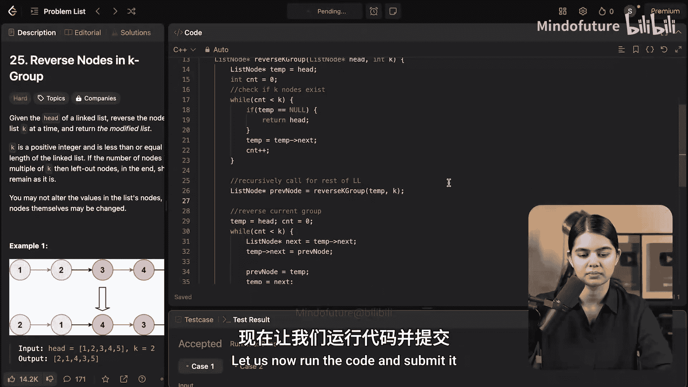

# 065：K个一组反转链表


在本节课中，我们将学习如何解决一个重要的链表问题：**K个一组反转链表**。这是一个LeetCode上的困难级别问题（第25题）。我们将通过递归方法，分解问题步骤，并最终实现一个完整的解决方案。

---

## 概述

问题要求我们给定一个链表的头节点 `head` 和一个整数 `k`。我们需要将链表中的节点每 `k` 个分为一组，然后反转每一组内的节点连接。如果最后剩余的节点数量不足 `k` 个，则保持其原有顺序不变。本节课将详细讲解解决此问题的思路和代码实现。

---

## 问题分解

解决此问题可以分为三个主要步骤：
1.  **检查是否存在K个节点**：首先，我们需要判断从当前头节点开始，是否至少有 `k` 个节点可供反转。
2.  **递归处理剩余链表**：如果存在 `k` 个节点，在反转当前这 `k` 个节点后，我们需要对链表剩余的部分递归地执行相同的操作。
3.  **反转当前K个节点**：这是核心操作，我们需要将当前组内的 `k` 个节点进行局部反转。

接下来，我们将逐一详细讲解每个步骤。

---

## 第一步：检查K个节点是否存在

在尝试反转之前，我们必须确保从当前 `head` 节点开始，链表中至少有 `k` 个节点。我们可以编写一个辅助函数来完成这个检查。

以下是检查功能的实现思路：
*   我们使用一个临时指针 `temp` 从头节点 `head` 开始遍历。
*   同时使用一个计数器 `count`，在遍历过程中递增。
*   如果我们在计数器达到 `k` 之前遇到了 `NULL`（即链表末尾），则说明节点数量不足 `k` 个。

```cpp
// 函数用于检查从当前head开始是否存在至少k个节点
bool checkKNodesExist(ListNode* head, int k) {
    ListNode* temp = head;
    int count = 0;
    while (count < k && temp != NULL) {
        temp = temp->next;
        count++;
    }
    // 如果count等于k，说明存在k个节点；否则不存在
    return count == k;
}
```

如果节点数量不足 `k`，我们直接返回当前的 `head`，无需进行任何反转操作。

---

## 第二步：递归处理后续链表

如果确认存在 `k` 个节点，那么在我们反转了当前这 `k` 个节点之后，链表剩余的部分也需要进行同样的“K个一组反转”处理。这是一个典型的递归应用场景。

假设我们有一个函数 `reverseKGroup(ListNode* head, int k)` 可以解决整个问题。那么，在反转了前 `k` 个节点后，新的头节点（假设叫 `newHead`）已知，而第 `k` 个节点的下一个节点（即 `第k个节点->next`）就是剩余链表的头节点。我们对这个剩余链表的头节点递归调用 `reverseKGroup` 函数即可。

这个递归调用将在反转当前组之后进行。

---

## 第三步：反转当前K个节点

这是算法的核心。我们需要实现一个函数，专门用于反转从给定头节点开始的连续 `k` 个节点。这个过程与反转整个链表类似，但我们需要在反转后，让新的尾节点（即原来的头节点）指向递归处理后的剩余链表的新头节点。

反转 `k` 个节点的步骤可以概括如下：
1.  初始化三个指针：`prev = NULL`， `curr = head`， `next = NULL`。
2.  使用一个循环，循环 `k` 次。
3.  在每次循环中：
    *   保存当前节点的下一个节点：`next = curr->next`。
    *   反转指针方向：`curr->next = prev`。
    *   移动 `prev` 和 `curr` 指针，为下一次迭代做准备：`prev = curr`; `curr = next`。
4.  循环结束后，`prev` 指向这 `k` 个节点的新头节点，而原来的头节点 `head` 现在变成了这组的尾节点。

关键的一步是：在反转完成后，我们需要让这个新尾节点（即原来的 `head`）的 `next` 指针，指向**递归调用 `reverseKGroup` 返回的结果**（即后续链表处理后的新头节点）。

---

## 完整代码实现与逻辑串联

现在，我们将以上三个步骤整合到 `reverseKGroup` 主函数中。

```cpp
/**
 * Definition for singly-linked list.
 * struct ListNode {
 *     int val;
 *     ListNode *next;
 *     ListNode() : val(0), next(nullptr) {}
 *     ListNode(int x) : val(x), next(nullptr) {}
 *     ListNode(int x, ListNode *next) : val(x), next(next) {}
 * };
 */
class Solution {
public:
    ListNode* reverseKGroup(ListNode* head, int k) {
        // 步骤1: 检查是否存在k个节点
        ListNode* temp = head;
        int count = 0;
        while (count < k && temp != nullptr) {
            temp = temp->next;
            count++;
        }
        // 如果节点数不足k，直接返回head，不进行反转
        if (count < k) {
            return head;
        }

        // 步骤3: 反转当前k个节点 (此时已知至少有k个节点)
        ListNode* prev = nullptr;
        ListNode* curr = head;
        ListNode* next = nullptr;
        count = 0;
        while (curr != nullptr && count < k) {
            next = curr->next;      // 保存下一个节点
            curr->next = prev;      // 反转指针
            prev = curr;            // 移动prev
            curr = next;            // 移动curr
            count++;
        }
        // 循环结束后，prev是当前组的新头节点，head变成了当前组的新尾节点

        // 步骤2: 递归处理剩余链表，并将当前组的尾节点与其连接
        // 此时curr指向第k+1个节点（即剩余链表的头节点）
        if (next != nullptr) { // 等价于 if (curr != nullptr)
            head->next = reverseKGroup(next, k);
        }

        // 返回当前组反转后的新头节点
        return prev;
    }
};
```

**代码逻辑流程：**
1.  函数首先检查从当前 `head` 开始是否有 `k` 个节点。如果没有，直接返回 `head`。
2.  如果有，则进入反转当前 `k` 个节点的循环。
3.  反转完成后，`prev` 成为这组的新头节点，`head`（原头节点）成为新尾节点，`curr`（即循环结束时的 `next`）指向下一组的头节点。
4.  递归调用 `reverseKGroup(curr, k)` 来处理剩余链表，并将返回的新头节点赋值给 `head->next`，从而将当前组与后续处理好的链表连接起来。
5.  最后，函数返回 `prev`，作为当前部分链表（已处理部分）的新头节点。

---

## 示例演示

让我们用一个例子 `head = [1,2,3,4,5], k = 2` 来演示过程：
*   首先检查 `[1,2,3,4,5]` 是否有2个节点？有。
*   反转前2个节点 `[1,2]`，得到 `[2,1]`。此时 `prev=2`（新头），`head=1`（新尾），`curr=3`（下一组头）。
*   递归处理以 `3` 为头的链表 `[3,4,5]` 与 `k=2`。
    *   检查 `[3,4,5]` 是否有2个节点？有。
    *   反转 `[3,4]`，得到 `[4,3]`。此时 `prev=4`，`head=3`，`curr=5`。
    *   递归处理以 `5` 为头的链表 `[5]` 与 `k=2`。
        *   检查 `[5]` 是否有2个节点？没有。直接返回 `head=5`。
    *   将 `head->next` (即 `3->next`) 指向递归结果 `5`。链表变为 `[4,3,5]`。
    *   返回 `prev=4` 作为 `[3,4,5]` 部分的新头。
*   将最外层的 `head->next` (即 `1->next`) 指向递归结果 `4`。链表变为 `[2,1,4,3,5]`。
*   返回最外层的 `prev=2` 作为最终结果的新头节点。

---

## 总结

在本节课中，我们一起学习了如何解决 **“K个一组反转链表”** 这个难题。我们通过将问题分解为三个清晰的步骤来降低复杂度：
1.  **检查**：确认有足够节点进行反转。
2.  **递归**：将剩余链表视为一个相同性质的子问题。
3.  **反转**：实现标准的迭代反转算法，但只反转固定数量 `k` 的节点。



我们实现了完整的C++代码，并通过示例梳理了程序的执行流程。掌握这个问题的解法，对于深入理解链表操作和递归思想非常有帮助。