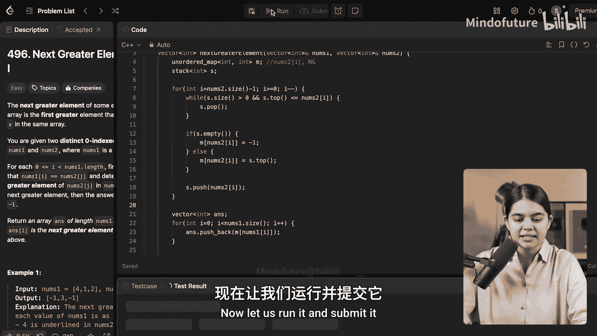

# 070：下一个更大元素 - 最优解


## 概述
在本节课中，我们将学习一个重要的算法概念——“下一个更大元素”。我们将理解其基本定义，学习如何使用栈数据结构高效地解决这个问题，并分析其时间与空间复杂度。最后，我们将探讨该概念的一个直接变体问题。

---

## 下一个更大元素的概念
上一节我们介绍了栈的基本应用，本节中我们来看看“下一个更大元素”的具体含义。

对于一个数组，元素 `arr[i]` 的“下一个更大元素”是指在其**右侧**出现的、第一个**值严格大于** `arr[i]` 的元素。

例如，对于数组 `[6, 8, 0, 1, 3]`：
*   元素 `6` 右侧第一个比它大的元素是 `8`。
*   元素 `3` 右侧没有比它大的元素，因此其下一个更大元素记为 `-1`。

## 使用栈的解决方案
为了找出每个元素的下一个更大元素，我们将使用**栈**数据结构。使用栈的原因是，我们需要访问右侧的元素信息，并且处理过程具有“后进先出”的特性。

基本思路是从数组**末尾向前**遍历。栈用于存储可能成为“下一个更大元素”的候选值。

以下是解决此问题的一般步骤：

1.  初始化一个空栈和一个与输入数组等长的答案数组。
2.  从最后一个元素开始向前遍历数组。
3.  对于当前元素 `arr[i]`，循环检查栈顶元素是否**小于或等于** `arr[i]`。如果是，则弹出栈顶元素，因为它不可能是 `arr[i]` 的下一个更大元素。
4.  循环结束后，检查栈的状态：
    *   如果栈为空，说明右侧没有更大的元素，则 `answer[i] = -1`。
    *   如果栈非空，则栈顶元素就是第一个大于 `arr[i]` 的元素，即 `answer[i] = stack.top()`。
5.  将当前元素 `arr[i]` 压入栈中，因为它可能成为前面元素的下一个更大元素。
6.  重复步骤3-5，直到遍历完所有元素。

## 代码实现
现在，让我们将上述逻辑转化为实际的C++代码。

```cpp
#include <iostream>
#include <vector>
#include <stack>
using namespace std;

vector<int> nextGreaterElement(vector<int>& arr) {
    int n = arr.size();
    vector<int> answer(n);
    stack<int> st;

    // 从后向前遍历
    for (int i = n - 1; i >= 0; i--) {
        // 移除栈中所有小于等于当前元素的元素
        while (!st.empty() && st.top() <= arr[i]) {
            st.pop();
        }

        // 根据栈的状态决定答案
        if (st.empty()) {
            answer[i] = -1;
        } else {
            answer[i] = st.top();
        }

        // 将当前元素压入栈
        st.push(arr[i]);
    }
    return answer;
}

int main() {
    vector<int> arr = {6, 8, 0, 1, 3};
    vector<int> result = nextGreaterElement(arr);

    for (int val : result) {
        cout << val << " ";
    }
    // 输出: 8 -1 1 3 -1
    return 0;
}
```

## 复杂度分析
*   **时间复杂度：O(n)**。虽然有一个嵌套的while循环，但数组中的每个元素最多被压入和弹出栈各一次，因此总操作次数与元素数量 `n` 成线性关系。
*   **空间复杂度：O(n)**。在最坏情况下，栈可能需要存储所有 `n` 个元素。

## 概念变体：下一个更大元素 I
我们刚刚学习了基础问题的解决方案，本节中我们来看看一个直接的应用变体——LeetCode 496题“下一个更大元素 I”。

**问题描述**：给定两个没有重复元素的数组 `nums1` 和 `nums2`，其中 `nums1` 是 `nums2` 的子集。需要找出 `nums1` 中每个元素在 `nums2` 中的下一个更大元素。

**解决思路**：
1.  首先，使用上述栈方法，计算出 `nums2` 中**每个元素**的下一个更大元素，并将结果存储在一个哈希映射（`unordered_map`）中。键为元素值，值为其下一个更大元素值。
2.  然后，遍历 `nums1`，直接从哈希映射中取出对应元素的下一个更大元素，组成答案数组。

以下是解决方案的代码框架：

```cpp
vector<int> nextGreaterElement(vector<int>& nums1, vector<int>& nums2) {
    unordered_map<int, int> nextGreaterMap;
    stack<int> st;
    vector<int> answer;

    // 步骤1：计算nums2中每个元素的下一个更大元素
    for (int i = nums2.size() - 1; i >= 0; i--) {
        while (!st.empty() && st.top() <= nums2[i]) {
            st.pop();
        }
        if (st.empty()) {
            nextGreaterMap[nums2[i]] = -1;
        } else {
            nextGreaterMap[nums2[i]] = st.top();
        }
        st.push(nums2[i]);
    }

    // 步骤2：为nums1中的元素查找结果
    for (int num : nums1) {
        answer.push_back(nextGreaterMap[num]);
    }
    return answer;
}
```



## 总结
本节课中我们一起学习了“下一个更大元素”问题。我们首先明确了概念定义，然后掌握了利用栈从后向前遍历的**最优解法**，并分析了其线性的时间和空间复杂度。最后，我们通过解决LeetCode 496题，实践了该算法在一个实际变体问题中的应用。理解这个模式是解决一系列类似单调栈问题的基础。