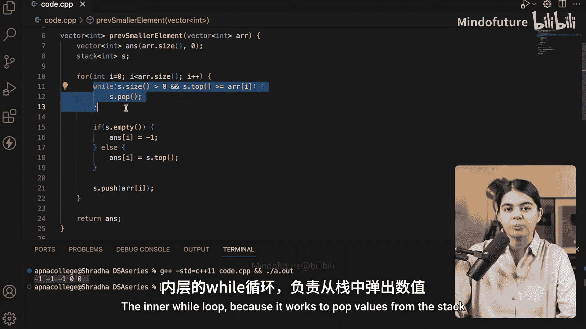

# 071：前一个更小元素 - 最优解代码 🧱


在本节课中，我们将学习如何解决一个重要的数据结构与算法问题：**前一个更小元素**。这是“下一个更大元素”问题的直接变体，我们将使用栈这一数据结构来高效地求解。

## 概述 📋

“前一个更小元素”问题要求我们为数组中的每个元素，找到其**左侧**第一个比它**小**的元素。如果不存在这样的元素，则返回 -1。我们将沿用解决“下一个更大元素”问题的思路，但调整比较的方向和条件。

## 问题定义与示例

给定一个数组，我们需要为每个元素找到其左侧最近且值更小的元素。

**示例**：
对于数组 `[3, 1, 0, 8, 6]`：
*   第一个元素 `3` 左侧没有元素，所以答案是 `-1`。
*   第二个元素 `1` 左侧第一个更小的元素不存在（`3`比`1`大），所以答案是 `-1`。
*   第三个元素 `0` 左侧第一个更小的元素不存在（`1`比`0`大），所以答案是 `-1`。
*   第四个元素 `8` 左侧第一个更小的元素是 `0`。
*   第五个元素 `6` 左侧第一个更小的元素是 `0`。

因此，最终答案数组为 `[-1, -1, -1, 0, 0]`。

## 核心思路与伪代码 🧠

我们将使用一个栈来辅助计算。栈用于按顺序存储可能成为后续元素“前一个更小元素”的候选值。核心逻辑是：在遍历数组时，我们不断从栈中弹出那些**大于或等于**当前元素的栈顶元素，因为这些元素不可能成为当前或之后元素的“更小”元素。

以下是解决问题的步骤伪代码：

```
1. 初始化一个空栈 `st`。
2. 初始化一个答案数组 `ans`，大小与输入数组相同。
3. 遍历输入数组中的每个元素 `arr[i]`：
   a. 当栈不为空，且栈顶元素 `>= arr[i]` 时：
      * 弹出栈顶元素。
   b. 如果此时栈为空：
      * `ans[i] = -1`。
   c. 否则：
      * `ans[i] = st.top()`。
   d. 将当前元素 `arr[i]` 压入栈中。
4. 返回答案数组 `ans`。
```

## 代码实现 💻

现在，让我们将上述逻辑转化为实际的 C++ 代码。

```cpp
#include <iostream>
#include <vector>
#include <stack>
using namespace std;

vector<int> previousSmallerElement(vector<int>& arr) {
    int n = arr.size();
    vector<int> ans(n, 0); // 初始化答案数组
    stack<int> st; // 辅助栈

    for (int i = 0; i < n; i++) {
        // 步骤a：弹出栈中所有大于等于当前元素的元素
        while (!st.empty() && st.top() >= arr[i]) {
            st.pop();
        }
        // 步骤b和c：确定当前元素的答案
        if (st.empty()) {
            ans[i] = -1;
        } else {
            ans[i] = st.top();
        }
        // 步骤d：将当前元素压入栈中
        st.push(arr[i]);
    }
    return ans;
}

int main() {
    vector<int> arr = {3, 1, 0, 8, 6};
    vector<int> result = previousSmallerElement(arr);

    cout << "前一个更小元素数组: ";
    for (int val : result) {
        cout << val << " ";
    }
    cout << endl;
    return 0;
}
```

## 复杂度分析 ⚙️

*   **时间复杂度：O(n)**。数组中的每个元素最多被压入和弹出栈各一次。
*   **空间复杂度：O(n)**。在最坏情况下（如数组严格递减），栈可能需要存储所有 `n` 个元素。

## 总结 🎯



本节课中，我们一起学习了如何解决“前一个更小元素”问题。我们首先理解了问题的定义，然后利用**栈**的特性，设计了一个高效的算法。其核心在于维护一个单调（非严格）递减的栈，从而能在 O(n) 时间内为每个元素找到答案。通过将伪代码转化为 C++ 实现，我们完成了从理论到实践的完整学习过程。掌握这个方法，对于解决一系列基于“下一个/上一个更大/更小元素”的问题至关重要。