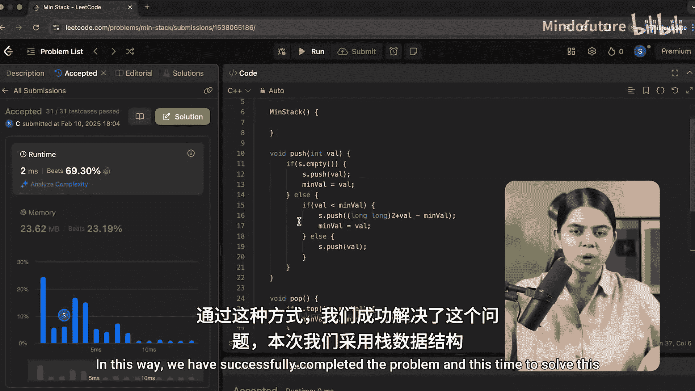

# 072：设计一个最小栈 - 最优解代码 🧱


在本节课中，我们将学习如何设计一个“最小栈”（Min Stack）。这是一个经典的数据结构问题，要求我们实现一个栈，它除了支持常规的入栈（push）、出栈（pop）、查看栈顶（top）操作外，还能在常数时间内检索到栈中的最小元素。我们将探讨两种解决方案，并重点讲解第二种空间复杂度最优的巧妙方法。

## 问题概述

我们需要设计一个栈数据结构，它包含以下四个操作，且所有操作的时间复杂度都应为 O(1)：
1.  `push(val)`：将元素 `val` 推入栈中。
2.  `pop()`：删除栈顶的元素。
3.  `top()`：获取栈顶元素。
4.  `getMin()`：检索栈中的最小元素。

让我们通过一个示例来理解需求：
*   执行 `push(-2)`
*   执行 `push(0)`
*   执行 `push(-3)`
*   执行 `getMin()` -> 应返回 `-3`
*   执行 `pop()`
*   执行 `top()` -> 应返回 `0`
*   执行 `getMin()` -> 应返回 `-2`

## 方法一：使用配对栈（直观解法）

上一节我们明确了问题需求，本节中我们来看看第一种直观的解法。其核心思路是：栈中的每个元素不仅存储原始值，还额外存储**到该元素为止的栈内最小值**。

以下是具体实现步骤：
1.  我们使用一个栈，但其元素类型是 `pair<int, int>`。
2.  每个 `pair` 的第一个值（`first`）存储原始数据 `val`。
3.  每个 `pair` 的第二个值（`second`）存储从栈底到当前元素为止的最小值。
4.  执行 `push(val)` 时，计算新的最小值 `new_min = min(val, 当前栈顶元素的最小值)`，然后将 `(val, new_min)` 压入栈中。
5.  执行 `top()` 时，返回栈顶 `pair` 的 `first` 值。
6.  执行 `getMin()` 时，返回栈顶 `pair` 的 `second` 值。
7.  执行 `pop()` 时，直接弹出栈顶元素即可。

**代码描述**：
```cpp
class MinStack {
private:
    stack<pair<int, int>> st; // pair<value, current_min>
public:
    void push(int val) {
        if(st.empty()) {
            st.push({val, val});
        } else {
            int current_min = st.top().second;
            st.push({val, min(val, current_min)});
        }
    }
    void pop() {
        st.pop();
    }
    int top() {
        return st.top().first;
    }
    int getMin() {
        return st.top().second;
    }
};
```
**复杂度分析**：
*   **时间复杂度**：所有操作均为 O(1)。
*   **空间复杂度**：O(n)，因为每个元素都额外存储了一个最小值。

虽然这种方法简单有效，但它使用了额外的空间来存储最小值。接下来，我们将探索一种空间复杂度更优的解法。

## 方法二：使用单个变量与编码公式（最优解）

上一节我们介绍了使用配对栈的方法，本节中我们来看看如何将空间复杂度优化到 O(1)。核心挑战在于：只使用一个栈和一个变量（`min_val`）来存储当前最小值，如何在弹出旧的最小值后，找回上一个最小值？

这里需要一个巧妙的**编码公式**。其核心思想是：当我们要压入的新值（`val`）比当前最小值（`min_val`）还小时，我们不直接压入 `val`，而是压入一个**经过编码的值**，这个值隐含了旧的最小值信息。

### 核心公式与逻辑

关键在于 `push` 和 `pop` 操作中对最小值的更新：

1.  **Push 操作**：
    *   如果 `val >= min_val`，直接压入 `val`。
    *   如果 `val < min_val`，这意味著最小值将更新。此时，我们压入一个编码值：**`encoded_val = 2 * val - min_val`**。然后更新 `min_val = val`。
    *   **公式解释**：`encoded_val` 必然小于新的 `min_val`（即 `val`）。这个值成为了一个“标记”，告诉我们最小值在此发生了变化。

2.  **Pop 操作**：
    *   如果栈顶元素 `top_val >= min_val`，直接弹出。
    *   如果栈顶元素 `top_val < min_val`，这说明栈顶存储的是编码值。此时，在弹出之前，我们需要**解码**出旧的最小值：**`old_min_val = 2 * min_val - top_val`**。然后更新 `min_val = old_min_val`，再弹出栈顶。

3.  **Top 操作**：
    *   如果栈顶元素 `top_val >= min_val`，直接返回 `top_val`。
    *   如果栈顶元素 `top_val < min_val`，说明栈顶存储的是编码值，此时实际的栈顶值就是当前的 `min_val`，返回 `min_val`。

4.  **GetMin 操作**：
    *   直接返回变量 `min_val` 即可。

### 示例推演

让我们用示例 `push(-2)`, `push(0)`, `push(-3)` 来验证：
*   初始：`stack = []`, `min_val = ?`
*   `push(-2)`：栈空，直接压入 `-2`，`min_val = -2`。`stack = [-2]`
*   `push(0)`：`0 >= min_val(-2)`，直接压入 `0`。`stack = [-2, 0]`
*   `push(-3)`：`-3 < min_val(-2)`，计算编码值 `encoded = 2*(-3) - (-2) = -4`，压入 `-4`，更新 `min_val = -3`。`stack = [-2, 0, -4]`
*   `getMin()`：返回 `min_val = -3` ✅
*   `pop()`：栈顶 `-4 < min_val(-3)`，解码旧最小值 `old_min = 2*(-3) - (-4) = -2`，更新 `min_val = -2`，弹出栈顶。`stack = [-2, 0]`
*   `top()`：栈顶 `0 >= min_val(-2)`，返回 `0` ✅
*   `getMin()`：返回 `min_val = -2` ✅

**代码描述**：
```cpp
class MinStack {
private:
    stack<long long> st; // 使用 long long 防止计算溢出
    long long min_val;
public:
    MinStack() {}
    void push(int val) {
        if(st.empty()) {
            st.push(val);
            min_val = val;
        } else {
            if(val < min_val) {
                // 压入编码值，更新最小值
                st.push(2LL * val - min_val);
                min_val = val;
            } else {
                st.push(val);
            }
        }
    }
    void pop() {
        if(st.empty()) return;
        if(st.top() < min_val) {
            // 栈顶是编码值，需要解码出旧的最小值
            min_val = 2LL * min_val - st.top();
        }
        st.pop();
    }
    int top() {
        if(st.top() < min_val) {
            // 栈顶是编码值，实际值就是当前最小值
            return min_val;
        }
        return st.top();
    }
    int getMin() {
        return min_val;
    }
};
```
**复杂度分析**：
*   **时间复杂度**：所有操作均为 O(1)。
*   **空间复杂度**：O(1) 额外空间（仅使用一个变量），栈本身存储 n 个元素是问题要求，不计入额外空间。这是最优的空间复杂度。

## 总结

本节课中我们一起学习了如何设计一个“最小栈”。
*   我们首先学习了**方法一：配对栈法**。该方法直观易懂，通过在每个栈元素中配对存储当前最小值，轻松实现了所有 O(1) 操作，但需要 O(n) 的额外空间。
*   接着，我们深入探讨了**方法二：编码公式法**。这种方法非常巧妙，利用数学公式 `2*val - min_val` 在栈中编码旧的最小值信息，从而仅使用一个额外变量就实现了所有功能，达到了 O(1) 的额外空间复杂度，是最优解。



理解第二种方法的编码与解码逻辑是掌握本题的关键。它展示了如何通过精妙的设计，用时间换空间（这里指计算时间，复杂度仍是O(1)），解决复杂的数据结构问题。