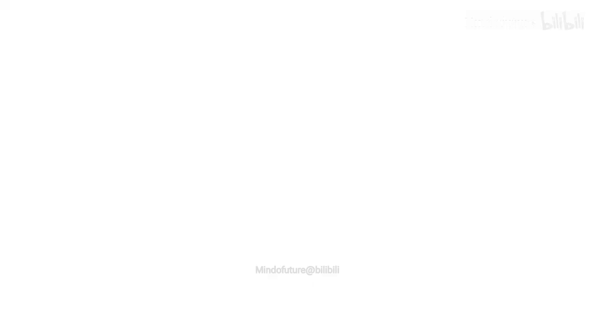
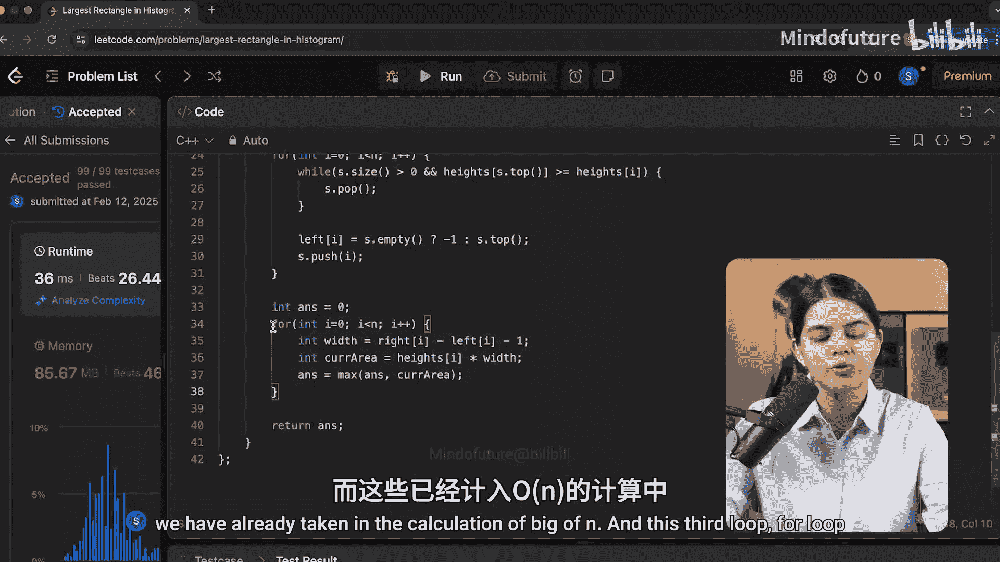

# 073：直方图中的最大矩形 - 最优解




## 概述
在本节课中，我们将学习如何解决一个名为“直方图中的最大矩形”的经典算法问题。这是一个LeetCode上的难题（第84题），我们将重点探讨其最优解法。我们将从理解问题开始，然后分析暴力解法，最后深入讲解并实现基于栈的最优算法。

---

## 问题理解

给定一个代表直方图高度的整数数组 `heights`，每个柱子的宽度为1。目标是找出直方图中可以勾勒出的最大矩形的面积。

例如，对于直方图 `[2,1,5,6,2,3]`，其最大矩形面积为10。

## 暴力解法思路

暴力解法的核心思想是枚举所有可能的矩形。对于每个柱子 `i`，我们将其作为矩形的高度，然后向左右两侧扩展，直到遇到比它矮的柱子，以此确定矩形的宽度。

以下是暴力解法的步骤：
1.  遍历数组中的每个柱子 `i`。
2.  以 `heights[i]` 作为矩形高度。
3.  向左找到第一个高度小于 `heights[i]` 的柱子，记其索引为 `left`。
4.  向右找到第一个高度小于 `heights[i]` 的柱子，记其索引为 `right`。
5.  计算宽度：`width = right - left - 1`。
6.  计算面积：`area = heights[i] * width`。
7.  在遍历过程中，记录遇到的最大面积。

这种方法的时间复杂度为 **O(n²)**，在数据量大时效率很低。

## 最优解法：单调栈

上一节我们介绍了暴力解法，本节中我们来看看如何利用**单调栈**将时间复杂度优化到 **O(n)**。

核心思路是：对于每个柱子，我们需要快速找到其左右两侧第一个比它矮的柱子。这正是单调栈（具体是单调递增栈）擅长解决的问题。

### 核心概念与公式

对于数组中的每个索引 `i`：
*   令 `left[i]` 为柱子 `i` 左侧第一个高度小于 `heights[i]` 的柱子的索引。如果左侧没有更矮的柱子，则 `left[i] = -1`。
*   令 `right[i]` 为柱子 `i` 右侧第一个高度小于 `heights[i]` 的柱子的索引。如果右侧没有更矮的柱子，则 `right[i] = n`（`n` 为数组长度）。

那么，以柱子 `i` 为高度的最大矩形的宽度为：
`width = right[i] - left[i] - 1`

其面积为：
`area = heights[i] * width`

全局最大面积就是所有 `area` 中的最大值。

### 算法步骤

以下是使用单调栈计算 `left` 和 `right` 数组的步骤：

**1. 计算 `right` 数组（下一个更小元素的索引）**
我们反向遍历数组，维护一个栈顶到栈底单调递增的栈。
*   当栈不为空且当前柱子高度 `heights[i]` 小于等于栈顶索引对应的高度时，弹出栈顶元素。这意味着当前柱子 `i` 是栈顶元素右侧第一个更小（或相等）的柱子，因此更新 `right[stack.top()] = i`。
*   将当前索引 `i` 压入栈中。
*   遍历结束后，栈中剩余元素的右侧没有更小的柱子，因此它们的 `right` 值设为 `n`。

**2. 计算 `left` 数组（上一个更小元素的索引）**
我们正向遍历数组，同样维护一个单调递增栈。
*   当栈不为空且当前柱子高度 `heights[i]` 小于等于栈顶索引对应的高度时，弹出栈顶元素。这意味着当前柱子 `i` 是栈顶元素左侧第一个更小（或相等）的柱子？不，这里逻辑需要调整。实际上，我们寻找的是 `i` 左侧第一个更小的柱子，所以当 `heights[i]` 小于等于栈顶高度时，栈顶元素对 `i` 的 `left` 值没有贡献，可以弹出，直到找到更小的。
*   此时，如果栈为空，说明左侧没有更矮的柱子，`left[i] = -1`；否则，`left[i]` 就是当前栈顶的索引。
*   将当前索引 `i` 压入栈中。

**3. 计算最大面积**
遍历每个柱子 `i`，利用公式计算面积并更新全局最大值。

### 代码实现

```cpp
#include <vector>
#include <stack>
#include <algorithm>
using namespace std;

class Solution {
public:
    int largestRectangleArea(vector<int>& heights) {
        int n = heights.size();
        vector<int> left(n), right(n);
        stack<int> st;

        // 计算 right 数组：下一个更小元素的索引
        for (int i = n - 1; i >= 0; --i) {
            while (!st.empty() && heights[st.top()] >= heights[i]) {
                st.pop();
            }
            right[i] = st.empty() ? n : st.top();
            st.push(i);
        }

        // 清空栈以复用
        while (!st.empty()) st.pop();

        // 计算 left 数组：上一个更小元素的索引
        for (int i = 0; i < n; ++i) {
            while (!st.empty() && heights[st.top()] >= heights[i]) {
                st.pop();
            }
            left[i] = st.empty() ? -1 : st.top();
            st.push(i);
        }

        // 计算最大面积
        int maxArea = 0;
        for (int i = 0; i < n; ++i) {
            int width = right[i] - left[i] - 1;
            int area = heights[i] * width;
            maxArea = max(maxArea, area);
        }
        return maxArea;
    }
};
```



### 复杂度分析
*   **时间复杂度：O(n)**。每个元素恰好被压入和弹出栈一次，三次遍历数组也是 O(n)。
*   **空间复杂度：O(n)**。用于存储 `left`、`right` 数组和栈。

## 总结

本节课中我们一起学习了“直方图中的最大矩形”问题。我们从暴力枚举法入手，理解了问题的核心在于为每个柱子寻找边界。然后，我们引入了**单调栈**这一数据结构，高效地解决了寻找“下一个/上一个更小元素”的问题，从而将算法优化到线性时间复杂度。掌握这个解法对于理解栈的巧妙应用和解决类似二维问题（如最大全1矩形）非常有帮助。

**课后练习**：请手动对示例 `[2,1,5,6,2,3]` 模拟算法过程，计算出每个柱子的 `left`、`right` 值以及对应的面积，验证最终结果是否为10。