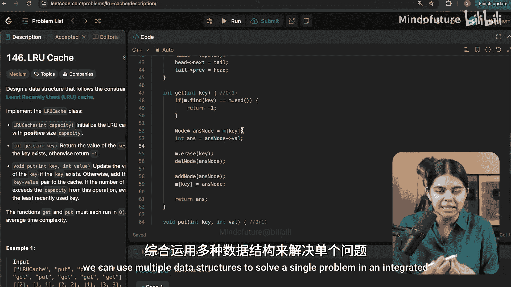

# 076：实现LRU缓存


## 概述
在本节课中，我们将学习如何设计和实现一个**LRU（Least Recently Used，最近最少使用）缓存**。这是一个常见的数据结构设计问题，要求我们实现一个具有固定容量的缓存，能够以常数时间复杂度执行 `get` 和 `put` 操作。我们将使用**双向链表**和**哈希表**来构建这个高效的缓存系统。

---

## LRU缓存的基本概念
LRU缓存是一种特殊的缓存策略。当缓存容量达到上限时，它会优先移除**最近最少使用**的数据项，为新数据腾出空间。

缓存以**键值对**的形式存储数据，以便快速检索。`get` 操作根据键获取值，`put` 操作插入或更新键值对。

**核心操作要求**：
*   `get(key)`：如果键存在，返回对应的值，并将该数据项标记为“最近使用过”。时间复杂度应为 **O(1)**。
*   `put(key, value)`：插入或更新键值对。如果插入后容量超出限制，则需移除“最近最少使用”的数据项。时间复杂度应为 **O(1)**。

---

## 数据结构设计
为了实现O(1)时间复杂度的操作，我们需要结合两种数据结构：
1.  **双向链表**：用于维护数据项的访问顺序。链表的头部代表**最近使用**的数据，尾部代表**最近最少使用**的数据。
2.  **哈希表（unordered_map）**：用于实现O(1)时间的键值查找。哈希表将键映射到双向链表中对应节点的**指针（地址）**。

**节点（Node）结构**：
每个链表节点需要存储键（key）、值（value），以及指向前驱（prev）和后继（next）节点的指针。

```cpp
class Node {
public:
    int key;
    int value;
    Node* prev;
    Node* next;

    Node(int key, int value) {
        this->key = key;
        this->value = value;
        prev = NULL;
        next = NULL;
    }
};
```

**缓存（LRUCache）类结构**：
缓存类将包含以下成员：
*   `int capacity`：缓存容量。
*   `Node* head` 和 `Node* tail`：双向链表的虚拟头节点和尾节点，简化边界条件处理。
*   `unordered_map<int, Node*> cacheMap`：哈希表，用于快速定位节点。

```cpp
class LRUCache {
public:
    LRUCache(int capacity) {
        // 初始化容量、虚拟头尾节点并连接它们
        // 初始化哈希表
    }

    int get(int key) {
        // 获取键对应的值，并调整节点顺序
    }

    void put(int key, int value) {
        // 插入或更新键值对
    }
};
```

---

## 辅助函数实现
在实现核心的 `get` 和 `put` 函数之前，我们需要两个辅助函数来操作双向链表。

### 1. 添加节点到链表头部
此函数将一个节点插入到虚拟头节点（`head`）之后，使其成为新的“最近使用”节点。

操作步骤如下：
1.  记录原第一个真实节点（`head->next`）为 `oldNext`。
2.  建立新节点与 `head` 和 `oldNext` 之间的连接。
3.  更新 `head` 和 `oldNext` 的指针，完成插入。

```cpp
void addNode(Node* newNode) {
    Node* oldNext = head->next; // 步骤1
    // 建立新节点的连接
    newNode->next = oldNext;
    newNode->prev = head;
    // 更新原节点的连接
    head->next = newNode;
    oldNext->prev = newNode;
}
```

### 2. 从链表中删除节点
此函数将给定的节点从链表中移除。

操作步骤如下：
1.  获取待删除节点（`oldNode`）的前驱节点（`oldPrev`）和后继节点（`oldNext`）。
2.  将 `oldPrev` 的 `next` 指针指向 `oldNext`。
3.  将 `oldNext` 的 `prev` 指针指向 `oldPrev`。
4.  （可选）释放 `oldNode` 的内存。

```cpp
void deleteNode(Node* oldNode) {
    Node* oldPrev = oldNode->prev; // 步骤1
    Node* oldNext = oldNode->next;
    // 重新建立连接，跳过 oldNode
    oldPrev->next = oldNext; // 步骤2
    oldNext->prev = oldPrev; // 步骤3
}
```

---

## 核心函数实现
有了辅助函数，我们现在可以实现 `get` 和 `put` 方法。

### `get(int key)` 函数实现
`get` 函数的目标是获取值，并将对应的节点移动到链表头部，标记为最近使用。

以下是实现步骤：
1.  **检查键是否存在**：在 `cacheMap` 中查找键。
    *   如果不存在，返回 `-1`。
2.  **获取节点和值**：从 `cacheMap` 中获取对应的节点指针，并读取其 `value`。
3.  **更新节点位置**：
    *   调用 `deleteNode(node)` 将该节点从当前位置删除。
    *   调用 `addNode(node)` 将该节点重新插入链表头部。
4.  **更新哈希表**：由于节点对象本身没变，只需更新其在链表中的位置，哈希表映射无需更改。
5.  返回获取到的值。

```cpp
int get(int key) {
    if (cacheMap.find(key) == cacheMap.end()) {
        return -1; // 键不存在
    }
    Node* targetNode = cacheMap[key];
    int ans = targetNode->value;
    // 将节点移至头部
    deleteNode(targetNode);
    addNode(targetNode);
    return ans;
}
```

### `put(int key, int value)` 函数实现
`put` 函数用于插入或更新键值对。如果键已存在，则更新其值并移至头部；如果不存在，则创建新节点。插入后若超出容量，需删除尾部的“最近最少使用”节点。

以下是实现步骤：
1.  **检查键是否存在**：
    *   **如果存在**：获取旧节点，更新其值，然后通过 `deleteNode` 和 `addNode` 将其移至链表头部。
2.  **如果键不存在**：
    *   **检查容量**：如果当前缓存大小已达到容量上限（`cacheMap.size() == capacity`），则需要执行淘汰。
        *   淘汰策略：删除链表尾部的“最近最少使用”节点（即 `tail->prev`）。
        *   同时从 `cacheMap` 中擦除该节点对应的键。
    *   **创建新节点**：用给定的键和值创建一个新节点。
    *   **插入新节点**：调用 `addNode(newNode)` 将新节点插入链表头部。
    *   **更新哈希表**：将新键和指向新节点的指针存入 `cacheMap`。

```cpp
void put(int key, int value) {
    // 情况1：键已存在
    if (cacheMap.find(key) != cacheMap.end()) {
        Node* existingNode = cacheMap[key];
        existingNode->value = value; // 更新值
        deleteNode(existingNode);
        addNode(existingNode);
        return;
    }

    // 情况2：键不存在
    // 检查容量，若满则淘汰
    if (cacheMap.size() == capacity) {
        Node* nodeToDelete = tail->prev; // LRU节点
        cacheMap.erase(nodeToDelete->key); // 从map中删除
        deleteNode(nodeToDelete); // 从链表中删除
        delete nodeToDelete; // 释放内存（可选，取决于实现）
    }

    // 创建并插入新节点
    Node* newNode = new Node(key, value);
    addNode(newNode);
    cacheMap[key] = newNode; // 更新哈希表
}
```

---

## 总结
本节课我们一起学习了如何设计和实现一个 **LRU（最近最少使用）缓存**。

我们首先理解了LRU缓存的核心思想：优先淘汰最久未被访问的数据。为了实现 `get` 和 `put` 操作都在 **O(1)** 时间内完成，我们结合使用了两种数据结构：
*   **双向链表**：高效地维护数据的访问顺序，支持在常数时间内删除任意节点并将其插入头部。
*   **哈希表**：提供键到链表节点指针的直接映射，实现常数时间的查找。

我们实现了两个核心函数：
1.  `get(key)`：查找键，若存在则返回值并将对应节点移至链表头部。
2.  `put(key, value)`：插入或更新键值对，若容量已满则淘汰链表尾部的节点。



这个设计问题不仅考察了对基础数据结构（链表、哈希表）的掌握，也是系统设计中的一个经典案例。理解并实现LRU缓存，对于提升解决复杂设计问题的能力非常有帮助。