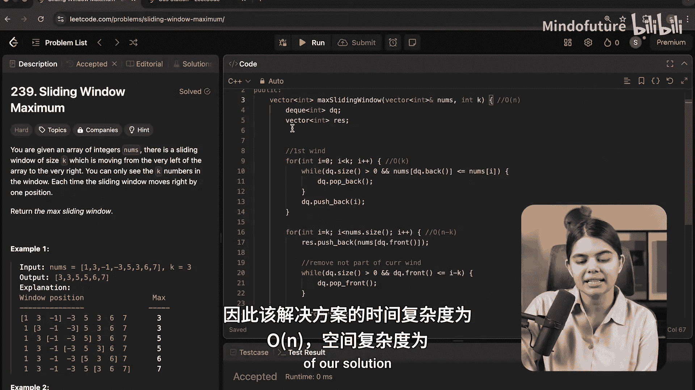

# 081：滑动窗口最大值 🪟


在本节课中，我们将学习一个重要的经典数据结构与算法问题——**滑动窗口最大值**。这是一个在LeetCode上编号为239的题目。我们将从理解问题开始，逐步探讨暴力解法，并最终实现一个使用**双端队列**的**最优线性时间复杂度解法**。

## 概述 📋

我们被给定一个整数数组 `nums` 和一个整数 `k`，`k` 代表一个固定大小的滑动窗口。这个窗口从数组的最左端开始，每次向右滑动一个位置。我们需要找出**每个窗口**中的最大值，并将这些最大值组成一个数组返回。

例如，对于数组 `[1, 3, -1, -3, 5, 3, 6, 7]` 和 `k = 3`，滑动窗口及其最大值如下：
*   窗口 `[1, 3, -1]`，最大值 `3`
*   窗口 `[3, -1, -3]`，最大值 `3`
*   窗口 `[-1, -3, 5]`，最大值 `5`
*   窗口 `[-3, 5, 3]`，最大值 `5`
*   窗口 `[5, 3, 6]`，最大值 `6`
*   窗口 `[3, 6, 7]`，最大值 `7`
因此，返回的结果数组是 `[3, 3, 5, 5, 6, 7]`。

## 暴力解法 💪

最直观的解法是遍历每一个可能的窗口，并在每个窗口中遍历所有元素以找到最大值。

以下是暴力解法的伪代码描述：
```cpp
vector<int> result;
for (int i = 0; i <= n - k; i++) { // n 是数组长度
    int max_val = nums[i];
    for (int j = 1; j < k; j++) {
        if (nums[i + j] > max_val) {
            max_val = nums[i + j];
        }
    }
    result.push_back(max_val);
}
return result;
```
**时间复杂度**：外层循环运行 `O(n-k)` 次，内层循环运行 `O(k)` 次，因此总时间复杂度为 **O(n*k)**。当 `k` 较大时，效率很低。

上一节我们介绍了直观但低效的暴力解法。本节中，我们来看看如何使用**双端队列**来实现一个**O(n)**时间复杂度的最优解法。

## 最优解法：双端队列 🚀

核心思路是使用一个**双端队列**来存储**数组元素的索引**。这个队列将帮助我们维护一个“可能成为当前或未来窗口最大值”的候选元素序列。

我们需要保证双端队列中的元素（通过索引指向的数组值）始终满足两个规则：
1.  **索引在窗口内**：队列中的索引对应的元素必须位于当前滑动窗口的范围内。
2.  **值递减顺序**：队列中的索引，其对应的数组值是**单调递减**的。这意味着队首索引对应的元素永远是当前窗口的最大值。

### 算法步骤详解

让我们一步步拆解算法的执行过程。

**第一步：处理第一个窗口**

我们首先处理数组的前 `k` 个元素，初始化第一个窗口。
以下是处理逻辑：
1.  遍历索引 `i` 从 `0` 到 `k-1`。
2.  对于每个 `nums[i]`，在将它的索引 `i` 加入队列**之前**，需要从队列**后端**移除所有其值小于 `nums[i]` 的元素的索引。这确保了队列中的值保持递减顺序。
3.  将当前索引 `i` 加入队列后端。

处理完成后，队列前端索引对应的元素就是**第一个窗口的最大值**。

**第二步：滑动窗口并计算后续窗口的最大值**

现在，我们从索引 `i = k` 开始，处理数组剩余的元素。对于每个新的 `nums[i]`：
1.  **获取上一个窗口的答案**：此时，队列前端索引对应的元素就是**上一个窗口**（即结束于 `i-1` 的窗口）的最大值。将其存入结果数组。
2.  **移除过期索引**：检查队列前端的索引。如果该索引等于 `i - k`（即该索引已经滑出窗口的起始位置），则将其从队列**前端**弹出。
3.  **维护递减顺序**：与第一步相同，从队列**后端**移除所有其值小于 `nums[i]` 的元素的索引。
4.  **加入新索引**：将当前索引 `i` 加入队列后端。

循环结束后，不要忘记将**最后一个窗口**的最大值（即队列前端索引对应的元素）加入结果数组。

### 关键操作总结

以下是算法中双端队列的核心操作：
*   `pop_front()`: 移除队首元素（当它滑出窗口时）。
*   `pop_back()`: 移除队尾元素（当新元素更大，需要维护递减顺序时）。
*   `push_back(i)`: 将新元素的索引加入队尾。
*   `front()`: 获取队首索引（即当前窗口最大值的索引）。

## 代码实现 💻

根据上述逻辑，我们可以将伪代码转化为实际的C++代码。

```cpp
#include <vector>
#include <deque>
using namespace std;

class Solution {
public:
    vector<int> maxSlidingWindow(vector<int>& nums, int k) {
        vector<int> result;
        deque<int> dq; // 存储的是元素的索引
        
        // 第一步：处理第一个窗口
        for (int i = 0; i < k; i++) {
            // 维护递减顺序：从后端移除比当前元素小的索引
            while (!dq.empty() && nums[dq.back()] < nums[i]) {
                dq.pop_back();
            }
            dq.push_back(i);
        }
        // 存储第一个窗口的答案
        result.push_back(nums[dq.front()]);
        
        // 第二步：滑动窗口，处理剩余元素
        for (int i = k; i < nums.size(); i++) {
            // 1. 移除滑出窗口的索引（从前端）
            if (!dq.empty() && dq.front() == i - k) {
                dq.pop_front();
            }
            
            // 2. 维护递减顺序：从后端移除比当前元素小的索引
            while (!dq.empty() && nums[dq.back()] < nums[i]) {
                dq.pop_back();
            }
            
            // 3. 加入新索引
            dq.push_back(i);
            
            // 4. 当前窗口的最大值在队首
            result.push_back(nums[dq.front()]);
        }
        
        return result;
    }
};
```

**时间复杂度分析**：数组中的每个元素恰好被加入队列一次，也最多被移除队列一次。因此，所有操作的总时间复杂度为 **O(n)**，其中 `n` 是数组的长度。
**空间复杂度**：双端队列在最坏情况下可能存储 `k` 个元素（例如数组完全递减时），因此空间复杂度为 **O(k)**。

## 总结 🎯

本节课中我们一起学习了**滑动窗口最大值**这一经典问题。
*   我们首先分析了**暴力解法**，其时间复杂度为 O(n*k)。
*   接着，我们深入探讨了基于**双端队列**的**最优解法**。该解法的核心在于维护一个存储索引的队列，并确保其对应的值单调递减，从而使得队首元素始终是当前窗口的最大值。
*   我们详细拆解了算法的每一步，并最终给出了完整的C++实现代码，该算法的时间复杂度为 **O(n)**，空间复杂度为 **O(k)**。



掌握这种利用数据结构特性来优化窗口类问题的技巧，对于解决许多复杂的算法题目至关重要。