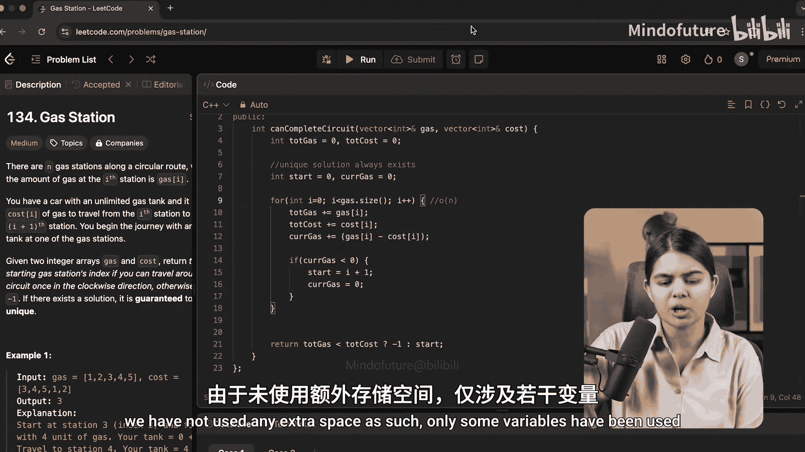

# 082：加油站问题 - 贪心方法


## 概述
在本节课中，我们将学习如何解决LeetCode第134题“加油站”。这是一个经典的贪心算法问题，涉及在环形路线上寻找一个起点，使得汽车能够绕行一圈。我们将通过分析问题、推导关键条件，并最终实现一个高效的解决方案。

---

## 问题描述
有`n`个加油站，它们位于一个环形路线上。给定两个整数数组：
*   `gas[i]` 表示在第`i`个加油站可以获得的汽油量。
*   `cost[i]` 表示从第`i`个加油站行驶到第`i+1`个加油站需要消耗的汽油量。

汽车开始时油箱为空。目标是找到一个起始加油站，使得汽车可以顺时针绕环形路线行驶一周，并返回起始加油站。如果存在这样的解，则返回起始加油站的索引；否则返回`-1`。题目保证如果存在解，则解是唯一的。

### 示例
假设我们有：
*   `gas = [1, 2, 3, 4, 5]`
*   `cost = [3, 4, 5, 1, 2]`

这表示有5个加油站。我们需要找到一个起点，使得汽车能够完成环形旅程。

---

## 核心逻辑分析
在深入代码之前，我们需要理解解决问题的两个关键逻辑。

### 全局可行性检查
汽车能够完成环形旅程的一个**必要前提**是：所有加油站提供的汽油总量必须大于或等于完成整个旅程所需消耗的汽油总量。

**公式表示为：**
`sum(gas) >= sum(cost)`

如果这个条件不满足，那么无论从哪里出发，汽油都不够用，直接返回`-1`。

### 寻找唯一可行起点
如果全局汽油充足（即 `sum(gas) >= sum(cost)`），那么必然存在一个唯一的起点可以完成旅程。我们可以使用贪心策略来找到它：

1.  从索引`0`开始模拟旅程，用`current_gas`记录当前油箱的剩余油量。
2.  遍历每个加油站`i`，计算到达该站并加油后的净收益：`gas[i] - cost[i]`，并将其累加到`current_gas`。
3.  如果在某个站点`i`，`current_gas`变为负数，说明从之前的`start`起点无法到达站点`i+1`。
4.  那么，新的潜在起点不可能是`start`到`i`之间的任何站点。我们将起点`start`更新为`i+1`，并将`current_gas`重置为`0`，重新开始计算。
5.  遍历结束后，最后更新的`start`就是答案。

**这个逻辑的直觉是**：如果从A点无法到达B点，那么A点和B点之间的任何点作为起点都无法到达B点。因此，我们可以安全地将起点跳到B点之后。

---

## 算法实现步骤
以下是实现上述逻辑的具体步骤。

我们将在一个循环中同时计算总油量、总消耗，并寻找起点。

**伪代码描述：**
```cpp
int start = 0;
int total_gas = 0;
int total_cost = 0;
int current_gas = 0;

for (int i = 0; i < n; i++) {
    total_gas += gas[i];
    total_cost += cost[i];
    current_gas += gas[i] - cost[i];
    
    if (current_gas < 0) {
        // 从当前start无法到达i+1，将起点设为i+1
        start = i + 1;
        current_gas = 0; // 重置当前油量
    }
}

// 检查全局条件
if (total_gas < total_cost) {
    return -1;
} else {
    return start;
}
```

---

## 完整C++代码
根据以上分析，我们可以写出简洁高效的代码。

```cpp
class Solution {
public:
    int canCompleteCircuit(vector<int>& gas, vector<int>& cost) {
        int n = gas.size();
        int total_gas = 0, total_cost = 0;
        int current_gas = 0;
        int start_index = 0;
        
        for (int i = 0; i < n; i++) {
            total_gas += gas[i];
            total_cost += cost[i];
            
            // 计算从当前假设的起点出发，到i+1站时的油量
            current_gas += gas[i] - cost[i];
            
            // 如果油量为负，说明当前起点不可行
            if (current_gas < 0) {
                // 将起点更新为下一个站点
                start_index = i + 1;
                // 重置当前油量，从新起点开始计算
                current_gas = 0;
            }
        }
        
        // 最终检查：总油量是否足够
        return (total_gas < total_cost) ? -1 : start_index;
    }
};
```

---

## 复杂度分析
上一节我们完成了代码实现，现在来分析其效率。

*   **时间复杂度：O(n)**
    我们只遍历了`gas`和`cost`数组一次，其中`n`是加油站的数量。所有操作都在常数时间内完成。
*   **空间复杂度：O(1)**
    我们只使用了几个整型变量（`total_gas`, `total_cost`, `current_gas`, `start_index`），没有使用任何与输入规模相关的额外数据结构。

这是一个时间上最优、空间上极简的解决方案。

---

## 总结
本节课我们一起学习了LeetCode第134题“加油站”的解法。

我们首先理解了问题的核心：汽车需要在一个环形路线上找到起点。然后，我们推导出两个关键点：
1.  解决问题的**必要条件**是总油量不小于总消耗（`sum(gas) >= sum(cost)`）。
2.  在条件满足的前提下，可以使用**贪心算法**在一次遍历中找到唯一的可行起点。其策略是当累计油量不足时，将起点跳到无法到达的站点之后。



最后，我们实现了时间复杂度为**O(n)**、空间复杂度为**O(1)**的高效代码，并成功通过了测试。掌握这种“全局判断 + 局部贪心寻找起点”的思路，对解决许多类似的序列遍历问题非常有帮助。