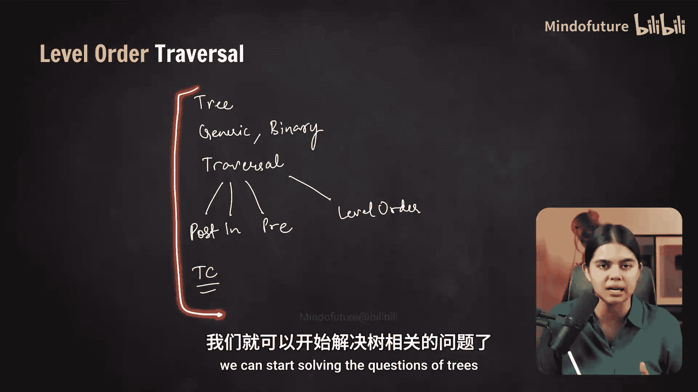

# 083：数据结构中的二叉树与树遍历 🌳


## 概述
在本节课中，我们将要学习一种新的数据结构——二叉树。我们将从基本概念开始，理解其结构、术语，并学习如何从序列构建二叉树。随后，我们将深入探讨四种核心的树遍历算法：前序遍历、中序遍历、后序遍历以及层序遍历。这些是解决众多基于树的问题的基础。

---

## 二叉树基础

### 什么是树？
树是一种以层级形式组织数据的非线性数据结构。我们可以将其想象为由节点和边组成的结构。

### 核心概念与术语
以下是理解树结构所需的核心术语：

*   **节点**：树中存储数据的基本单位。
*   **根节点**：位于树顶层的节点，是整棵树的起点。
*   **父节点与子节点**：如果一个节点直接连接到下层的一个或多个节点，那么它被称为这些下层节点的**父节点**，而下层节点则被称为它的**子节点**。
*   **叶节点**：没有子节点的节点。
*   **子树**：树中的任意一个节点及其所有后代节点构成一棵**子树**。

### 什么是二叉树？
二叉树是一种特殊的树结构，其中每个节点最多只能有两个子节点，通常称为**左子节点**和**右子节点**。

**二叉树节点的代码表示**：
```cpp
class Node {
public:
    int data;
    Node* left;
    Node* right;

    // 构造函数
    Node(int val) {
        data = val;
        left = NULL;
        right = NULL;
    }
};
```

---

## 从前序序列构建二叉树

上一节我们介绍了二叉树的基本结构，本节中我们来看看如何根据一个特定的序列（如前序序列）来构建一棵二叉树。

前序序列遵循 **“根-左-右”** 的访问顺序。给定一个包含空节点（通常用 `-1` 表示）信息的前序序列，我们可以递归地重建二叉树。

**构建逻辑（伪代码）**：
1.  从序列中读取当前索引的值。
2.  如果该值为 `-1`（表示空节点），则返回 `NULL`。
3.  否则，用该值创建一个新节点作为根节点。
4.  递归构建左子树（索引递增）。
5.  递归构建右子树（索引继续递增）。
6.  返回创建好的根节点。

**C++ 实现代码**：
```cpp
int index = 0; // 静态或引用传递的索引，用于遍历序列

Node* buildTree(vector<int> &preorder) {
    // 基线条件：如果遇到空节点标记
    if (index >= preorder.size() || preorder[index] == -1) {
        index++;
        return NULL;
    }

    // 创建当前根节点
    Node* root = new Node(preorder[index]);
    index++;

    // 递归构建左子树和右子树
    root->left = buildTree(preorder);
    root->right = buildTree(preorder);

    return root;
}
```
该算法的时间复杂度为 **O(n)**，其中 `n` 是序列中节点的数量。

---

## 树的深度优先遍历（DFS）

构建好树之后，我们需要方法来访问或“遍历”树中的所有节点。深度优先遍历是一种沿着分支深入到底部，再回溯的遍历方式。主要有三种类型：

### 1. 前序遍历
前序遍历的顺序是：**访问根节点 -> 遍历左子树 -> 遍历右子树**。

**C++ 实现代码**：
```cpp
void preorderTraversal(Node* root) {
    if (root == NULL) {
        return;
    }
    cout << root->data << " "; // 访问根
    preorderTraversal(root->left); // 遍历左
    preorderTraversal(root->right); // 遍历右
}
```
时间复杂度：**O(n)**。

### 2. 中序遍历
中序遍历的顺序是：**遍历左子树 -> 访问根节点 -> 遍历右子树**。

**C++ 实现代码**：
```cpp
void inorderTraversal(Node* root) {
    if (root == NULL) {
        return;
    }
    inorderTraversal(root->left); // 遍历左
    cout << root->data << " "; // 访问根
    inorderTraversal(root->right); // 遍历右
}
```
时间复杂度：**O(n)**。

### 3. 后序遍历
后序遍历的顺序是：**遍历左子树 -> 遍历右子树 -> 访问根节点**。

**C++ 实现代码**：
```cpp
void postorderTraversal(Node* root) {
    if (root == NULL) {
        return;
    }
    postorderTraversal(root->left); // 遍历左
    postorderTraversal(root->right); // 遍历右
    cout << root->data << " "; // 访问根
}
```
时间复杂度：**O(n)**。

---

## 树的广度优先遍历（BFS）/ 层序遍历

上一节我们学习了三种深度优先遍历，本节我们来看看广度优先遍历，即**层序遍历**。它按层级从上到下、每层从左到右访问节点。

层序遍历通常借助**队列**数据结构来实现。

**算法步骤**：
1.  将根节点入队。
2.  当队列不为空时循环：
    *   取出队首节点并访问。
    *   将该节点的左子节点（如果存在）入队。
    *   将该节点的右子节点（如果存在）入队。

**基础层序遍历 C++ 实现**：
```cpp
void levelOrderTraversal(Node* root) {
    if (root == NULL) return;

    queue<Node*> q;
    q.push(root);

    while (!q.empty()) {
        Node* current = q.front();
        q.pop();
        cout << current->data << " ";

        if (current->left != NULL) {
            q.push(current->left);
        }
        if (current->right != NULL) {
            q.push(current->right);
        }
    }
}
```

### 分层打印的层序遍历
为了使输出结果更清晰，我们经常希望将不同层的节点打印在不同的行。

**改进思路**：在队列中插入一个`NULL`作为层结束标记。
1.  初始将根节点和`NULL`入队。
2.  当出队元素为`NULL`且队列不为空时，说明一层结束，打印换行符，并再向队尾插入一个`NULL`。

**分层打印的 C++ 实现**：
```cpp
void levelOrderTraversalLine(Node* root) {
    if (root == NULL) return;

    queue<Node*> q;
    q.push(root);
    q.push(NULL); // 第一层结束标记

    while (!q.empty()) {
        Node* current = q.front();
        q.pop();

        if (current == NULL) { // 遇到层结束标记
            cout << endl;
            if (!q.empty()) { // 如果队列还有下一层的节点
                q.push(NULL); // 为下一层添加结束标记
            }
        } else {
            cout << current->data << " ";
            if (current->left != NULL) q.push(current->left);
            if (current->right != NULL) q.push(current->right);
        }
    }
}
```
层序遍历的时间复杂度同样为 **O(n)**。

---

## 总结
本节课中我们一起学习了数据结构中的**二叉树**。
*   我们首先理解了树和二叉树的基本定义、节点结构及核心术语。
*   接着，我们学习了如何从一个**前序序列**递归地构建二叉树。
*   然后，我们深入探讨了三种**深度优先遍历**方法：前序、中序和后序遍历，并理解了它们访问节点的不同顺序。
*   最后，我们学习了**广度优先的层序遍历**，包括如何借助队列实现，以及如何改进算法以分层打印节点。



这些关于二叉树构建和遍历的基础知识，是理解和解决更复杂的树形结构问题（如二叉搜索树、AVL树、图算法等）的基石。