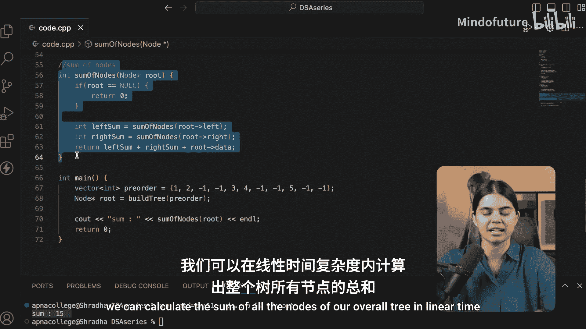

# 084：二叉树的高度与节点计数 📊

在本节课中，我们将学习二叉树的两个基础但至关重要的概念：计算树的高度和统计树的节点总数。我们将通过清晰的逻辑、代码示例和分步解释来掌握这些核心算法。


## 概述 🌲

二叉树是数据结构中的基石。理解如何计算其高度和节点数量是解决更复杂树形问题（如平衡检查、遍历优化等）的第一步。本节将介绍使用递归方法解决这两个问题的思路与实现。

## 二叉树的高度 📏

上一节我们介绍了二叉树的基本结构，本节中我们来看看如何计算一棵二叉树的高度（或深度）。树的高度定义为从根节点到最远叶子节点的最长路径上的**节点数**。

### 核心概念与公式

计算任意节点为根的子树高度的递归公式如下：

**`height(node) = max(height(node.left), height(node.node.right)) + 1`**

这个公式的含义是：以当前节点为根的树的高度，等于其左子树和右子树中**较大**的高度值，再加上当前节点自身（因此需要 `+1`）。

### 算法步骤说明

以下是计算高度的递归步骤：

1.  **基准情况**：如果当前节点为空（`nullptr`），则其高度为0。
2.  **递归计算**：分别计算当前节点左子树和右子树的高度。
3.  **合并结果**：取左右子树高度的最大值，然后加1，即为当前节点为根的树的高度。

### 代码实现

```cpp
int heightOfBinaryTree(Node* root) {
    // 基准情况：空树高度为0
    if (root == nullptr) {
        return 0;
    }
    
    // 递归计算左子树高度
    int leftHeight = heightOfBinaryTree(root->left);
    // 递归计算右子树高度
    int rightHeight = heightOfBinaryTree(root->right);
    
    // 当前树的高度 = 左右子树最大高度 + 1 (当前节点)
    return max(leftHeight, rightHeight) + 1;
}
```

## 二叉树的节点计数 🔢

理解了如何计算高度后，我们再来看看如何统计二叉树中节点的总数。思路与计算高度类似，同样采用递归分治的策略。

### 核心概念与公式

计算以某个节点为根的子树中节点总数的递归公式如下：

**`countNodes(node) = countNodes(node.left) + countNodes(node.right) + 1`**

这个公式的含义是：以当前节点为根的树的节点总数，等于其左子树的节点数、右子树的节点数之和，再加上当前节点自身（因此需要 `+1`）。

### 算法步骤说明

以下是统计节点总数的递归步骤：

1.  **基准情况**：如果当前节点为空（`nullptr`），则其节点数为0。
2.  **递归计算**：分别计算当前节点左子树和右子树的节点数。
3.  **合并结果**：将左右子树的节点数相加，再加1，即为当前节点为根的树的节点总数。

### 代码实现

```cpp
int countNodesInBinaryTree(Node* root) {
    // 基准情况：空树节点数为0
    if (root == nullptr) {
        return 0;
    }
    
    // 递归计算左子树节点数
    int leftCount = countNodesInBinaryTree(root->left);
    // 递归计算右子树节点数
    int rightCount = countNodesInBinaryTree(root->right);
    
    // 当前树的节点总数 = 左子树节点数 + 右子树节点数 + 1 (当前节点)
    return leftCount + rightCount + 1;
}
```

## 扩展：计算节点值的总和 ➕

基于相同的递归模式，我们可以轻松扩展出另一个实用功能：计算二叉树中所有节点值的总和（假设节点存储整数值）。

### 核心概念与公式

计算节点值总和的递归公式如下：

**`sumOfNodes(node) = sumOfNodes(node.left) + sumOfNodes(node.right) + node.data`**

### 代码实现

```cpp
int sumOfNodesInBinaryTree(Node* root) {
    // 基准情况：空树节点值总和为0
    if (root == nullptr) {
        return 0;
    }
    
    // 递归计算左子树节点值总和
    int leftSum = sumOfNodesInBinaryTree(root->left);
    // 递归计算右子树节点值总和
    int rightSum = sumOfNodesInBinaryTree(root->right);
    
    // 当前树的节点值总和 = 左子树总和 + 右子树总和 + 当前节点值
    return leftSum + rightSum + root->data;
}
```

## 总结 📝

本节课中我们一起学习了二叉树的三项基本操作：
1.  **计算高度**：使用 `max(leftHeight, rightHeight) + 1` 的递归公式。
2.  **统计节点数**：使用 `leftCount + rightCount + 1` 的递归公式。
3.  **计算节点值和**：使用 `leftSum + rightSum + node.data` 的递归公式。



这三个问题都完美体现了**分而治之**的递归思想：将一个大问题（整棵树）分解为相同的小问题（左子树和右子树），解决小问题后合并结果。它们的**时间复杂度都是 O(N)**，其中 N 是节点数，因为每个节点都会被访问一次。掌握这些基础是迈向更高级二叉树算法的重要一步。