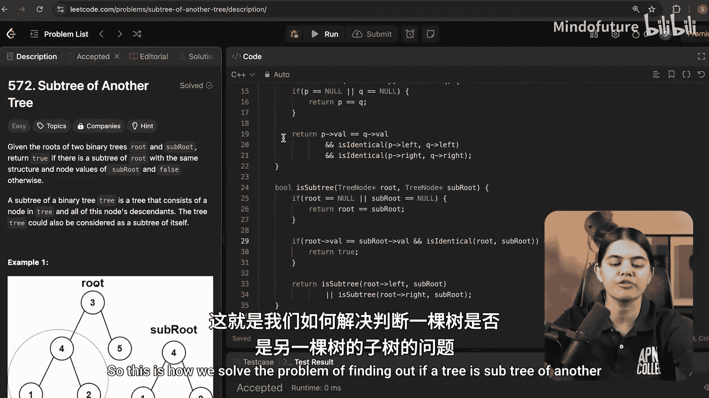

# 085：相同的树与另一棵树的子树


在本节课中，我们将学习解决两个重要的二叉树问题：“相同的树”和“另一棵树的子树”。我们将通过递归方法，逐步分析问题并编写解决方案。

## 相同的树

首先，我们来看第一个问题：“相同的树”。题目要求判断两棵给定的二叉树是否完全相同。完全相同意味着两棵树的结构完全一致，并且每个对应节点的值也相等。

以下是判断两棵树是否相同的逻辑步骤：

1.  **检查当前节点**：比较两棵树当前节点的值是否相等。
2.  **递归检查左子树**：判断两棵树的左子树是否相同。
3.  **递归检查右子树**：判断两棵树的右子树是否相同。

只有当以上三个条件同时满足时，两棵树才被认为是相同的。

### 递归函数设计

我们可以设计一个递归函数 `isSameTree` 来实现上述逻辑。函数的伪代码如下：

```cpp
bool isSameTree(TreeNode* p, TreeNode* q) {
    // 基础情况处理
    if (p == nullptr && q == nullptr) {
        return true; // 两个节点都为空，视为相同
    }
    if (p == nullptr || q == nullptr) {
        return false; // 只有一个节点为空，结构不同
    }
    // 检查当前节点值，并递归检查左右子树
    return (p->val == q->val) 
           && isSameTree(p->left, q->left) 
           && isSameTree(p->right, q->right);
}
```

**代码解释**：
*   `if (p == nullptr && q == nullptr)`：如果两个节点都为空，说明这一分支已经结束且匹配，返回 `true`。
*   `if (p == nullptr || q == nullptr)`：如果只有一个节点为空，说明两棵树结构不一致，返回 `false`。
*   `return (p->val == q->val) && ...`：检查当前节点值是否相等，并递归地对左、右子树进行相同的判断。使用逻辑与 `&&` 连接，确保所有条件都满足。

这个算法的时间复杂度是 **O(N)**，其中 N 是两棵树中节点数的较小值，因为我们需要遍历每个节点进行比较。

---

上一节我们学习了如何判断两棵树是否完全相同。接下来，我们将利用这个结论来解决一个更复杂的问题：“另一棵树的子树”。

## 另一棵树的子树

这个问题要求判断一棵给定的树 `subRoot` 是否是另一棵树 `root` 的子树。子树意味着在 `root` 中存在一个节点，以该节点为根的子树与 `subRoot` 完全相同（结构和值）。

解决思路是遍历主树 `root` 的每一个节点，并以该节点为根，判断其子树是否与 `subRoot` 相同。

### 算法步骤

以下是判断子树的逻辑步骤：

1.  **遍历主树**：从 `root` 的根节点开始。
2.  **匹配检查**：对于当前节点，检查以该节点为根的子树是否与 `subRoot` 相同。这可以直接使用我们刚才编写的 `isSameTree` 函数。
3.  **递归搜索**：如果当前节点不匹配，则递归地在当前节点的左子树和右子树中继续寻找。

### 递归函数设计

我们可以设计一个递归函数 `isSubtree` 来实现上述逻辑。

```cpp
bool isSubtree(TreeNode* root, TreeNode* subRoot) {
    // 基础情况处理
    if (subRoot == nullptr) {
        return true; // 空树是任何树的子树
    }
    if (root == nullptr) {
        return false; // 主树为空，不可能包含非空子树
    }
    
    // 检查当前根节点的子树是否与 subRoot 相同
    if (isSameTree(root, subRoot)) {
        return true;
    }
    // 如果不相同，则在左子树或右子树中继续寻找
    return isSubtree(root->left, subRoot) || isSubtree(root->right, subRoot);
}
```

**代码解释**：
*   `if (isSameTree(root, subRoot))`：调用 `isSameTree` 函数检查以当前 `root` 节点为根的树是否与 `subRoot` 完全相同。如果相同，则找到子树，返回 `true`。
*   `return isSubtree(root->left, subRoot) || isSubtree(root->right, subRoot)`：如果当前节点不匹配，则问题转化为在左子树或右子树中是否存在 `subRoot`。使用逻辑或 `||` 连接，只要在任意一侧找到即可。

这个算法在最坏情况下（例如，`subRoot` 几乎与 `root` 相同但最后才匹配）的时间复杂度是 **O(M * N)**，其中 M 和 N 分别是 `root` 和 `subRoot` 的节点数。因为对于 `root` 中的每个节点，我们可能都需要进行一次 `isSameTree` 的 O(N) 比较。

---

## 总结

本节课中我们一起学习了两个基于递归的二叉树问题：

1.  **相同的树**：我们通过递归比较两棵树每个节点的值及其左右子树，来判断它们是否完全相同。核心函数是 `isSameTree`。
2.  **另一棵树的子树**：我们通过遍历主树的每个节点，并利用 `isSameTree` 函数来判断以该节点为根的子树是否与目标子树完全相同。核心函数是 `isSubtree`。



理解递归在树结构中的应用是解决此类问题的关键。通过将大问题分解为结构相同的子问题，我们可以写出简洁而有效的代码。