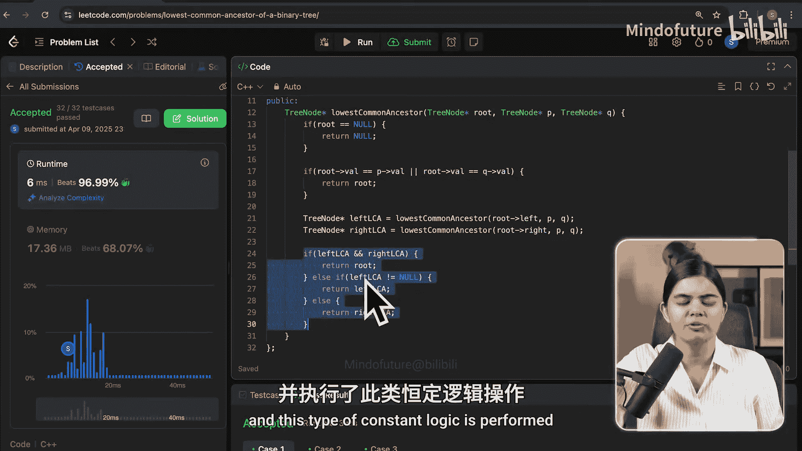

# 089：二叉树的最低公共祖先


## 概述
在本节课中，我们将学习如何解决二叉树中的一个重要问题：寻找两个节点的**最低公共祖先**。我们将理解其核心概念，并通过递归方法实现一个高效的解决方案。

---

## 什么是LCA？🧐
**最低公共祖先**是指在一棵二叉树中，同时为两个指定节点 `p` 和 `q` 的祖先，且深度尽可能大的那个节点。一个节点也可以是其自身的祖先。

例如，考虑以下二叉树：
```
        1
       / \
      2   3
     / \ / \
    4  5 6  7
       / \
      8   9
```
*   节点 `5` 的祖先有：5, 2, 1。
*   节点 `9` 的祖先有：9, 5, 2, 1。
*   节点 `5` 和 `9` 的公共祖先是 5, 2, 1。其中最低（最深）的是 `5`，因此 LCA(5, 9) = 5。
*   节点 `6` 和 `7` 的 LCA 是 `3`。
*   节点 `6` 和 `3` 的 LCA 是 `3`（节点自身可以是祖先）。

## 核心思路 💡
LCA 是第一个在其**左子树**和**右子树**中分别能找到 `p` 和 `q` 的节点。我们可以通过递归遍历来寻找这个“第一个”节点。

以下是解决问题的递归逻辑步骤：

1.  **基线条件**：如果当前节点为空，或者等于 `p` 或 `q`，则直接返回当前节点。
2.  **递归搜索**：分别在左子树和右子树中递归寻找 LCA。
3.  **结果分析**：根据左右子树的递归结果，有四种情况：
    *   左右结果都为空：返回空。
    *   左结果非空，右结果为空：返回左结果。
    *   左结果为空，右结果非空：返回右结果。
    *   左右结果都非空：这意味着当前节点就是 `p` 和 `q` 的“分岔点”，即我们要找的 LCA，返回当前节点。

## 代码实现 🖥️
根据上述思路，我们可以编写出以下 C++ 函数。

```cpp
/**
 * Definition for a binary tree node.
 * struct TreeNode {
 *     int val;
 *     TreeNode *left;
 *     TreeNode *right;
 *     TreeNode(int x) : val(x), left(NULL), right(NULL) {}
 * };
 */
class Solution {
public:
    TreeNode* lowestCommonAncestor(TreeNode* root, TreeNode* p, TreeNode* q) {
        // 基线条件
        if (root == NULL || root == p || root == q) {
            return root;
        }
        
        // 递归搜索左右子树
        TreeNode* leftLCA = lowestCommonAncestor(root->left, p, q);
        TreeNode* rightLCA = lowestCommonAncestor(root->right, p, q);
        
        // 分析递归结果
        if (leftLCA != NULL && rightLCA != NULL) {
            // 情况4：当前节点是分岔点，即LCA
            return root;
        } else if (leftLCA != NULL) {
            // 情况2：LCA在左子树中
            return leftLCA;
        } else {
            // 情况3：LCA在右子树中 (或情况1，返回NULL)
            return rightLCA;
        }
    }
};
```

## 复杂度分析 📊
*   **时间复杂度**：`O(n)`。在最坏情况下，我们需要访问树中的每一个节点，其中 `n` 是节点总数。
*   **空间复杂度**：`O(h)`。空间消耗取决于递归栈的深度，即树的高度 `h`。在最坏情况（树退化为链表）下，空间复杂度为 `O(n)`。



## 总结
本节课我们一起学习了如何寻找二叉树中两个节点的**最低公共祖先**。我们理解了 LCA 的定义，掌握了通过**递归遍历**和**分治**思想来定位 LCA 的核心算法。该算法思路清晰，代码简洁，是解决此类问题的**最优方法**之一。