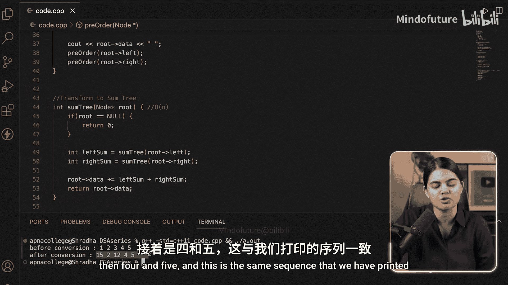

# 091：转换为和树


## 概述
在本节课中，我们将学习如何将一个普通的二叉树转换为“和树”。这是一个基础且重要的问题，有助于理解递归在树结构中的应用。我们将通过一个简单的例子，逐步讲解转换的逻辑和实现方法。

## 什么是和树？
和树是一种特殊的二叉树。在转换后的和树中，每个节点的值被替换为原节点值加上其左子树所有节点值的总和，再加上其右子树所有节点值的总和。

**公式表示**：
`新节点值 = 原节点值 + 左子树节点值总和 + 右子树节点值总和`

## 问题解析
假设我们有一个二叉树。我们的目标是将其转换为和树。例如，考虑根节点值为1，其左子节点值为2，右子节点值为3。转换后，根节点的新值将是 `1 + 2 + 3 = 6`。这个过程需要递归地应用到每一个节点上。

上一节我们介绍了和树的概念，本节中我们来看看具体的转换算法。

## 递归转换算法
核心思想是使用递归。对于每个节点，我们先递归地转换其左子树和右子树，然后计算当前节点的新值。

以下是算法的伪代码步骤：

1.  如果当前节点为空，返回0。
2.  递归调用函数，转换左子树，并得到左子树节点值的总和。
3.  递归调用函数，转换右子树，并得到右子树节点值的总和。
4.  将当前节点的值更新为：`原节点值 + 左子树总和 + 右子树总和`。
5.  返回更新后的当前节点值（作为其父节点计算子树总和的一部分）。

## 代码实现
让我们将上述逻辑转化为实际的C++代码。我们将定义一个名为 `sumTree` 的函数。

```cpp
int sumTree(Node* root) {
    // 基础情况：如果节点为空，返回0
    if (root == NULL) {
        return 0;
    }

    // 递归转换左子树并获取其节点值总和
    int leftSum = sumTree(root->left);
    // 递归转换右子树并获取其节点值总和
    int rightSum = sumTree(root->right);

    // 保存当前节点的原始值
    int oldValue = root->data;
    // 更新当前节点的值为新值
    root->data = oldValue + leftSum + rightSum;

    // 返回当前节点的新值，供其父节点使用
    return root->data;
}
```

## 复杂度分析
该算法会访问树中的每个节点恰好一次。因此，其时间复杂度是线性的，即 **O(n)**，其中 n 是树中节点的数量。

## 示例与测试
为了验证我们的函数，我们可以在转换前后分别打印树的前序遍历序列来观察变化。

```cpp
// 假设有一个打印前序遍历的函数 printPreorder
cout << "转换前的树（前序）：";
printPreorder(root);
cout << endl;

// 执行转换
sumTree(root);

cout << "转换后的树（前序）：";
printPreorder(root);
cout << endl;
```

运行代码后，如果转换前的序列是 `1, 2, 3, 4, 5`，转换后的序列可能会变为 `15, 12, 5, 12, 4, 5`，这展示了每个节点值已被其新值替换。

## 总结
本节课中我们一起学习了如何将二叉树转换为和树。我们理解了和树的定义，掌握了使用递归算法进行转换的核心步骤，并实现了相应的C++代码。这是一个很好的递归练习，有助于加深对树形数据结构和递归思想的理解。



