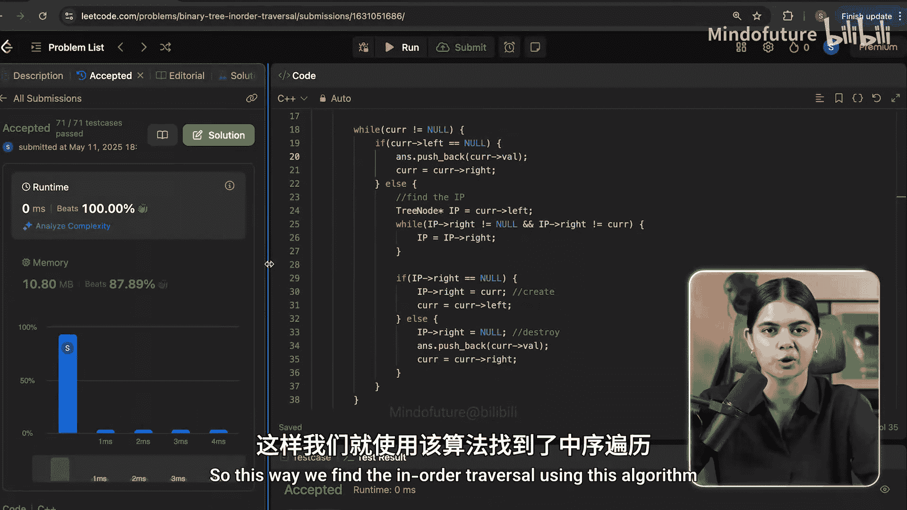

# 094：莫里斯中序遍历


在本节课中，我们将学习一种名为“莫里斯中序遍历”的算法。这是一种用于二叉树遍历的巧妙方法，它可以在不使用递归或显式栈的情况下，实现中序遍历。我们将重点理解其核心概念和工作原理。

## 概述

莫里斯中序遍历算法通过临时修改二叉树的结构（创建临时线索）来实现遍历，遍历完成后会恢复原状。其核心思想是利用“中序前驱节点”来建立从叶子节点返回父节点的路径。

## 核心概念：中序前驱节点

在深入算法之前，我们需要理解“中序前驱节点”这个概念。

对于一个给定的节点（例如根节点），它的**中序前驱节点**定义为：在中序遍历序列中，排在该节点**之前**的那个节点。

具体寻找方法是：**找到当前节点左子树中的最右侧节点**。

例如，考虑以下树结构：
```
    1
   / \
  2   3
 / \
4   5
```
对于根节点 `1`，它的中序前驱节点是节点 `5`（节点 `2` 的右子树中的最右节点）。对于节点 `2`，它的中序前驱节点是节点 `4`。

## 算法步骤解析

上一节我们介绍了中序前驱节点的概念，本节中我们来看看莫里斯遍历如何利用它。算法的核心是在遍历过程中，动态地创建和删除临时线索（将中序前驱节点的右孩子指向当前节点），以模拟递归栈的回溯功能。

以下是算法的具体步骤，我们结合伪代码进行说明：

1.  **初始化**：将 `current` 指针指向根节点。
2.  **循环条件**：当 `current` 不为 `null` 时，执行循环。
3.  **处理左子树为空的情况**：
    *   如果 `current` 的左孩子为空，则访问当前节点（将其值加入结果）。
    *   然后将 `current` 移动到其右孩子 (`current = current->right`)。
4.  **处理左子树不为空的情况**：
    *   找到 `current` 节点的中序前驱节点 (`predecessor`)。
        *   方法：从 `current` 的左孩子开始，一直向右走，直到某个节点的右孩子为 `null` **或** 指向 `current` 本身。
    *   **创建临时线索**：如果前驱节点的右孩子为 `null`，则将其右孩子指向 `current`。这创建了一条返回 `current` 的路径。然后将 `current` 移动到其左孩子 (`current = current->left`)。
    *   **删除临时线索并访问节点**：如果前驱节点的右孩子已经指向 `current`，说明左子树已被访问完毕。此时，将前驱节点的右孩子重新置为 `null`（恢复树结构），访问当前节点，然后将 `current` 移动到其右孩子 (`current = current->right`)。

## 代码实现

让我们将上述逻辑转化为 C++ 代码。以下函数实现了莫里斯中序遍历，并返回一个包含中序序列的向量。

```cpp
vector<int> inorderTraversal(TreeNode* root) {
    vector<int> answer; // 存储遍历结果
    TreeNode* current = root; // 当前节点指针

    while (current != nullptr) {
        // 情况1：当前节点的左子树为空
        if (current->left == nullptr) {
            answer.push_back(current->val); // 访问节点
            current = current->right; // 转向右子树
        } else {
            // 情况2：当前节点的左子树不为空，寻找中序前驱节点
            TreeNode* predecessor = current->left;
            // 关键条件：predecessor->right != null 且 predecessor->right != current
            while (predecessor->right != nullptr && predecessor->right != current) {
                predecessor = predecessor->right;
            }

            // 子情况A：前驱节点的右孩子为空，创建临时线索
            if (predecessor->right == nullptr) {
                predecessor->right = current; // 创建线索
                current = current->left; // 转向左子树
            } 
            // 子情况B：前驱节点的右孩子指向当前节点，说明左子树已遍历完
            else {
                predecessor->right = nullptr; // 删除线索，恢复树结构
                answer.push_back(current->val); // 访问当前节点
                current = current->right; // 转向右子树
            }
        }
    }
    return answer;
}
```

## 复杂度分析

*   **时间复杂度**：O(n)，其中 n 是树中的节点数。每个节点最多被访问两次（一次用于创建线索，一次用于遍历访问），因此是线性时间复杂度。
*   **空间复杂度**：O(1)。该算法只使用了固定的几个指针变量，没有使用递归栈或额外的数据结构，因此是常数空间复杂度。这是莫里斯遍历相比递归和迭代栈方法的主要优势。



## 总结

本节课中我们一起学习了莫里斯中序遍历算法。我们首先理解了“中序前驱节点”这一关键概念，然后逐步剖析了算法如何通过创建和删除临时线索来模拟递归过程，最终实现了无需额外栈空间的中序遍历。该算法在时间复杂度上与递归法相同，但将空间复杂度优化到了 O(1)，在处理大规模二叉树或空间受限的环境下非常有用。