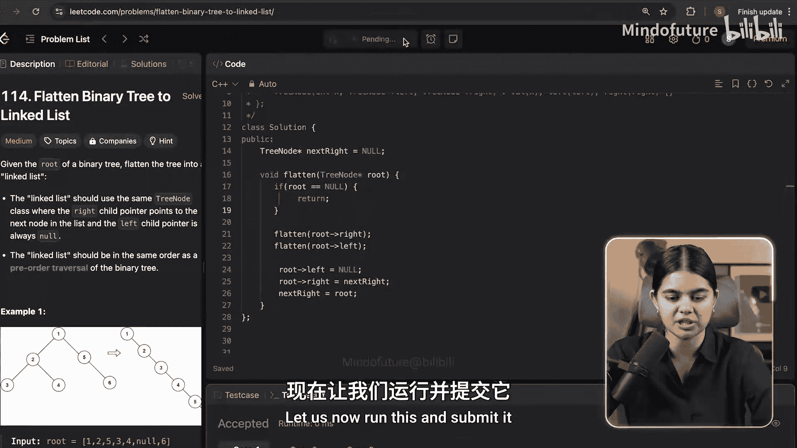

# 095：将二叉树展开为链表


在本节课中，我们将学习如何将一个二叉树“展开”为一个链表。展开后的链表遵循二叉树的**前序遍历**顺序，并且所有节点都通过其 `right` 指针连接，`left` 指针则全部设置为 `null`。

## 问题描述

给定一个二叉树的根节点 `root`，你需要将其展开为一个“链表”：
1.  展开后的“链表”应使用与 `TreeNode` 相同的 `TreeNode` 类，其中 `right` 指针指向链表中的下一个节点，`left` 指针始终为 `null`。
2.  链表的节点顺序应与二叉树的**前序遍历**顺序相同。

**示例：**
给定二叉树：
```
    1
   / \
  2   5
 / \   \
3   4   6
```
展开为链表：
```
1 -> 2 -> 3 -> 4 -> 5 -> 6 -> null
```

## 解决方案思路

我们将采用一种**反向后序遍历**的递归方法。核心思想是：从最后一个节点开始处理，并维护一个指向“当前已处理链表”最后一个节点的指针 `next_right`（或称 `last_visited`）。

以下是算法的核心步骤：
1.  递归处理右子树。
2.  递归处理左子树。
3.  处理当前根节点：
    *   将当前节点的 `left` 指针设为 `null`。
    *   将当前节点的 `right` 指针指向 `next_right`（即上一个处理好的节点）。
    *   更新 `next_right` 指针为当前节点。

这样，当我们从递归调用返回时，链表就已经从后向前构建好了。

## 代码实现

以下是该算法的 C++ 实现：

```cpp
class Solution {
private:
    TreeNode* next_right = nullptr; // 指向已构建链表末尾的指针
public:
    void flatten(TreeNode* root) {
        if (root == nullptr) {
            return;
        }
        
        // 1. 递归处理右子树
        flatten(root->right);
        // 2. 递归处理左子树
        flatten(root->left);
        
        // 3. 处理当前节点
        root->left = nullptr;          // 左指针置空
        root->right = next_right;      // 右指针指向上一个处理好的节点
        next_right = root;             // 更新链表末尾指针为当前节点
    }
};
```

## 算法流程详解

让我们通过一个简单的例子来逐步理解算法。考虑二叉树：
```
    1
   / \
  2   3
```

**执行步骤：**
1.  调用 `flatten(1)`。
2.  在 `flatten(1)` 中，先递归调用 `flatten(3)`。
3.  `flatten(3)` 中，其右、左子树均为空，直接处理节点3：`3->left = null`， `3->right = next_right`（初始为 `null`），然后 `next_right = 3`。
4.  回到 `flatten(1)`，接着递归调用 `flatten(2)`。
5.  `flatten(2)` 中，其右、左子树均为空，处理节点2：`2->left = null`， `2->right = next_right`（此时 `next_right` 是 `3`），然后 `next_right = 2`。
6.  回到 `flatten(1)`，处理节点1：`1->left = null`， `1->right = next_right`（此时 `next_right` 是 `2`），然后 `next_right = 1`。

最终链表为：`1 -> 2 -> 3 -> null`，符合前序遍历顺序。

## 复杂度分析

*   **时间复杂度：O(n)**，其中 `n` 是树中的节点数。每个节点恰好被访问一次。
*   **空间复杂度：O(h)**，其中 `h` 是树的高度。这是由于递归调用栈的深度。在最坏情况（树退化为链表）下，空间复杂度为 `O(n)`。

## 总结



本节课我们一起学习了如何将二叉树展开为链表。我们掌握了一种巧妙的**反向后序遍历递归**方法，通过维护一个 `next_right` 指针来从后向前构建链表。这种方法代码简洁，但思路需要仔细理解。关键记住处理顺序：**先右、后左、再根**，并在处理根节点时完成指针的重定向。