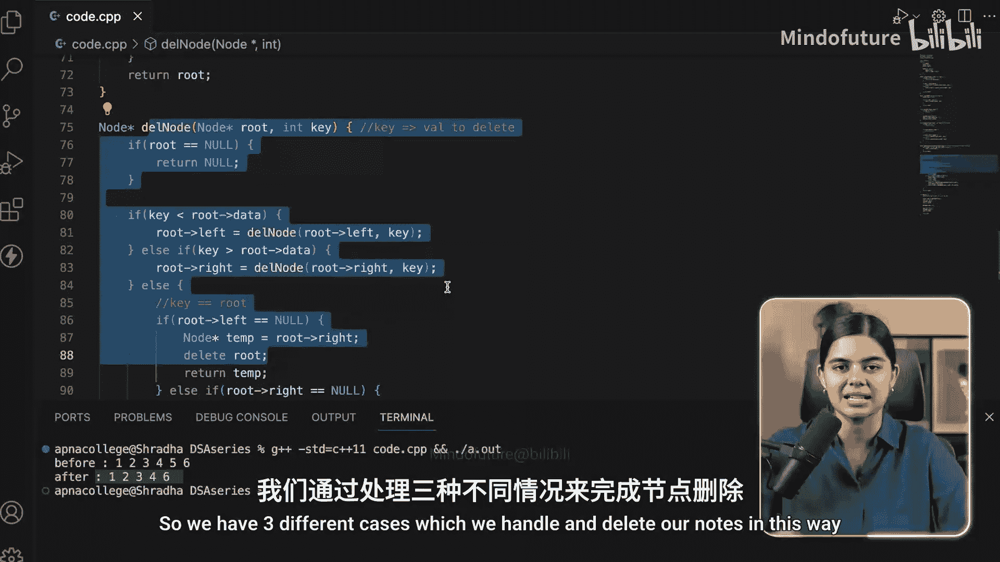

# 096：二叉搜索树 (BST)


在本节课中，我们将学习一种重要的数据结构——二叉搜索树。我们将了解它的定义、核心属性，并学习如何实现插入、搜索和删除节点这三种基本操作。

## 概述

二叉搜索树是一种特殊的二叉树。它的核心特性是：对于树中的任意节点，其左子树中所有节点的值都小于该节点的值，其右子树中所有节点的值都大于该节点的值。这种结构使得数据的查找、插入和删除操作非常高效。

## 什么是二叉搜索树？

上一节我们介绍了数据结构的基本概念，本节中我们来看看二叉搜索树的定义。

二叉搜索树是一种节点值遵循特定排序规则的二叉树。具体规则如下：
*   每个节点包含一个值。
*   任意节点的左子树只包含值**小于**该节点的节点。
*   任意节点的右子树只包含值**大于**该节点的节点。
*   通常，树中所有节点的值都是唯一的。

例如，如果根节点是 `5`，那么所有小于 `5` 的值（如 `1, 3, 4`）都在左子树，所有大于 `5` 的值（如 `6, 8, 9`）都在右子树。

## BST的节点结构

二叉搜索树的节点结构与普通二叉树相同。每个节点包含三部分：存储的数据、指向左子节点的指针和指向右子节点的指针。

以下是C++中节点的定义代码：
```cpp
class Node {
public:
    int data;
    Node* left;
    Node* right;

    Node(int val) {
        data = val;
        left = NULL;
        right = NULL;
    }
};
```

## 在BST中搜索节点

搜索是BST的核心操作之一，它利用了BST的排序特性。搜索的逻辑类似于二分查找。

搜索算法的步骤如下：
1.  从根节点开始。
2.  如果当前节点为 `NULL`，说明值不存在，返回 `false`。
3.  如果目标值等于当前节点的值，搜索成功，返回 `true`。
4.  如果目标值小于当前节点的值，则递归地在左子树中搜索。
5.  如果目标值大于当前节点的值，则递归地在右子树中搜索。

由于每次比较都能排除一半的子树，搜索的平均时间复杂度为 **O(log n)**，其中 `n` 是树中节点的数量。在最坏情况下（树退化成链表），时间复杂度为 **O(n)**。

以下是搜索函数的实现代码：
```cpp
bool search(Node* root, int key) {
    if (root == NULL) {
        return false;
    }
    if (root->data == key) {
        return true;
    }
    if (key < root->data) {
        return search(root->left, key);
    } else {
        return search(root->right, key);
    }
}
```

## 构建BST（插入节点）

构建BST的过程就是不断插入新节点的过程。插入操作也需要维持BST的属性。

插入一个新节点的逻辑如下：
1.  如果树为空（`root == NULL`），则创建新节点作为根节点。
2.  否则，将待插入的值与当前节点的值比较。
3.  如果值小于当前节点值，递归地将其插入左子树。
4.  如果值大于当前节点值，递归地将其插入右子树。
5.  将更新后的子树指针连接回父节点。

以下是插入单个节点和构建整棵树的函数代码：
```cpp
// 在给定子树中插入一个值，并返回新的根节点
Node* insert(Node* root, int val) {
    if (root == NULL) {
        return new Node(val);
    }
    if (val < root->data) {
        root->left = insert(root->left, val);
    } else { // 假设值不重复，val > root->data
        root->right = insert(root->right, val);
    }
    return root;
}

// 使用数组构建一棵BST
Node* buildBST(vector<int> values) {
    Node* root = NULL;
    for (int val : values) {
        root = insert(root, val);
    }
    return root;
}
```

## BST的中序遍历

BST有一个非常重要的性质：**对BST进行中序遍历，会得到一个升序排序的序列**。

这是因为中序遍历的顺序是“左-根-右”，而BST的性质保证了左子节点 < 根节点 < 右子节点。

以下是中序遍历的代码：
```cpp
void inorder(Node* root) {
    if (root == NULL) {
        return;
    }
    inorder(root->left);
    cout << root->data << " ";
    inorder(root->right);
}
```

## 在BST中删除节点

删除节点是BST操作中最复杂的一部分，因为删除后必须保持BST的性质。根据要删除节点的子节点数量，分为三种情况。

### 情况1：删除叶子节点（无子节点）
这是最简单的情况。直接删除该节点，并将其父节点对应的指针设为 `NULL`。

### 情况2：删除有一个子节点的节点
*   用其唯一的子节点替代该节点的位置。
*   将该子节点连接回原节点的父节点。

### 情况3：删除有两个子节点的节点
这是最复杂的情况，需要找到合适的节点来替代被删除的节点，以保持BST的性质。
1.  找到该节点的**中序后继节点**（即其右子树中的最小节点）。
2.  用这个后继节点的值**替换**要删除节点的值。
3.  递归地**删除**右子树中的那个后继节点（此时它最多只有一个右子节点，属于情况1或2）。

中序后继节点的查找逻辑是：进入右子树，然后一直向左走，直到没有左子节点为止。

以下是删除节点的完整实现代码：
```cpp
// 辅助函数：查找中序后继节点
Node* getInorderSuccessor(Node* root) {
    Node* curr = root;
    while (curr && curr->left != NULL) {
        curr = curr->left;
    }
    return curr;
}

// 删除值为key的节点，返回新的根节点
Node* deleteNode(Node* root, int key) {
    if (root == NULL) {
        return NULL;
    }

    // 查找要删除的节点
    if (key < root->data) {
        root->left = deleteNode(root->left, key);
    } else if (key > root->data) {
        root->right = deleteNode(root->right, key);
    } else {
        // 找到要删除的节点 root
        // 情况1 & 2：有一个子节点或无子节点
        if (root->left == NULL) {
            Node* temp = root->right;
            delete root;
            return temp;
        } else if (root->right == NULL) {
            Node* temp = root->left;
            delete root;
            return temp;
        }
        // 情况3：有两个子节点
        Node* successor = getInorderSuccessor(root->right);
        root->data = successor->data; // 用后继的值替换
        root->right = deleteNode(root->right, successor->data); // 删除后继节点
    }
    return root;
}
```

## 总结

本节课中我们一起学习了二叉搜索树这一核心数据结构。
*   我们了解了BST的定义和排序特性。
*   我们学习了如何在BST中**搜索**节点，其高效性源于类似二分查找的过程。
*   我们掌握了**构建**BST的方法，即通过插入操作维持树的结构。
*   我们认识到BST的**中序遍历**结果是一个有序序列。
*   最后，我们深入探讨了最复杂的**删除**操作，并学会了如何处理具有零个、一个和两个子节点的不同情况。



理解并实现BST的这些基本操作，是学习更高级树形结构（如AVL树、红黑树）的重要基础。