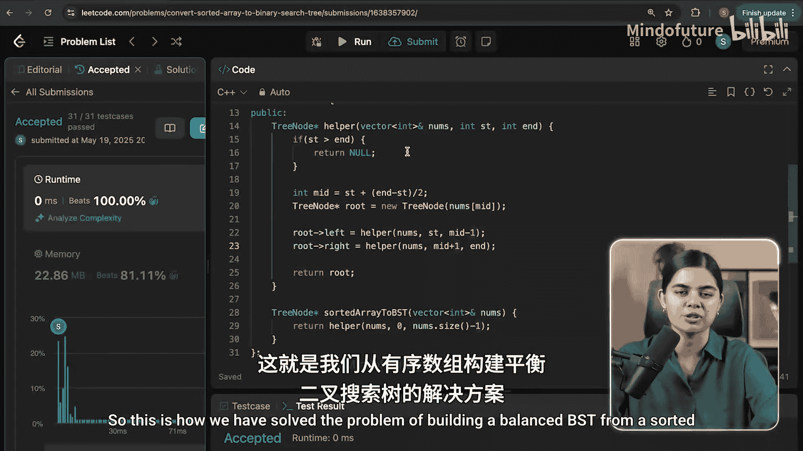

# 097：有序数组转为平衡二叉搜索树


在本节课中，我们将要学习如何将一个有序数组转换为一棵平衡的二叉搜索树。这是一个在LeetCode上编号为108的简单级别问题。

## 概述

二叉搜索树是一种特殊的二叉树，它遵循一个关键属性：对于任意节点，其左子树中的所有节点值都小于该节点值，其右子树中的所有节点值都大于该节点值。这个属性使得对BST的中序遍历结果是一个有序序列。

平衡二叉搜索树是BST的一种，它要求树的左右子树的高度差尽可能小，这能保证树的操作效率。

## 问题理解

我们被给定一个按升序排序的整数数组。任务是将这个数组转换为一棵高度平衡的二叉搜索树。高度平衡二叉树是指一个二叉树每个节点的左右两个子树的高度差的绝对值不超过1。

由于输入数组已经排序，我们可以利用BST的属性来高效地构建树。核心思路是递归地将数组的中间元素作为树的根节点，这样可以自然地保证树的平衡性。

## 核心算法

上一节我们介绍了问题的基本概念，本节中我们来看看具体的构建算法。

算法的核心是分治策略。对于一个排序数组，其中间元素是构建平衡BST的最佳根节点选择。选择中间元素后，数组被分为左半部分和右半部分。左半部分用于递归构建左子树，右半部分用于递归构建右子树。

以下是构建平衡BST的递归步骤：

1.  找到当前子数组的中间索引。计算公式为：`mid = start + (end - start) / 2`。使用这个公式可以避免整数溢出。
2.  以中间索引处的元素值创建一个新的树节点，作为当前子树的根节点。
3.  递归调用函数，使用左半部分子数组（`[start, mid-1]`）构建左子树，并将其连接到根节点的左孩子。
4.  递归调用函数，使用右半部分子数组（`[mid+1, end]`）构建右子树，并将其连接到根节点的右孩子。
5.  返回创建好的根节点。

递归的基本情况是当起始索引大于结束索引时，这意味着当前子数组为空，因此返回空指针（`nullptr`）。

## 代码实现

理解了算法步骤后，现在让我们将其转化为C++代码。我们将实现一个辅助函数来完成递归构建。

```cpp
/**
 * Definition for a binary tree node.
 * struct TreeNode {
 *     int val;
 *     TreeNode *left;
 *     TreeNode *right;
 *     TreeNode() : val(0), left(nullptr), right(nullptr) {}
 *     TreeNode(int x) : val(x), left(nullptr), right(nullptr) {}
 *     TreeNode(int x, TreeNode *left, TreeNode *right) : val(x), left(left), right(right) {}
 * };
 */
class Solution {
public:
    TreeNode* sortedArrayToBST(vector<int>& nums) {
        // 调用辅助函数，初始范围为整个数组
        return helper(nums, 0, nums.size() - 1);
    }

private:
    TreeNode* helper(vector<int>& nums, int start, int end) {
        // 基本情况：子数组为空
        if (start > end) {
            return nullptr;
        }

        // 找到中间索引，避免溢出
        int mid = start + (end - start) / 2;

        // 创建根节点
        TreeNode* root = new TreeNode(nums[mid]);

        // 递归构建左子树和右子树
        root->left = helper(nums, start, mid - 1);
        root->right = helper(nums, mid + 1, end);

        // 返回构建好的子树根节点
        return root;
    }
};
```

## 复杂度分析

最后，我们来分析一下算法的时间复杂度和空间复杂度。

*   **时间复杂度**：算法会访问数组中的每个元素恰好一次来创建节点。对于有 `n` 个元素的数组，时间复杂度为 **O(n)**。
*   **空间复杂度**：空间消耗主要来自递归调用栈。由于树是平衡的，递归深度为 `O(log n)`。此外，存储 `n` 个节点需要 `O(n)` 空间。因此，总的空间复杂度为 **O(n)**。

## 总结

本节课中我们一起学习了如何将一个有序数组转换为平衡二叉搜索树。我们首先回顾了BST的定义和平衡树的概念。然后，我们深入探讨了利用数组有序特性、通过递归分治选择中间元素作为根节点来构建平衡BST的核心算法。接着，我们将思路转化为清晰的C++代码实现，并分析了算法的时间与空间复杂度。掌握这个方法，你就能高效解决这一类从有序序列构建平衡树的问题。



