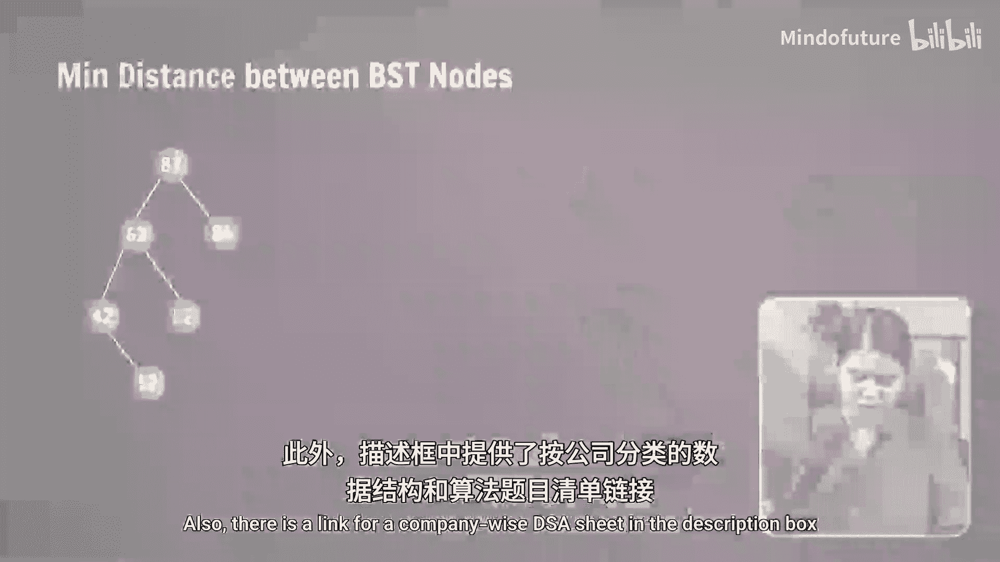
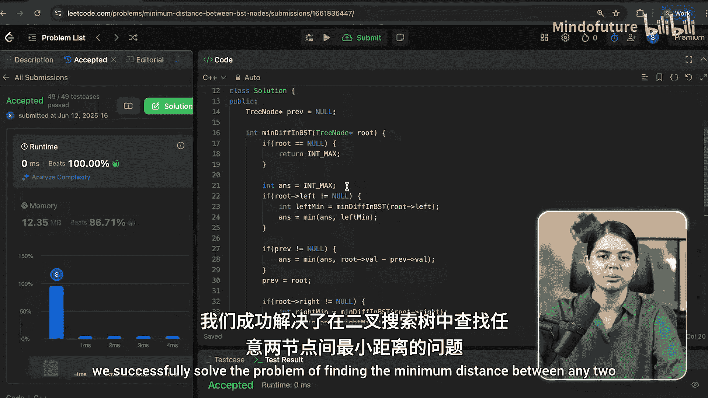

# 099：二叉搜索树节点间的最小距离




在本节课中，我们将学习如何解决一个重要的二叉搜索树问题：计算树中任意两个节点值之间的最小差值。这是一个常见的面试问题，理解其解法有助于巩固对二叉搜索树和中序遍历的理解。

## 概述

问题要求我们找出给定二叉搜索树中任意两个不同节点值之间的最小绝对差值。由于二叉搜索树具有有序的特性，我们可以利用中序遍历来高效地解决这个问题。

## 问题分析与核心思路

二叉搜索树有一个关键性质：**中序遍历BST会得到一个升序序列**。例如，对于节点值序列 `[42, 52, 62, 82, 83, 88]`，任意两个相邻数字的差值可能是最小的。因此，问题转化为：在一个已排序的数组中，找出相邻元素的最小差值。

这是一个线性复杂度问题。我们只需要遍历排序后的数组，计算当前值与前一个值的差值，并记录遇到的最小差值即可。

**核心公式**：
`当前差值 = abs(当前节点值 - 前一个节点值)`
我们需要找到所有此类差值中的最小值。

那么，如何获得BST的排序序列呢？答案是进行**中序遍历**。在中序遍历过程中，我们访问节点的顺序本身就是排序好的。

## 算法步骤详解

上一节我们分析了问题的核心是获取排序序列。本节中我们来看看具体的实现步骤。关键在于在中序遍历的同时，记录上一个被访问的节点值，并计算差值。

以下是实现算法的详细步骤：

1.  **初始化**：创建一个全局或类成员指针 `previous`，用于指向上一个被访问的节点，初始化为 `nullptr`。同时初始化一个变量 `minDiff` 来记录最小差值，初始值可以设为 `INT_MAX`。
2.  **中序遍历**：
    *   递归遍历左子树。
    *   **处理当前节点**：如果 `previous` 指针不为空，计算当前节点值与 `previous` 节点值的绝对差值，并更新 `minDiff`。
    *   将 `previous` 指针更新为当前节点。
    *   递归遍历右子树。
3.  **返回结果**：遍历结束后，`minDiff` 中存储的就是最小距离。

## 伪代码与C++实现

让我们将上述逻辑转化为伪代码，并最终写成C++代码。

以下是算法的伪代码描述：

```cpp
// 全局或类成员变量
TreeNode* previous = nullptr;
int minDiff = INT_MAX;

void inOrderTraversal(TreeNode* root) {
    if (root == nullptr) return;

    // 1. 遍历左子树
    inOrderTraversal(root->left);

    // 2. 处理当前节点
    if (previous != nullptr) {
        minDiff = min(minDiff, root->val - previous->val); // BST中序遍历保证root->val >= previous->val
    }
    previous = root; // 更新previous指针

    // 3. 遍历右子树
    inOrderTraversal(root->right);
}

// 主函数
int getMinimumDifference(TreeNode* root) {
    inOrderTraversal(root);
    return minDiff;
}
```

现在，我们将其转换为可以提交的C++代码。注意处理边界情况，例如树为空或只有一个节点。

```cpp
/**
 * Definition for a binary tree node.
 * struct TreeNode {
 *     int val;
 *     TreeNode *left;
 *     TreeNode *right;
 *     TreeNode() : val(0), left(nullptr), right(nullptr) {}
 *     TreeNode(int x) : val(x), left(nullptr), right(nullptr) {}
 *     TreeNode(int x, TreeNode *left, TreeNode *right) : val(x), left(left), right(right) {}
 * };
 */
class Solution {
private:
    TreeNode* prev; // 记录中序遍历的前一个节点
    int minDiff;    // 记录最小差值

    void inOrder(TreeNode* node) {
        if (node == nullptr) return;

        // 遍历左子树
        inOrder(node->left);

        // 处理当前节点
        if (prev != nullptr) {
            minDiff = min(minDiff, node->val - prev->val); // 由于中序遍历有序，node->val 一定大于 prev->val
        }
        prev = node; // 更新前驱节点

        // 遍历右子树
        inOrder(node->right);
    }

public:
    int getMinimumDifference(TreeNode* root) {
        prev = nullptr;
        minDiff = INT_MAX;
        inOrder(root);
        return minDiff;
    }
};
```

## 复杂度分析

*   **时间复杂度**：O(N)，其中 N 是树中的节点数。我们只对树进行了一次中序遍历，每个节点访问一次。
*   **空间复杂度**：O(H)，其中 H 是树的高度。空间消耗主要来自递归调用栈。在最坏情况（树退化为链表）下，空间复杂度为 O(N)。

## 总结

本节课中我们一起学习了如何解决“二叉搜索树节点间的最小距离”问题。我们利用二叉搜索树**中序遍历有序**的特性，通过一次遍历，在访问每个节点时计算其与前驱节点的差值，从而在线性时间内找到了全局最小差值。这个方法高效且优雅，是处理BST相关问题的典型技巧。



