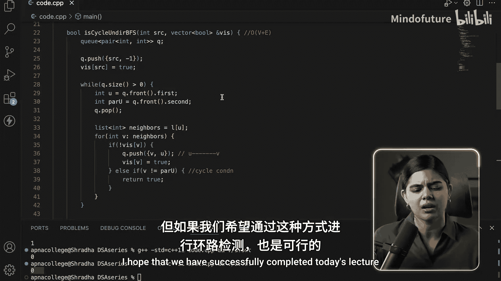

# 113：使用BFS检测无向图中的环 🕵️


## 概述
在本节课中，我们将要学习如何使用广度优先搜索算法来检测一个无向图中是否存在环。我们将从理解核心概念开始，逐步深入到具体的算法逻辑和代码实现。

## 核心概念与条件
上一节我们讨论了图的基本遍历。本节中我们来看看在无向图中检测环的特殊条件。

检测无向图中环的核心在于识别“后边”。后边是指连接当前节点与其非父节点的、已被访问过的邻居的边。在BFS遍历中，如果发现这样的边，就说明图中存在环。

用逻辑条件描述如下：
*   如果节点 `v` 已被访问
*   并且 `v` 不是当前节点 `u` 的父节点
*   那么边 `(u, v)` 就是一条后边，表明图中存在环。

## BFS检测环的算法逻辑
理解了环存在的条件后，我们来看看如何将其融入BFS算法框架。

以下是使用BFS检测环的逐步逻辑：
1.  初始化一个访问标记数组 `visited`，全部设为 `false`。
2.  初始化一个队列 `q`，用于BFS遍历。队列中的元素是 `(当前节点, 父节点)` 对。
3.  对于图中的每一个未访问节点，以其为起点开始BFS。
4.  将起点节点及其父节点（初始为 `-1`）入队，并标记为已访问。
5.  当队列不为空时：
    a. 取出队首元素，得到当前节点 `u` 及其父节点 `parent`。
    b. 遍历节点 `u` 的所有邻居 `v`：
        i. 如果邻居 `v` 未被访问，则将其标记为已访问，并将 `(v, u)` 入队（`u` 是 `v` 的父节点）。
        ii. 如果邻居 `v` 已被访问，且 `v` 不等于 `u` 的父节点 `parent`，则发现后边，返回 `true`（检测到环）。
6.  如果遍历完所有节点都未发现后边，则返回 `false`（图中无环）。

这个逻辑确保了即使对于非连通图，我们也能检查其所有连通分量。

## 代码实现
掌握了算法逻辑，现在我们可以将其转化为具体的C++代码。

以下是检测无向图中环的完整函数实现：

```cpp
#include <bits/stdc++.h>
using namespace std;

bool isCycleBFS(int src, vector<int> adj[], vector<bool>& visited) {
    // 队列存储 (节点, 父节点) 对
    queue<pair<int, int>> q;
    // 将源节点入队，其父节点设为-1
    q.push({src, -1});
    visited[src] = true;

    while (!q.empty()) {
        int u = q.front().first;
        int parent = q.front().second;
        q.pop();

        // 遍历当前节点的所有邻居
        for (int v : adj[u]) {
            if (!visited[v]) {
                // 如果邻居未访问，标记并入队
                visited[v] = true;
                q.push({v, u});
            } else if (v != parent) {
                // 如果邻居已访问且不是父节点，发现环
                return true;
            }
        }
    }
    return false;
}

bool isCycleInUndirectedGraph(int V, vector<int> adj[]) {
    vector<bool> visited(V, false);

    // 遍历所有节点，处理非连通图的情况
    for (int i = 0; i < V; ++i) {
        if (!visited[i]) {
            if (isCycleBFS(i, adj, visited)) {
                return true;
            }
        }
    }
    return false;
}
```



## 总结
本节课中我们一起学习了使用广度优先搜索检测无向图中环的方法。关键点是利用BFS遍历，并通过检查是否存在连接当前节点与其非父节点的已访问边（即后边）来判断环的存在。我们详细分析了算法逻辑，并给出了完整的C++代码实现。对于非连通图，需要遍历所有连通分量以确保检查全面。