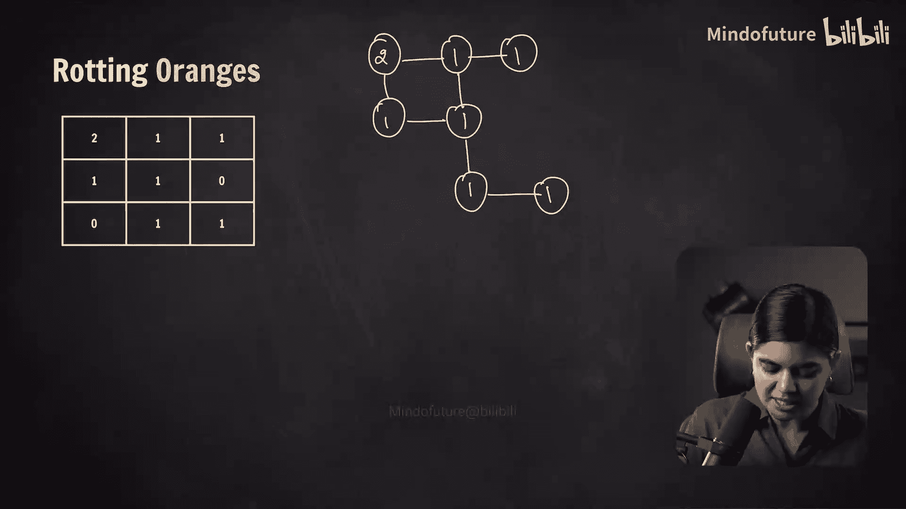

# 115：腐烂的橘子 - 多源BFS - Leetcode 994 🍊


在本节课中，我们将学习一个经典的图论问题——“腐烂的橘子”。这是一个在网格上使用**多源广度优先搜索**的典型问题，对应LeetCode第994题。我们将从问题理解开始，逐步构建解决方案，并最终实现代码。

## 问题概述

问题描述如下：给定一个 `m x n` 的网格，每个单元格可以有以下三种状态之一：
*   **0** 代表一个空单元格。
*   **1** 代表一个新鲜橘子。
*   **2** 代表一个腐烂的橘子。

每分钟，任何与腐烂橘子（4个正方向，上、下、左、右）相邻的新鲜橘子都会腐烂。你需要计算直到网格中没有新鲜橘子为止所必须经过的最小分钟数。如果不可能使所有橘子腐烂，则返回 `-1`。

## 核心思路：将网格视为图 🗺️

这个问题初看是一个网格问题，但实际上可以抽象为一个图论问题。

*   将网格中的每个单元格视为图中的一个**节点**。
*   如果两个单元格在水平或垂直方向上相邻（共享一条边），则它们之间存在一条**边**。
*   这样，整个网格就构成了一张隐式的图。

理解了这一点后，解决“腐烂的橘子”问题就变得和标准的图遍历问题非常相似。

## 为什么使用BFS？ ⏱️

广度优先搜索的特点是**逐层扩展**。在这个问题中，“层”的概念恰好对应着“分钟”。
*   在第0分钟，所有初始腐烂的橘子是第0层。
*   在第1分钟，所有与第0层橘子相邻的新鲜橘子会腐烂，成为第1层。
*   以此类推，直到无法扩展或所有新鲜橘子都已腐烂。

因此，BFS能自然地帮我们计算出腐烂过程所需的总时间（即BFS的深度）。

## 关键概念：多源BFS 🔥

在标准BFS中，我们通常从一个起点开始。但在本问题中，初始时可能有**多个腐烂的橘子**。它们应该**同时**作为BFS的起点。

以下是多源BFS的实现思路：
1.  初始化队列时，不是放入单个起点，而是将所有初始状态为“腐烂”（值为2）的单元格坐标及其时间（初始为0）一起加入队列。
2.  然后进行常规的BFS遍历。这样保证了所有腐烂源是同时开始传播的。

## 算法步骤详解

以下是解决“腐烂的橘子”问题的详细步骤。

### 步骤1：初始化
*   获取网格的行数 `n` 和列数 `m`。
*   初始化一个 `visited` 二维数组（布尔类型），记录每个单元格是否已被访问（即是否已腐烂）。初始时所有单元格为 `false`。
*   初始化一个队列 `q`，用于BFS。队列元素是一个三元组 `(i, j, t)`，其中 `(i, j)` 是坐标，`t` 是该节点腐烂的时间。
*   初始化答案变量 `ans = 0`，用于记录最大时间。

### 步骤2：多源入队
遍历整个网格。对于每个单元格 `grid[i][j]`：
*   如果其值为 `2`（腐烂橘子），则将其坐标 `(i, j)` 和时间 `0` 作为一个三元组 `(i, j, 0)` 加入队列 `q`。
*   同时，将 `visited[i][j]` 标记为 `true`。

### 步骤3：执行BFS遍历
当队列 `q` 不为空时，循环执行以下操作：
1.  从队首取出一个节点 `(i, j, t)`。
2.  更新全局答案：`ans = max(ans, t)`。
3.  检查当前节点的四个邻居（上、下、左、右）。对于每个邻居 `(ni, nj)`：
    *   **边界检查**：确保 `ni` 和 `nj` 在网格范围内。
    *   **访问检查**：确保 `visited[ni][nj]` 为 `false`（未腐烂）。
    *   **状态检查**：确保 `grid[ni][nj]` 为 `1`（新鲜橘子）。
    *   如果以上条件都满足，则：
        *   将邻居 `(ni, nj, t+1)` 加入队列 `q`。
        *   将 `visited[ni][nj]` 标记为 `true`。

### 步骤4：检查剩余新鲜橘子
BFS结束后，再次遍历整个网格。
*   如果存在任何一个单元格满足 `grid[i][j] == 1` 且 `visited[i][j] == false`，说明这个新鲜橘子无法被腐烂到。
*   在这种情况下，返回 `-1`。
*   否则，返回答案 `ans`。

## 代码实现

以下是基于上述思路的C++代码实现。

```cpp
class Solution {
public:
    int orangesRotting(vector<vector<int>>& grid) {
        int n = grid.size();
        int m = grid[0].size();
        
        vector<vector<bool>> visited(n, vector<bool>(m, false));
        queue<pair<pair<int, int>, int>> q; // ((i, j), time)
        int ans = 0;
        
        // 多源入队：将所有初始腐烂的橘子加入队列
        for(int i = 0; i < n; i++) {
            for(int j = 0; j < m; j++) {
                if(grid[i][j] == 2) {
                    q.push({{i, j}, 0});
                    visited[i][j] = true;
                }
            }
        }
        
        // 方向数组，方便遍历四个邻居
        int dir[4][2] = {{-1, 0}, {1, 0}, {0, -1}, {0, 1}};
        
        // BFS遍历
        while(!q.empty()) {
            auto current = q.front();
            q.pop();
            
            int i = current.first.first;
            int j = current.first.second;
            int time = current.second;
            
            ans = max(ans, time);
            
            // 遍历四个方向
            for(int d = 0; d < 4; d++) {
                int ni = i + dir[d][0];
                int nj = j + dir[d][1];
                
                // 检查邻居是否有效、未访问且是新鲜橘子
                if(ni >= 0 && ni < n && nj >= 0 && nj < m 
                   && !visited[ni][nj] && grid[ni][nj] == 1) {
                    q.push({{ni, nj}, time + 1});
                    visited[ni][nj] = true;
                }
            }
        }
        
        // 检查是否还有无法腐烂的新鲜橘子
        for(int i = 0; i < n; i++) {
            for(int j = 0; j < m; j++) {
                if(grid[i][j] == 1 && !visited[i][j]) {
                    return -1;
                }
            }
        }
        
        return ans;
    }
};
```

## 总结

本节课我们一起学习了LeetCode 994题“腐烂的橘子”。我们掌握了以下核心内容：



1.  **问题抽象**：将网格问题转化为图遍历问题，每个单元格是节点，相邻关系是边。
2.  **算法选择**：使用**广度优先搜索**，因为其逐层扩展的特性与时间流逝的分钟数完美对应。
3.  **关键技巧**：使用**多源BFS**来处理多个同时存在的起点（初始腐烂的橘子）。
4.  **实现步骤**：初始化 -> 多源入队 -> BFS遍历 -> 最终检查。
5.  **边界与状态检查**：在BFS过程中，必须仔细检查数组边界、访问状态和单元格原始值。

通过这个例子，我们看到了BFS算法在解决具有“扩散”或“传播”特性问题时的强大能力。理解并掌握多源BFS，对于解决类似的网格最短路径、感染传播等问题至关重要。