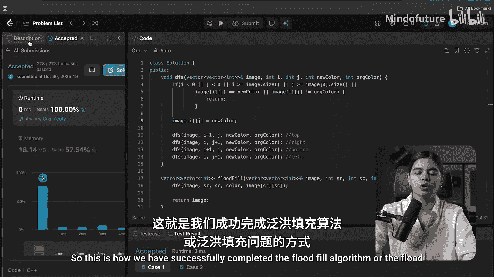

# 120：洪水填充算法 - 图问题 🎨


## 概述
在本节课中，我们将学习一个名为“洪水填充”的经典算法问题。这个问题是LeetCode上的第733题。我们将通过一个简单的深度优先搜索方法来解决它，该方法用于修改图像网格中特定区域的颜色。

---

## 问题理解
首先，我们来理解问题。我们有一个 `M x N` 的二维网格 `image`，代表一张图像。每个单元格 `image[i][j]` 代表该像素的颜色值。

我们会获得一个起始坐标 `(sr, sc)` 和一个新的颜色值 `newColor`。任务是从这个起始像素开始，将所有在**四方向**（上、下、左、右）上相连的、且颜色值与起始像素原始颜色相同的像素，都填充为新的颜色。

### 核心概念
用**代码**描述问题输入和输出：
```cpp
vector<vector<int>> floodFill(vector<vector<int>>& image, int sr, int sc, int newColor) {
    // 算法实现部分
}
```

---

## 算法思路
上一节我们介绍了问题的定义，本节中我们来看看如何解决它。我们可以将图像网格视为一个**图**，其中每个单元格是一个**节点**，与它上下左右相邻的单元格之间存在**边**。

我们的目标是从源节点 `(sr, sc)` 开始，遍历所有颜色相同的连通节点，并改变它们的颜色。这自然引出了**深度优先搜索** 或**广度优先搜索** 算法。

我们将使用**DFS递归**来实现，因为它代码简洁直观。

### 算法步骤
以下是洪水填充算法的核心步骤：

1.  获取起始像素 `(sr, sc)` 的原始颜色 `originalColor`。
2.  如果 `originalColor` 已经等于 `newColor`，则直接返回原图像，无需修改。
3.  否则，调用DFS函数，从起始点开始递归遍历。
4.  在DFS函数中：
    *   将当前单元格的颜色改为 `newColor`。
    *   检查当前单元格的四个邻居（上、下、左、右）。
    *   对于每个邻居，如果它在网格范围内，并且其颜色等于 `originalColor`，则对这个邻居递归调用DFS。

---

## 代码实现与解析
理解了算法步骤后，现在让我们将其转化为具体的C++代码。

我们将实现一个DFS辅助函数，它需要知道当前坐标 `(i, j)`、图像本身、原始颜色和新颜色。

```cpp
class Solution {
public:
    void dfs(vector<vector<int>>& image, int i, int j, int originalColor, int newColor) {
        // 边界条件检查：索引越界
        if(i < 0 || j < 0 || i >= image.size() || j >= image[0].size())
            return;
        // 条件检查：颜色不是原始颜色，或者已经填充为新颜色
        if(image[i][j] != originalColor || image[i][j] == newColor)
            return;

        // 修改当前像素颜色
        image[i][j] = newColor;

        // 递归调用四个方向的邻居
        dfs(image, i-1, j, originalColor, newColor); // 上
        dfs(image, i+1, j, originalColor, newColor); // 下
        dfs(image, i, j-1, originalColor, newColor); // 左
        dfs(image, i, j-1, originalColor, newColor); // 右 - 注意：此处代码有笔误，应为 j+1
    }

    vector<vector<int>> floodFill(vector<vector<int>>& image, int sr, int sc, int newColor) {
        int originalColor = image[sr][sc];
        if(originalColor != newColor) {
            dfs(image, sr, sc, originalColor, newColor);
        }
        return image;
    }
};
```

> **注意**：上面的示例代码中有一个故意的笔误（`j-1` 写了两次），正确的第四个调用应该是 `dfs(image, i, j+1, ...);` 用于探索右侧邻居。在实际编写和提交代码时务必修正。

### 关键点解析
1.  **递归基**：DFS函数开头的两个`if`语句是递归终止条件，防止无限递归和无效访问。
2.  **颜色判断**：`image[i][j] != originalColor` 确保只修改颜色相同的区域。`image[i][j] == newColor` 是一个优化，避免对已修改的像素重复处理。
3.  **邻居探索**：通过修改 `i` 和 `j` 的坐标值（`i-1`, `i+1`, `j-1`, `j+1`）来访问上下左右四个邻居。

---

## 复杂度分析
最后，我们来分析一下这个算法的效率。

*   **时间复杂度**：**O(M * N)**。在最坏情况下，我们可能需要访问图像中的每一个像素。
*   **空间复杂度**：**O(M * N)**。这主要是递归调用栈的深度。在最坏情况下（例如整个图像都是同一种颜色），递归深度可能达到像素总数。

这个算法简单高效，是解决此类区域填充问题的标准方法。

---

## 总结
本节课中，我们一起学习了**洪水填充算法**。

我们首先理解了问题背景：如何基于种子点填充图像中的连续区域。接着，我们将问题建模为**图遍历**，并使用**深度优先搜索**策略来访问所有符合条件的相邻像素。然后，我们一步步实现了DFS递归函数，并详细解释了其中的边界条件和颜色判断逻辑。最后，我们分析了算法的时间和空间复杂度。



通过这个例子，你不仅学会了一个LeetCode题目的解法，更重要的是掌握了如何将网格问题转化为图遍历问题，并运用DFS进行解决的通用思路。请务必自己动手实现代码，并尝试使用**广度优先搜索** 来重新解决这个问题，以加深理解。继续练习，祝你学习愉快！