# UNIX高级编程-p01-P01-Week-01---Introduction--BV1hPuVz8EWS_p1-

Hello and welcome to CSs 63，1 Advance programming in the Uni environment。Don't panic。

 I'm on the Internet。 I'm here to help。My name is Janan Shaoman and I've been an adjunct professor at Stevens Institute of Technology since around 2005 or so。

 teaching this class as well as CS 615 system administration。

 which some of you may have taken before。Besides that。

 I work as a principal infrastructure as security architect at Verizon Media。

You can reach me via email at jasalmer@tevens。edu and the course website is located at the link shown in the slide here。

Despite having taught this class for going on about 15 years now。

 this is the first time we are holding it entirely online and so you spare the very long late Monday night lectures so good for you。

Instead， we are going to break the lectures into smaller segments for you to consume asynchronously and at your own time。

 and instead use a scheduled class time for interactive discussions and for me to help you with any questions or problems you may have。

This on lecture today summarizes the class。 We discuss what we will cover， how we will work。

 what the syllabus looks like and what resources you should bookmark。In our second part。

 we will then review the history of the Unix operating system and perform a whirlwind tour of the Unix programming environment and some of the features of the C programming language。

As is the first time we are flipping the classroom and moving all content online。

I'm going to rely on your feedback throughout the semester to help you get the most out of this class and to help me be a more efficient teacher。

So please don't be shy letting me know what you think， okay？With that。

 if you are still with me right now and haven't yet switched over to your Facebook tab， let's begin。

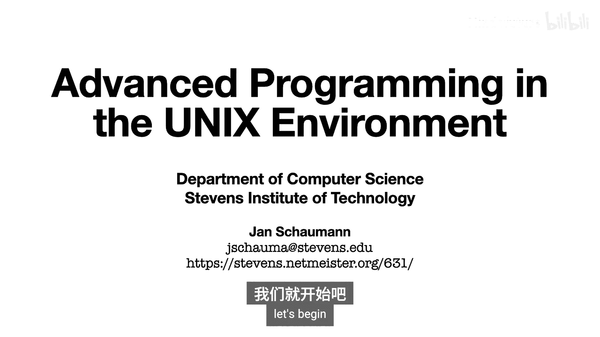

Okay， so this class is called advanced programming in the UniX environmentron。

Each of those words is apt picked and it is important to note what this class is not。Specifically。

 this class is not an introduction to using UniX。All students are expected to be comfortable using a Uni like operating system from the command line exclusively。

I assume that you are able to use a common Uni text editor， know how to find。

 search and manage files， how to use the shell and the various common tools。

 how to compile your code， and run new program。All the things that you currently see over here in this little screen recording。

If you are not familiar with Uni systems or are not comfortable using the command and interface in this class will be very。

 very challenging for you。Secondly， this class is not an introductory programming class that is you are expected to have written sizable programs before and to be familiar with most common paradigms of the practical efforts involved in writing and debugging code。

Finally， in this class we will be using the C programming language and you are expected to be familiar with that as well。

Please note that there's a difference between C and C plus plus。

As you will see in the second segment of our week1 lectures。

 the C programming language and the Uni operating systems are deeply intertwined。In this class。

 we will only write plain old C。 So in the nutshell。

 if what you see here on the screen in the terminal looks in any way foreign or strange to you。

 then this class is not for you。It's called advanced programming in the Unix environment for a reason。

 and that is what we will be doing。Okay， so having gotten that all of the way and now being on the same page about what this class is not。

Let's talk about what this class is， specifically what we're doing here。

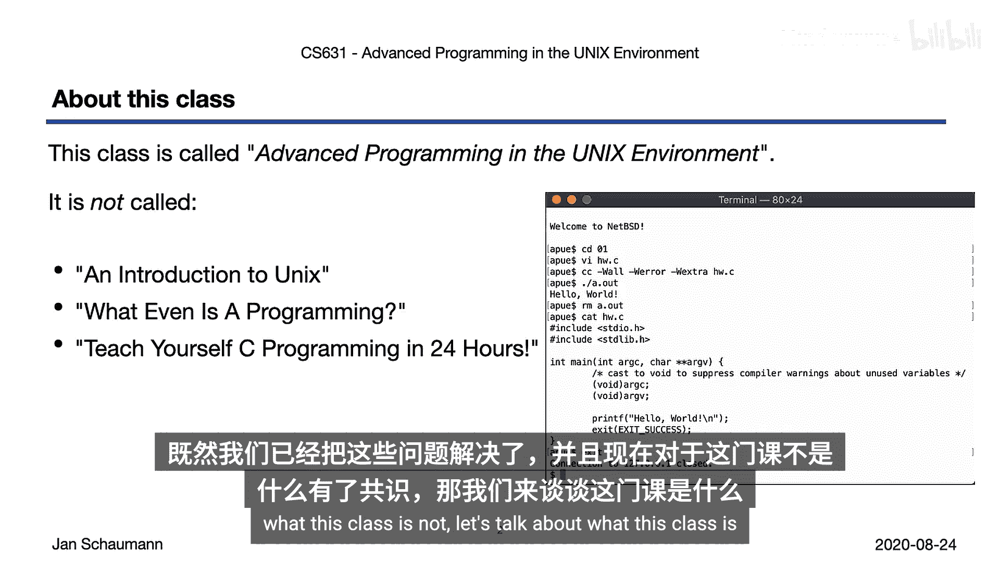

As we're talking about advanced programming in the UniX environment。

Let us take a quick look at what this environment looks like。As you know。

 the system provides a number of standard toolss in the slash bin directory。By the end of this class。

 you should be able to implement any one of these tools。

You should be able to look at the manual page for a given tool and from there determine how to write the code to provide the given functionality。

 to be aware of some of the edge cases， the hidden requirements that you may encounter and so on。

In fact， by the end of week1， these lectures that we are talking about right now。

 we already have looked at how to implement， maybe from the most basic level and interactive shell。

 the Ls command， as well as the cat utility。So some of the most basic command that you are familiar with。

 we will have covered already in the first lecture to some degree。

Take a look at what the command that you find in Ser bin。Look around。

 think about what all these programs do and how you would implement them。

Can you jot down the pseudocode for three or four of them？ Just pick any ones。 Look at it。

 You have the date command， You have the DF command， perhaps the tar command or the M V command。

 Those are all command that you use day in and day out。

 and you should be able to have an idea to come up with an idea of how you implement them。

If you're not familiar with any of these comments you see here， take note and look them up later on。

Remember that our Uni system comes with detailed menu pages for each of the provider commands。

But this class goes beyond just the command on utilities that we use day to day。

 as useful and interesting as that is。In addition， we will be looking at inter processcess communications and even some network programming in a client server model。

What you see here on the screen right now are most of the network library functions needed to implement communications across the internet between hosts to listen on a socket。

 to accept connections， to send and receive data。Note that all of these functions are operating on an integer file descriptor。

 thereby providing a simple， flexible and consistent API。

We'll talk a whole lot more about this in future lectures。

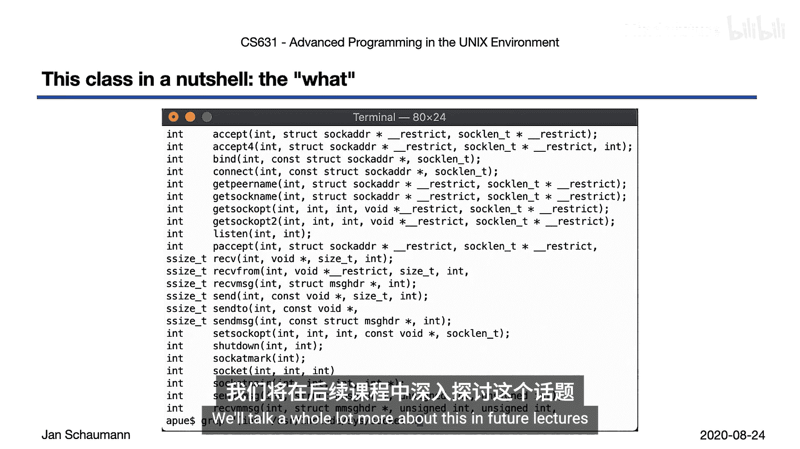

So what are we doing in this class obviously we will be performing some programming in the UniX environment hence the name。

 but as so often in academia， the outcomes and lessons of a class go well beyond just the practical tasks performed。

That is， we are going to specifically look into gaining an understanding of the UniX operating systems from a programmer's perspective。

We are also looking to gain systems programming experience。

Prolying on the systems level is somewhat different from programming on， for example。

 the kernel level， from programming in embedded environments。Of programming mobile apps or databases。

We will be using the UniX environment as well as understanding how it is implemented。

 how we can write tools for and within the UniX environment。In so doing。

 we will further gain a deeper understanding of a number of fundamental operating system concepts。

 even though we are focusing on the UniX family， these concepts will still translate to other operating system families as well。

Many of you will already have some familiarity with these concepts。

 but I believe that all of you will find us revisiting this concepts in class with strength and your understanding and deepen your knowledge。

These concepts are。General multi user concepts， how an operating system that has to accommodate multiple users simultaneously will function and what the implications are。

We'll talk about basic and advanced style。We will talk about process relationships。

 we will handle interproal communications and as mentioned earlier。

 we will discuss basic network programming using a client's server model。

 which seems like a good basis for any programmer to develop。Okay， great。

 So learning all these things sounds awesome， but why are we doing this？Well of course。

 you are doing this probably so that you get hopefully a good grade and are able to graduate。

 but I do naively hope that we have additional goals as we follow this class。For starters。

 understanding the Uni family of operating systems gives you a better understanding of other operating systems concepts。

The systems level experience that we gain in this class will make us better。

 more advanced users of the system will let us better understand the limitations of all programs and applications that we encounter。

Next， as mentioned earlier， we are programming in C。Nowadays。

 C is often considered a low level programming language。

 something we'll get back to in our next segment。And there are many problems being called out in using a language like C for modern programming tasks。

However， understanding how C works and what these limitations are will help us better understand the number of general programming and operating system concepts。

 again reinforcing some previous lessons and hopefully helping you gain new insights as well。Lastly。

 C is far from obsolete， in fact， it remains ubiquitous。

As we look at the different APIs and interfaces of the standard libraries， we will find that many。

 if not most of the higher level programming languages eventually fall back onto exactly these standard libraries。

From assistance perspective， C remains the de facto standard。

 and then understanding standinging how to ride sea in the Eson Ireland will make you a better programmer all around。

It will make you a better Python programmer， a better go programmer， a better pearl or rust。

 or even JavaScriptscript programmer。

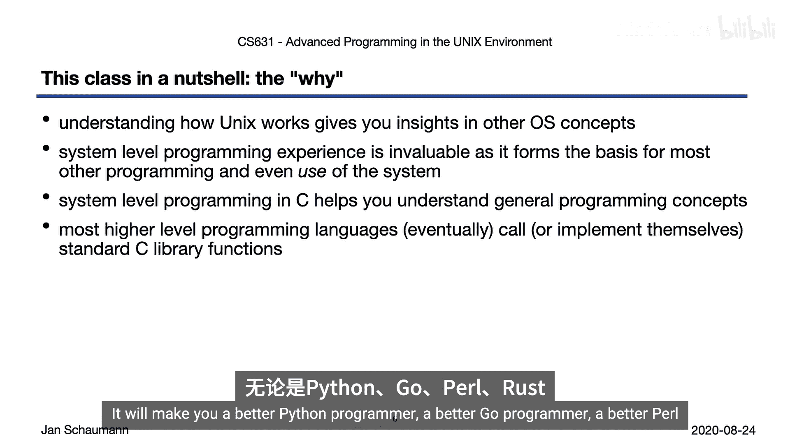

So now that we know what we're doing and why we're doing it。

 let's take a look at how we're going to do it。As we will discuss in our next segment。

 the history of the Unix family of operating systems is long and complex and different flavors have emerged over time。

For this class we will need a single reference platform to ensure that all students are working in the same environment。

 and I can grade your work on the platform where we do not end up with a discussion about how your code works just fine on your laptop but not on mine or how your version of the hardest in its distribution of the month has certain libraries。

 but Last month variant does not， and no your code explodes when I run it。So for this reason。

 we are going to use the netPSD operating system as our reference platform。Of course。

 you can develop and run your code on， for example， your MacOS system or your Linux VPS。

 but at the end of the day， your code is expected to compile and run on the NePSD 9。0 systems。

 which is where I will test and grade it。There are many different ways for you to get access to a net PSD system to make it easy for you。

 I've put together step by step instructions on how to install in virtual box VM。

 which you can see at the link shown here。This is the environment that I would be using throughout this class and all code and terminal examples or snippets shown in these slides or used in the discussions or in the mailing list are and is explicitly noted from an NePSST 90 virtual machine。

So it is in your interest to make sure that you have this reference platform set up as early as possible。

 preferably even before we come together for our first interactive commerce。

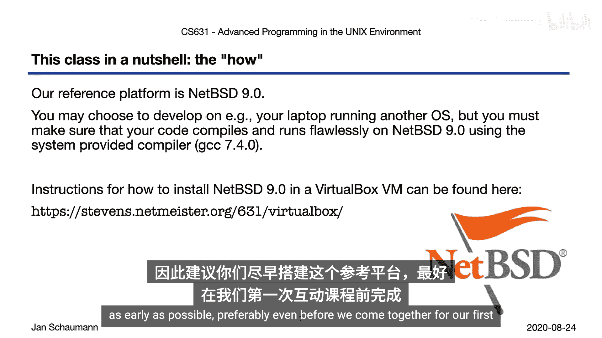

The next thing we note about programming is that it's useful to be able to read code， in fact。

 reading code is a critical skill， not always stressed enough when it comes to programming or computer science education。

In this class， you should be in the habit of reading a lot of code。Fortunately for us。

 many of the Unix flavors that are populous days are open source。

 and we can easily browse their source code。Being able to maneuver an entire operating system sourcetry and identifying where to find the code snippets you're looking for is a really important skill being able to dive into a code base and extracting what information you need from it is something else you have to simply practice to develop。

The NePSSD operating system is an open source operating system as well。

 and so I recommend that you actually fetch and extract the source code as shown on the screen here and make yourself familiar with the code base。

 that you maneuver through the source tree， open a couple of source files and see what the different tools are and how to jump into the C library and things like that。

So poke around the soil tree， find the utilities that we mentioned earlier that we might understand how they are implemented。

 then look at the code。Look at all the tools from s bin that we discussed or that you picked previously and see if you find the source and then see if it makes sense for you。

Another interesting thing to do is compare how different systems have implemented the same tools。

Consider that all the Uni systems come with a whole bunch of tools that are more or less the same。

 or at least they are very similar across the different platforms。So do they share code。

 do they implement the same logic， are they done the same way？On the website。

 there's a recommended exercise that is over here in the slides link at the bottom to give you a hint of how to compare the different code bases of three different open source operating systems。

Maybe take a look at that and see if that makes sense to you。

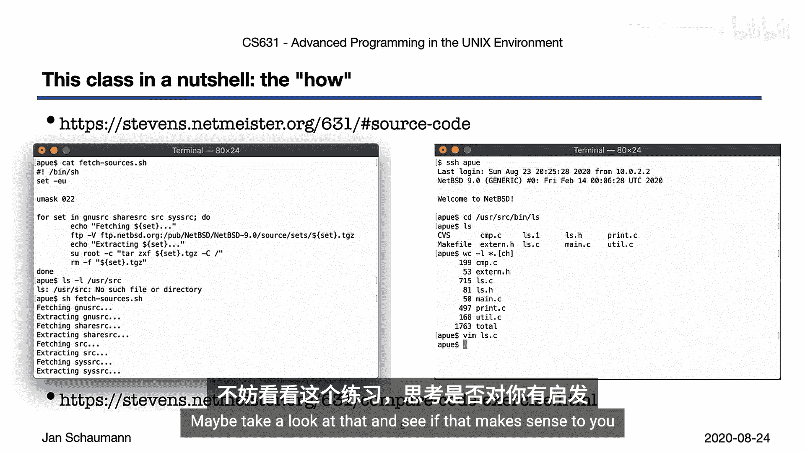

Now obviously reading code is only one part， the much more obvious part。

 which is what people really think about when they hear something like advanced programming in the UniX environment。

 is that we will be writing a whole lot of code in this class and I am going to be very。

 very pedantic about the quality of your code。Coode is communication。

Code needs to be easy to read not just for the author right now， but for others as well。

The reason for this is that you will always spend a disproportionately bigger amount of time reading code。

 debugging code than actually writing code。When you work on a code base with others or when you are debugging a tool that somebody else wrote。

 it's critical that you can quickly dive right in and are not confused by that author's specific style preferences or what have you。

And writing legible clear code is something that can only be homened with practice。

So for every assignment and all the code you write in this class。Let's make sure。That it is。

Clearly structured。Your code should be well separated， compartmentalized。

 split into functions and different modules as makes sense。

 to actually provide a decent structure that is easy to discern。

The code needs to be well formatted with appropriate line breaks and wide space used consistently。

We want to use a very specific consistent coding style。

 Different people have different preferences about where they place their braces。

 how they indent things。 But if you are working with other people。

 you all have to agree on one style， and it may not always be the style that you wish。

 or that would be your preference。So we are going to use a specific coding star link later on that I will be enforcing for all assignments。

Make sure that you use meaningful names when you are declaring variables。

 when you are using functions or objects that those are named descriptively and intuitively named。

And remember that vowels don't cost extra as we name things for some reason。

 programmers seem to obscurew variables， vowels and variable names， etc cea。

 make sure that you can fluently read the code。Another thing we will be focusing on is providing commons that we are only using when they're necessary。

One of the things that a lot of computer science students learn early on is that every line of code must be commented。

And rather than net， I think it's important to keep in mind that as you're reading code and as you're reading commons。

 your context switching， you're switching from one language to another。

 you're switching from the machine language， the programming language to another language。

 oftentimes， that's English that may not even be your native language。

 So you have even another context switch there， right。

So make sure that we are reducing the context switching for the person reading the code and optimize for legibility and readability of the code by itself。

 and we are focusing on really only providing comments that explain why you're doing something。

 not how you're doing。We have a coding style guide linked over here at the bottom of this slide at this particular link。

Okay， so now on to more practical things。So this is a university class and you're paying a lot of money in tuition。

We are gonna have to give you a grade at the end of the semester。Trust me， I wish I didn't have to。

 but， you know， it is what it is。So here's how we're going to do this。

Even though this class is online， we are hopefully， anyway， going to have interactive exchanges。

 sometimes synchronously via Zoom sessions， sometimes asynchronously on the mailing list。

 sometimes semiynchronously on the class general。Your participation here will matter。

 I'm looking for you to speak up， to contribute， to ask questions。

 to follow up in the lectures and all around to be mentally present。

So this is kind of a nice change from our in class interactions where students generally are physically present。

 but often not mentally so maybe in this version of the class will strike a reasonable equilibrium right。

Anyway， so class participation and your preparation for each week in the form of course notes。

 which we'll discuss more in more detail in a minute， will make up 50 points。

There will be two smaller programming assignments， maybe something like 200 lines of code or so。

Then there will be a more sizable mid project， which we assign after the second week。

That will likely be several hundred lines of code， maybe up to 2000 or so。

We then have a larger project that will be done in teams of two or three people。

 and finally another individual project towards the end of the semester。So as you can see。

 this class is heavy on programming because you really can only get better at programming by doing it。

 so we're going to try to really do a lot of that。All these points should add up to 500 total points。

With letter grades then being given out as explained of the course website。

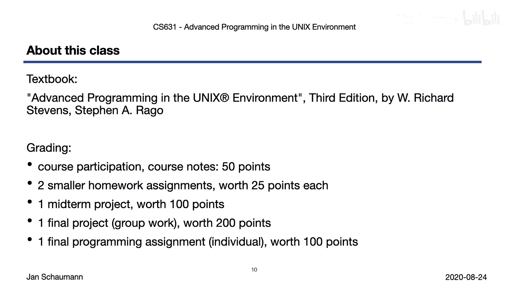

As I mentioned， your course participation will in part be evaluated based on the course and notes you take。

This is something that I found to be useful to help students come to class prepare to help guide them throughout the semester。

So here's how we will do this。You should create a good repository with a single text file for each lecture。

Before each lecture， in that text file， you node。What you've read before。

 what code exercises you've done， what questions you have？

This should help you prepare for the class and then be able to ask these questions in class on the mailing list to help you really gain understanding of what wasn't clear based on your reading or the preparation that you've done。

After each lecture I want you to go back， I want you to write down whether or not you found the answers to the questions that you had。

Or note anything that you learn because of particular interest。But of course。

 oftentimes new questions come up as we go into the lectures， so you may want to write those down。

You may want to see which questions you didn't get answered right so write those down so you can keep track of that。

Afterwards， you can then follow up on the unanswered questions either in class or on the mailing list。

At the end of the semester， you submit all your notes to me。

And so the goal is for you to have a way to review your progress throughout the semester。

As you can tell， if you're preparing for each class with beforehand work and then rework it afterwards。

 that should give you an idea of what you've accomplished each week。But at the same time。

 it will also give you an idea how much you' have accomplished across the semester。

Something that might not have made much sense in the second or third week may then become clearer towards the end of the semester。

So use these notes to guide you to what questions to ask。

 what does the clarification on and what to share with your classmate。

I'm going to review the notes at the end of the semester and gauge your progress as well。

 So the more detailed your notes are， the easier it will be for me to give your credit。

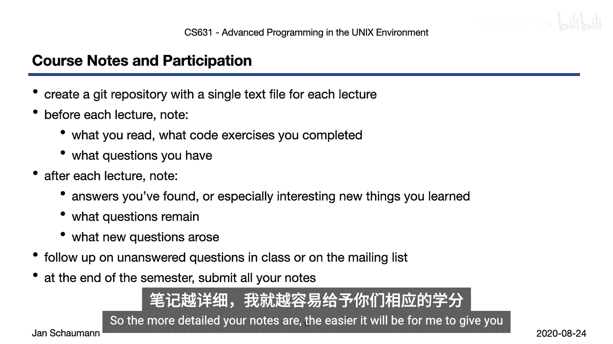

The assignments that we have， the coding assignments will be posted to the class mailing list and announced in the video lecture。

 that it is your responsibility to note the due date and submit your code on time。

I understand it especially at this time。 Many people have different obligations。

 and anything may come up that may dere your plans。 If it happens， please come to me right away。

I'm okay with granting an extension if circumstances require it。

But I cannot grant an extension simply for to poor time management and planning where you come gentlyly and say。

 oh， I started my assignment last night， and it turns out it takes me longer than a few hours to actually complete it。

 Can I submit it late。 It is not going to be a good excuse。

The assignments that I give are generally given with sufficient time to complete them。

But in my experience， students often times start much too late。

He won't be able to complete the assignments in a rushed manner in the last minute or even in the last 24 hours before their due。

So please don't delay working on the assignments， oftentimes unexpected problems arise and clarifications are necessary as you work on them。

The sooner you discover these issues， the better for you。

Given the circumstances and trying to adopt to a new online syllabus syllabus Im also changing another important aspect of this class。

Where there will be no make up assignments or no extra credit at work towards the end of semester or anything like that。

 I will allow you to resubmit your code after you have received your grade to correct any major problems。

This option will be available if the work you submitted did not receive an A。 In that case。

 you may take my comments。 They will provide to you and the feedback。

And resubmits your improved code a week later to attempt to bump up your grade。Finally。

 and I'm said that I have to explicitly point this out， you are responsible for your own work。

Every semester， I have at least one student who will hand in code that they did not write themselves。

Sometimes they find code on the internet， sometimes they find code from previous students that have taken the class。

 sometimes they hand in code that I have written and assume that I't recognize it。

This constitutes plagiarism and possibly copyright violations。

 and this will immediately yield a field rate。Please note that even though the code for the Uni systems we are using is publicly available in this licenses open source code。

 you may still not take the code and submit it as your own for assignments in this class。

The same holds for smaller code segment and snippets。 If you run into a problem， search the Internet。

 followllow the first Google results to the stack overflow answer and then copy that code snippet into your assignment。

 Then that still may be plagiarism。At the minimum， you need to identify to me in your code which part you did not write yourself and copied from the internet。

And know very well that in the so called real world out there people search for and copy code from stack overflow all the time。

 but it's critical for computer science students to learn to properly cite their sources。

The programming assignments given here are not like the problems you're solving in that mystical real world。

They are not an objective for you to produce。But an opportunity for you to learn something。

By blindly copying code from the Internet and gluing together something that perhaps even works。

 but that you did not write yourself， you are robbing yourself of the opportunity to really understand the problem to learn。

So the best way to avoid any problems here is for you to actually sit down and write all code you hand in yourself。

And if you run into problems， if you questions， if you have questions about how to best do something。

 please reach out under the class mailing list where encourage all of you to share code segments or discuss the best approach to any given。

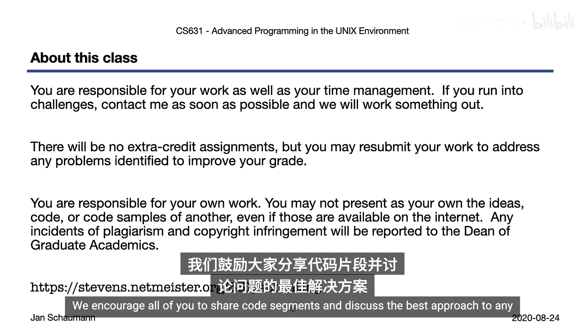

All right。Now that we have all these formalities out of the way， let's take a look at our syllabus。

It will by and large follow the outline of the course book。

 although we will also throw an lecture on using the UniX environment in an efficient manner。

Other than that， I hope that you will to find a certain progression and topics we cover。

We will begin with local file IO and file systems。Then， take a look。And process relationships。

Move on to inter process communication and network programming before we round out our understanding of the system with a number of mixed and advanced topics。

The order of the lectures may be subject to change。

 it all depends how much time I find to put these lectures together and arrange them。

 but hopefully also based on interest and discussions in our requirements class。

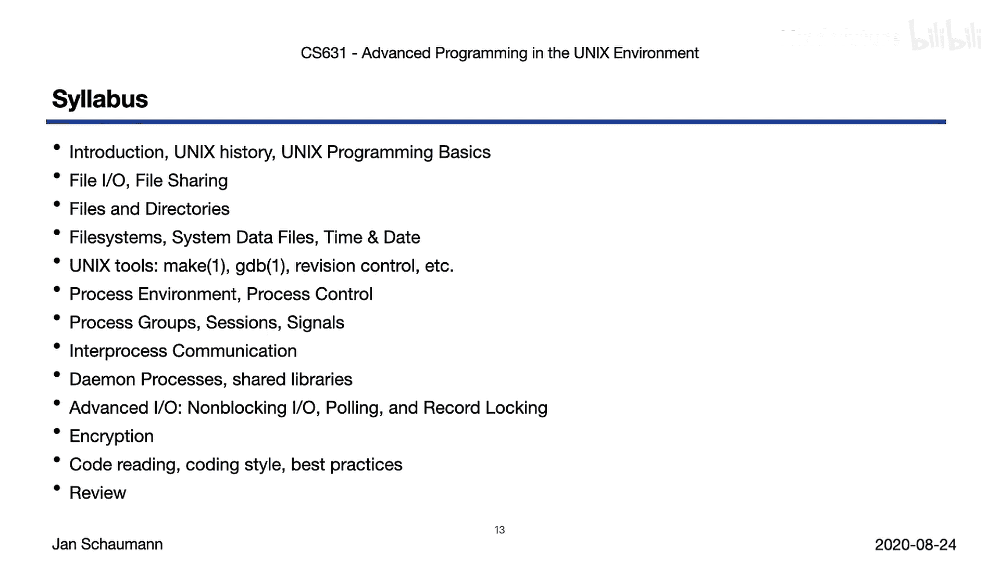

Over here on this slide， I've put together the most important course resources that by now you should have bookmarked already。

The most critical one is， of course， the first link， right。

 It's the one that is the website for this class， the course website。

 it is linked to from the Stevens Candll shell and remains authoritative for all information about the class。

 And please do note that there is no other information in the Stevens Candles shell。

 Make sure that you refer to the course website for all materials that we have here。

The second most important part is the course mailing list。

 which will be our primary means of communication。I subscribe all students who are currently enrolled in the class If you are not subscribed。

 please do subscribe yourself using the Steven。edu email address。

I can't and won't accept any other addresses on this mail。The mailing list is a discussion list。

 not an announcement only list。 I send announcements there sure。

 but they expect you to participate in discussions on the list。

If you have a question and see clarification about anything， please send a mail to the mail。

If you send it to me in private， chances are， and I will reply saying please send your question to the class mailing list。

 so save yourself the round trip。The only time you should email me off list is if you are referring to your grades or any other personal circumstances。

 Any generic questions should go through the list。The reason for this is that it iss quite likely that if you have a question that other students would also benefit from an answer or clarification。

So please don't be shy。Also， do not rely on me to respond to every question you see in the class mailing list if you know the answer or you think you do。

 please reply on the list。If you come across an interesting link relevant to the class in general or a specific topic in particular。

 please share it。I'm actually looking actively for your interactions on the list。

I've also set up a select channel for this class and have invited all registered students to join。

If you have not received an invite， please email me and I will add you。

The select channel is intended to let us discuss anything well semiynchronously， you may share links。

 post questions or engage in code analysis or comparison at any time。However。

 while the mailing list is mandatory reading the selectck channel is optional for you。

There is announcements of any importance will be sent to the mailing list。

 but I hope that we can enjoy chatting a little bit less formally on slackla as time permits。 I。

 myself will peek into the slack channel every so often。

 but you shouldn't expect me to immediatelyly respond right away to any question you may have。😊。

Finally， the last thing shown here goes to the Cos YouTube channel where I will upload these video lectures like this as soon as I finish them for each week。

 I will likely post an announcement to the list when new material is there but you can also of course subscribe。

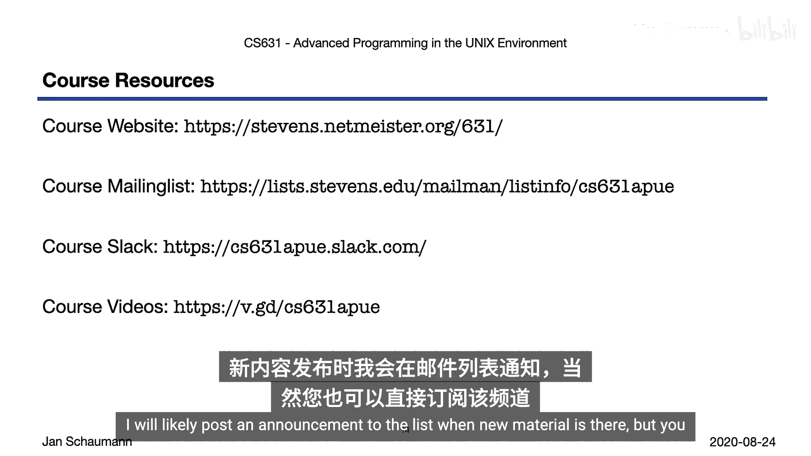

All right。Looks like we're going to reach the end of the first segment。

 so let's take a look at a recap of what homework you have in order to get the most out of this class。

And I want to stress that the homework that I expect you to complete really is primarily intended to guide you。

 to learn and to get the best and the most experience out of this class。That is， in effect。

 I'm looking for you to do prep work that relates to the course node that we discussed and something that I expect any good student to already be in the habit of。

So you should for every lecture， review the previous week's， slides and notes that we have。

 watch the video lectures and the slides for the class， follow up with questions。

 follow the links that are on the course website for the given week。

 and do the recommended exercises。The course website has a number of so called recommended exercises。

 that are not graded assignments。 That is， I put together a whole bunch of problems or tasks that I believe will help you better understand the topic for the given week。

 and I very much recommend that you use them as a self guided study tool to deepen your understanding of the topic。

You will also note that my lecture slides include lot of code snippets， even in the video lecture。

 they may be flying by too quickly for you to really see what we're doing here。

 So I recommend that after you view the lecture you take some time to run the commands and examples that we used This will help you understand also again what we're trying to do and may even teach you a couple of tricks in the UniX environment as well。

And then of course， you ought to update your class notess as we discuss。For this week in particular。

 your homework is really basically just to get set up for this class， bookmark all the resources。

 initialize your course notes， and get your netPSSD reference platform set up。

If you run into any of these problems with these tasks， please guess what。

 send the mail to the mailing list， we will discuss it there。Allright。

 so this concludes our first video segment for week one of the fall 2020 semester of CS631 Advance programming in the UniX environment。

I hope you are able to pay attention and find that this video lecture is helpful。

The slides accompanying this video are， of course， available from the courseite website as well。

In our next web segment， we'll cover the UniX history and take a look at some of the basics of the UniX programming environment and important features of the C programming language。

 which， as you know can be a little bit thicker。But more on that in our next segment。

Thanks for watching and until the next time。

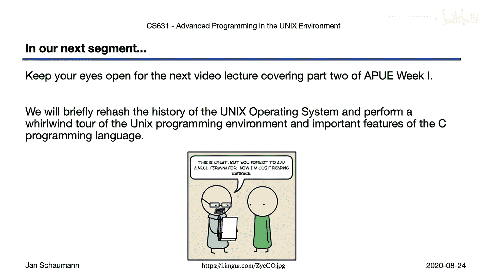

Cers。