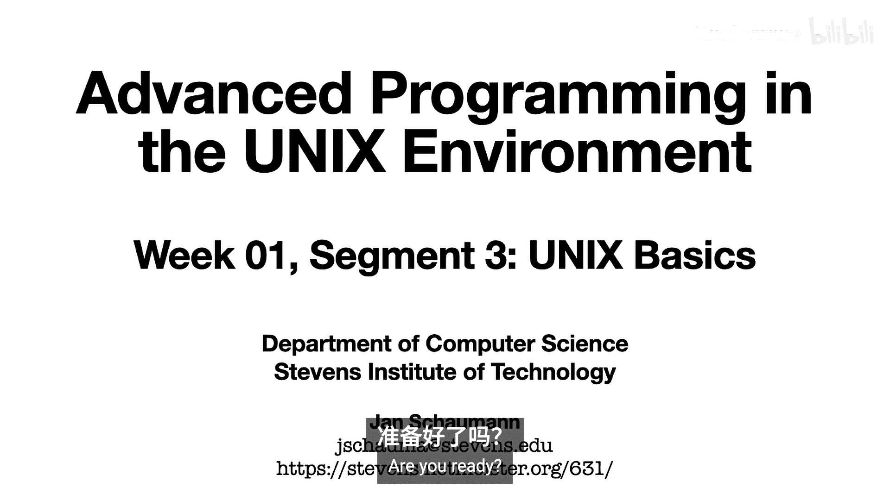
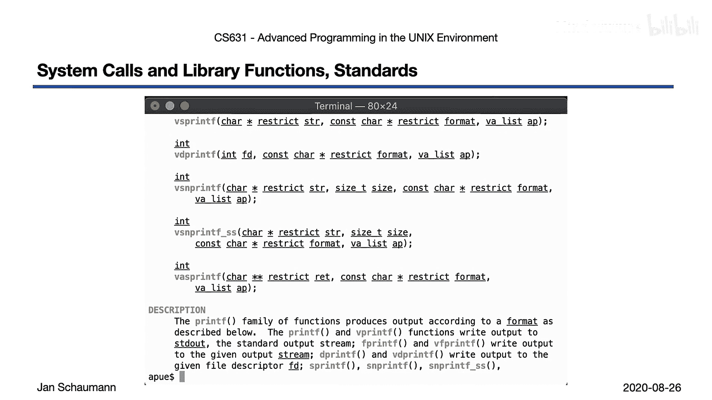
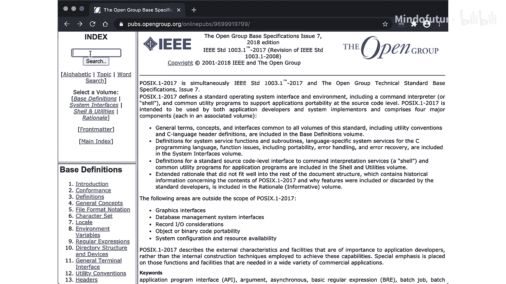
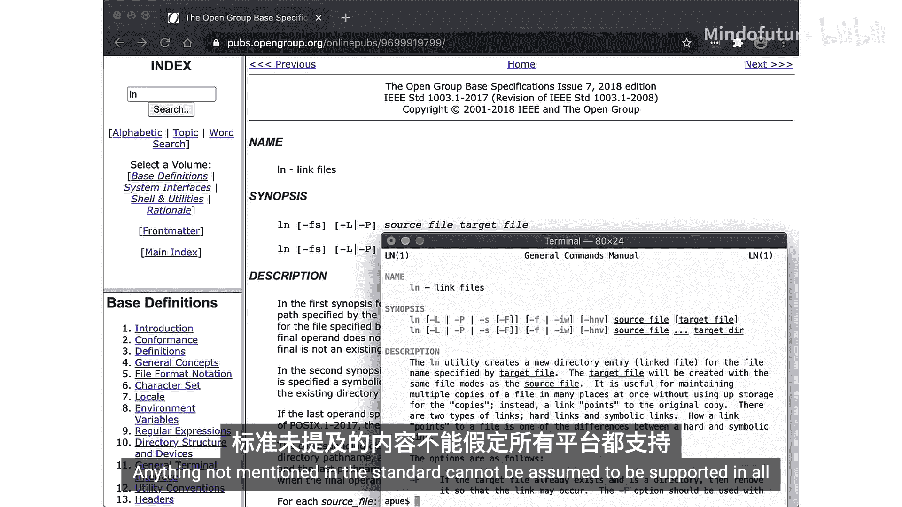
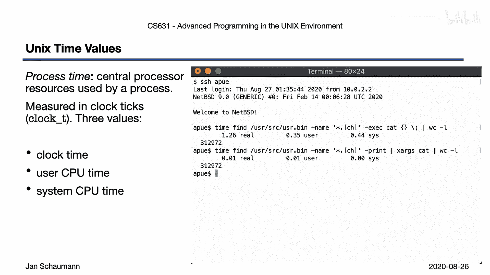
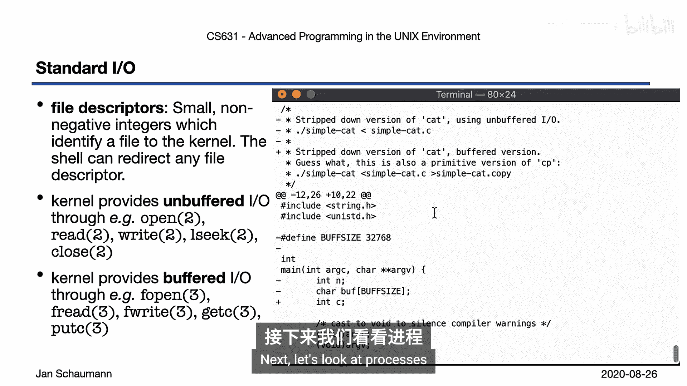
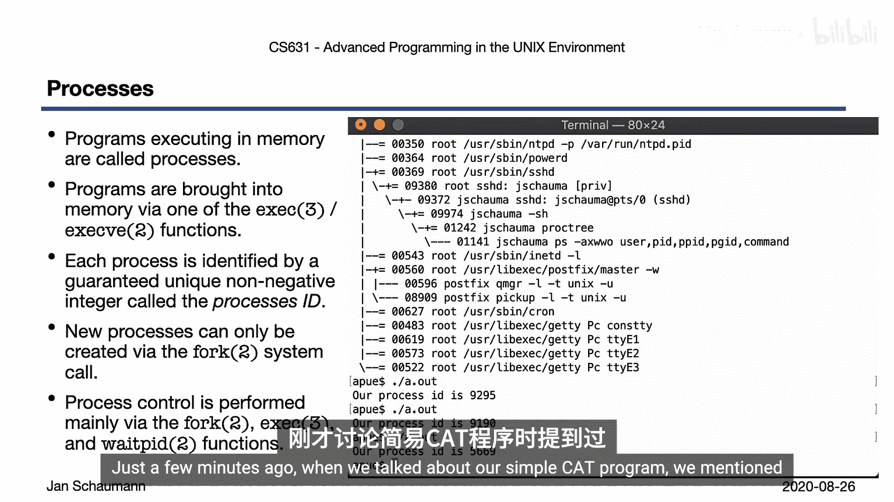
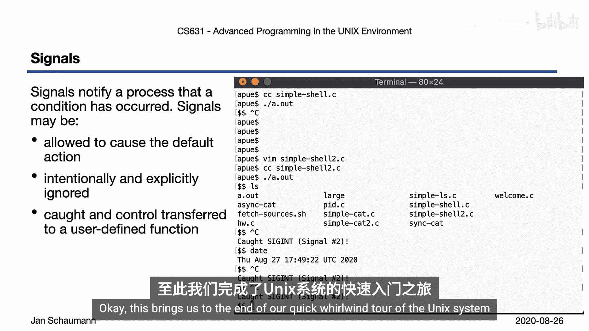
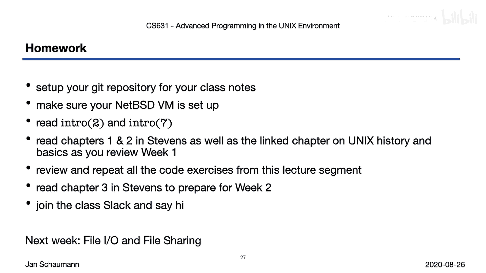

# UNIX高级编程-p03-P03-Week-01---Unix-Basics--BV1hPuVz8EWS_p3-

Hello and welcome back to the third segment for week1 of CS631 Advance programming in the UniX Environ。

In this portion of the lecture， we will cover a select UniX basics and run through a few important features。

We'll also finally get to wrangle some code so make sure to follow this lecture with your NePSDv and boot it up and loggged in so that you can play along with the examples。

You may wish to pause the video every now and then to better be able to run the same comments and examples。

Are you ready， okay， let's get started。

The basic design of the UniX operating system can be visualized somewhat like this。At the core。

 sits a monolithic O S kernel， which does all the heavy lifting。

 It initializes and controls the hardware， which may be physical or virtual。 It manages memory。

 performs task scheduling， handles the file system and interpo communications， etc ceter。

Most Uni versions use such a monolithic kernel。Notable differences here are Linux。

 a true microcro kernelnel and Darwin， Mac OS， iOS， etc。

 which use the Xnu hybrid kernel derived from the Mac micro kernelnel developed at Carnegie Mel。

The operating system provides a small number of so called system calls。

 hooks into kernel space that allow the remainder of the OS to perform the required tasks。

System calls may then be wrapped by library functions which are executing in user space。

Applications generally call these library functions。

 but may also call system calls directly themselves。

The shell carved out here in this graphic as somewhat separate is actually nothing but a regular application。

 But since it provides the primary user interface who are calling it out separately。

We take a look at what their shell does and how it works in more detail in just a moment。

Unique systems come with detailed documentation in the form of manual pages。 That is。

 if you don't know what a function does or how to use it。

 you do not need to Google it and rely on random people on stack Overflow to exppoedic about their interpretations or preferences。

 likely telling you that what you're doing is totally wrong。Instead。

 you can simply look up the information by calling up the relevant manual page。

The manual pages on the Uni systems are divided into multiple sections。

 We will use a standard notation of identifying the section in parentheses。

 as shown here in the slides。That is the right system call as explained in Section 2 of the manual pages。

 while the print of library function is documented in Section 3。

Given the wide variety of systems that we saw in our segment on the Uniix history。

 it stands to reason that we need some sort of agreement on how things should behave。

As previously discussed， they exist a Uni certification。

 which implies that there is a set of rules by which noes must abide to meet the requirements for this certification。

The US standard for UniI Systems is known as Posics， the portable operating systems interface。

 which defines the API， command line utilities and interfaces for software compatibility with variants of Unix。

This tender developed into and now is functionally equivalent to the single Uni specification S US。

We'll take a quick look at what this means。In practice， in a moment。

To clarify the usage of the termin terminology， and how we reference commands。

 library functions or systems， calls， let's bring up a few manual pages。

If we type simply man print and de， then we will get the menu page from the first section Section 1。

 which covers general commands。That is， there is a print of utility。But frequently。

 we do not want the command land tool， but the library function。

So we have to explicitly specify the section as so。Man3， princes。

This now brings up the description of the library function print E as desired。Similarly。

 if we type man right， then we get the description of the right command。

So let's try to look for the function instead， following the previous example。As we type man3 right。

We find that there is no library function named right。

That is because right is a system call and thus is' described in section 2 of the manual pages。

There we go。Kne that the man command will always pull up the first page fines。That is。

 if there is no command by the given name， but there is a library function。

 then we do not need to type man 3。For example， simply typing Man F print F will bring up the Section 3 manual page because there is no F print F command and no F print F Cisco。

Throughout this semester， in emails and written assignments。

 we will thus use the convention of always explicitly specifying the section of the manual pages。

 and we refer to a command or function。

Okay， now on Passs， you can find a single Uni specification on the website of the open group。

 and I recommend you bookmark this site。The document provides a number of definitions as well as a search index。

 so if we were to， for example， search for the police definition of the LM command。

 which find it here。

The page pulled up in this way looks a lot like a manual page， doesn't it？

It provides a synopsis in the description， defines the command and options。

 and includes further information about the environment， etc。One particularly useful section。

Is the rational now， And Chelsea you understand why certain behaviours were chosen over others。Now。

 let's compare the standard to reality as we perceive it。Here in the standard。

 we see the command and options that a tool must support to be projects compliant。

As we pull up our manual page on our NePSSD system。

 we notice that our version of LN supports additional flags not mentioned in the standard。

That is fine。 the standard defines only the minimum requirements。That is。

 if you are aware which options are products required and which ones are not。

 then you can better set your expectations when writing portable scripts or code。

Anything not mentioned in the standard cannot be assumed to be supported in our platforms。

Now let's take a look at our programming language of choice C。

Even though the C programming language was developed as as systemss programming language on and alongside the Uni system。

 it is an O agnostic language and thus has a standard separate from what defines the Uni systems。

As the old saying goes， standards are wonderful because there are so many to to choose from。

C developed from the early language still referred to as K and R C After occurringing enriching。

 of course， into NCC， formally standardized in 1989。Since then， a number of changes have been made。

 a new versions of the sta have been released。Your compiler may or may not support a given version。

 and if your code is relying on certain features in a newer version。

 you do need to be explicit about this requirement。However。

 the changes in the language are notably less drastic than， for example。

 the changes in other languages such as Python 2。 x versus Python 3。 x。

The important features that be got with NCC are。Function prototypes。

This allows us to use forward declarations， meaning we can separate the programming interface from the implementation。

Generic pointers void pointer can be used to reference objects of unspecified type。

 so are generic in nature。This provides a big amount of flexibility， but it comes with some risks。

 as careless pointer manipulation and handling can lead to a number of software errors and vulnerabilities。

This feature is one of those examples illustrating how C always gives you enough rope to hang yourself。

Another feature are abstract data types。As we discussed earlier。

 using C to implement UniX made the OS portable， one of the features that allow for increased portability are abstract data types。

Rather than implementing a data type as an end or assigned end。

 we simply declare them to be of a specified type。 The implementation of the type is then left to the O S and remains opaque to us。

 We don't need to know how the O S represents them。Consider， for example。

 that a time T data type used to represent time as expressed in seconds since the Unix epoch used to。

 by by and large， be implemented as a 30 tubeid integer。To avoid the year 2038 problem。

 which we discuss briefly later in the segment， many operating systems switched it to a 64 B integer。

The advantage of the use of an abstract in type here is that that means that application code does not need to be changed。

Simply recompiling the same code on the new platform will make the program safe。Next。

 Well written C implements common Uni's best practices of returning a meaningful value。That is。

 a program will always indicate without completed successfully by returning a numeric value。

 If that value is 0， then the program terminated successfully。 Otherwise， an error occurred。

What's more， the type of error is relay to the user via the return code。

Consider that almost any program can fail for a myriad of reasons。

 and it would be useful for the user of the programme to easily identify the failure caused without having to parts error messages。

Enter Erno。 Erno is part of the C standard Library， which acts as an integer value。

 representing the reason for failure。Now， numeric codes are great for programme on computers。

 but humans tend to prefer language in words。 We are simply bad at remembering things。

 So a return value of 13 doesn't help us much。 but a string like permission denied is a little bit more helpful。

So we have two helpful library functions that take this earn value and return to us a string representation of the error suitable for displaying to the user。

S TR error and P era。Please note that in this class。

 we will be meticulous in our use of meaningful return values， as well as the use of STR error， etc。

 to print meaningful error messages。Something went wrong。 Its not a useful error message。

 Un to open file full permission。 denied it is。Entering the use of these patterns into your programming muscle memory is officially a good idea。

Alright then， let's finally write some code already。

I have put all the sample programs that we are using in this class into a single tu on the website。

 I recommend you fetch and extract this on your B D VM， as shown here。As I mentioned earlier。

 I also recommend that you pause the video here to perform these steps and can thus work with a code alongside my talking。

Once extracted， go into the directory for lecture 1 and in it you will find a file called welcomecome。

c。Which is the most trivial a programme to printed a reading to the terminal。Have fun。All right。

 I know that you didn't pause the video， so let's go and do this together。

So first we fetch the sources。We're using the FTP utility because NePSSD does not ship out of the box with curl A W get。

We could install those， but there's no need since FTB speaks HTPS as well。Once extracted。

 we find our welcomecome。c program。Before we compile it。

 let's quickly make a copy of the fire in case we want to modify it and back out our changes for some reason。

嗱。Let's compile it。H seemsm to spuce on garbage to the terminal。 but surely all that is meaningless。

 So let's just run8do out。Well no， no ain' not out。But that really shouldn't come as a surprise。

 as the compiler told us that there was error。As if any program simply compiles all of the box。

 welcome to C programming。Fortunately， the compiler tells us exactly what the error is。

 as well as where in the file it is。So let's fix this era。Sish。

 somebody forgot a semiqu at the end of the statement。 Let's add it。We saved the fire。

And compile it again。There， no error。We can inspect the return code of the last command by running Echo Do question mark。

It shows a zero， meaning the compiler completed successfully。

We can confirm that we got it executable。voa， A up。

 Let just ignore this other garbage the compiler printed up there since it completed。

 Then surely it's entirely unimportant and should be ignored， right。Okay， let's run it out and。Okay。

 the sford， right， We're programming in C。But what went wrong？

Let's look at the output from the compiler again。The compiler gave us a warning。

Something about an implicit function declaration of get login。 What function is that。Now， hold on。

 don't Google the error。Remember how I told you that you can use the manual pages to help you。

 Let's try that。Man get login。All right。So Ga login returns a char star。What did we use。Hun。😔。

Precent S， that should be right。Then' just try to compile it again。You know。

 maybe there were some sun spots the first time。 So surely doing the same thing a second time will yield a different result。

Yes， that's how programming works， doesn't it。Hm。Same warning。 Let's take a closer look。

What does implicit function declaration mean？While， not surprisingly。

 it means that there is no forward declaration of the function present。

 A feature we had previously noted as being part of NCC。Well。

 we know what the function prototype is from the manual page。So why don't we just add it？

And edit the file。And right under the headers， we're adding the function prototype。Save it。

Compile it again， and。Horay， no warnings。Yep， the compiler succeeded。Executable present。

 we're good to go。Okay， that's great。 We fixed our problem。 the program completed successfully。

 didn't suck forth and even did what we wanted it to do。

But why did we have to add the function prototype ourselves， That seems tedious。

Let's have another look at the manual page。Notice how in the synopsis。

 the manual page also tells you which headifier to include。

That's the file that includes the forward declaration of the function in question。

And the compiler gave us a warning， but our programme sec faultaltered。That's also not very nice。

So let's rewind and start over。Only this time。We will add a few compiler flags to instruct the compiler to turn on more warnings。

 and， in fact， not just war us， but instead to treat all warnings as errors。

 so we can't blindly ignore them。 Here we got。Notice that our output shows the same error about the missing semicolon as before。

But has a new additional error message， as well as change the previous warning to an error。

The additional error message we get tells us exactly why we got a sec fault。

If the compiler doesn't know what a function returns， it assumes it will return an integer。

Silili compiler。 But what are they going to do， It's as good a guess as any。NowNow unfortunately。

 the printer found we specified and expects a string， but our compiler set things up for an end。

 hence the sfold， so let's fix this again。First， fix the missing semicolon。As before。

 this leaves the other error。But this time， with our additional compile of athletics。

 the compiler will not succeed and instead aboard。What used to be a warning has been turned into a fatal error to prevent us from doing something stupid。

Now， from our manual page， we also remember that the right header is to include。

 so let's add that instead of ourselves providing the forward declaration。Let's compare it again。

 hold on。With the right compilers flags。Success。There you go。

 a typical C programming session where a single line of code managed to first not compile and then trigger a sec fault。

You'll see a lot of those in this class， but most of the time you can avoid them by paying attention to what the compiler tells you。

On Uni systems， the messages the programs generate are meaningful and should not be ignored。

For this reason， we will always enable all warnings and always turn warnings into  errors。

 This helps protect us against our own mistakes。To ensure that we don't forget to enable these flans。

 let's add them to a shell start fire and create an nailliaus as shown here。With this in place。

 you can then simply invoke C and it will use the right flags。

For a list of additional warning flags you can enable， check out this link here as well。

 you may choose to add even more pedantic flags。But remember， for this class。

 all your code must always comply with the dashW all dashW error， dash W extra flag。Okay。

 so let's go back to our architecture diagram we briefly covered system called versus library functions Next let's take a look at the shell。

What exactly does a shell do。Simplified to its core， shell really doesn't do a whole lot。

It loops forever， reads comments from the user， then executes them。

So we can write a very simple shell in just a few lines， let's do that。Again。

 please consider pausing the video here and reading the code before we move forward。But okay。

 let's do it together。Note that here we are saying explicitly that we only try to execute the command。

That we identifying a few limitations。 After all， this is the world's simplest chill。

Our main loop is trivial。As promised， we loop forever printing a shell prompt。

 then reading input from the user into a buffer。Once we have the input from the user。

We fork a new process。Over here。If anything goes wrong here。

 we'll follow our best practices and generate a meaningful error message via the STR error function。

Can always take a look at the menu pages from within your code。Otherwise， everything works out。

We exact the command we were given。Again， if anything unexpected happens。

 we generate an narrow message and exit with a meaningful exit status rather than random number。

Finally， the parent process sits back and waits for the child process to terminate。

 upon which it will loop back and read input again。If there's normal input， we exit successfully。

Did you notice the exit sts we used， How do we decide which ones to use， and matter they come from。

The Ciss Exs manual page has all the good information here。

It is not a good practice to call exit with arbitrary values。 We want meaningful return codes。

 remember。If you scroll through the manual page here。

 you will find exit codes for many error scenarios。

Using these appropriately is a good habit to get into。All right。Let's compile this coat。

Heres a quick reminder that we set our alias so that we use the right compiler flags。

When we run C simpleimplehell。 C now， we get no warnings， no errors， everything looks pey。

Let's run the show。We can run simple commands like who am I？Or Alice。Or date。Or cat。Oh， wait。

 Why does our invocation of cat not work。Or LL。Why does that fail if the previous invocation of Els did succeed？

Notice the error message。 It says， could not execute Es Staelle。Not could not execute L S。

That is our shell really only handles the single word。Execute whether we are given。

Let's exit the Clicia。Oh， wait， why can't we even exit？

Our loop continues to read input from the user until there is no input。

 So now we have to somehow provide no input。 That is。

 we have to feed the program an end of file character。

Most terminals are set up to generate this end of file character by the key combination control D to end loop。

Let's give that a try。There we go。 That worked。All right。

 So we've seen that the world's simplest shell is indeed somewhat limited， but nevertheless。

 the most basic functionality， the read exact loop can be accomplished with just a few lines of code。

😊，Within this shell and the code example， we've also already brushed upon some coreI Uni programming best practices。

One of the great things about the UniX environment is that it behaves consistently。That is。

 the tools on it behave consistently across the different versions of Uniix based on the standard。

 but also， the tools not included in the standard behave in the predictable manner。

Consistency is an important part of the Eunuch's philosophy。

 which prescribes the behaviour of the environment。

 such that every tool fits in and can be combined with others。

And that will be our goal for all the programs we write in this class as well。

The programs we write should not be obvious CSs class assignments。

 but look feel and behave as if they were part of the O。Oh， and if you haven't heard of Fred Brooks。

 you should look up his book The Myical Man Mon as required reading for any C， S major。

The Unix philosophy。Is simple but powerful in a nutshe。

 It prescribes that programme should be simple。 That is。

 they should not attempt to solve every problem in a single program。

 It is preferable to build multiple smaller， simpler tools than a single overly complex one。

You should follow the element of least surprise。 The user should not be surprised by what the tool does。

 both in a successful use case， but importantly， also when things go wrong。

When you're writing a tool and you're not sure whether you should do something one way or another or handle a use case or not。

 ask yourself what you as the user would expect。We should accept input from standard in and generate output is standard out。

This allows you to avoid the complexities of file IO。

 which we will get into in the next class and ensure that your program can be combined with other tools。

You should generate meaningful error messages to stand on error。

It's important to separate normal output generated by your program from any error messages you produce。

By separating them， your tool again becomes more flexible in the way it can be combined with others。

 and the user can choose to redirect output and error messages into different places。

You too should have a meaningful exit code。 As we discussed。

 we want to be able to identify when a programme has encountered a problem without having to parse error messages。

Eror messages are for the human user。 error codes are for the computer。

 for other tools to inspect and react on。This， too。

 helps make your tool a more useful building block。And finally。

 your unique tool should have a manual page。 The manual pages are an important part of the environment。

 They document the tool and provide a reference for the user。

 but as a programmer writing and manual page is also a very good practice to get into the habit of as it helps you clarify and to find the user interface。

😊，One of the results of applying the UniX philosophy is that we can combine small tools。

 building blocks into more complex things。This is primarily accomplished by stringing them together via the pipe。

As shown here， the Uni practice of operating on the three standard file descriptors， standard in。

 standard out in standard error， always allow the combination of different tools where by output from one tool is used as input for another。

The Unix pipe was invented by Dolas McGilroy， and we can visualize its functionality as shown here。

Note that the interaction with a terminal allows for both input and output。

 as well as redirection by the shell。As we will show in a little bit in more detail。

To better illustrate the power of the Unix pipe， consider how combining small little tools lets you create something that the writers of the original tools could not have been able to anticipate。

Suppose you'd like to know what the longest word found on the 10 most frequently retrieved English Wikipedia pages says。

Here's a pipeline that actually does just that。Try it out at home and see if you understand what each step along the way does。

Sure， it's an arbitrary example， but I believe it illustrates the flexibility we gain from the use of the pipeline。

Okay， let's move on to the file system。As I'm sure most of you know。

 the Unix fire system is a tree structure with all partitions mounted under the root。

 also known as slash。Fire names may consist of any character except slash。

 and null as path names are a sequence of0 or more file name separated by slashes。 and nulls。

 of course， terminate the strings and C and hence cannot be included in the name。

Well get intimately familiar with the details of the Unix file system in the future lecture。

 But for now， let's quickly know that the directories。Our type of file。In particular。

 they are providing a mapping between a file name and the internal data structure used to reference and look up the file in the file system itself。

 the iNot。That is， the file name is not a property of a file， but rather an entry in this directory。

 a mapping a way to find the file object。As we consider a directory as a simple lookout table。

 that may give us the data associated with a file by the mapping of the file name。

 and we can already guess how a tool like the LS utility might work。Time for another code example。

 You know the drill， pause the video， read the code， run the command shown here and come back。

A simplistic implementation of the US command does not have to be very complicated。

This version clocks in at perhaps surprising 34 lines of code， including comments and headers。

Let's take a look。If we look at the main function， we already see the full functionality simple as it is。

We expect to be given an argument， the directory to list the contents off。Then we open the directory。

With the aptly named opener library function， then loop over all the entries found in the directory by a reader printing the name of the directory entry we found。

When we're done， we close the directory and return。Let's run it。As promised。

 we require a directory name to be given。 Let's give it the current booking directory。

 also known as dot。Evoa， all entries found in the directory are printed one line at a time。

Note that the output is not sorted。 The system less command man behaved differently here。

 But when we iterate over the。If we give it another directory。Say our home directory。

 We'll see a couple more files。Including those that start with a dot。 again。

 the system behaved differently and that it by default heights these files。

But there's nothing special about files starting with a dot as far as the file system is concerned。

Not displaying them， but default just happens to be a convention of the LS command。Cool， so far。

 we've already written a simple shell in the version of a less command。 Let's see what's next。

On the Uni system， all all users are identified by a numeric value computeruters like numbers。

 It's as silly humans who don't like to be referred to as a number， so we came up with username。

 but as far as the computer is concerned every user is but the UI and may additionally be a member of multiple groups again identified as numeric group I。

The who am I command。Which we saw earlier prints the username of the effective user as the manual page tells us。

This command is actually deprecated in favor of the ID command。

If we run the ID command just by itself， we get the numeric UI as well as a symbolic username together with the group IDs and group names。

A Uni system requires a way to represent time， an odd concept。

And does so by counting second since an arbitrarily chosen date， midnight of January 1，1970， Aka A。

 the Eunuchx Epoch。Fun fact， Eunuchs， having been created in 1969， predates the Eunx epoch。 I know。

 I know it's the sort of trivia that makes his class worth it。So this。

Its in effect the counter that we have， and we need to somehow represent this number。

As explained earlier， using an abstract data type， a time T to be specific here is useful because any resource on the computer system is finite。

 and unfortunately， time has the apparent tendency to continue to move forward so this value necessarily must continue to increase。

 leading to a possible wrap encounter。Specifically， the latest time。Since January 1st， 1970。

 the can be stored using a sign 32 but in is 31407 on Tuesday， January 19， 2038。At that time。

 the calendar will wrap。The dates will become。December 13，1901。

 that's probably not so good for most applications。ForFortunately， though。

 most operating systems designed to run on 64 bit hardware already use sign 64 bit time T integers。

And by using a time T， even those operating systems that did use a si and 32 bit integer can be changed to using a 604 bit value without requiring all applications to be modified。

 although they need to be rebuilt on the given platform。Now。

 another important lesson here is that any time you make a change like this。

 we are effectively kicking the can down the road， since even a 64 bit count will eventually wrap。

However， a 64 bit counter is capable of representing a date that is over 20 times greater than the estimated age of the universe。

 So the new repararound date for a 64 bit counter is approximately 292 billion years from now。

Most people do not consider this a significant problem。

But there's more time than just counting seconds since the epoch。

 Sometimes we want to know how long it took a programme to run。

This time is measured in three distinct values。There's clock time or the time it has elapsed in total。

 There's user CPU time or the time the process spent in New Zealand。System。

 CPU time or the time the process spent in kernel space is the last component。Now。

 you might reasonably think thats system time plus user time。Plus equals clock time。

 but unfortunately that's not the case。 the time that ellappses while the process is blocked。

 for example， because it's waiting for IO is not accounted for neither user nor system time。

So here's an example。Let's find out how many lines of code there are in all of the user source files for all the tools under their user bin。

To do that， we run the find command。Can all the filess in question and pipe all that into the WC command。

Has shown him。Let's see along the ticks。Okay， so we find about 312000 lines of code。

 and the command took us about 1。26 seconds total time， of which 0。

35 seconds were spent in the user space and 0。44 seconds in kernel space。

Notow that there are missing 0。47 seconds， which is time spent waiting for the actual I O in this case。

But if we use the exact flag for find， we will invocate once for every single file。

Can we optimize this？Let's try to first generate the list of files。

 then use X arcs to invocate fewer times。Hey now， that's a lot faster。Now。

 there may be a bit of optimization by the file system by way of the buffer cache。

 but we'll talk about that in more detail in our next class For now。

 let's just note that we can use these time measurements as a way to optimize our programs。

 but also to find out where it spends the most time。

All right， on to file descriptors。As mentioned earlier， Uni tools operate on standardadin。

 standard out and standardadur。 These are file streams by default connected to the terminal and represented via other file descriptors 0。

1， and 2 respectively。But this concept of file descriptors goes beyond just these numbers。

 All file Io is done based on file descriptors， small non negative integers representing the filing question。

As we have already seen， the shell can redirect any file descriptor。

Examples for that include the ubiquitous pipe whereby standard allowed from one program became standard in for another。

 But， of course， you all have also already used the usual redirection of output into a file or into Devnol。

 et cetera。AFile I owe generally comes in two flavors， buffered and unbuffed。

As you can tell by looking at the manual pages referenced here。

 Unbarford IO is done by our system calls， Ugo takes place in kernel space。

Buffal I own contrast is implemented by library functions and thus executes a user space。

In a nutshell， your sended print F provides buffer ao。

 whereby you can ask the system to print something， and it'll say， sure。

 I'll totally print this right away， but it actually lies to you。Instead。

 the system buffers the input oftentimes， depending on or influenced by what the output is connected to。

For example， output output to the terminal is line buffer。

 meaning the library uses a line feed to indicate that it should flush its buffer。And Buffet I。

 on the other hand， will be performed immediately as the system call completes。

We will discuss all well， most things I owe in our next lecture， but what we have summarized here。

 we can already write a simple implementation of the cat command and under 50 lines of code。

Before we look at the code， let's think about what the cat command actually does。

It reads data from Snain and then writes it to Sna out。 So not surprisingly。

 our simple cat will do the same thing。Let's take a look at the main loop。

Note that we are using the number， we are not using the number 0 and1。

 Then instead are using the constants to find for standard it in and standard it out。

This is the general practice we will follow throughout this class。

 We avoid using so called magic numbers that presume the person reading the code knows what they mean。

 And instead， you symbolic names or appropriate name variables。For consistency's sake。

 we do this even if virtually all unit systems do define fine standard in file node to be 0 and then allowed file no to be1。

We want to get into the habit to build muscle memory and avoid magic numbers whenever we can。

Likewise， we do not initialize our buffer with an arbitrary integer number。

 but using a symbolic name。How we picked this number is something we'll get back to in the next lecture。

Okay， so simple enough， right？Let's see if it behaves as expected。We entered the data and scan it in。

And the program beautifully equated back to us， great。

Since our program loops for as long as there's data on Cadin。

 we need to send it EOF and or file to signal the end of the input， as mentioned before。

 we can do this by pressing C D and the terminal。Now let's try to get a file。H。

That doesn't seem to do what we want。It just sits there。

And that is because our program was not written to handle any comment on arguments at all。

It will just always read from7 then。Another way of aboarding the program。

 and you're all probably familiar with that， is to press control C。

 which generates the interrupt signal。This is different from generating EOF。In this case。

 we are causing an abnormal exit of the program by the signal。They in our show。

We might that any file descriptor can be redirected by the shell that includes them NN。

The shell uses us the less than syntax for that。 So if we run this command。Showone over here。

Then we get the contents of the file on Sennain and our simpleque program nicely printed out and send out。

 as we expect。Now， what happens if we redirect the net out to another fire？Let's say， slash temp。

 copy。Well， we effectively copied the fire， no surprise。Copying a file， after all。

 really only means that you have to open a file， read all the input。

 write all the data to another file。And then you're done。By using the redirection program。

 redirection provided by the shell， we avoid all the complexities in our program of dealing with opening up files and our 40 line simple CA is also effectively an implementation of the CP program Ne。

All right， so our simple cat here used read and write， which was using on buffer dial。

Let's take a look at how we could write the same tool using bufferrennaio。Well。

 not much different here。The only difference is that instead of read and write。

 we are using gettsy and Putsy。With a respect to Fo。Let's run that。Yep， same as before。

The difference in code between these two versions is really minimal。

We can copy the file just like before and will find that a true copy has been made。

But Bford and unbarffered I O really do not differ a whole lot in this example。Next。

 let's look at processes。

Any program executing in memory is called a process。

A process that is identified by a small non negative inte called a process I D or pit。

You can only create a new process via the fork system called and the general flow to run another program is to fork then exactly the executable and wait for it。

Just as we saw earlier， and we wrote the word simpleimpst shell。

We'll discuss all the details of processes in a future lecture， of course。

 Let's play around with us a little bit， to warm up。First。Let's install a tool called PS tree。

 sometimes known as Proc tree that will help us illustrate the process relationships。

When we run Pro3， we see how the systems create different processes of it。Launched this S H D。

 which created a session for my user， which runs a login shell， which now runs the proctory command。

 which itself appears to invoke the P S command with the flags as shown over here。

How do we know what our current pit is， Well we can use get pit。Let's run this command。This。

Is the process ID of the process that was created when we ran a dot out of the program that print get it。

The shell itself has a different process ID， and we can print that by having it echo the dollar dollar variable。

Compared to the output of prot tree， And we can confirm that the shell didn't lie to us。

 and its pit really is 9，9，7，4。Notice that if we run our program to print a pit。

We will always get a different number in an unpredictable order。

It also means that if you look at the process table and see a process with Pi 123，4 now。

 and then you look again five minutes later and see a process with Pi 1234。

 you have no guarantee that that's still the same process。Pits can be reused。

 So if one process terminates， the next process that starts might get that pit。And finally。

 make a quick note about signals just a few minutes ago， when we talked about our simple CA program。

 we mentioned that you could interrupt the program using control C。

This key combination happens to by convention generate the interrupt signal and the default action for a process receiving the interrupt signal is to terminate abnormally。

So we have already seen signals in action。 More generally speaking。

 signals are a simple way to inform a process that a certain condition has occurred。As a programmer。

 you can choose to do with these with this information one of the following things。

You can do nothing， meaning you allow the default action to take place。

 This is what we did with our simple cat example。You can intentionally and explicitly ignore the signal。

This is you say， whenever this happens， I don't care I'm not going to do anything about this。

 but I'm also not going to allow the default action to take place。And finally。

 you can choose to perform a custom action whenever this event occurs。

There's a bunch of intricacies involved in signal handling。

 and we'll cover those later in the semester。Let us briefly get back to our simplest show from earlier。

When we ran simple cat and hit control C。Zimlicquet terminated。Which is exactly what we want。

But now consider what happens when the program you're running is a shell。If we at control， C here。

 the shell exits。That's really no surprise。 But on the other hand。

 that's not really what we would want， is it。Imagine if you log into a system and every time you hit control C accidentally。

 perhaps you shall exits。 You'd be locked out of the system。

So what happens when we do hit control C in our regular log shall？Control C once， twice， three times。

It looks like the shell simply prints the prompt again， and it doesn't。

So let's change our simple shell to behave similarly。Notice that right above our main function。

 we know a function called S int that merely prints out that we have caught the interrupt signal。

Now to ensure that this function， the signal headlet is installed。

 we call the signal function before we begin our main do。This is in effect saying， hey。

 whenever the user happens to generate the interrupt signal。

 don't just abort instead jump into the secondened function that I have written for your purpose。

Or the rest remains exactly the same as our original shop。Okay。

 let's run this new show and see if this works。Okay， command execution still works。

 that's it control C。Hey， look at that。 It worked nice。Okay。

 this brings us to the end of our quick whirlen tour of the Uni system and the programming environment basics。

In this session we've now written a number of programs already。

 first we've debued the silly little H of work program and discussed the importance of the right compile flags。

Then we wrote a simple shell， which we just now extended to add a signal handler。

We rode a simple Ls clone， and we wrote two versions of cat。 Not too bad for our first week。

So make sure to go over these code examples and repeat them for yourself later on。

 make sure you set up for this class with UVvM and have initialized your course notes。

If you have any questions or any problems， please send them mirror to the course meetinging list or post in slackla。

 we can then discuss there as well as our our first sync in the Zoom class on Monday。

In preparation for the following week， please make sure to read chapter 3 in the Stevens book。

 I'll be posting the video lectures for that material sometime next week。Thanks for watching。

 cheerers。

