# UNIX高级编程-p04-P04-Tool-Tip---Installing-NetBSD-evbarm-in-UTM-on-Apple-M1--BV1hPuVz8EWS_p4-

Hello and welcome back to CS631 Advance programming in the UniX environmentviron。As you know。

 we're using NePSSD as our reference platform in this class。

If you do not already use NePSD as your primary OS。

 then it might be useful to create a VM to do all your course work on。

 which is what this video will help you get set up。

This video is intended to walk you with a setup of an Apple device using an Apple M1 ship。

 which is an arm based processor。Will use UTM。Which is a convenient app that allows you to both emulate。

 as well as virtualize other operating systems。Together。

 this then allows us to run the EVB arm port of NePSD on our MeOS systems。

 and I walk you through the installation steps in this video。Now， honestly。

 I don't know why you're even watching this video because I also have step by step instructions available for you on the course website。

Seriously， everything we cover in this video is written up there as well。

 But if you happen to prefer watching a video and playing along with your own setup。

 then perhaps this will be useful for you。Well install that B SD， of course。

 but willll also then configure and set up use of SSH from your parent system to the VM。Simplify。

 start up and shut down off the Vm。And in the process。

 end up learning a little bit about using Apple's script editor to automate graphical user interface interactions。

But first of all， why do we even want to use UT M here。

 The Class Qse website also has instructions for using Oracle's Vir box hypervisor。

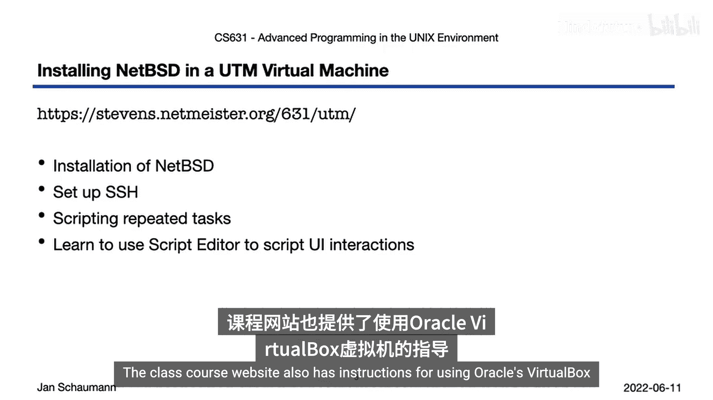

But if you try to install virtual box on recent Apple hardware。

 then you quickly find out that it only supports Intel chips。So if your system has an Apple M1 chip。

An arm base processor。 Well， then youre out of luck with virtual box。

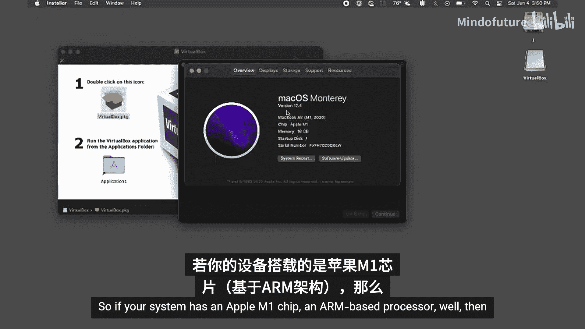

So instead， let's head on over to Mac dot get UTM dot app and download UTM。Once downloaded。

 the installation is trivial。Just drag the app icon into your application folder。there来造。

But now before we start UTM， let's go and grab our netPSSD installation image。

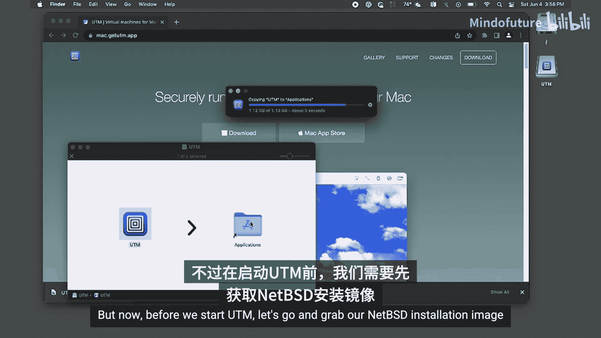

On the NeBSD's project website， we see that the latest release of NeBSD， as of June 2022， is NeBSD 9。

2。Unfortunately， that release does not work with UT M on the M1 chip。

 So we need to get the latest development version of Ne B SD， known as Ne B SD current。

 So head on over to w w w。t net B S D dot org slash releases slash current dot H T M L。

That BSD current is a daily development snapshot letting you try out all the code that's pushed into the code repository as it shows up here。

You can either build the entire array from these sources yourself。

Or you can download a prebuilt snapshot images from this URL here。

We'll click on through to the latest build and then search for images since we're looking for an installation image。

There。Here we can see the many different Iso images for all the different N BSD ports。

We are looking for the E VBRM AR 64 image， which we can then download to a desktop。

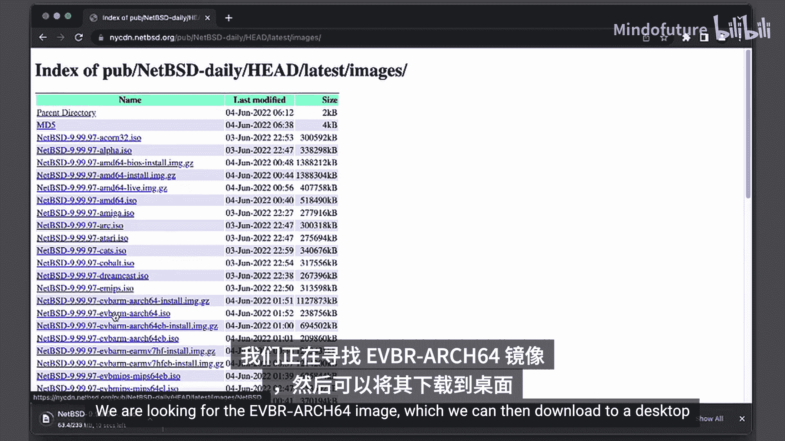

Okay， so here we are。 That's our that PD Io image over here。 So now let's start UTM。And select。

 create a new virtual machine。We're now given the option to choose if we want to emulate some different hardware or virtualize the current hardware。

We'll choose virtualize and then select other from the operating system screen。

Here we then load the ISO image。 We had previously downloaded， and then continue。

On the next few screens， we can basically accept the default options offered。

Although we really don't need that much storage。So let's change it to 16 gigs。

 although we could get away with even less。All right。Now we'll name R the M A P U E and save it。Okay。

 here we are now with our VM setup。But before we boot。

 let's quickly go into the VM preferences here where we can see information about the VM。

UTM is based on the open source Q M U。And here you can see all the different options passed to QMU。

You could even add additional options here， for example， to add a second network interface。

Talking about networking， let's take a look at that。

Will change this to a bridged interface to allow V M to get full networking capabilities。

And now we're ready to start and get our Ne Do installed。So， let's start up O theM。

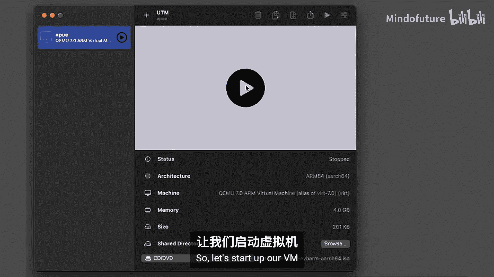

Here we now see the installed city booting up with a 30 second timer。

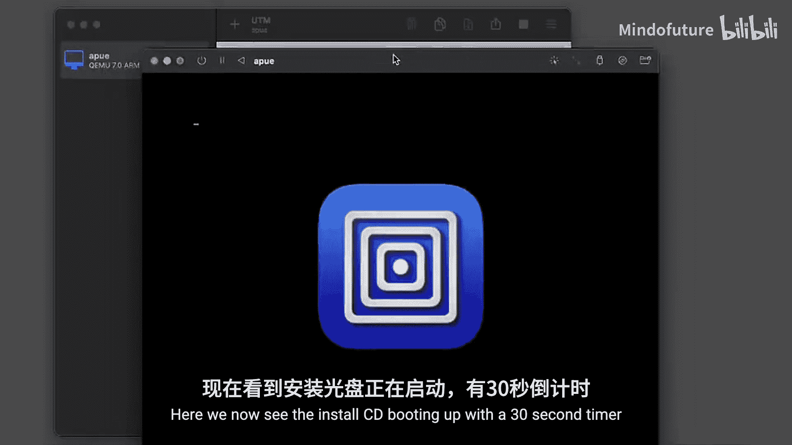

You can let that run down or simply hit return to boot up。After booting。

 this will drop you into the menu driven installer where we select install messages in English and then select the first option and install that BSD to hard disk。

Let's say yes， to continue。The installer checks for any disks， since there's only one。

 we select that one。 El friend， this case。We'll use the G UI partition table to partition the disc。

And then use the default netPSSD Partition scheme。Which gives us a small boot partition。

 a large road partition and some swap space。Now we're ready to write this information to disk and create a file system which is destructive。

 no joining back。 so the installer asks us to confirm。Okay。After the file system has been created。

 we now select our installation。We'll do a full installation。

 but we don't need the X 11 window systems。 So we pick option B。We get our packages from C D。

 and here we go。After the sets have been extracted， we can then perform a few configuration steps。

First。We set a rude password。After which we find ourselves in the configuration menu。

Let's start by configuring our network。 Select a and hit return。

We simply accept the defaults and let DHP do its thing。We name R V M， A P U E。

Leave the domainium empty， and then accept this configuration for a system。

Back on the configuration screen， we go down。And enable SSHD。Enable NPD and NTP date。And finally。

 add a normal user。Pick a username you like。And add them to the group wheel。

 so you can assign to root。Pick your shell， and a password。

And now we're done configuring our system and return back to the main install menu。Since we're done。

 we can now exit the installer and shut down the Vm completely。

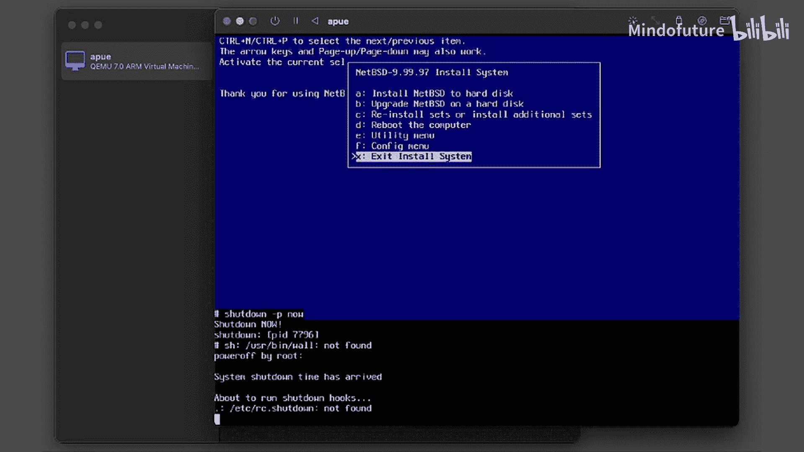

There。We're back now where we started with a fully installed V M。

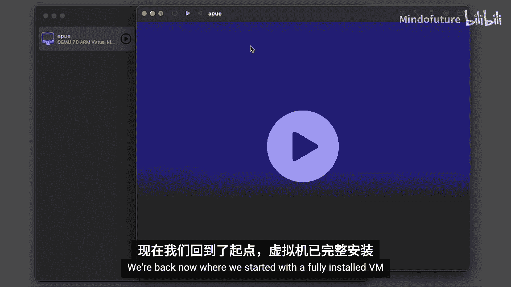

Now， down here at the bottom， we clear the C D drive to remove the install image。

 that the next time we boot up， we boot the actual V M。Now， if we boot up RVM。

 we'll see that we are booting from a normal virtual disk with a default netPSD bootloader being shown。

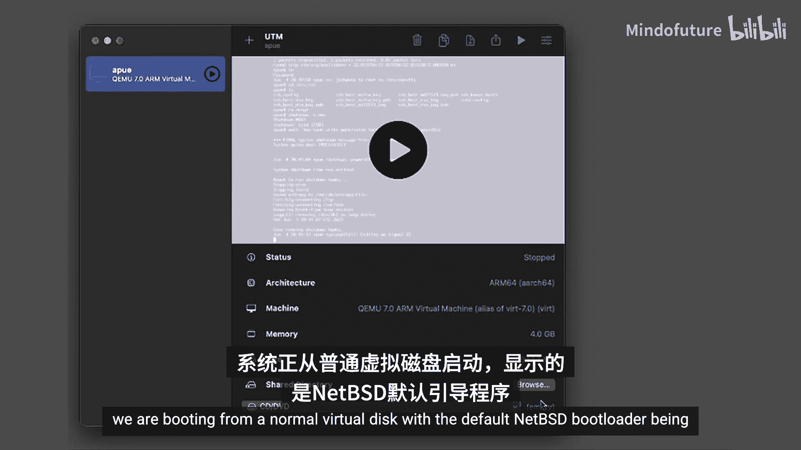

After the default，5 second time out， the colonel boots。Starts in it at the different services。

And be're ready to log in。Would use the user account be created？Heyvoa， we were hit。

Let's take a look at the network configuration and make sure we can talk to the Internet。

Looking good。To shut down RVM， we can become rude and run the shutdown command like so。

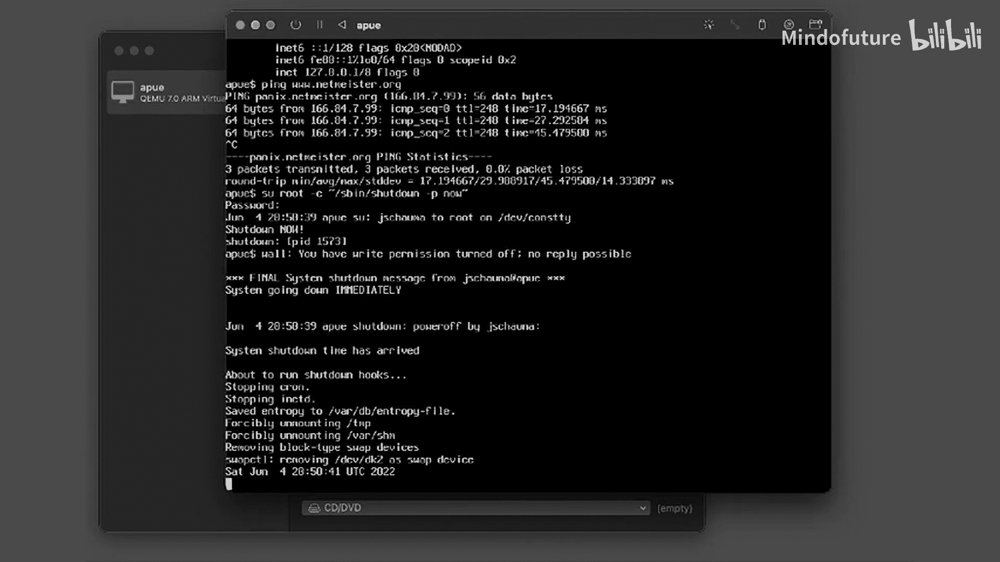

Okay， so we have our VM all set up。 But now let's see if we can make starting it a bit easier。

Whenever we want to run our VM， we right now have to start UTM， select the right VM， click start。

 etc。And that's a bit annoying。 We'd like to make that simpler and quicker。

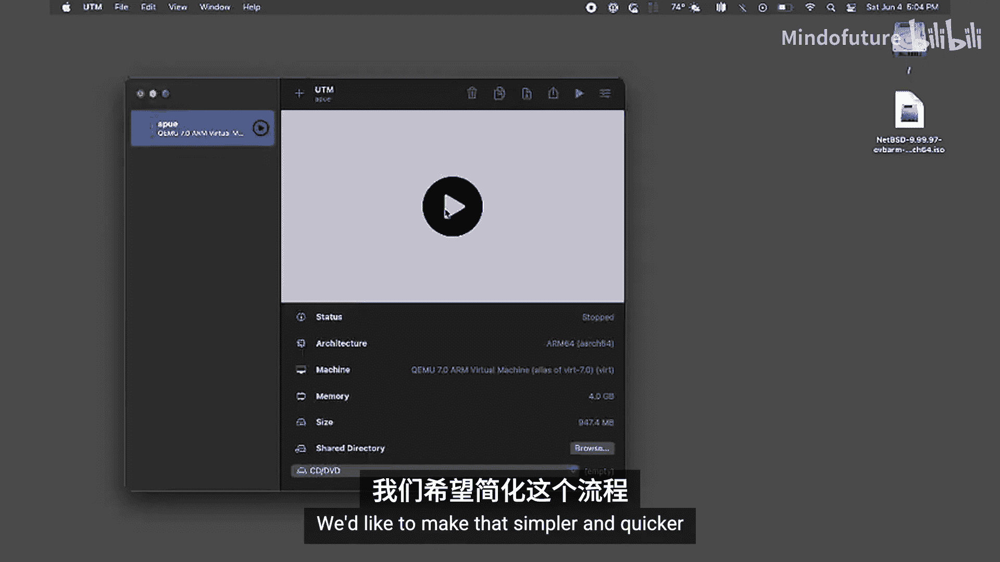

So let's pause here。Power off the V M。

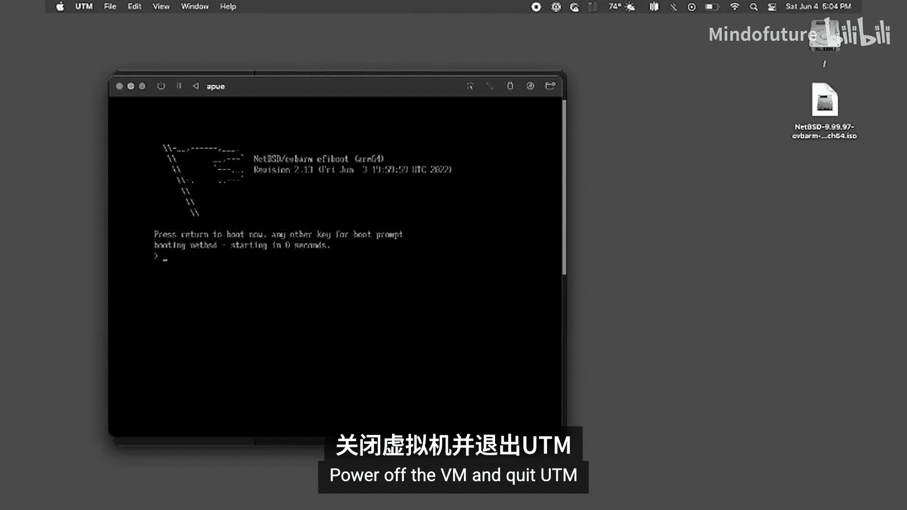

And quit U T M。As we do virtually all our work from the command line。

 we want to have a way to start the VM from the terminal as well。 So let's open the terminal。

And try out this command here。Open UTM slash slash start question mark name equals AP P U E。

The UTM app has registered the UTM URL team。 So calling open will now boot up our right VM。Neit。

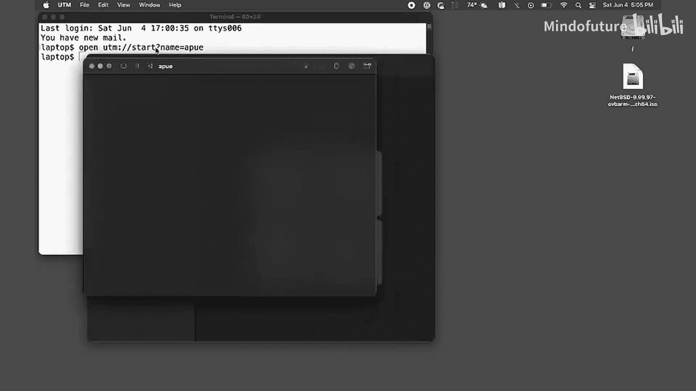

But this still leaves these two UTM winners up front。Well be accessing our VM over SS S H。

 So having these windows in front is annoying。

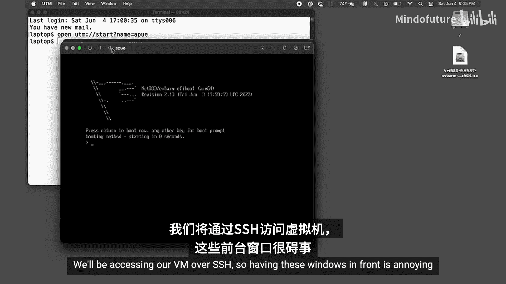

Let's halt again and see if we can find a way to get those windows out of the way。Now。

 in virtual box， there's a way to run a V M headlessly， but UTM does not appear to support that。

 So we have to get creative。We can't run RVM without UTM running。

 but we don't need it to be in the foreground。 Fortunately， at Mekos。

 you can script interactions with the U I using the script editor app。Let's open that up。

Create a new document and put in this little script here。The script is quite self explanatory。

After we compile it， it shows us that all it does is bring the UTM up to the front and then select the minimize option of the menu in the front。

We have two windows， so we wanted to do this twice。Let's give it a try。First。

 we need to start over the yet。And now， with the V M booting。We contest test our script。

Hit the play button。And bam， just make magic。 The UTM windows are minimized。 Cool。

So let's bring back these two windows。And save the script as UT M Min。

Now we can see how we can execute a script from the command line by running it by an OS A script。

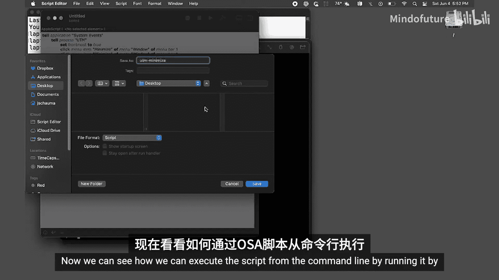

Hm。That didn't work out。 What happened。Here's the error。

 O A script does not have accessibility privileges， which will have to explicitly enable。For that。

Open system preferences。Go to security and privacy。Go to accessibility。Authenticate。

 so you can make changes。And now。Let's add the terminal application here。There。Now， let's try again。

Yep， that worked out nice。So now we can combine these two steps。

 opening UTM and starting the Vm together with minimum among the windows。Into a simple shell script。

Well， put a short sleep in between the commands to ensure that UTM has actually started before we try to minimize it。

Then we move the UTM minimize script into a reasonable location。

If this new script execute permissions。And now should be able to give it a go。

Let's shut down the running VM so we can try out our script。

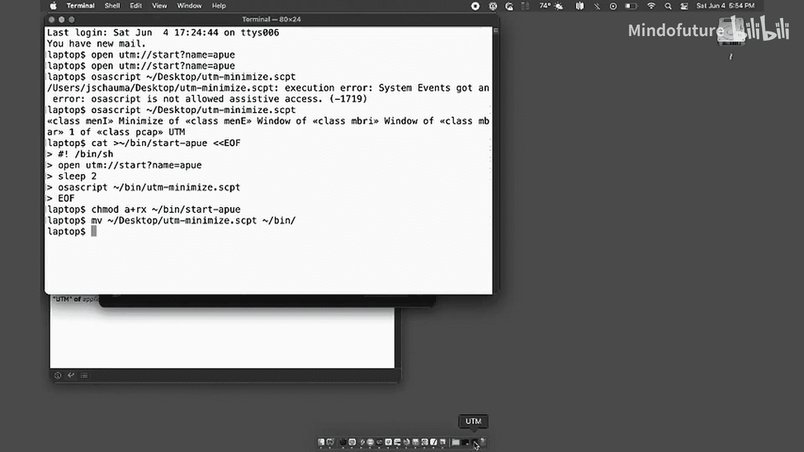

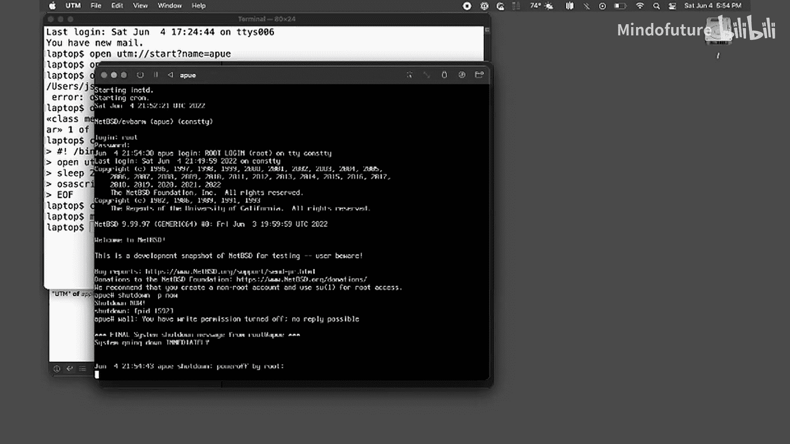

Okay， here we go。This is our script。And when we run it。UTM starts， or V M is booted。

 and the windows are minimized。There's a bit of verbose output here from the O S A script command。

 So let's suppress that by redirecting it to Devvnll。 and we're good。Okay。

 so now we've got a way to start the Vm easily。 Let's think about how we can shut it down equally easily。

For that， we want to be able to log in on the VM， shut it Don， then terminate UT M。But to SS H。

 well need to know the I P address and get SSH set up。

 so we don't have to type in our password all the time。 So let's do that next。

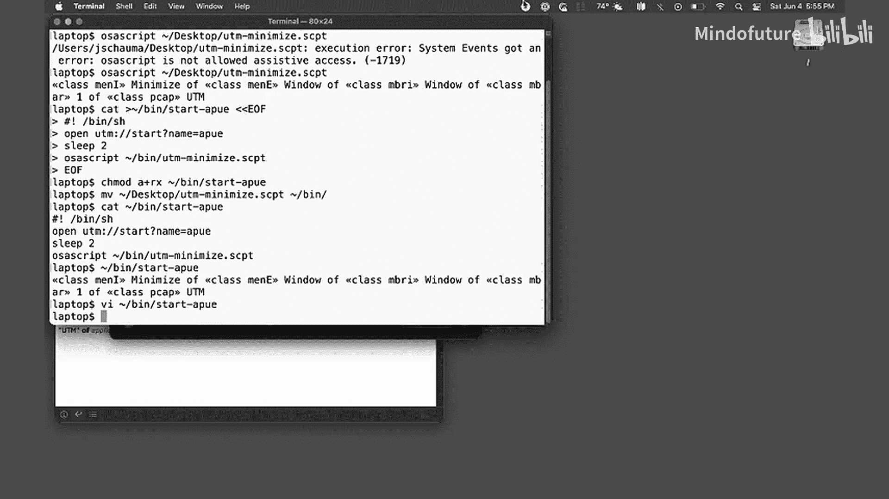

Remember， when we first logged into our VM， we re if config。

 which showed the I P address assigned to our VM。So， no。

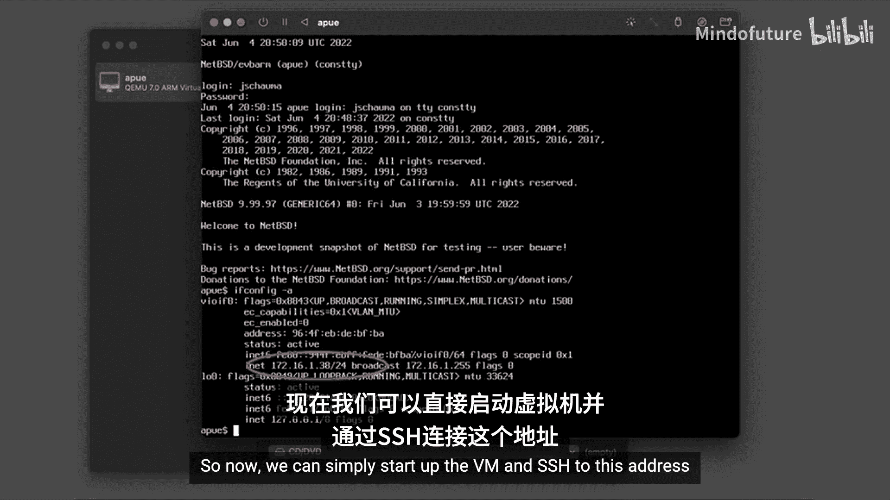

We can simply start up the V N and SS H to this address。1，72，16，1，38， in my case here。

This is the first time we're connecting to the VM。 So， of course。

 we get an necessary stage fingerprint， unknown warning。Now。

 unlike 100% of all users on the Internet， we actually care about authenticity。

 and we are going to check that this fingerprint is actually correct before we send overall password。

But how do we do that。Well， since we do have a serial console on the end。

 we can actually bring it up here。

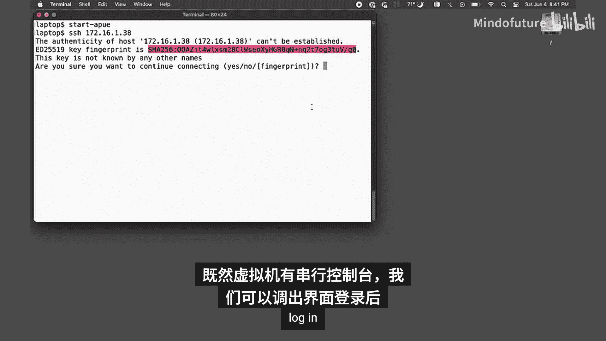

login。

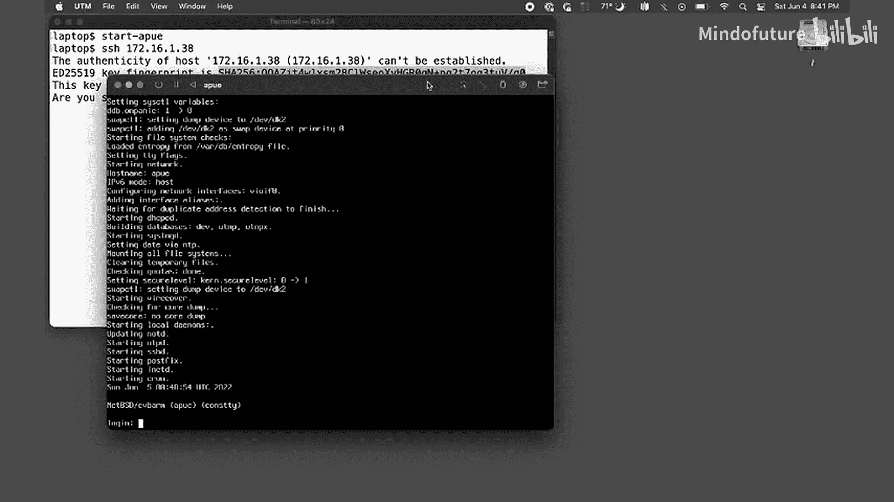

And then， run。Is this H Kejan， dech Deth。On the host key。And compare the two fingerprints。So。

 that looks good。So， we can connect。Enter our password。And there we are。

But we want to be able to SSH without entering our password。 So let's set up an SSH key。First。

 create the dot SSH directory。Then on our parent system， generate a new SSH key pair。

Well call it A P U E。And then copy the public key to the VM。As authorized keys。Next。

 we create a simple entry in order SSH slash config file。We add the right address。

And the path to the SS H key， we just generated。So that now。We can simply type SS， S H。

 A U E and log into all the app。There we go。Now， finally。

 the last part of the puzzle is to automate the VM termination。First。

 let's make it easy on ourselves and remove the password for the root account。

I know this sounds like a terrible idea， but in this case， this is actually okay。 You'll see why。

 in a second。Remember that R V M。Is only reachable via the virtual console from our laptop here。

 for which you'd need to control the U I over S S H。 empty passwords are not allowed， as shown here。

This directive is comment allowed， but the default value is no。Now。

 normally we change a password using the password utility。

But setting it to the empty password is not actually permitted here。

 So well edit the password database directly。Don't worry。

 We'll talk quite a bit more about that file in week 4。 But for now。

 just know that we can remove the password hash field and Esy password for route。

 and then no longer need to provide a password when we ask you。In order to run as you。

 user needs to be in the wheel group， which we added our user tube during the VM installation earlier。

But no other users are in that group， so only our account is able to become rude。Okay。

 let's log out and verify that we can't S H as route with no password。There。

Were prompted for a passport。 And if we simply had entered， we are still blocked， good。

So now we can create our script to terminate our VM。We'll call it stop A P U E。And in it， will first。

 SS H2 R V M。To run shut down as rude。Then we'll give it a few seconds to completely the power off。

After that， we simply kill the UTM processes。Give the script execute permissions。And。Run it。There。

 you can see that RV M is being shut down。And UTM is terminated。We're done。

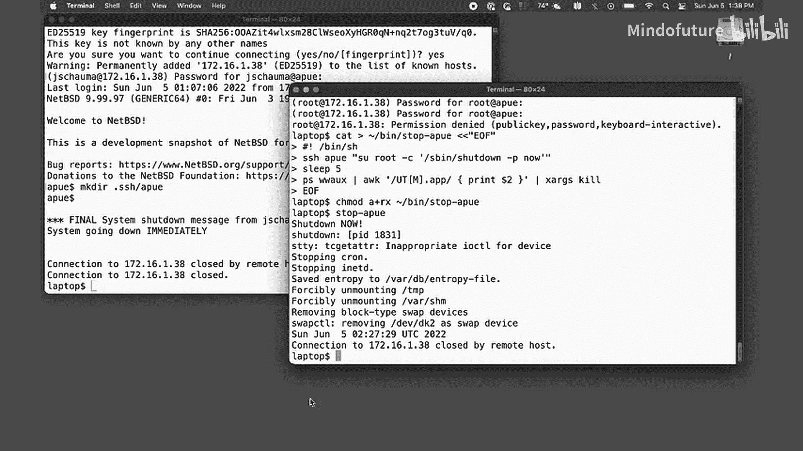

Okay， let's recap what we've done here。The installation of NePSSD into UTM was pretty straightforward。

First， we downloaded UTM， then we downloaded the netPSD current image of NePSD EVB arm AR 64。

And simply followed the default installation process。 really no magic here at all。After that。

 we scripted our VM startup a minimization using the script editor application。

Set up SS H and create a trivial script to terminate or VM。 And that's really all。

If you have trouble following the video， you can find step by step instructions for everything covered here on our Q website as well。

Anyway， hope you find it useful and make sure to let me know if you have any questions。

 See you next time， yes。

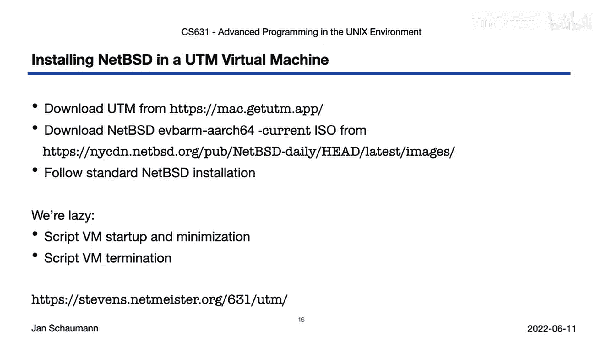