# UNIX高级编程-p05-P05-Tool-Tip---ctags(1)--BV1hPuVz8EWS_p5-

Hello and welcome to CS631 Advance programming in the UniX Environment。

In the video segments for lectures， we often run through a lot of code examples。

 and I figured it might be of use to explain a few of the tools we use as well as some shortcuts we can take advantage of to allow us to more efficiently use the UniX programming environment。

For this reason， I'm starting a new series of short tool tip segments。

 of which this video is the first。In this toolt， we briefly introduced the CTX utility and how we can use it to more efficiently browser our code base。

Let's take a look。

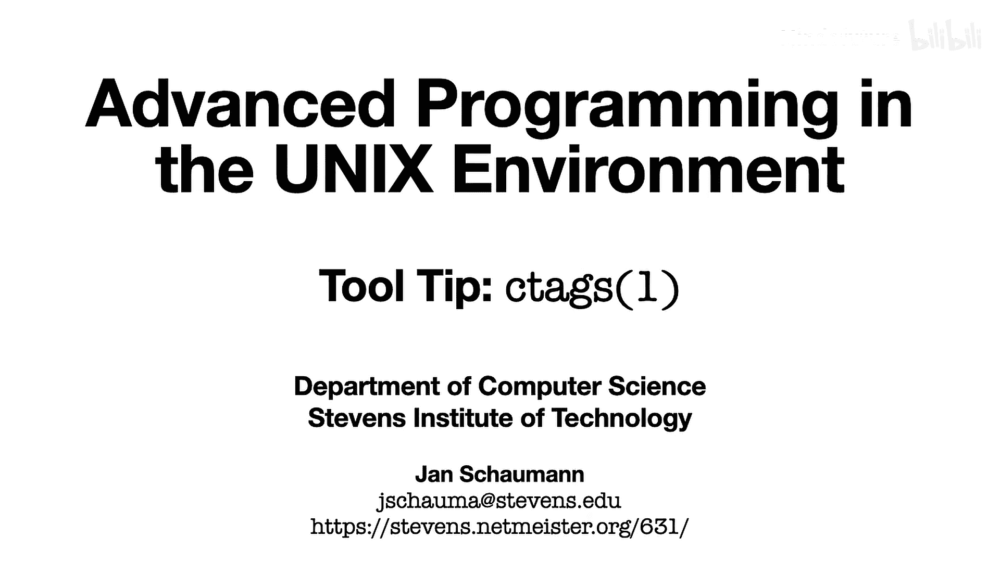

Simple shots from lecture 1。Here we had two helper functions， get input and stick in。

Since they are very small， they can all the coat in a single source fire。

If we find ourselves down here in Maine。Looking at the while loop。And wonder what get input does。

 we can easily scroll back up and see the function implementation。What's more。

 we've made a habit of writing our functions such that the return type is on one line and the function name always at the beginning of the line。

This allows us to easily find the function definition from anywhere in our code。

 even if the function is called multiple times。You simply search for an anchored string， such as。

Get input。And here we go。Returning back to where we just were requires a bit of scrolling down again。

So far， so good。But most of the time， we will have significantly more complex co。

 and we want to make it a habit to split coal functionality into separate files。So in this case。

 we might want to break out。They get input function into a separate file and put all the code relating to signal handling into a third file。

This makes for a cleaner code layout， it increases readability。Let's see what that might look like。

See here we have multiple a more typical source tree。

 we have multiple dot C files and a few header files and a make file。

To allow us to compile the program by simply typing， make。Let's look at the code。

Note that we have only one function here。Main， this function looks exactly the same as before。

 but all other helper functions are split out into separate files。The helper function prototypes。

Are defined the head of files we include over here。Remember。

 includess using quotes are resolved within the current working directory， so include get input。 age。

 will insert the content font in that file at the compilers preprocessor stage。GetD input。

 H looks like so。Like any other sea header fire， it protects itself against multiple inclusion via an if death。

Then provide the forward declaration of the function provided by the separate source fire。

Get input do C looks like this。Simber， right。The same goes for S H and S do C。To compile our code。

 we just want make。that will compile the object files and link them into the executable symbol shell。

If you are not familiar with makeg， we'll discuss it in more detail in a future class。

 but please do make sure to read up on it as I expect to make for to accompany all code submissions in this class。

Okay， so a simple shell works just like before， no surprise。

But now when we're going through our code。In simple She C， we want to see what get input does。

 Let me have a problem。We have to actually know which file it is implemented in， close this file。

Open the other file。And then return turned back to where we came from。Now， this is a bit tedious。

Especially when you consider that you will have dozens or hundreds of source files that you wish to browse。

Rning grab to look for the file that includes the function implementation is not going to be a very efficient method。

But fortunately， our UniX environment provides a number of tools that allow us to be more efficient。

Enter a C tags。CTX is a tool to index your code base and create a mapping of where functions are definediant。

With the help of the resulting tags file， your editor can then easily let you automatically find and jump to the implementation and back。

Let's run it。So now we have a new fight in this directory called tags， let's take a look。

Simple enough。Here we see three columns tag tag。A file name。And the regular expression。

This is in this， in this file， we have the mapping that tells the editor that for any given tag。

 they can open the specified file and search for the given redex to find the definition。

Now most UniX editors have support for texts built in。The eye， for example。

 by default understands the presence of the tax file in the current working directory and can use it。

So now if we are now code here in Maine and we want to jump to the implementation of get input。

 we can put theor cursor on the word in question and press control closing bracket。Bam。

 just like that， we find ourselves in the file， get input。 see。

At the beginning of the function implementation。To return back to where we came from， press C T。

Me brother， we're back。你睇。You can also jump to any specific tag without being right on the word in question。

Suppose we are on line 46 over here。And theyre wondering， wait， what does Sin do again？

Then we can type。T A second。And were abroad to the function definition。In the file in question。Again。

 Control T brings us back to where we came from just like before。Okay。

 so this is really helpful when you're browsing your local code and you want to jump between function implementations。

But wouldn't it be really cool if we could do the same thing for our standard library functions。

 macro definitionfins， etc ce like。Suppose we want to see how F print is implemented。

Putting a cursor on F printf and hitting control close bracket gives us a narrow tag not font。

But remember， in our week1 segment one session， we fetched and extracted all the source code for the OS。

 including the C libraries and extracted them under a user source。Look。

 all this thingopla implementation is here。For example。

 F print F is in lip Liy standard that Iio F printf。 C。Here it is。

So what we can do is create a global tags file that indexes our entire source tree as well as our standard includes and add that to our editor's list of tag files to look things up then let's do that。

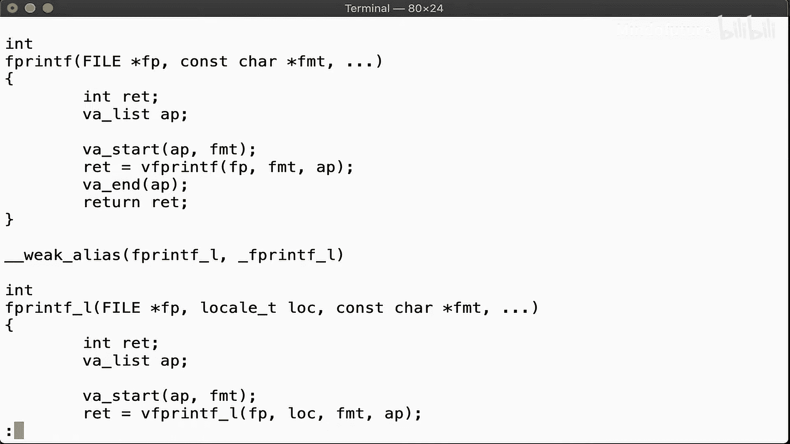

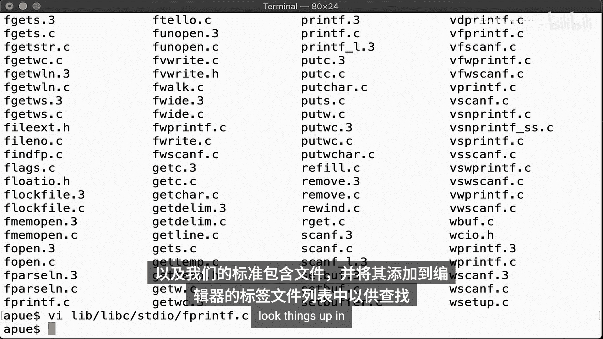

For this， though， we use a different version of CtX called exuberant CtX。

 This version is a number of features and added compared to the system provided CTtX program。

We quickly installed it via packaging。One of the things that this version of CTTch supports is ignoring certain patterns such as macrodes that might otherwise trip up the regular expressions used in finding the tags。

So let's recurse through our header files and library sourcetry and build a new CTtX file in our home directory。

We recur， and we are ignoring certain patterns that would otherwise avoid in finding the right definition。

The indexing user include。And user source slip。Okay。

 so now we've created a new file in our home directory。

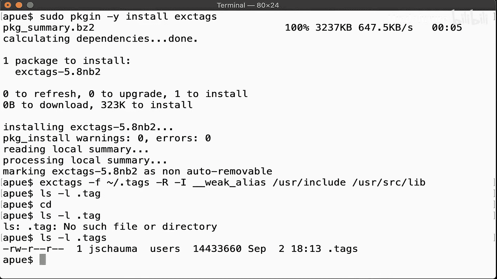

Let's take a look again。I think so。

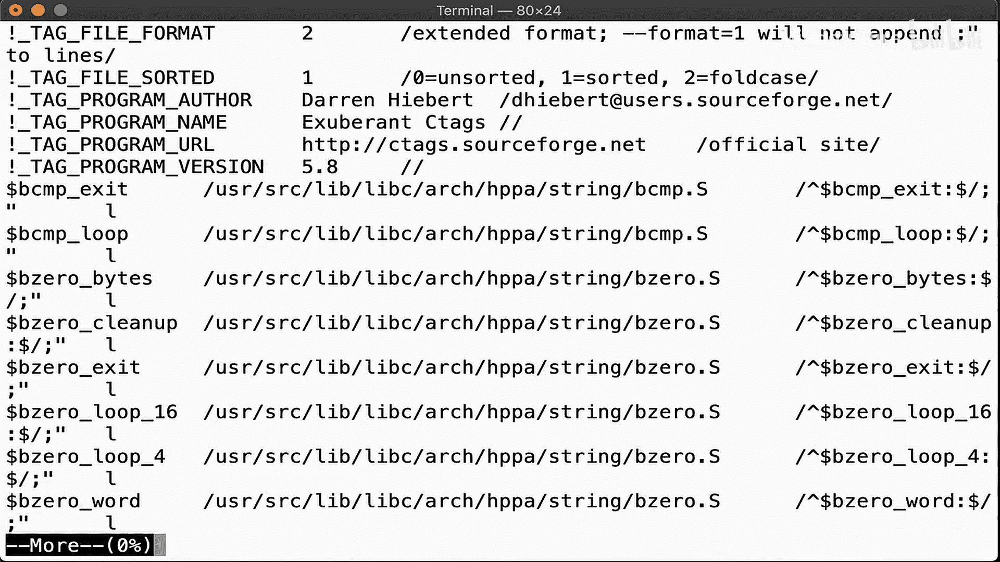

And here we have all the different shortcuts indexed， including all the definitions sorted。

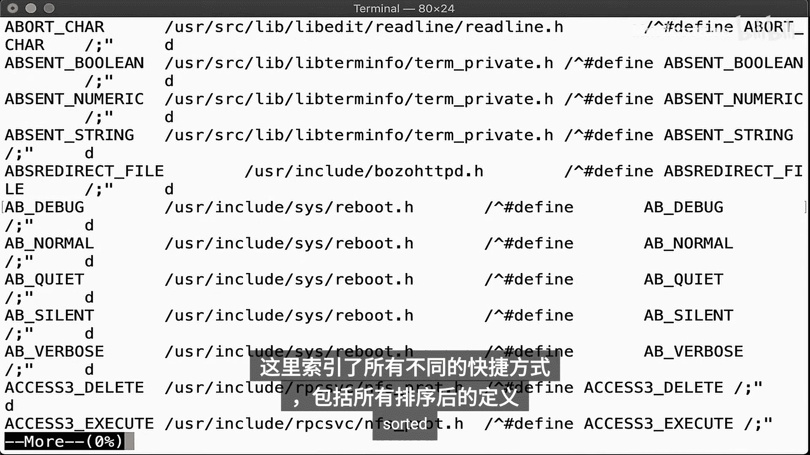

Looks like there's a lot of stuff in here。So now let's have our editor。

 which by default only looks for file named tags in the current directory to also use this file。

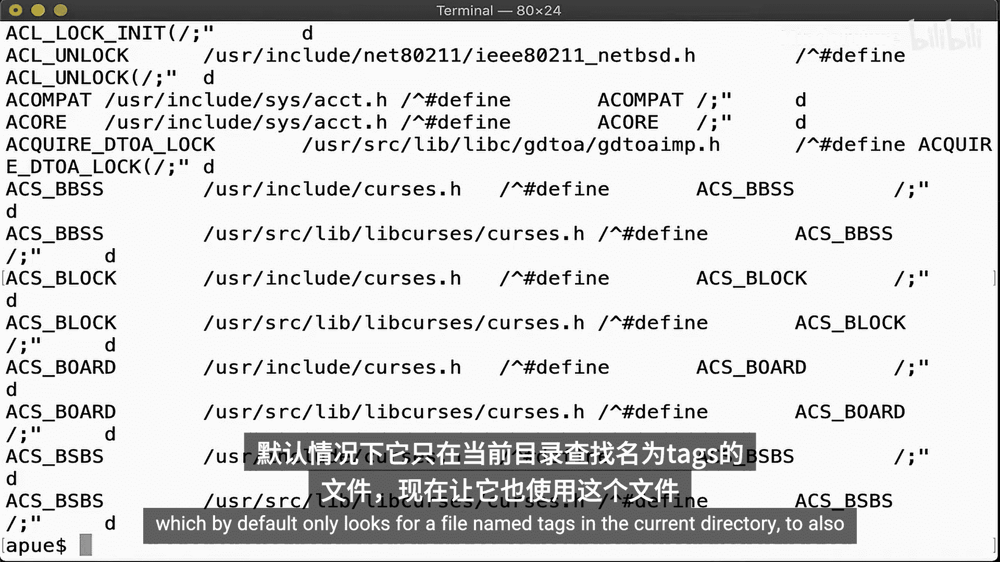

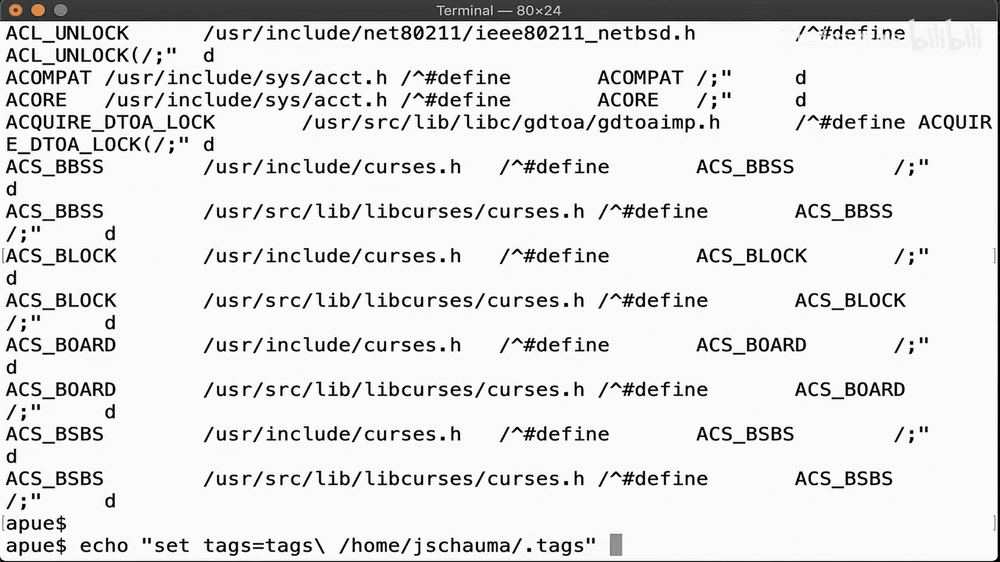

Remember， vanilla VI uses the same con field as x， they're basically the same program。

If you're using them， then you can use this command。

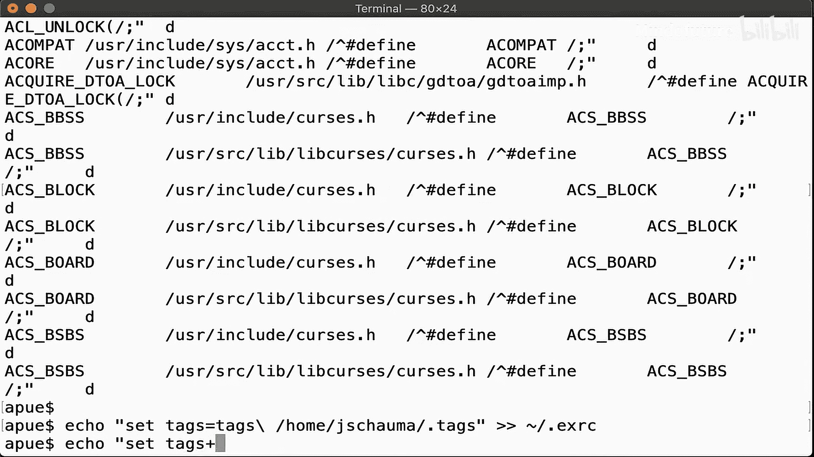

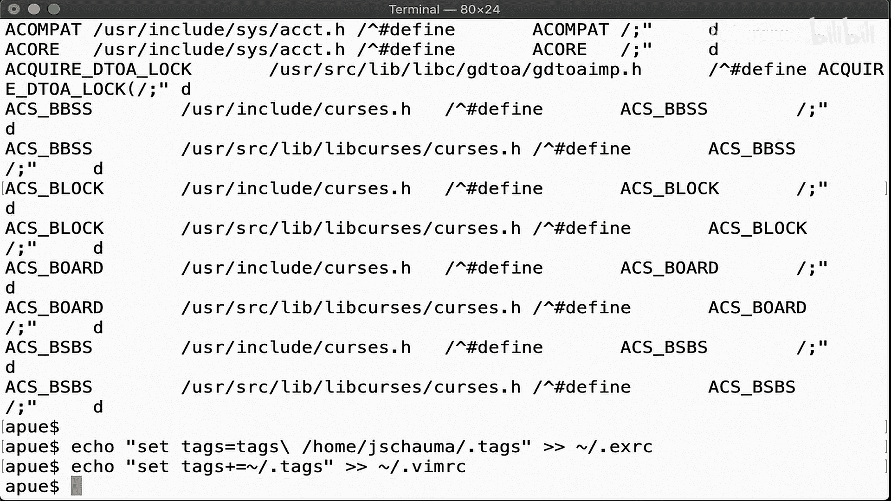

Okay， so let's give this a try。Let's first verify that on tag file from the Kbroken directory still works。

Here we go。Hit control close bracket， there we go， still jumps into the file。 that works。

Let's go back and that's fine。Now let's take a look if we can jump into FP。Hey， that works， too。

 That's pretty neat。 Look at this。 We're jumping right into the fire on the user source for Liy staio。

 as we wanted。And return we're back here。Now note that this works not just for functions。

 but also for macro declarationlars。Look further up where we declared our buffer。

We initialized it to be of size， passes。But we never defined that value， and it is。

 it must be a system provided number。Let's put our cursor on this number or this string rather。

 and then hit control closed bracket and see what happens。

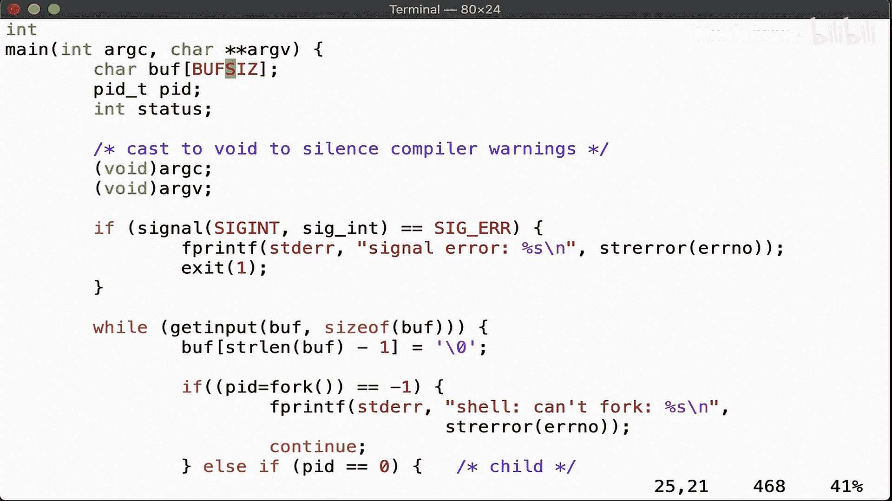

Here we go。As defined， instead I owe at age to be 1024。And again， we return with Cl T。

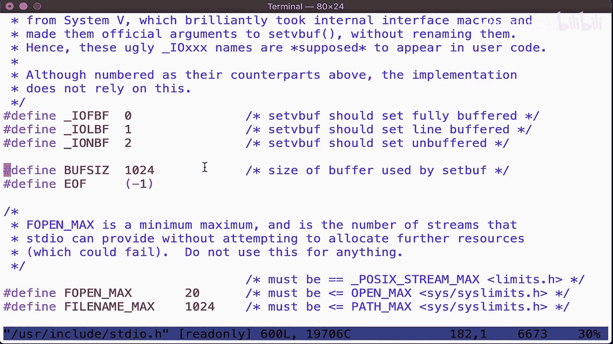

Note also that we can jump from anywhere to anywhere。 That is， if we say， in the definition of S end。

And we want to know how a flush works。We can jump into that。And in there。

 if we want to know what the value of eB F is for Erno。We can jump in there。

So we can jump around with building a stack if you want to return to where you came from， again。

 hitting Cr T brings you back one level and all the way as you continue to hit put the button。

I took it all the way back at the bottom of the taxt。Oh， and before we close out。

 just one more thing。Just like you can jump to the implementation or definition using tags。

 you can also jump directly to the manual page of a given function by pressing。Shift k。

So for example， let's look at STR error。Hit shift K。And up comes the manual page for SDR era and PR。

 as they are combined。When you're done reading a manual page， it brings you right back to your code。

This also works while you're typing， by the way。So suppose you wanted to use the function puts。

 but you don't remember what the prototype is or how it works。 You just start typing， hit shift K。

 and it pulls up the manual page for this as well。Okay， we don't need this over here。

 but this is still a really useful feature。

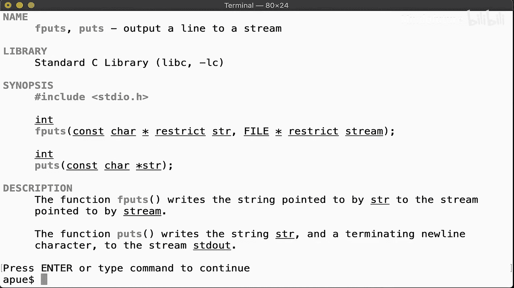

NowOkay， this was our first tool tip using CTtX to efficiently maneuver around your source tree。

You can find many tutorials on this topic by searching the internet for the term CtX。

Go ahead and make sure to set up your editor and environment to take advantage of this neat tool。

I hope this little video was useful to you and thanks for watching， cheers。

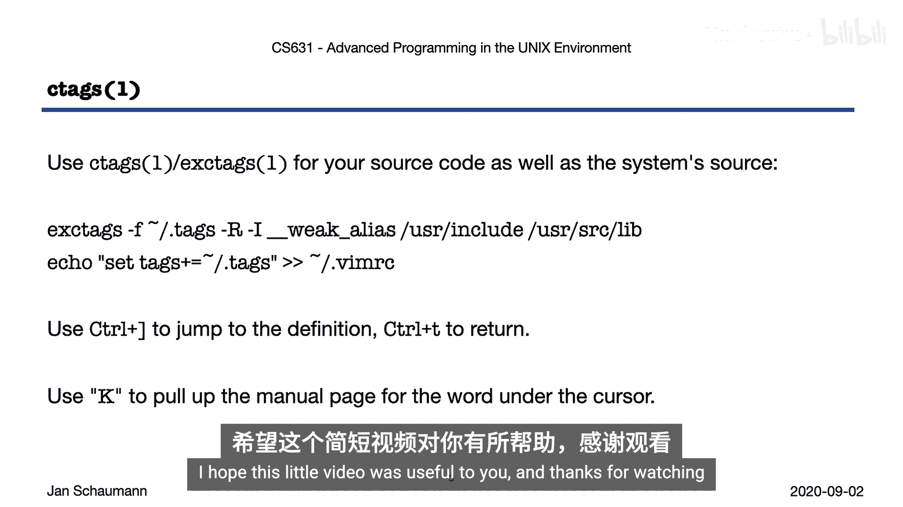