# UNIX高级编程-p06-P06-Week-02,-Segment-1---File-Descriptors--BV1hPuVz8EWS_p6-

Hello and welcome back to CS631 Advanced programminging in the UniX Environ。

This is the first segment of our week two content， where we will be covering most things file I O and file sharing。

The material for this week is split into several video segments to hopefully make it easier for you to consume the content and work alongside it。

In this segment， we'll actually run through a quick code example illustrating the resource limitations around the file descriptors。

The second segment will cover the open and close calls。Then we'll go on to read， write。

 and El seek and move on from there。Sound good。Let's get started。In our segment on UniX basics。

 we already briefly summarized the concept of filelessscriptors and we saw the use of the standard filescriptors in a few code examples。

 such as when we implemented the CA command。To summarize， in Uni。

 almost all IO is done on file scriptures， also known as file handles。

These fileyscriptors are implemented as small， non negative integers。

 which is the reason why almost all ciscals having to do with Io take an int as an argument。

This approach allows for a neat abstraction by using a file descriptor。

 the ciscal question does not need to know whether it actually represents an actual file。

 a pipe or a socket， for example。Once you have a file descriptor， you can operate on it。

 pass it into functions， and even on your children for interprocess communication。

You can implement an API that works for file IO， just as it works for network IO by operating on fileless scriptures。

As we discussed， we know that standard in standard out and standard R are nearly universally declared as 01 and 2 respectively。

 but as we also discussed already， we do not use magic numbers in our code and instead use a symbolic definitions for them。

Our terminal is set up our shell as these three fighterscriptors already opened and connected as illustrated here。

Send it in and send that Er both connected to the terminal by default。

 So there doesn't seem to be much of a difference between the two。

 But the elegance of this simple setup becomes apparent when we consider the common use case of piping output from one command into the other。

In that case， each program has its send connected to the terminal。

 but standard out and sended in are connected via other pipe。

 allowing the flow of bys from one to the other， where each program retains the capability of generating error messages to the terminal。

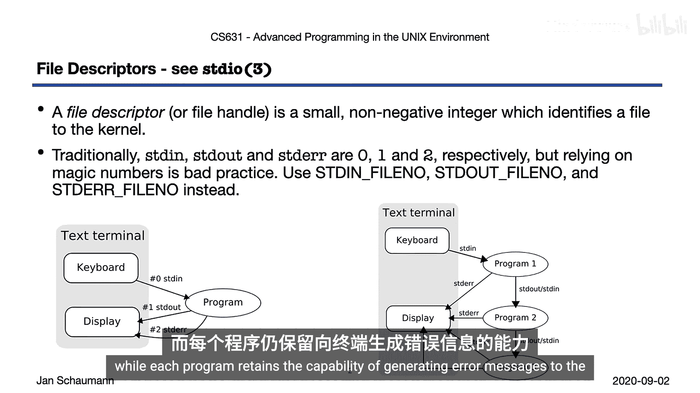

Okay， so file descriptors are awesome， but they are necessarily a finite resource if the kernel has to keep track of which integer represents which file。

 then it cannot allow a program to open an infinite number of files。

Unix systems generally have to be careful about what resources they allow to be used as a multi processing multi user system。

 they always exist the threat of resource starvation of one process or the entire system by another。

So what is the maximum number of file descriptors a process is allowed to handle or asked another way。

 how many files is a process allowed to open？To find out。

 we do what we will do a whole lot in this class， we write a program。

Whenever we want to find out how something works， and we want to verify that our understanding of a concept is correct。

 we try to put it in code and see what happens。For this question。

 how many files can the process have， we will use the program Openmax。c。

The program attempts to identify the maximum number of file descriptptors per process in the number of ways。

Let's look at Maine。First， we are checking whether the OpenM constant has been conveniently defined for us。

This happens via a preprocessor definition in a system header。

And we can include code in our program conditional and the presence of this constant。Next。

 we are looking at the get count of invocation。Looking at the manual page using an iffty trick for our tooltip。

 we note that getCon references ciscon， which we'll see in a second。As we continue in our program。

We ask suscan ourselves。For the value of the underscore SC OpenMax variable。Through the manual page。

 Ciiscon gets us a configurable system variable。S C Open Max sounds just like what we need。

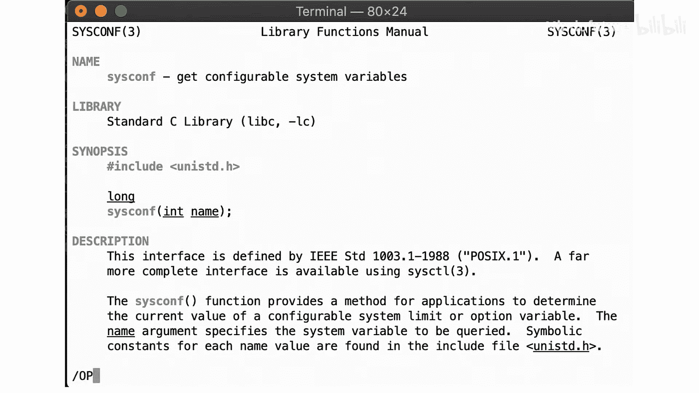

Now， like all good Uni functions， the return value is meaningful。We get back negative one on error。

 with Erna said appropriately， but we also need a way to identify when we can't find the variable we were asked to look up。

 but we can't return 0， since that might be a valid value。So we return negative1 again。

 but leave Erno unmodified。This is why we explicitly need to set earn to zero here。Otherwise。

 it's possible that a function call prior to us calling Suskf sets Ernno to a non0 value。

 and we wouldn't be able to tell the value was not found。

Note also the comment up here about the function call get detail size。

 It provides the value we are looking for。But as the manual page notes。

 it's functionally equivalent with a call to ci confirm source and which we wanted to illustrate here。

We can verify that this is actually not only function equivalent。

 but the exact same thing as calling Cisconf by looking at the implementation in the source file。

After having retrieved the value for ST Open Max， we are next looking at get R limit。

For the Parliament no file resource。Which not surprisingly again。

 gets us value representing the next number of open files。

The resource limitations inspected by Genner limit are per process。

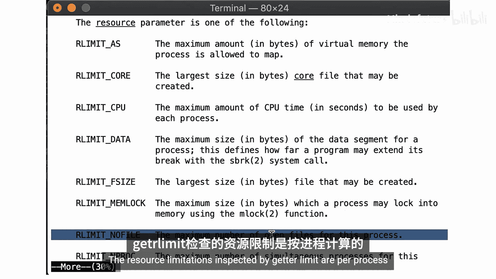

Meaning any attempt to change them can only be done within the same process。

We'll get back to this idea and the concept of shell builts in a future lecture。

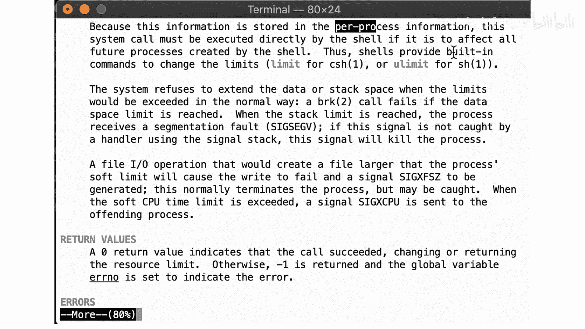

Okay， so by this point， we have a few numbers， but which number applies。For that。

 we wrote a function called Open files。Open files first attempts to identify which file descriptors are currently open。

Unfortunately， there is no convenient call to get that set。

 And since the closed file descriptor does not lead to a renumbing of the other open file descriptors。

 there'd be quite some chaos if it did。 We need to actually iterate over the full set and test each one。

We're assuming we don't have more than none file descriptors。

 So we check all of them via the Ft system called。Priinnt which one is open and can those that are。

Next， we are starting opening files in a loop。Only exiting the loop if we are running into the limit。

Which is relayed to us by open setting Ernal to EM file。After all that。

We are done with our OpenMX program。And return。Let's compile and run this program。Okay。

 let's see what it says。First。We find that Openm is defined to be 128。

But then Gtconf OpenMax claims that it's 1024。That seems odd。

 since one would expect those two to be the same number。 Let's check manually。Okay。

128 is what the header says。1024 is what getcombs says。Let's look at getcons。

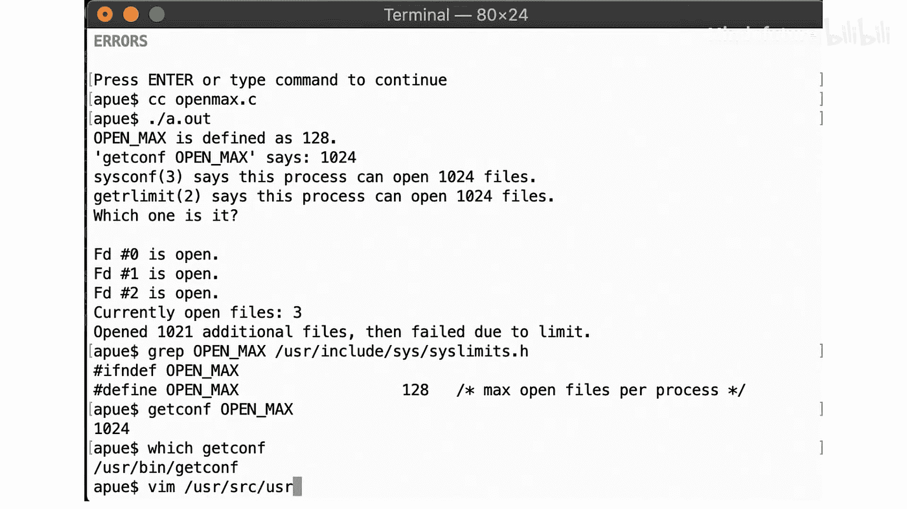

Here in user source， user bin get getcomv。c， we see that the value for OpenMax。

Shall use Csconf with the value of ST Open Max。

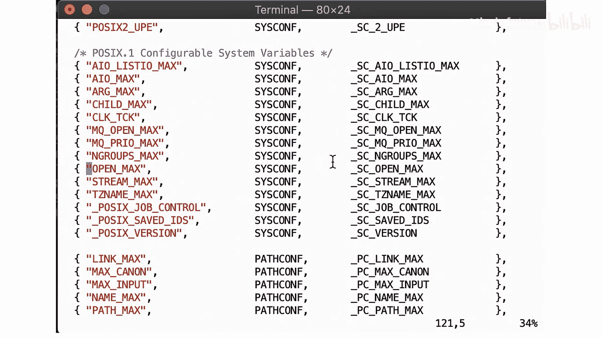

In Maine。Willll follow the call to Printvoar。Where we see that for variables。Of type this con。

It will make the Ciscon library function call。So getcon OpenMax is indeed the exact same as Ciscon as the OpenMax again。

 which we know to be 1024， just like what KedR limit says。But all right。

Let's see which number is right。We find that F D 0，1 and 2， that is standard in。

 standard out and standard her are open as we would expect。They are connected to a terminal。

 as usual。We were then able to open an additional 1021 files。

 meaning it looks like the 1024 number was accurate。

Let's inspect what the current limit in our shell is via the U limit built in。1024 again。

 No surprise。What happens when we change this number by lowering the limit to say 64？

Our program continues to insist that Open Max 128。But all the other methods， get Ciscon， getar limit。

 appear to agree that 64， which be experimentally can confirm。

This illustrates that the maximum number of open files per process is configurable at runtime。

 meaning it can change from one moment to the next。

 which is why the Swisscon function allows you to retrieve it equally at runtime instead of looking up a fixed constant from the header file。

Now let's see what this number is， whether or not this number is the same across different versions of UniX。

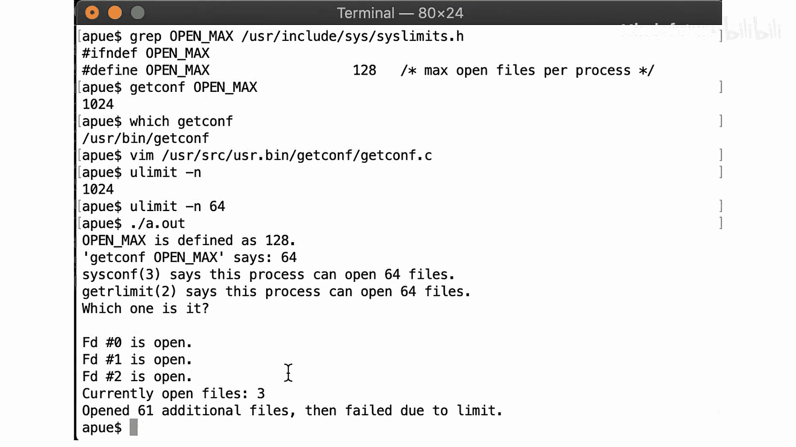

First， we can try to run this command on MacOS， which we recall from our earlier lecture is derived from Darwin。

 which itself is BSD derived system。

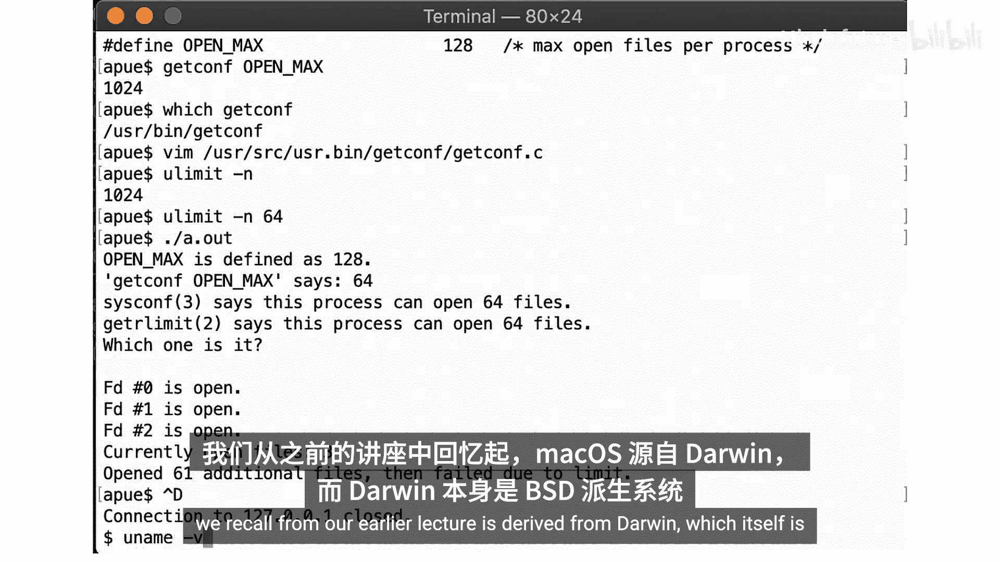

Now when we run our program Open Max program over here。Let's compile it。Whoops， wrong directory。Okay。

 compile it and run it。So now when we run our OpenMax program here。

 we find that Openmax is defined to be 10。240，10 times the number system returned to the net BSD。

But get K and France all agree and 2560。This illustrates the different operating systems。

May use different fixed constants。Let's compare to a Linux system。

Here we access an Uuntu 1604 assist。The output from our OpenMax program here。

Shows us that on some platforms， OpenMax may not be defined at all。

But the runtime configuration value here is again defined to be 1024， just like Con onnet PD system。

Okay， so let's go back to our reference VM one more time。

And let's look at the Get the table size manual page。

The history section of the menu page includes this information。Historically。

 each process had a fixed size descriptor table and yet the table size would return that fixed value。

But since the table is dynamic nowadays。This doesn't make much sense。

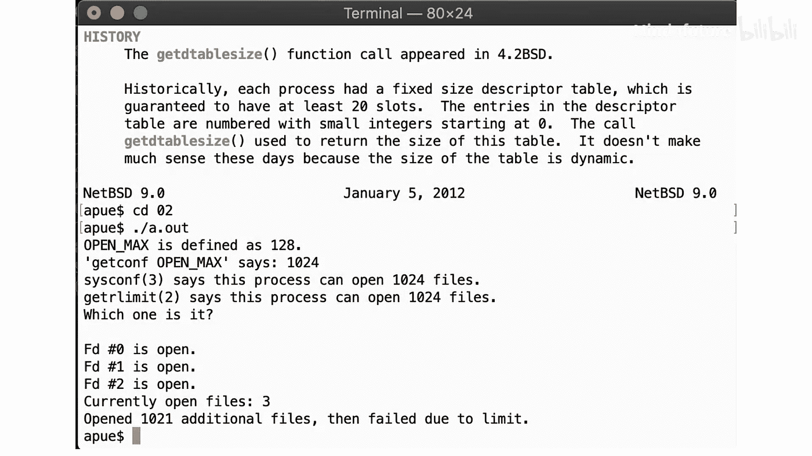

All right。After having spent a perhaps surprising amount of time on the simple question。

 how many file descriptors can a process have opened， We finally know that the answer is， it depends。

Specifically， we found out that OpenMax may not be defined on the platform you're on。

OpenMax may be defined， but may not reflect reality。In fact。

 Openms may not be useful at all to answer these questions。

 even though it really sounded like it would be。We also noticed that Cisk Van Gaar limit may return different values in subsequent invocations。

 even within the same process。Most importantly， though。

 I hope that we showed that writing and reading some code to figure out what's going on is a useful way to get a better understanding of a topic。

So whenever you wonder， wait to what would happen if we watch the editor and write some code。

Testing your code on multiple platforms is then a great way to confirm that your understanding is correct。

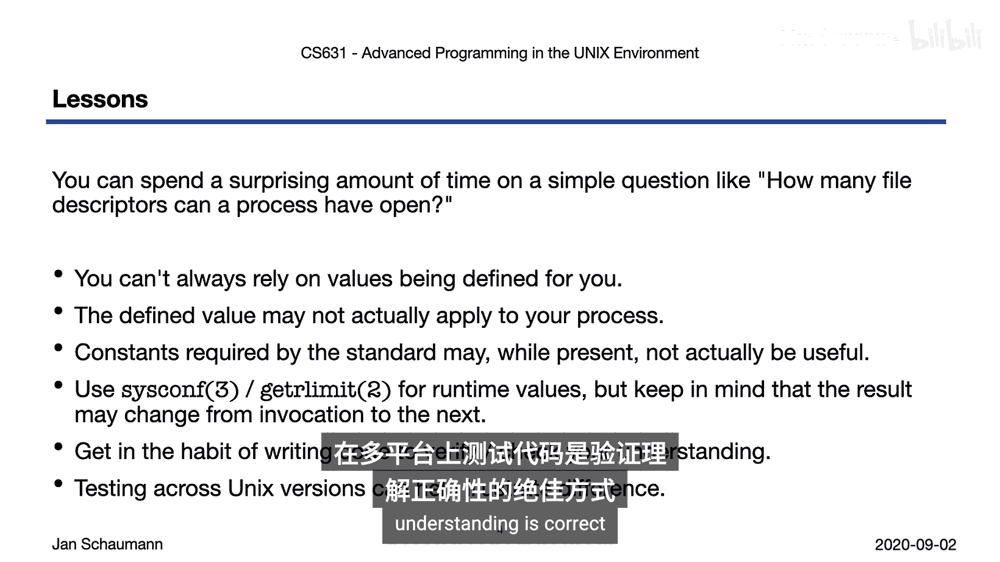

AYou thought you were done with this question now， didn't you？Think again。

There's always more to research， another layer to investing in。

Here are some questions for you to research after you've completed this example on your own。

If as rude， you set the limit to unlimited。What number will that be。We know it can't be infinite。

 or can it。There is a value called underscore Pos Open Max， what does that have to do with anything？

And we have another exercise for you to prep before the next video segment。In that segment。

 we move on to take a closer look at open and close。Thanks for watching， cheer。

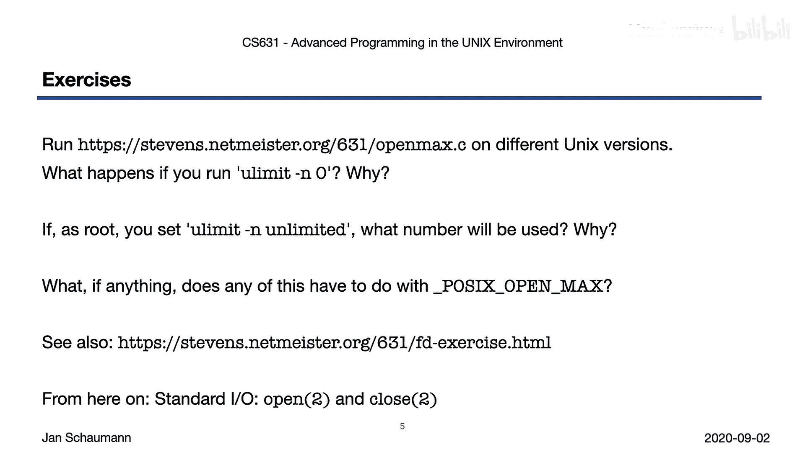