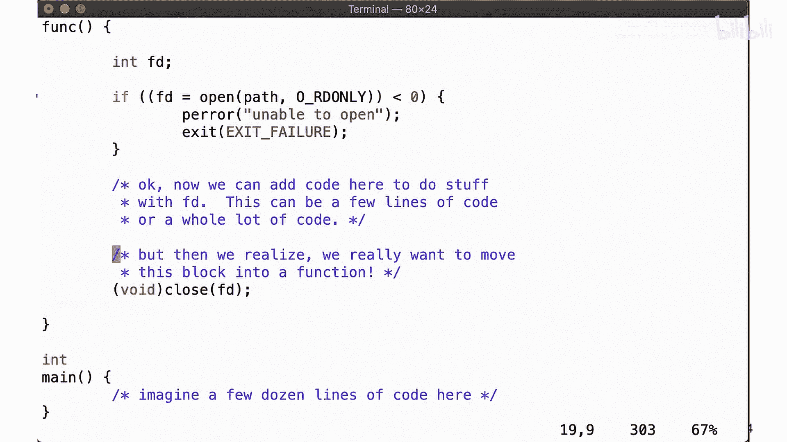
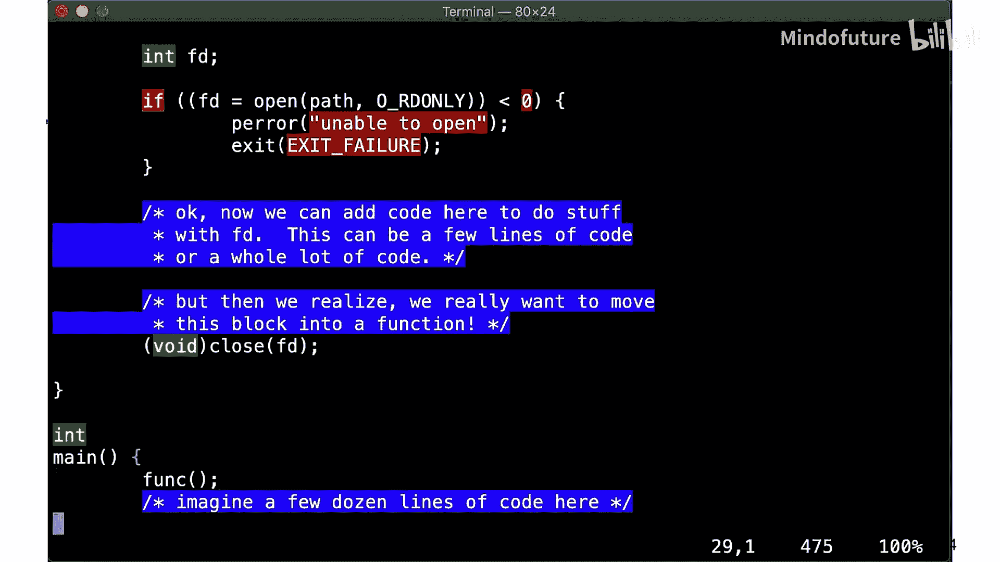
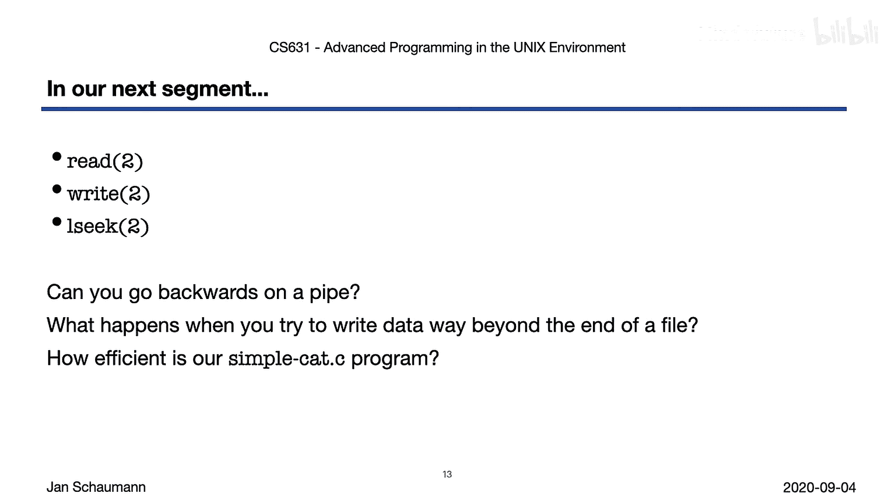

# UNIX高级编程-p07-P07-Week-02,-Segment-2---open(2)-and-close(2)--BV1hPuVz8EWS_p7-

Hello and welcome back to CS631 Advanced programming in the UniX environmentron。

In this second segment， for a week two materials， we will cover the open and closed system called。

As usual， we'll walk through some code examples to illustrate the functionality。

 but this time things should be a bit more straightforward than the last time when we dove into the question of how many file descriptors of process can open。

Are you ready， let's go。As mentioned in our last video segment。

 almost all file IO can be performed using just these five functions， open and close。

 which we'll cover in this video segment and read write an LC。

 which we'll cover in our next video segment。As you can tell， all of these are system calls。

 and so it will come as no surprise to you that a lot of this functionality is rep for convenience or with additional functionality provided by numerous library functions。

However， at the end of the day， it's the calls that do all the work。Okay。

 so before we can do any file Io， we probably need to actually have a file， right？

So let's create one to do that we can call。The cat system go up。

This call takes a path name as the first argument and the mode T。

 a description of the access permissions as a second argument。

 and it will dutifully create the new file， open it in write mode and return to you the file descriptor representing this new file。

But wait a second。 wouldn't I just say that all I owe could be made with these five cicals。

Create isn't in there。Well， the reason for that just follows。As I mentioned。

 Creat returns to you a file descriptor opened in right only mode。

 but sometimes you want to create a new file and get back a file handle that allows both reading and writing。

In the early days of UniX， when Open wasn't able to create files。You had to create the file。

 close it， then open it again。This poster race condition， whereby another process could have。

 for example， unlink the file and put it in place a different file leading to unexpected results。

That is the creation and opening of the fire was not an atomic operation。

As we discuss process relationships with respect to fire descriptors in a future video segment。

 we'll get back to this concept of atomic operations。 But for now。

 suffice it to say that an atomic operation is one where all steps are guaranteed to complete without the possibility for another process to change state during the operation。

So the createat call was obsoleted by open with the flags used as shown here。

Which then gets us to the open system call。The opens Ciiss call takes his argument a path name。

 a bit mask of flags telling open how to behave， as well as optionally a third argument。

 the mode permissions with which a file will be created。

 subject to modifications by the processes you mask， which we will see in a future lecture。

Note that this makes open the Oneusus copy decassier that doesn't take a file descriptor。

 which makes sense since is the one call that returns the file descriptor。

With a path name argument being self explanatory， let's take a look at the O flags。

When opening a file， you need to specify whether the file should be opened in read only mode in write only mode or in Readrite mode。

This is a useful protection for you against yourself if you know you will never write to the firing question。

 open it in read only mode and you won't be able to even do so by accident。

Then there are a few additional flags you can enable by oring the flags。They are。Overend。

 which we'll see and practice in a little bit。O C， which is what allowed us to obsolete the Cre call。

 if O create is specified， then the third argument mode is required。

O Xco allows for an atomic exclusive opening of a file， since without this。

 a test for the existence of the file followed by the call to open it。

 thereby again introducing a race condition。This is actually a common vulnerability pattern known as talk2 at time of check versus time of use race condition。

So all Xco avoids this problem。Or trunk trunk to the file and we'll see the other options in the future lecture。

Note also that the flags supported by open may differ across platforms and go beyond what Pos requires。

Here's a list of additional flags that may or may not be supported on your particular UniX version。

For the most part， we will be focusing on the flags with our prescribed projects。

But it's useful to know and be aware of which flags are available。

Check your local manual page to figure out which open flags are supported on your particular system。

You may find that there is a couple that we didn't even list here。Finally。

 many UniX versions nowadays also support the OpenNe call。

 which is used to handle relative pass names from a different working directory in an atomic session。

This may sound confusing， consider that you can change your working directory and you may wish to resolve a path in relative to wherever you started without having to either change back or to have to construct a relative path。

Perhaps consider this another exercise for you， think of a scenario where OpenNe can help prevent the time of check time of reuseed race condition。

 then write some code to confirm your understanding。Now。

 Open will return to us a file descripture and success， but of course things don't always go well。

 when open fails， it will return negative one and set Erno appropriately。

Some of the most common errors why open may fail are shown here。

If we ask Open to create a file with Oexco and the file exists， it will fail with E exists。

As we've seen in our previous video segment， if we run out our file descriptors。

 open multi with EM file。If the file does not exist， we get Inoent。

If we don't have permission to open the file as we'd like。

 read permissions for All read only or O read write， write permissions for O write only or O readr。

 we get Em。There are many， many other scenarios under which open may fail， check your menu page。Now。

 given that open may fail， for so many reasons， we always always check the return code of the open call before trying to use the fileless returns。

That is， you never write code like this。But always like this。Closing a file is a bit easier。

You pass the file descriptor and that's about it。We'll note that clo the file descriptor will release any record logs on that file。

We discuss the concept of filing record locking later in the semester。Now in a simple program。

 you can even get away with not calling close yourself at all when you process exits。

 the kernel will automatically close any open file Descripts your head open。

But that is a sloppy programming and B easily leads to you leaking file descriptors when you refactor your code and all of a sudden your open code is made inside a loop。

 for example。To prevent this， you should get into the habit of always closing the filescriptor explicitly and within the same scope of your open call。

To illustrate this concept of opening and closing files within the same scope。

 let's take a look at a quick example。Imagine we have a bunch of code already written。

And we then add logic to do something new with the file。We'll add our open call right here。

Carefully checking the return code， of course。Then right after this code block。

 we'll immediately add the call to close。After that。

 we go back up and begin inserting code that does something with a filescriptor in between the open and close calls。

This way， we do not forget to add the close call later on， as would be easy to do otherwise。

Even better。If we decide to move this whole block into another function。

Then we can just take everything， we can move the whole thing and again remain reassured that we didn't leak a file descriptor。

Let's see in an example。We'll go back up， declare a new function。Pull the code that we need。

And then call the function。

This simple trick of always writing out the close call right after having typed the open call。

 something you should get into the habit of and should use likewise for any other resources。

 such as when you for example， allocate memory or have to free it afterwards。

An easy way to remember how to keep them in the same scope is to check the indentation level。

Here we have open in one level and we make sure the close is indented on the same level。Okay。

 so back to close。You might have noticed that we are not checking the return code of close in our code example。

 even though I've said we always have to check the return code of all of our functions。

 So why is that Can close simply not fail。If you look at the manual page。

 you will find that close can fail， it can fail if the number you gave it was not a fileless scriptor。

 or if it received a hardware interrupt， what's about it？

So what do you do if your close call fails Well， you are going to close the file descriptor so you wouldn't be using it after the close call anyway。

 so in most cases it' is actually permissible to move on even if close failed。However。

 as careful programmers， we want to make sure that the reader understands that we are not blindly ignoring the return value。

 so we explicitly cast it to void as shown over here。Okay。

 now let's take a look at opening files by example。Our code example。

 Openex illustrates what happens when we create a file。Try to create an existing file。

Fail to create an existing file， open an existing file。

 fail to open an non existing file and truncate an existing file。First， we have a few functions here。

Note that we're passing in O Creat， but not Oexcro。If the fire doesn't exist。

 this will create the file， if the fire does exist， however， it will simply open it。

Since we're creating a file。😊，We have to specify a mode。

 we do this using the symbolic name functions Ct age to ensure owner read and write permissions。Now。

 also note that contrary to our recommendation， we are not closing the filescriptor here within the same scope。

But here we are doing this on purpose as we want to illustrate that opening files will yield incrementing file descripts。

Next。We'll try to create a fire that we know already exists。This time we pass Oreate Oexco。

So we expect open to fail here， meaning our attempt to close an invalident filescriptor in the next step will also fail。

This time we will print a message to confirm。Next， we try to open a fire that we know doesn't exist。

And we know that will fail， so just like we know that the close will fail so we can cast the two void over here。

Here is the most basic scenario， we open an existing file， this source file， and close it again。

And finally， we are creating a copy of the source file that we then open with OT to illustrate truncating an existing file upon opening。

In Maine， we simply call these different functions with a few seconds pause in between。Let's run it。

Okay， we try to create new file which doesn't exist yet。

 that works out and we get back a file to scriptor number three。

That makes sense because we know that file descriptor 0，1 and 2 are already open。

 so the next available of file descriptor is bound to be3。

Now remember we are intentionally not closing this file asscriptor。

 then trying to make the exact same call again， trying to quote unquote。

create the file that already exists。This time around， Newfo already exists。

 but since we didn't specify OX goal， our open call succeeds anyway and we get back via descriptor 4。

Which we also unique。Now we'll try to open new file with Oreate and OXco。As the file already exists。

 thus fails。 and since that failed， the file descriptor we are passing to close is all invalid。

Now we open Openex。c and read only mode， which works out， we get back a new file descriptor， F5。

 and we promptly close this file descriptor again。Trying to open a nonexistent file fails as expected。

And finally， we copied Openex to new file。LS shows us the size of new file before we call open。

Now we pass O trunk to open， Open succeeds， returns to us the next available file is scripture FD5。

 and we can observe that new file was indeed truncated。So in this example。

 we saw the different ways in which the call to open。

Might have failed as well as how it might succeed。We note that STR error generates meaningful error messages in that file descriptors appear to generate in sequential order from the lowest number available。

Okay this brings us to the end of this segment， as usual。

 please make sure to run the code examples yourself and to ask questions on the mailing list if anything remains unclear。

In our next segment， we'll finally do something more exciting with our file descriptors than just opening and closing them。

We'll also find out answers to these questions。Can you see backwards on a pipe？

What happens when you try to write data beyond the end of a file？

How efficient is our simple CADC program from week one。Can we make it read more data faster？

Until then， thanks for watching， cheer。

