# UNIX高级编程-p08-P08-Week-02,-Segment-3---read(2),-write(2),-lseek(2)--BV1hPuVz8EWS_p8-

Hello and welcome back to CS631 Advance programming in the UniX Environment。

In this video segment covering material for week2， we will go into the details of the read。

 write and L6 system calls。We'd also do a few weird things with filelessscriptors and take a look at how we can ensure IO efficiency when making these system calls。

After this segment， we have completed all the five basic IOis calls。

 you'll be ready to write some code。

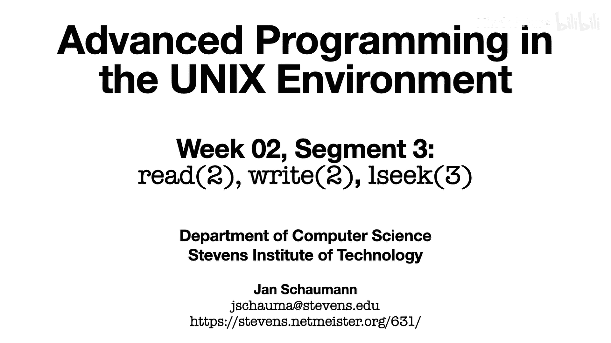

Let's roll。Here we see the function prototype for read。As previously promised。

 Reid takes a Phi descript as its first argument， not a path name。In addition。

 it takes a pointer to a generic Ie void buffer into which it will read the data as well as the number of bytes should attempt to read。

Now in typical C fashion， it is your responsibility to ensure that the buffer you hand to read is big enough to read Numbbits into。

If the pointer passes buffers in galll， or if it points to a buffer that's too small。

 you'll get a segmentation violation， a sec fault。Read or begin reading at the current offset of the file。

We'll talk more about the offset in a little bit， but for now， consider a marker。

 a bookmark in the file that says you are here。As Re reads bytes from the filescriptor。

 it increments the offset so the subsequent read call continues wherever the previous call left off。

If there is no more data that is when we have reached the end of the file， Aka EOF。

Then read will return0。If read count as an error， we return negative1 and said Erno。

For the various possible error conditions， see the manual page as usual。

Note that Ri does not guarantee that it will read exactly nuumbbys。

 and that reading fewer than nuumbbits is not an error condition。Specifically。

If you ask Reid to read 256 bytes of data， but there are only 32 bytes of data left。

 then it will read those 32 bytes。A subsequent recall will then return 0 to indicate EOF。

There may not be as much data available as you have requested。

 even though you have not yet reached EOF， for example， if you're reading from a socket。

 it's possible that not enough data has arrived yet。

So Reed might return to you however many bytes are available， but upon a subsequent call。

 there may be new data available。The same behavior can be seen on any file descriptor representing record oriented devices。

 such as magnetic， which will always return to your data one record at a time。And finally。

 you might get interrupted by a signal。We had briefly alluded to signals in the earlier segment。

But as promised then， we'll have an entire lecture on the topic of signals and signal hand in the future。

 so let's skip over this year。Writing data works almost the same way。

You again provide a file descript to write to a buffer containing the data you want to write and the number of ps you want to be written。

Just like with a read， it's again， your responsibility to ensure that the buffer is at least none bys in size。

 or else you again encounter a segmentation violation， the sec fault。Like read。

 W will attempt to ride the requested number of bytes but may not necessarily succeed。In general。

 W will block until it has completed writing the requested number of bytes。 If in non blocking mode。

 and if the object represented by the filescriptor subject to flow control， such as network sockets。

 for example， then W may write fewer than the requested number。

 and you'd have to retry writing the remaining bytes yourself。

We discuss the differences between blocking and nonbing IO in a future lecture。Also， like read。

 W will begin writing at the current offset and increment the offset by however many bytes were written。

However， if the filing question was opened with the O pen flag。

 then Wright will not use the current offset and instead go to the end of the file before riding。

That is， it will dependend the data， as well illustrate in a moment。

Writing to a file changes the contents of the file， though。

 the that can be of significant meaning if the filing question isn't executable and even more so if the filing question is a setuid executable for this reason。

 W will clear the setu ID bit on the file。We'll discuss how this at UID but works in another lecture。

 but perhaps try to think through this scenario and create an example execution or attack。

 whereby a captured ridriable said UID file descriptor could otherwise be abused。

Not mentioned a few times before。 it's good to get into the habit of writing programme。

 proofs of concept to clarify and verify your understanding。

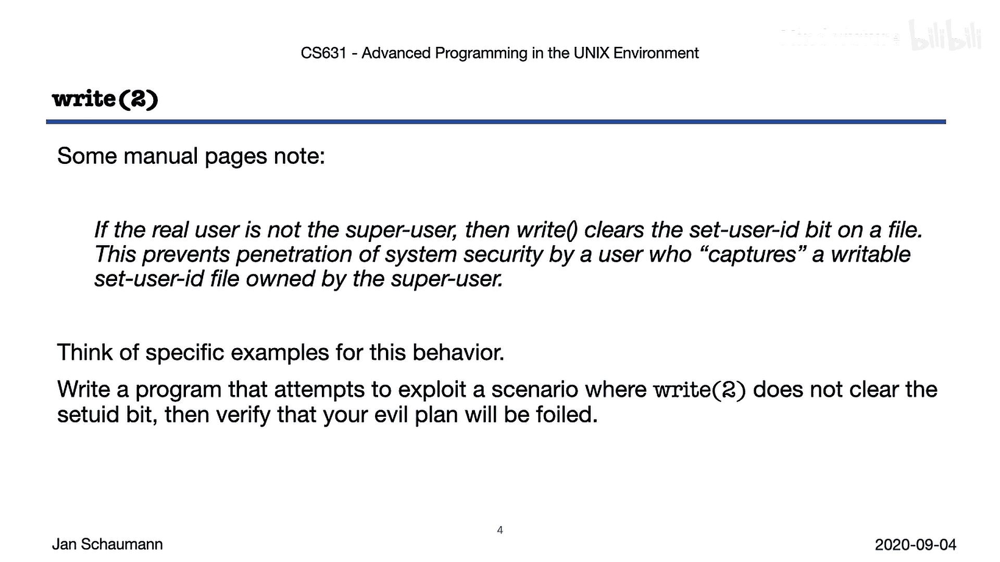

All right， time for an example。Let's look at the file RWx。c。

This is the trivial program that will simply read a few bytes from its source file。

 then append a comment at the end。Here's our open call。Using over pen and or readr。Next。

 our read call， where will read the defined number of bytes into our fixed size buffer。

 then write data to standard out。

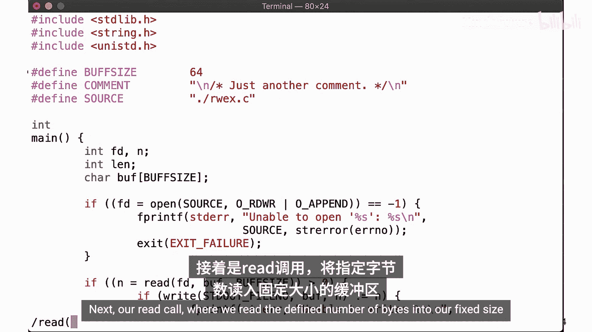

Next， we write the comment we had to find above。Clooseser or file Descriptor and exit。Let's run it。

Okay， we've read the first 64 bytes。You can cut the bites here， if you like。

The one thing to note is that we are reading bytes。

 So are not bound by liness or any other formatting。

 And all 64 bytes just happen to end in the middle of a common here。Next。

 our programmer promised to write some data to append a comment at the end。Let's see。Yep。

 there it is。What happens if we run it again？The same data is red。

 and if we look at the end of the file。We see our second commanddepend。Makes sense。Now， though。

 let's see what would have happened if we hadn't used our pen。To do that。

 let's remove the flag from the open call。We will still read bothuff sides bys。

 which shall leave the current offset in the file at By 65。And then we write our new comment。

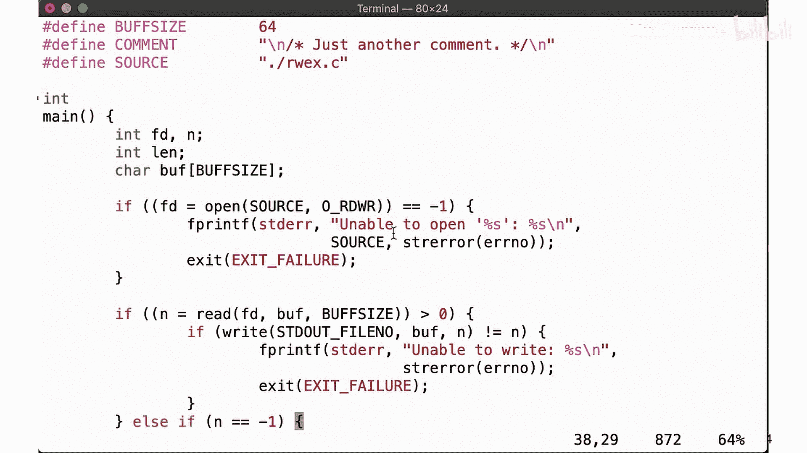

Let's just quickly remove the comments we had previously appended here at the end to avoid any confusion。

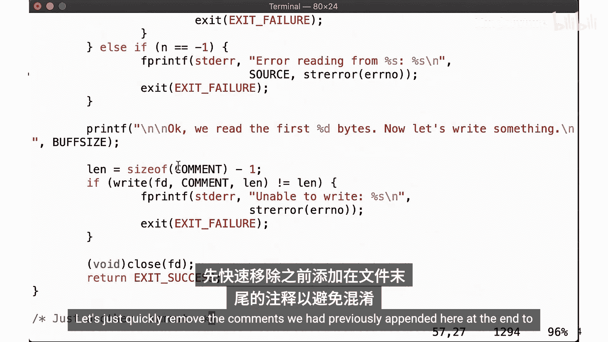

Let's compile and run it again。The read remains the same， no surprise。

But now let's look at the beginning of the fire。We see that the first 64 bytes remained the same。

 and our new comment is written starting at Byte 65， overriding whatever data we had there before。

Here， let's fix our comment。Can we try to insert our new comment after this comment block over here？

Let's see。Let's change our above size。I'll change it to 247。Y 247。

Because that's the by position in which the first common block ends。

 so if we want to insert our new comment， we can begin writing here。Let's give it a try。

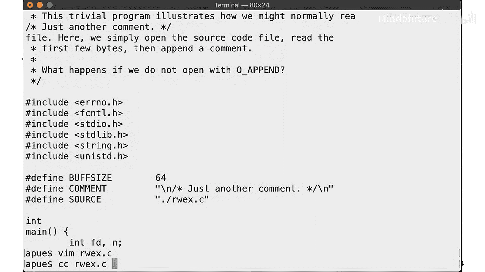

Okay， that doesn't look so bad or comment。Or was red as we expected， right？But now。Heres our comment。

 We are insert it at the right point。But wait， what's this。Remember。

 write simply write data to the current location。It will not insert data；

 That is it will not keep all the remaining data and shifted backwards by however many data it's written。

Instead， W begins writing at the current offset， over writing whatever data happens to be there。

So now we get to fix our code again。And return the over pen flag and ensure that everything's back to normal。

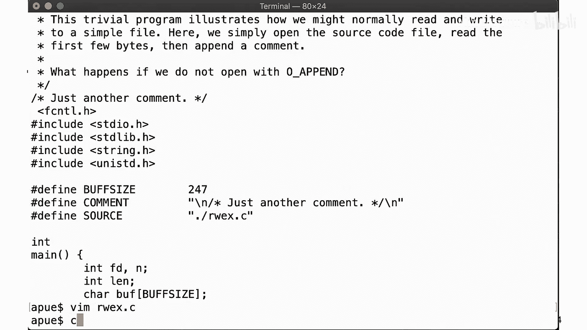

O。So this code example should have illustrated how read and write work and how they operate on the fight offset。

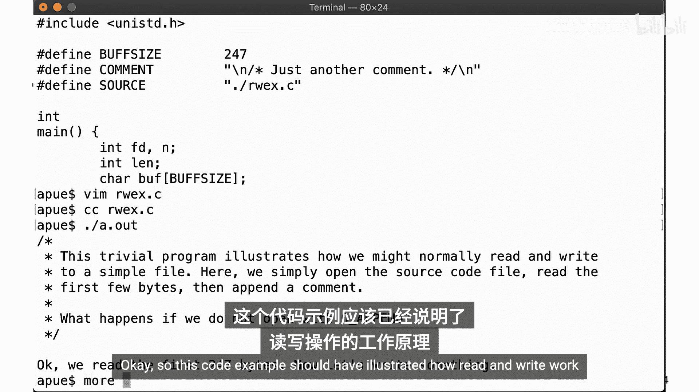

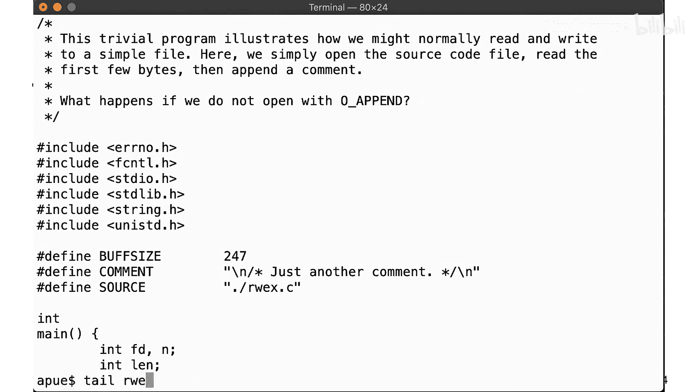

Specifically， writing at offsetet will overwrite any data that happens to be there。

 and it will extend the file if we're writing to the current end of file。

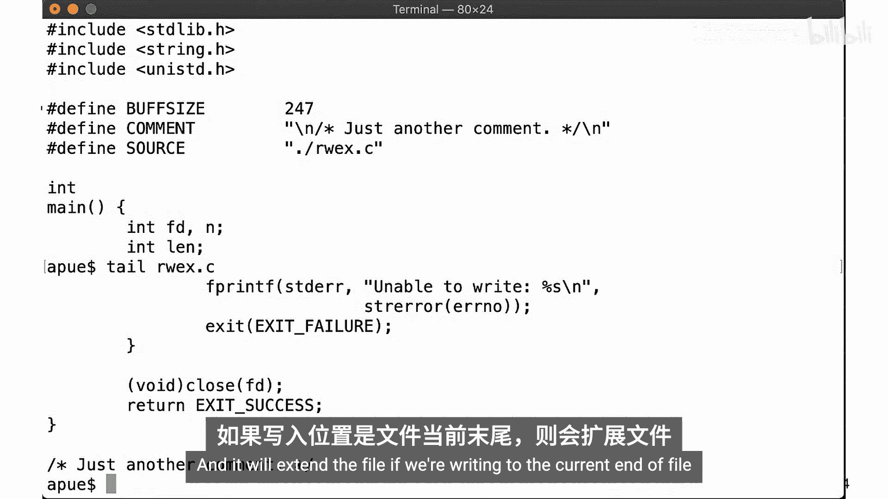

Which brings us to El Si？Do any of you know what this thing is that we're showing over here？

Does anybody even do mix tapes anymore？The idea of an offset in a fire is not quite unlike the concept of a cassette tape where you can play Ie read or record Ie write data at the current position of the read Whitehead。

Now another thing you can do with a cassette tape， and if you've ever tried to record songs off the radio。

Is fast forward or rewind。That is， you are changing the position of the reed righthead relative to the tape。

Okay， perhaps that's enough for the poor analogies from years long gone by， I hope you get the idea。

Just that you can fast forward and rewind on a tape。

 so can you move the current offset of the file by calling L。

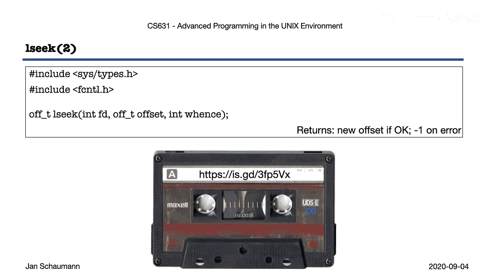

Lseq by the way， is called L Siq and not just Siq because it used to return along and prior to being switched to return an abstract data type and off T。

Anyway， so Lse takes a file descriptor。An offset to move the offset by。

 as well as a third argument wins。This value wins， determines how the offset is used。

You can begin seeking of the beginning of the file with See set。

You can seek of the current position with seek curve。

Or you can seek of of the end of the fire by a seek end。Upon completion。

 Lsq will move the current offset as indicated and return to you the new offset。

A value of negative one indicates an error as usual。Now。

 even though seeking in a fire seems reasonably logical。

 especially with my rather excellent castic analogy and mind。There are a few odd things you can do。

You can seek to a negative offset。This may not actually be quite so weird because that's really just rewinding our tape。

So if you want to step back a few bytes， you specify。

 say negative 32 as the offsite and see curve as whens。

Or say you wish to go to a position 64 bytes before the end of the file。

Pass in negative 64 and second， and there you go。However。

 what do you think happens when you call Ls with negative 1 and c set？

Take a look at what Ltq returns an error and write a quick three lines of code to confirm。Next。

 you can pass an offset of zero， of course。This can be useful when you want to jump to the beginning of the file。

L60， seek set。Or the end of the file， L seek0 sec。But of course。

 you can also say go zero bytes from the current position， or in other words， don't do anything。

 stay right there。But doing that is not quite a noap， as we will see in a second。

Another weird thing you can do is seek past the end of the file。

Now that's something you can't do with the cassette tape， but what does it mean？

We'll find out in a minute。

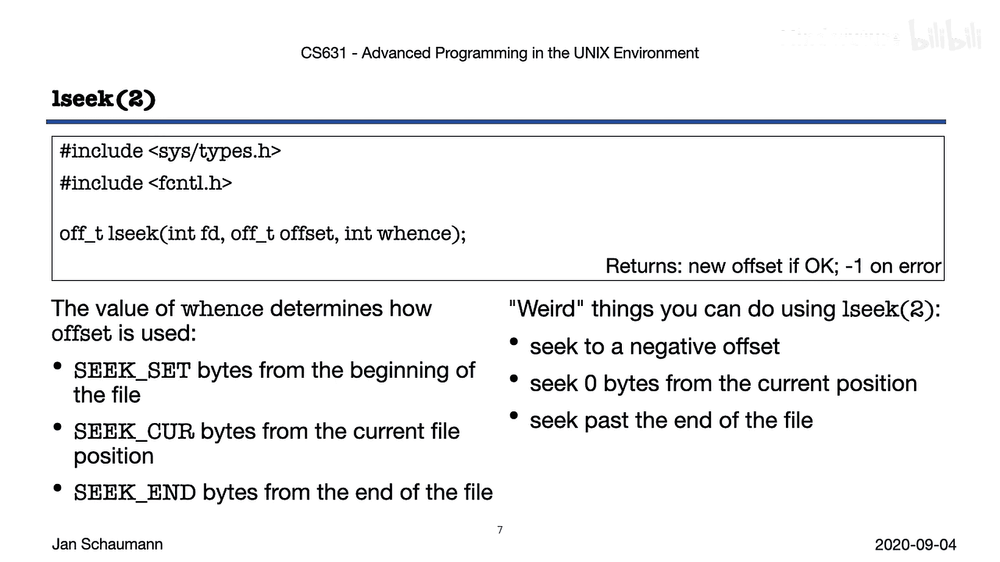

Okay， quick example to show how we might want to see0 bytes of the current position。

 let's look at LCc。c。By trying to seek zero bytes of the current position。

 we can determine whether or not the file descriptor we have is sable at all。Because guess what。

 seeking is not always possible and all fileless scriptors。Let's give it a try。

 we try to seek of the standard in file descriptor。If we run the program。Just like this。

We are told that we can seek。

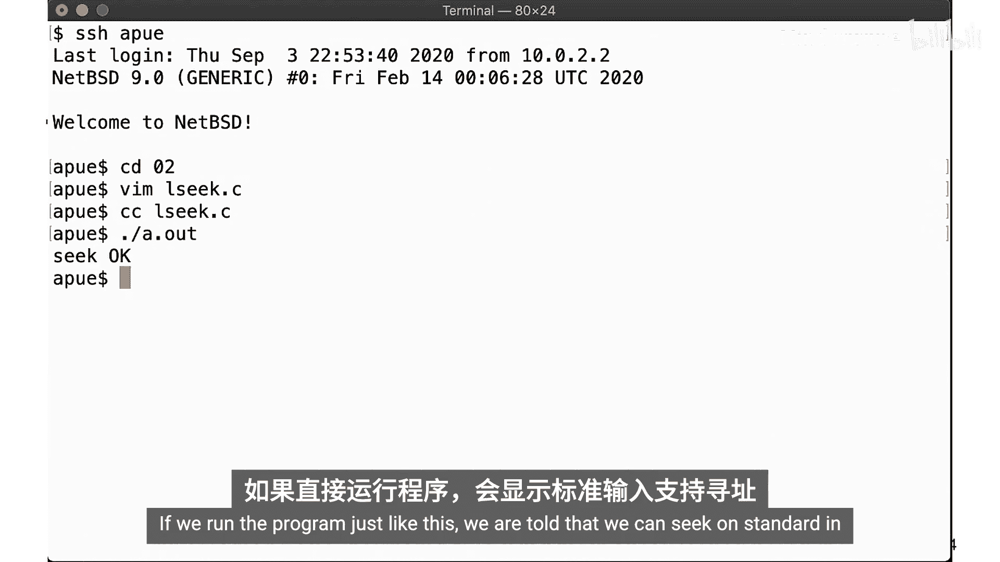

Unstanded it。What is the name in right now， well， we didn't change anything， so it's our terminal。

Now let's redirecting it in and instead connect it to a regular file。

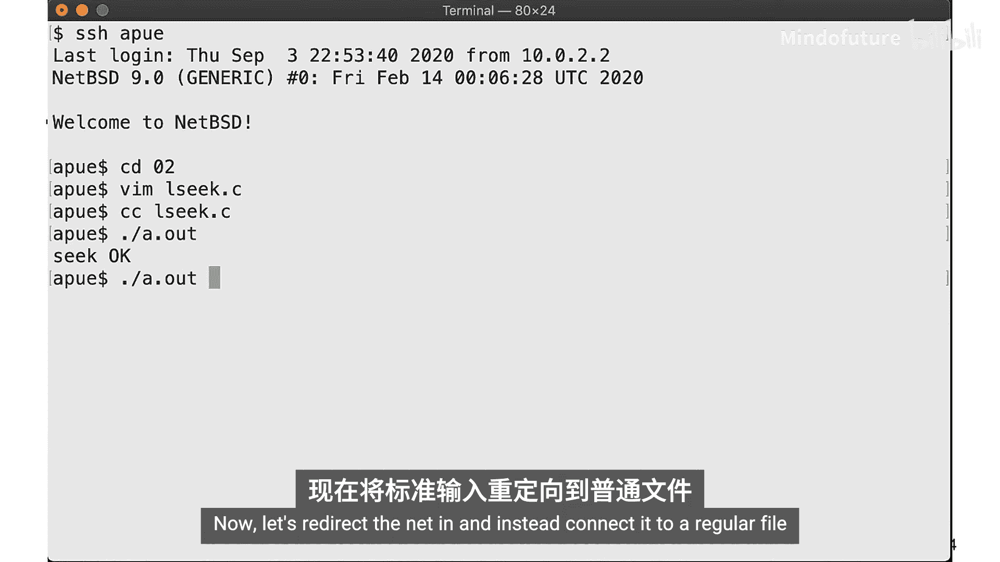

Yep， that too works。No。What if we pipe a file into this program？Oh， look at that， we can't seek。

That's because now this net in for program is a pipe and the pipe is record oriented。

 meaning you can't move back and forth in the data as it comes in， you can't seek on a pipe。

How about a fi4， Let's create one。Nope。We can't stick on the 50， either。Well。

 that too shouldnt make sense， since a54 has really nothing else but a pipe manifested in the file system。

We revisit Peps and  FiOs in our lecture on Interproces communication。

 so don't worry if this doesn't seem quite obvious to you just yet。Okay。

 but what about seeking past the end of the file， What does that even mean？

Suppose youre at the end of the fire and then seek a bunch of bytes beyond that and then write data on the new location what happens to the gap in between？

Let's give it a try。The file hold at sea contains a program that will do just that。

 thereby creating a file with a hole in it， a so called sparse file。Let's take a look。First。

 we create a new file using the obsolete create system call just to show it in action for once。

Then we're riding a few bytes to the beginning of the file with a file offset then left at the beginning of that data at the end of that data。

Next， we all seek a significant number of bites of the current position。

 meaning we're now in no man's land。Then we write the contents of our other buffer and another 10 bytes。

Now， before we run this command。Let's take a look at how much disk space we have available。

Note that the information provided to us by the DF command is on 512 byte blocks。

So here we see how many blocks are available and how many are used。

Now we can run our program and look at the newly created file。Okay。

 that's a big fiber we created there， which is just around 10 megabyte。

How many 512 byte blocks should this file use up？哦。😮，Let's do the math。Okay。

 so that should be just about 20512 byte blocks， so we should should see this number。

 the number of total blocks used。Get increased by about 20 k。Let's run Df again and do the math。

What 96？Let's ask LS， which has a flag to report the number of blocks used by the filing question。

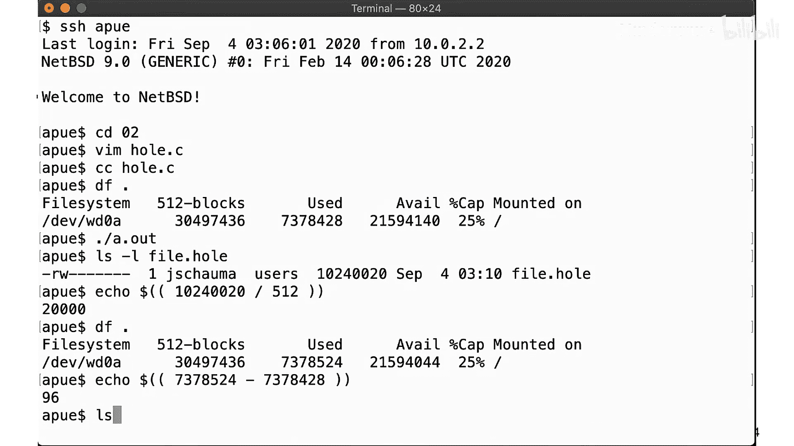

H，96。How do we fit 10240，020 bytes into 96512 byte blocks？

Let's take a look at the raw data using the hex dumpump utility。

What we see here are the first few bytes that we wrote， followed by a whole lot of nullbits。

 repeating and repeating for so long that Hexton got tired and decide to just not print them until we get to the very end when we find our last 10 bytes of data。

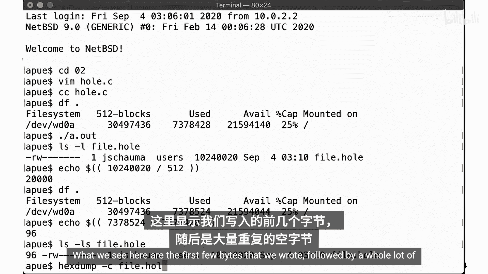

Okay， so what's going on here， we created a file， wrote some data。

 used LsC to move the offset 10 megabyte beyond the end of the file， then wrote some more data。

So on disk， we really only have these 20 bytes of data that we wrote。

 but with a whole lot of nothing in between a hole in the file。Now allow me to read this file。

 such as using hext， the kernelel says， well， there is nothing there。

 but I don't know how to represent nothing， so here have a bunch of nullys instead。

 that's as close to nothing as we can get。That is。 The colonel pretends that there's null bites。

 but on disk， they actually aren't any bites。 It's a sparse file。 It has a hole， Wehu。By wait。

 it gets weirder。What happens？Let me copy this file。

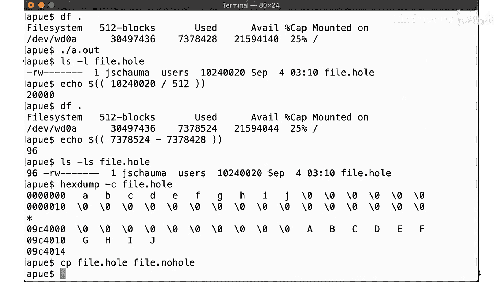

H looks just about as expected。 Both files are the same teams。How many blocks does each file require。

Okay， that's weird。 One file takes 96 blocks， the other over 20000 blocks。

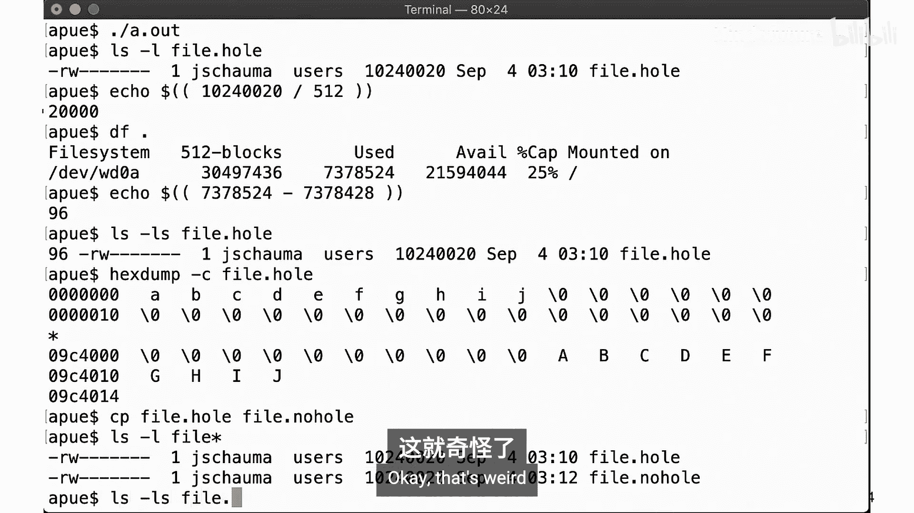

Wait，20，000 blocks。 that's just what we expected the fire to use of。

Let's take a look at the contents of that fire。嗯。That looks just like the other a fire。

 the one with the whole。So， those files。All right， En。Let's ask diff。Right。

 Daveiff says those two files are identical。But they are not。One contains a hole and the other。Well。

 remember what I said the kernel does when we ask it for the contents of the file。

And gives us a bunch of null bites。So when we copied the fire。

 the kernelel gave the CP program all those nullbytes。

 and CP dutifully wrote out those nullytes to disk into the fire， fire。nohole。That is。

 while fileot hole contains a hole which is presented to us as a sequence of nullbits。

 fileot no hole does not contain a hole。 It contains actual nullbits written to disk。AUnix is fun。

Hey， let's see what happens when we do this on a different operating system。

Let's give it a spin on our Macas system first。

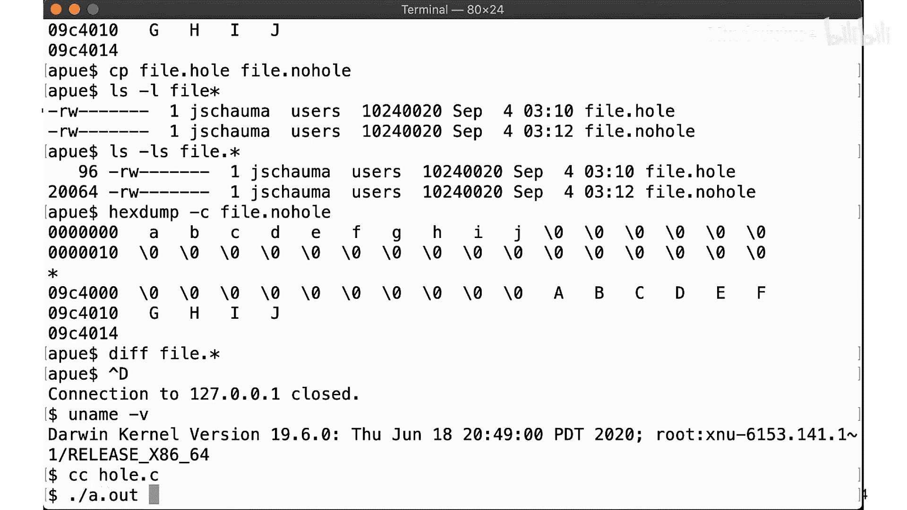

Wait， here our file with a whole does take up 20，000 blocks。

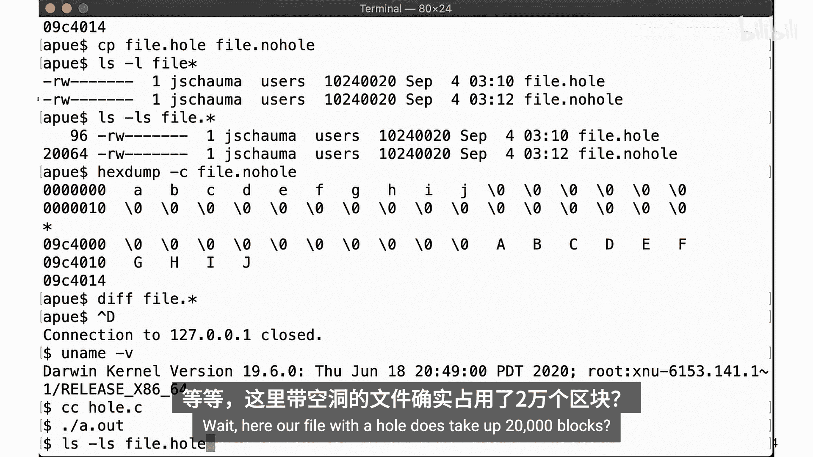

Well， that's because support for sparse files depends on the file system。

 and the HFS+ file system used on this system does not support sparse files。

 so we may use LC to go beyond the end of the file and then wrote our data。

 the OS wrote actual nullbittes into the hole because the file system doesn't want to hear about all this nonsense of files with holes in them where data is not present。

What about Linux？Okay， so here our large file takes up exactly one disk block。

 so this system must support spa files。What happens when we copy the file？Wait， now what？Fot hole。

 which a second ago used a single block， now all of a sudden uses 258 blocks while the copy。

 it should use that more blocks only requires 33。What the hell is going on here？

Let's run LS LS again。

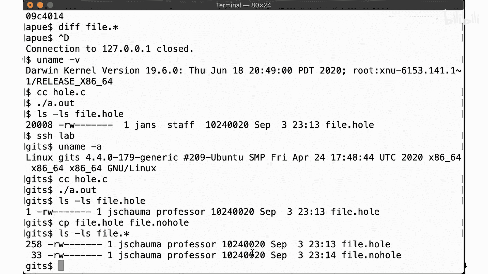

Okay， now both files use 258 blocks。

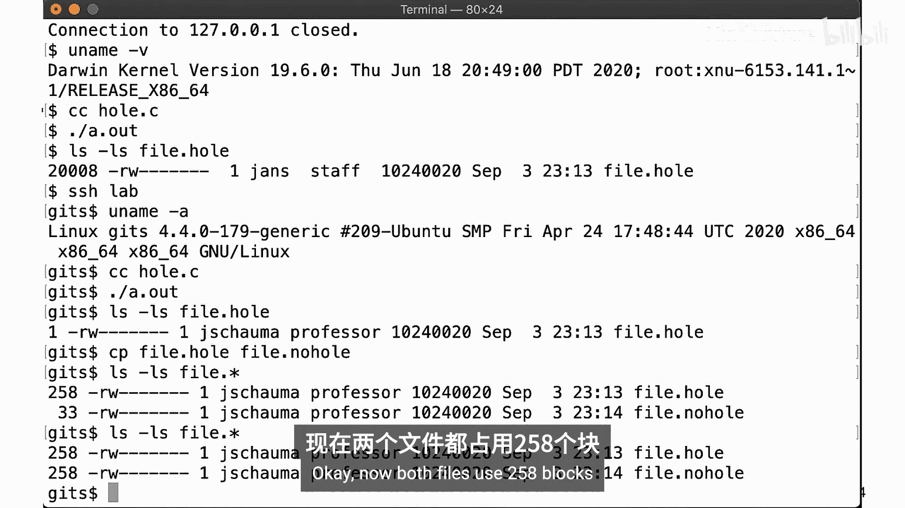

Let's think there's through。Where are we here anyway， Okay， we're in my home directory。

How much disk space do we have here？Oh， look at that。 Our home directory is on an NFS share。

 a network file system。

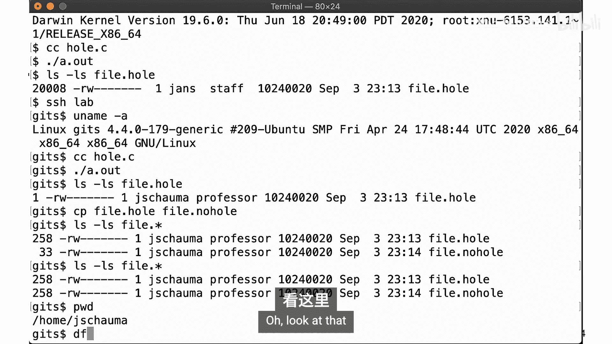

So when we created the spars file。It started to write data and we observed the actual network lag of that data being written to the remote system before it finally settled on using 258 blocks。

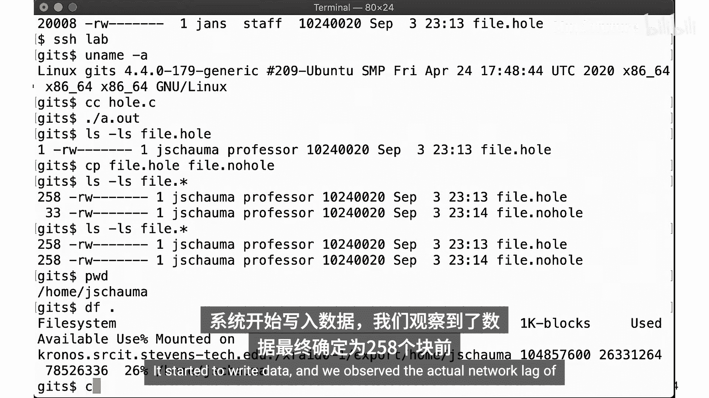

Let's try this again on a local file system。Here in slash T， we can try this once more。

Confirm this is a local file system。And begin executing our command。

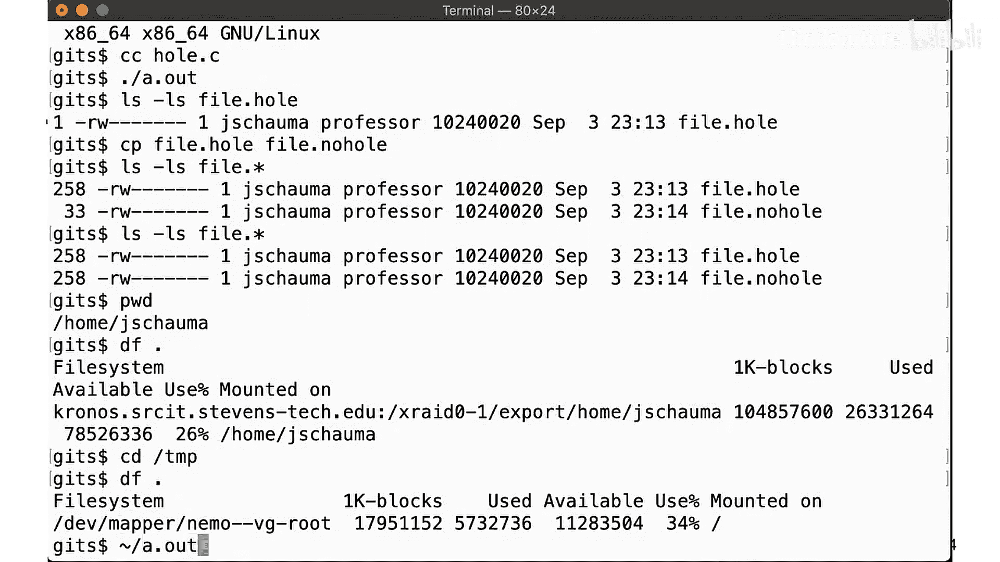

Okay， the newly created sparse file takes up eight blocks。Let's copy it。H。

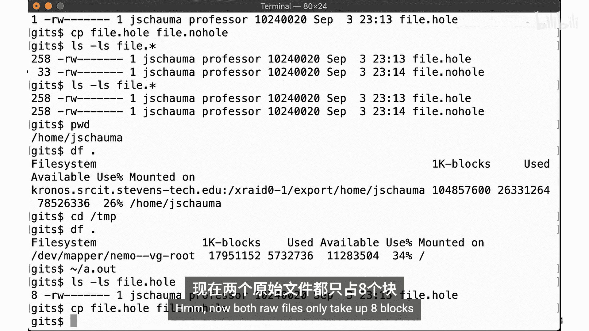

Now， both of our files only take up eight blocks。Maybe we have a similar situation as before。

So let's wait a second and check again。H， no change。

So it looks like the CP command created a sparse file。Let's look at the menu page。

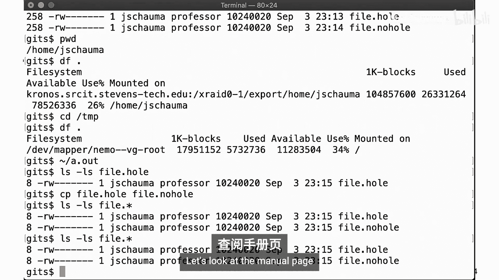

Oh。

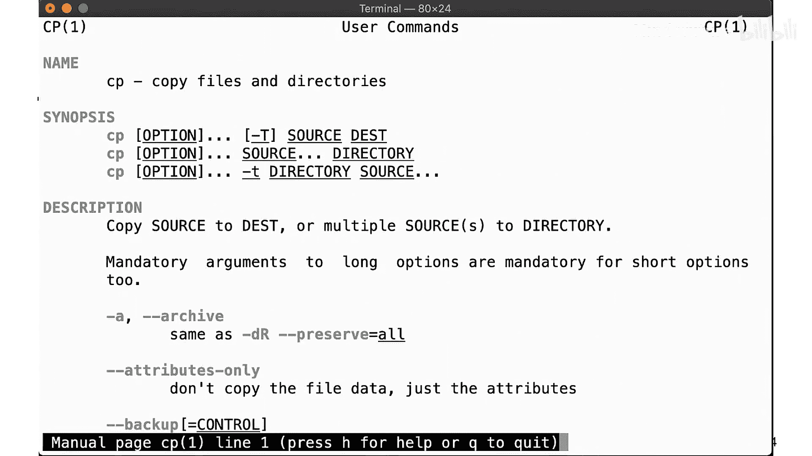

It seems that this version of CP is able to detect sparse files。

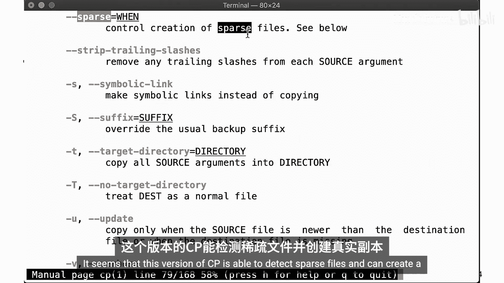

And can create a true copy of it。

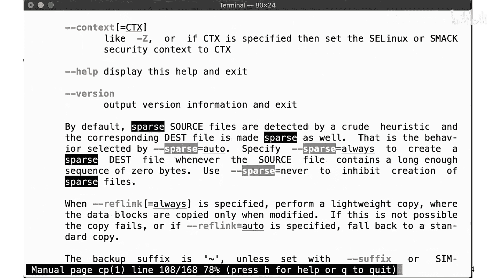

Making the destination file sparse as well。All right。

 and one more quick thing we had earlier observed that using CAt。

 we can copy a file by simply redirecting file descriptors， let's do that。

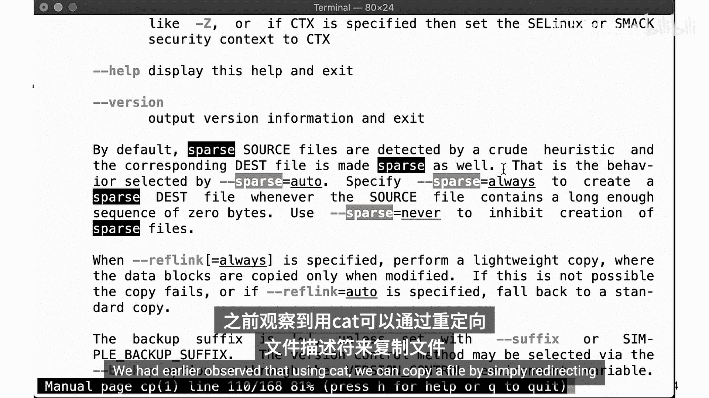

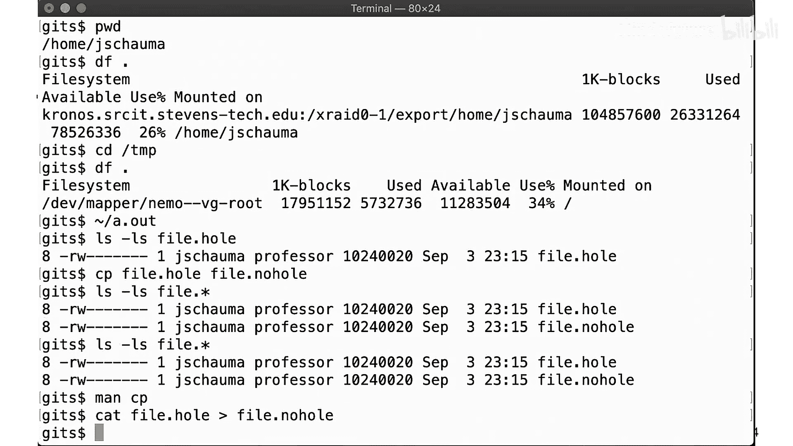

Aha， now we have a difference。Kt of course， has no such fancy logic to attempt to detect the sparse fire and instead did write out the nullbits provided by the colonel as we had expected CP to do。

So I was a bit weirdhu。

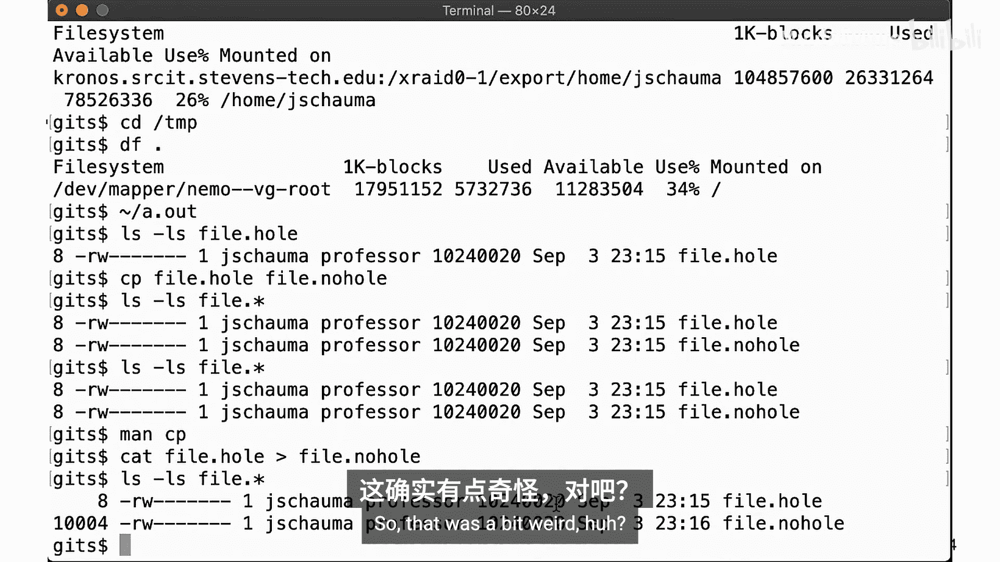

To summarize， you can see past the end of a file and thereby create a so called sparse file5 with the whole。

But the fire system must support this， or else you just get a fire with lots of nullys written to disk。

If the fire system supports sparse files， then the kernel will supply nullbytes when you read the whole。

 but they will not actually be on disk。Different versions of C or other toolss may or may not be able to support sparse files。

 although that is mostly based on the guess that if you encounter a sufficiently large sequence of null bitetes。

 the input was probably a sparse file。We'll revisit some of the things we discussed here。

 especially with respect to disc blockss in a future lecture as well。For now， let's move on。

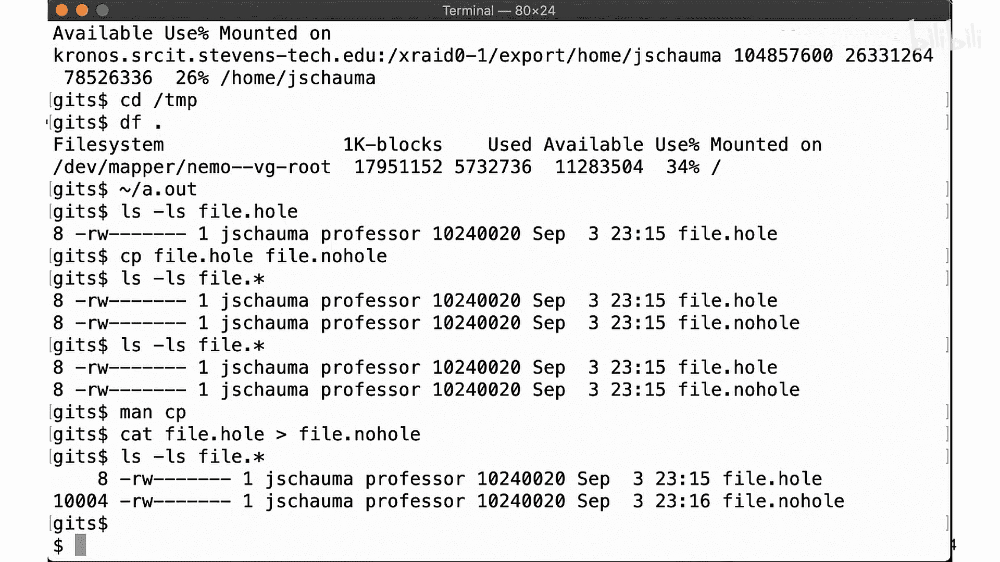

Let's take a look at our simple cat。c program from last week。

We are processing data from standardalin in a loop， reading it into a buffer of size， buff size。

That means that the smaller above sizes， the more iterations of the loop we perform and the more calls to both read and write we perform。

Likewise， as we increase buff size， we reduce the number of iterations。

 reduce the number of test calls， and thus become more efficient。In our initial version。

 we chose the buffer size of 32K， but we could have picked any value really y 32 k bytes。

If we want to be really efficient， why not a？Pinty on your mouth， Doctor。 Et。

1 million by its sized buffer。And if our efficiency increases as we increase the buffer。

 is there no upper limit？Now， we can't create a buffer of unlimited size。

 but couldn't we create a buffer that's just about as large as the amount of memory we have available and then read in all the data in one go。

Well the right thing to do is。Try it out。We have a hypothesis。

 so now we test it science for the wind。Now to test this， well need a few large files。

Using this loop over here， we create 10 files named file1 through file 10。

 each containing 100 megabyte of random data。Next， we will try out the following buffer sizes。3 meg。

1 meg， 32 k， 16 k， 4 k， 1 k， 256 bytes，128 bytes， 64 bytes， and finally a single byte buffer。

For each buffer size， we compile the program using the Dbuff size flag and then run the command five times in a row reading the specified file。

Note that by using random data in the input file and different files for each buffer size。

 we are avoiding having the test be affected by the files system trying to be clever and caching the data from this。

Here， let's give it a try。Since I'm lazy， I put the commands to generate the data files as well as the loop to compile and invoke the command with the different buffer sizes into a make file so I can save myself some typing。

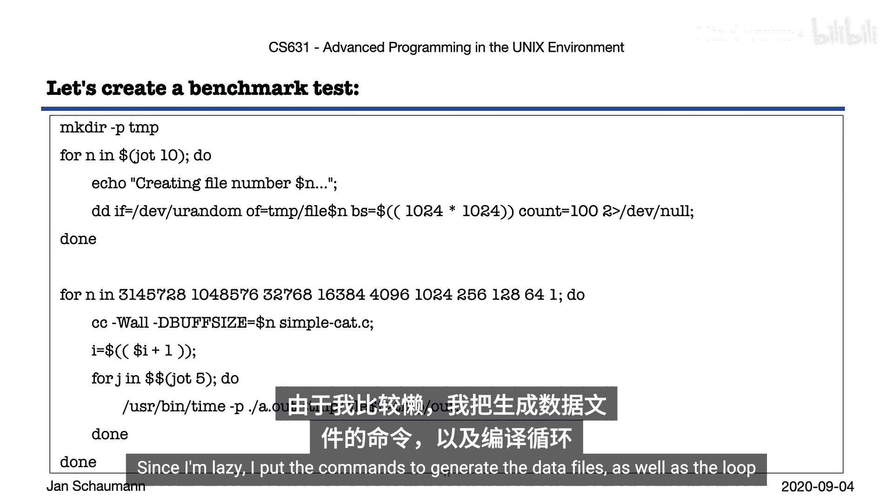

Okay， here we are now creating 10 data files， each00 megabytes of random data。

This illustrates the use of make for more than just building code projects。

 we get back to that in a future lecture。But if you're interested。

 I've placed the make file into the updated code Toable on the Co website。

 you can fetch it from there。Anyway， let's take a look。All right。

Since we now have all of our data files。Let's build a comparison on the different buffer sizes。

 from largest3 maggs to smallest， one measly bite。Okay。

 the first few iterations go by pretty quickly。Let's scroll up and see what this says。

Looking at these numbers， we should quickly see that there doesn't seem to be much of a difference between using a 3MG buffer and a 1 MacG buffer。

 a 32K buffer， and even a 16 k buffer。The speed increase with a larger buffer is insignificant。

Considering that a 3 meg buffer is almost 200 times the size of a 16 k buffer。

 but the speed increase is around 1 hundredth of a second or。

Note also that for each of the five invocations， the first one is always slower than the subsequent invocations。

That is because the file systems bufferuff does indeed kick in and deliver the data that was just used faster if it is accessed again immediately。

Now the difference between 16 k and 4K seems a bit more noticeable。

 and as we decrease our buffer size， we clearly see a degradation in performance。

Down here with a 256 bite buffer， things are really starting to slow down。

And using a single byte buffer will actually take us about five minutes for each iteration to copy the data。

I'm not going to let it run for this long。Okay， so based on this output。

It looks like the buffer size beyond 16K has only negligible benefits， but why is that？

Shouldn't a bigger buffer be more efficient？Well the reason that we can't keep gaining efficiency by increasing the buffer has to do with the file system。

The file system has a fixed block size in which it reads data from the disk。

 and no matter how large a buffer is， the file system can read more efficiently than whatever that block size is。

What we see here in our benchmark is this effect。 The file system has a block size of 16 k。

 so increasing the buffer size beyond that value doesn't buy us a whole lot。But surely。

 we don't want to go and perform such a benchmark every time we want to copy data。

 Wouldn't it be nice if there was a way to determine the optimal IO size that is the fighterest to block size of a given file。

Well， lucky you， there is。Try running stat against the fire。Look at that 16K。

Now that the command and syntax for the Stat command differs between Uni versions， Linux。

 for example， uses Stat C percent O always check your manual page。Note also that of course。

 the results of a little benchmark here will differ from file system to file system and operating system to operating system。

Give it a try。All right， so there was a whole bunch of fun。

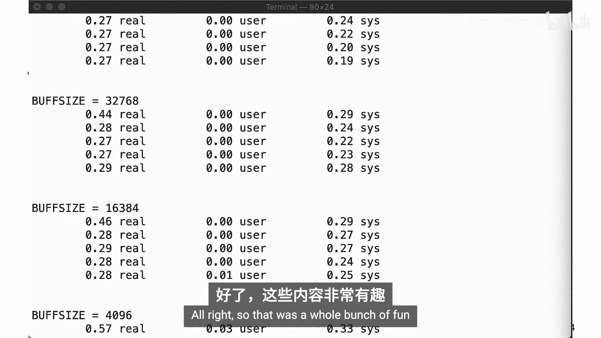

We encountered some trivial things， opening， closing， reading and writing files。

 and some pretty weird things such as creating files with holes in them。

Make sure you check out the manual pages and see which options are supported。

 they differ across operating systems， and it's useful to see what new features are available now that they are not prescribed by Poss。

Try to think a bit beyond the examples we provided here in this video and answer the questions on this last slide。

Share your answers and findings on the class mailing list。This concludes this video segment。

In our next segment， we'll take a closer look at file sharing and what the implications of a multi processing system are on file descriptor handling。

Thanks for watching， cheer。

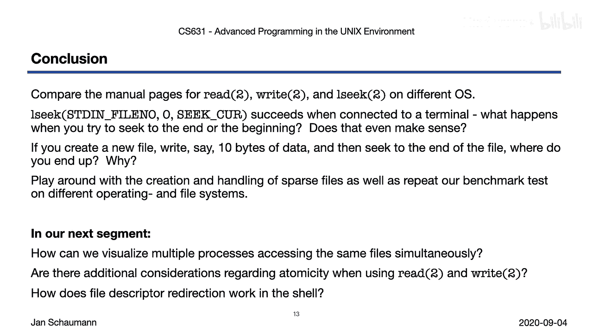