# UNIX高级编程-p09-P09-Week-02,-Segment-4---File-Sharing--BV1hPuVz8EWS_p9-

Hello and welcome back to CS631 Advanced programminging in the UniX Environment。

This is the final video segment for a week two materials After having discussed the five essential Ciscal responsible for almost all fileIO and Unix in our previous segments。

 we'll now take a look at what it means when multiple processes access the same files and what the implications of that are in the ciscals we know。

We also look at a few additional functions relating to file IO and file descriptors。

 but after all this you will be all set to go and work on your first homework assignment。

 putting to good use what we've learned so far。Let's get started。

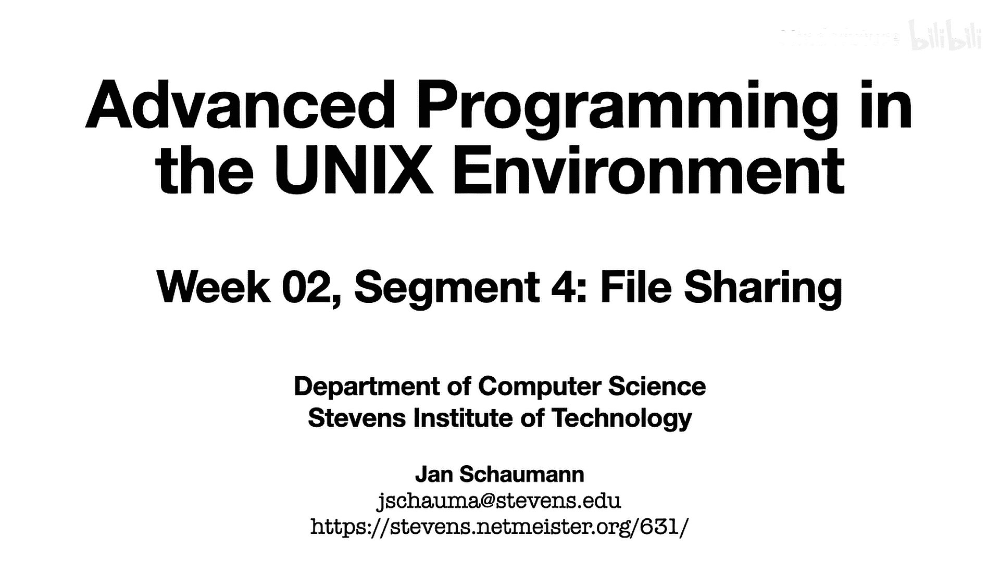

As we know， UniX has been a multi user multi processingces operating system from its inception。That。

 of course， implies that multiple processes may be accessing the same resources such as files at the same time。

To better understand what that means， we look at some kernel structures relating to the implementation of these concepts。

You will find the diagrams used here in your course textbook and can count yourself lucky。

 You don't have to deal with me trying to draw them on a whiteboard。But okay， let's see。

The kernel maintains a process table， and that each process table entry contains a table of file descriptors。

 which in turn contain the file descriptor flags which we haven't seen yet。

 as well as a pointer to a file table entry。In addition to a process table。

 the kernel also maintains a file table。Each entry contains the file status flags。

 several of which we've already seen， such as O pent， for example。The current offset。

 as well as a pointer to a vino table。Strictly following the mantra that in computer science。

 all problems can be solved with another layer of interactiondirect。

 we do not immediately implement the file system logic， but instead provide the V node。

Which allows for an abstraction of the fire System API。

Different file systems include different meta information in the Vn table entry。

 but for compatibility with a traditional UniX file system。

 they implement a provide of the Ine information。Don't worry。

 we'll spend plenty of quality time with the I noteote and all information stored there in our next lecture。

Anyway， so here's what all this might look like。Again。

 we see the process table with each entry pointing to a file table entry。

 with each of those entries pointing to Vino table entry。

 which finally contains the I information as well as eventually appointed to the actual blocks on disk used for the contents of the file。

If a process opens the same file twice， then we'll get data structures as represented here。

Note that the fire table entries shown in the middle are distinct。

 but pointing to the same vino table entry on the right。Similarly。

 if two different processes open the same file， then things might look like so。Now。

 understanding these kernel structures， let's consider some of the calls we've seen earlier。

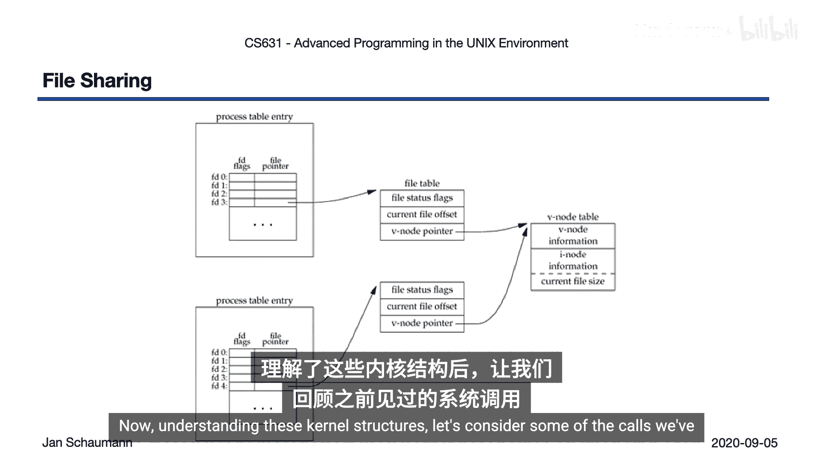

As we discussed， read and write， begin at the current offset and increment the offset upon completion by the number of bys red or written。

If we write data and the resulting offset is larger than the file size that as we add data to the file。

 then we simply copy the current offset to the Inode file size。So far so good。

 but we said that if we use O pen， that all rightss will occur at the end of the file。

 how does that work？Well， if you open the file in over pen mode。

 the file status Fls are set accordingly and whenever we call right。

It will first set the current offset to the current file size。Then update the current offset。

 and since by definition， the current offset is larger than the file size。

 also update the file size in the in。Looking at these data structures， we also see how LSQL work。

All it does is manipulate the current offset in the file status table。To seek to the end。

 Lseq will copy the current file size into the offset done。To see to the beginning。

 simply set the card offset to0。Note also that L See is entirely independent of the file size。

 It does not need to go to the disks and actually fetch information from there。 Rather。

 it operates entirely on the meta information。

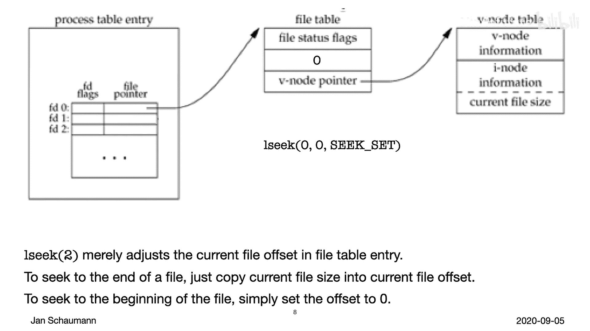

All right， but what if we have multiple processes possibly accessing the same file at the same time？

Then we quickly require atomic operations。As a reminder。

 atomic operations are operations that are guaranteed to complete in the entirety without another process being able to interfere on not at all。

Let's illustrate the need for such operations。Early versions of Unix did have the O pen flag。

 So if you wanted to append to a file， you'd have to first Ls to the end of the file and then issue your right。

 You had to complete two operations。What if another process at the same thing at the same time。

Let's imagine two processes， both trying to appendent to their respective buffer contents to the same file。

Process 1 wants to append P1 always writes to the end of the fire， where Pro 2 wants to append。

 not true。 This time P2 wins P1 loses， ha ha。So let's pretend process 1 gets the CPU first and begins by calling LC。

0， s and。As we discussed， this copies the current file size to the current offset in the file table entry of process  one。

But now the scheduler decides that it's time for process 2 to get the CPU and that process。

Calls L seek 0， seek n。So， of course， it copies the current file size 128 to the current offset of process 2's file table entry。

Process 2 then issues its right， successfully appending data to the end。The new offset is now 173。

 and since that's larger than 128， it copies 173 to the file size in the in。

Content with having written its data process two happily exits。Now， process 1 gets the CPU again。

 continuing where it left off， which was right after it had called Elseig。So with its current offset。

 set to 128。It will write the contents of Buff 1 at position 1，28。

Overriding the bys previously written by process2。It adjusted its offset and exits。

And we are left with corrupted data at the end of the file。

This illustrates the necessity for an atomic operation to append data。

 and the fire status flag overend solves this problem。

But sometimes we want to write data to a different location besides the end。

 and we want to avoid the race condition we just explained。

 as that would apply equally for multiple processes trying to do that at the same time， too。

So to address that problem， we have in addition to the standard read and write system calls。

 the functions P read and P writeite， which work just like the normal read and write calls。

 but take an additional parameter， an offset to which they will atomically seek before issuing the read and write operation。

The current file offset will then not be changed， meaning that after a call to these functions。

 your current position in the file is the same as before you made the call。As usual。

 if an error is encountered， these functions return negative 1 and setEno as we'd expect。

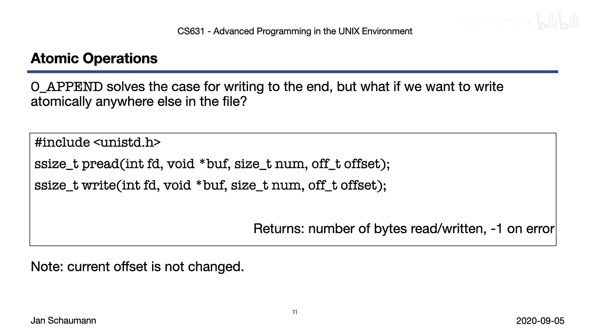

Let's look at the various file status Fl and what they mean in practice when we run commands in the shell。

As we know。When we use the greater then symbol in the shell to redirect it out into a file。

 it will create the file if it does not exist and write data into it。If the phi does exist。

Then it will be truncated。Meaning that the open flags used by the shell here are o creat and ot。

So no surprise， the contents of the file will be over it。If we want to append to the fire。

 the shell allows us to do so via two great symbols， changing o trunk。To o a pen。Note。

 however that even in our pen mode， we are still creating the fight if it doesn't exist。

 so all c remains in place。Appending to an existing file works as expected without truncation of the file。

Okay。Now let's look at output redirection of multiple streams。If we run a program。

 we know that both standard out and standard error are connected to the terminal。

We will get both the error message as well as the output from the command on the terminal。

If we want to suppress the error messages， we can redirect another file descriptor 2 to another file。

Using the special device Devolll， we are able to ditch the output from Senra completely。

 but the redirection here is still done simply by opening a fire。If we redirect file to scriptor 1。

 send it out then。We don't have to specify the fileless scriptor。

 the shalllets are used greater than by itself。Standard R will still remain connected to the terminal as we expect。

But now look at the contents of file。Note here that LS told us that file is 0 bytes in size。

Let's compare。H， the file is 51 bys in size。Why did it write zero bytes in size when we redirected the output？

The reason for that is， as noted just a minute ago。

 that output redirection opens the file question with O trunk。

 The output redirection happens in the shell before the others command is executed。

 So the shell truncnkets the file。 And when a less looks at it。It finds it to be zero bytes in size。

Okay， let's try to capture standard error in the same file。

Let's simply redirect it over here using this syntax。When we run the command。

 we get no output on the terminal since we redirected both in and out and the merge of the file。

But what's this now， file only contains the output from S out of the command。

Where did the output from Sennaargo。Let's take a look at the error message。Over here。

It is a bit shorter than the output from standard out。It's generated it again and compare。

This is the error message。And this is what we expect to show in the fire。 This is longer。

So it seems that perhaps Standarder was written to the file first。

 but then Standardau overwrote the output。Just like we had illustrated a few minutes ago with regards to O pen being thec。

To test the hypotheses。Let's try to generate a longer error message。

If we try to LS 2 non existingent directories， then our error messages are longer than the successful output of the command。

Let's give that a try。Hm， interesting， we get a partial error message。

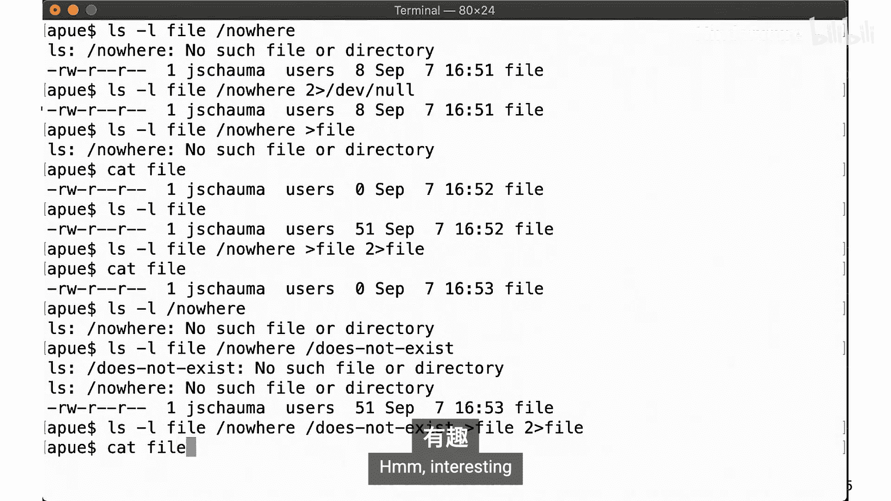

So this confirms our hypothesis， both redirections of standard O and standard R open the fight and O trunk mode。

 so it set both the size and current offset to0。The error messages are written and when standard out is written and overwrs some of the bys from Standardadur。

 with the remainder of the bys from Standardnaur being left afterwards。

So let's try to fix this by asking standard Earth to use orend。

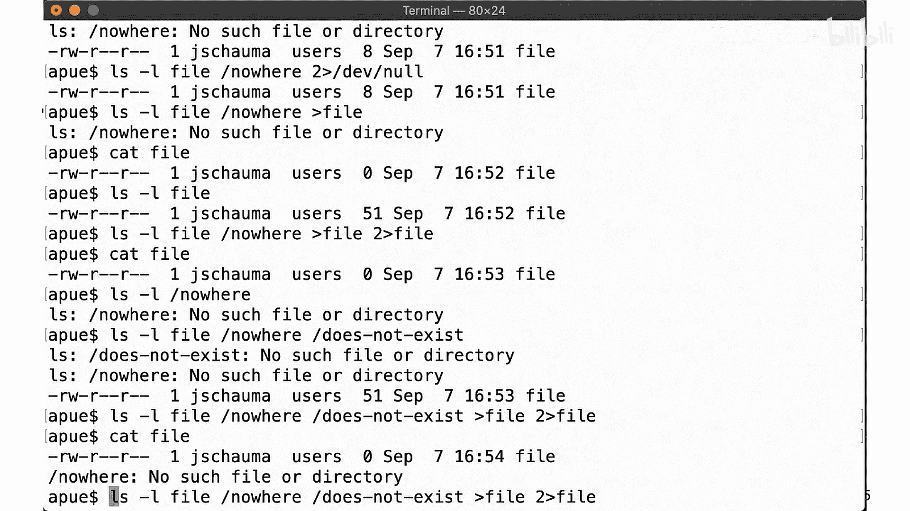

Unfortunately， that too fails。 Standard out redirection opens the fight and trunkncet mode。

 Standard R opens it an over pen mode， but if standard R writes data first。

 then O pen doesn't help us。

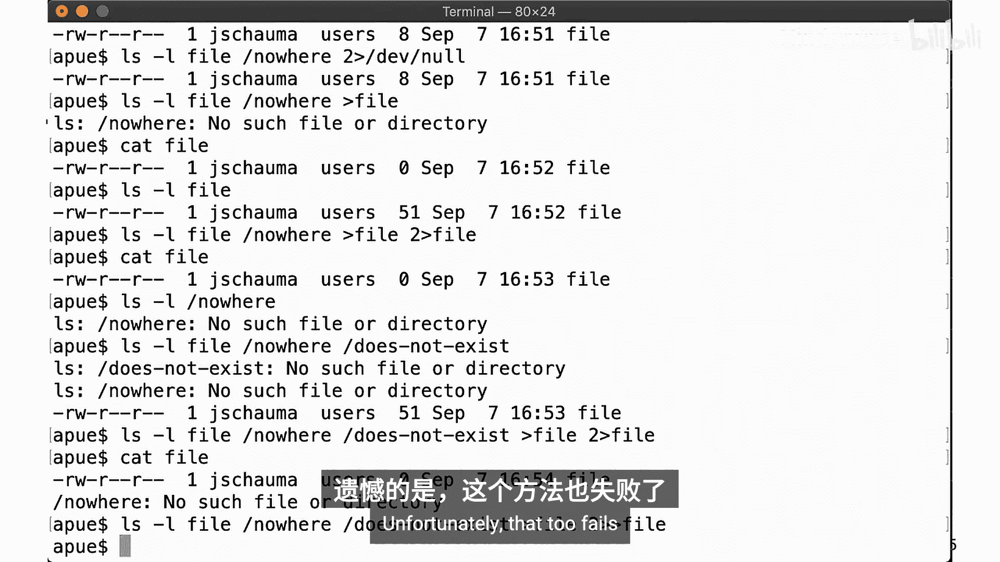

Let's try the other way around。

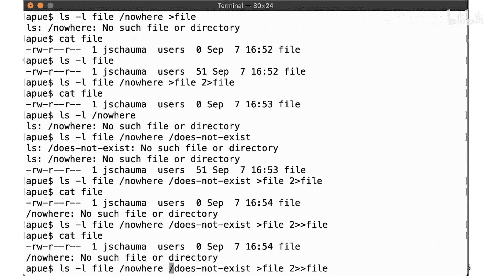

There， that looks better。So we observed exactly the race condition we illustrated earlier。

 and we observed that that air appears to complete before it standard out。Is that always the case？

Well， in general， messages to standard error are unbffered。

 while IO to standard out is likely to be buffered。

 which is why you will likely see error messages prior to normal output when both are connected to a terminal。

But of course， there's a better way to ensure a standard error and standard out go to the same place。

And I'm sure many of you have used it before。The easier way to do this is to not tell the shell put standard out into file and put standard R into file。

 but rather put standard out into file and put standard R， wherever standard out currently points to。

This is the common syntax for that。There we go。The advantage of this syntax is that we can tell the shell to put standard air wherever standard out is regardless of where N out goes to。

The most common use case is to tell the shell to make sure to write both standard out and standard ur into a pipe。

As we discussed and by design that remains connected to the terminal when you pipe output into another command。

So this syntax says open the pipe and connect the net out from the first command to send it out of the second send in of the second command。

 then redirect the netder of the first command to wherever s net out goes to Oh that goes into the pipe。

 O， puts the netter over there too。But how do we do this？

Redirection via greater then and via greater greater than use the open system call。

 But how do we open whatever standard out is。

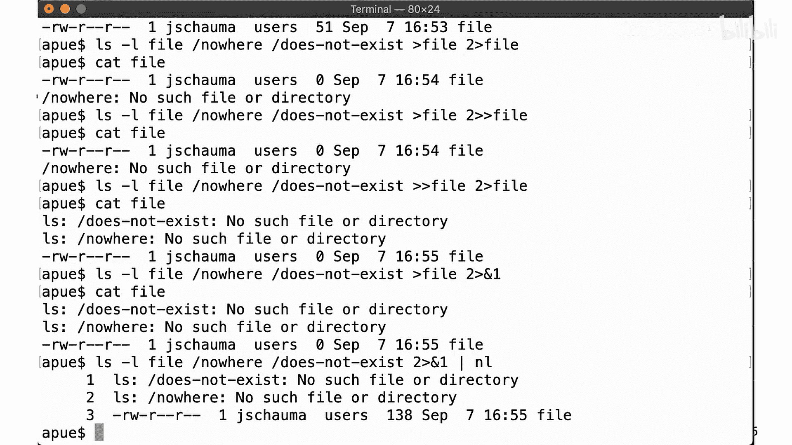

The answer to that question is dupe。The Dope system call duplicates an existing file descriptor。

 and you get back the second file handle pointing to the same file table entry as the first one。Here。

 let's again look at the kernel structures involved。

Note the difference and scope of the file descriptor flags on the left in the process table and the file status flags in the middle in the file table。

Unlike in the case where a process has called open on the same files multiple times and gets back filescriptors pointing to distinct file table entries that then point to the same vino table entry。

Here we have duplicate file descriptor pointing to the same file table entry。

 meaning the two share the offset and file status， flags， etc。

The new file descriptor is indeed a duplicate of the original。

Now to allow for redirection of an existing file descriptor， we can use Dupe 2。

 the existing file descriptor will be closed and instead pointed to the originals Fire table entry。

In code， this looks like so。Here。We define two messages。

 one intended for standard out and one for standard。

Our right both function will write the given marker to stand it out。

And then write the standard out message to the standard out file scriptor。

And the standarder message to the standarderified descriptor。In Maine， we call right both。

Then do standarder onto standard out。 That is we are redirecting any messages to be sent to standard error to wherever standard out currently goes。

 and then we call write both again。Let's run it。Okay， no surprises here。

 we have both standard out and snader connecting to the terminal。

 so the output is sequential and exactly as we'd expect。Now。

 let's suppress the emit by redirecting it to Devnoll。Note that in our first call。

 Staella was suppressed because our shall had redirected it to Devonnel。

But then we redirected the earth from wherever it was pointing to to now go to wherever standard netout goes to the terminal。

 And so the error message from what second call to write both was displayed on the terminal。

How about the other way around？Let's redirect the out to a file。

Now we see an error message on the terminal and the contents of the file show。

That that error message came from the first call to write both when that Er was still connected to the terminal by default。

After we redirect。Sen to send out， the right to senator ended up in the fire。

This illustrates how Duke2 is used to perform output redirection by the shell and is another example of how we can easily confirm our understanding by writing a few lines of code。

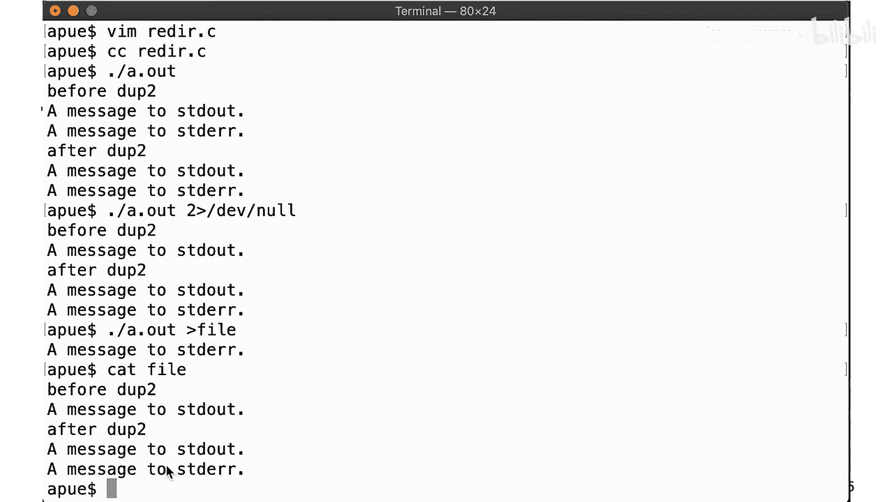

With the visual representation of the kernel objects。

 we've seen that the file descriptor flicks are found in the process table entry。

 and file status flags are available in the file table。These are usually set when open is called。

 But what if we want to inspect or change them when we didn't call open ourselves。

 That is when we all， when all we have is a file descriptor。

Enter F control F control is one of those catch all functions that can do a whole bunch of things。

For example， you can get or set either of these flags。

 but you can also duplicate a file descriptor via F control。

 as well as do a number of OS specific things。Check your manual page as usual。

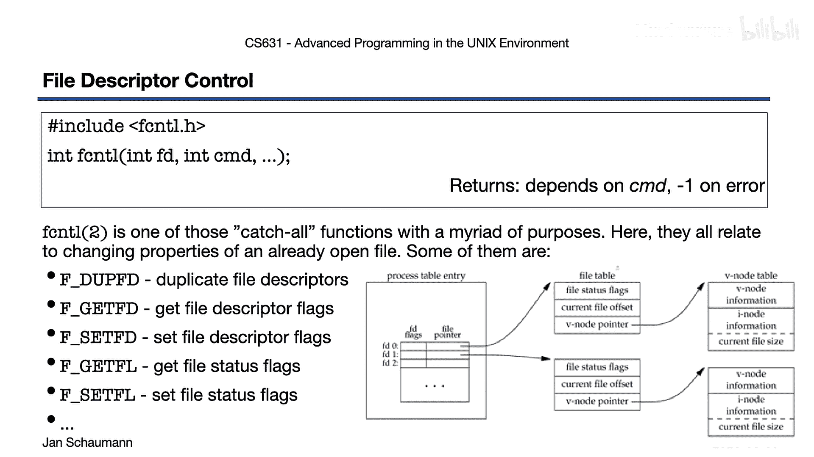

Let's look at an example of using F control。Here we have another version of our simple CAT program。

Only in this version， we want to ensure that IO is done synchronously。As a reminder。

 synchronous output will wait for IO to be flushed to disk after each call。

 while asynchronous output allows the O to handle this more efficiently and cache IO a bit。

Since our simple cat operates and stainner in F now。

 we can't call open with Osnc to turn on synchronous mode， as would be done for normal files。

 so instead we use air control here。To set a specific flag， we first must get the existing flags。

Then turn on or off whichever flag we want。And then set the flags。

The remainder of the program remains the same as before。Okay。Before we run it。

 we'll create a large enough file to illustrate the performance difference between synchronous and asynchronous mode。

Let's make it。At1 me file。Okay， now when we run our synchronous cat。

 we observe that it takes some time to complete。4our and a half seconds。Now。

 how does it compare to asynchronous mode？Let's briefly comment out the Osyinc flag。

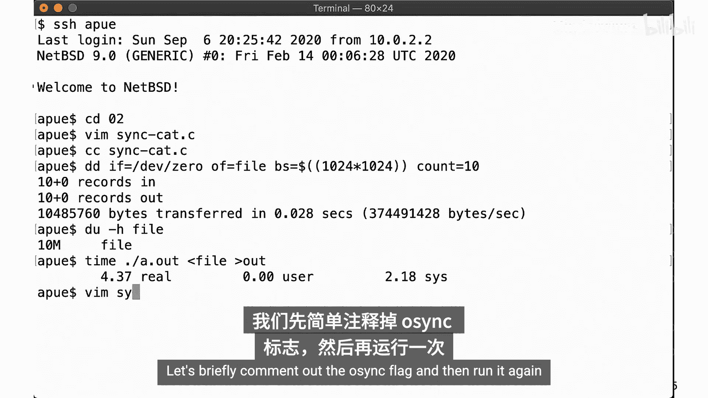

And then run it again。

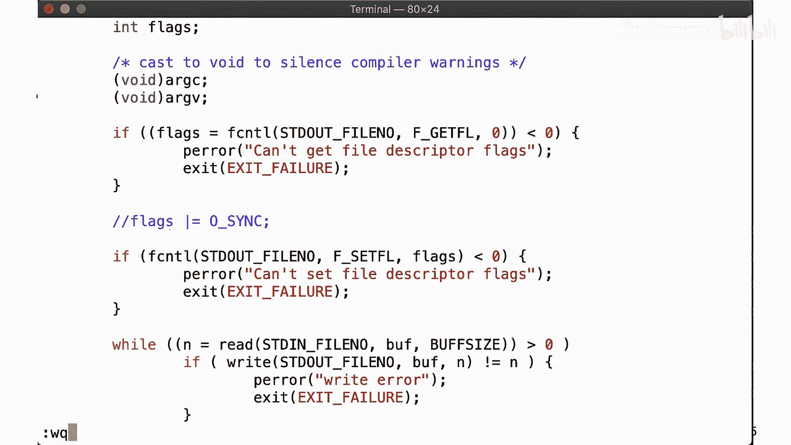

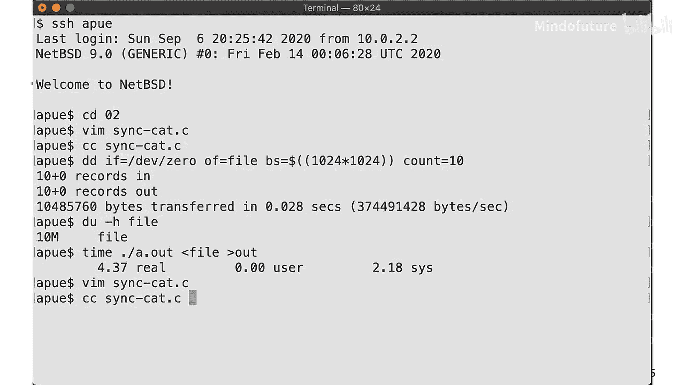

All right， that was a bit faster， wasn't it？So synchronous mode guarantees that I always flushed right away。

 but will obviously take a performance penalty。We can turn on synchronous mode by using F control to set the appropriate file flags。

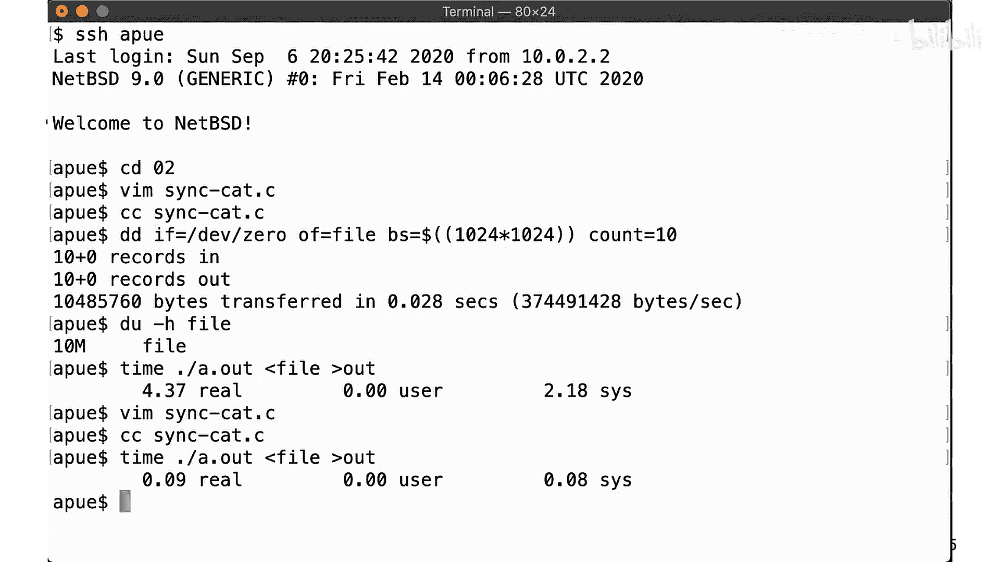

Next， there's Ioctal。Iocal is another catch all function on Uniix。 many。

 many interfaces have been shoehored into the file descriptor API。

 and things that aren't files at all may have certain flags or other type of device specific settings。

The aocal system call is often used to tickle those flags for things like terminal Io， magnetic tape。

 etc。We mention this year for Compness sake only， but you are encouraged to read the various manual pages as you will encounter Iocs when you move on to more advanced systems programming。

Finally， given that the file API in UniX is rather handy。

 let's take a look at file descriptors being represented as files。

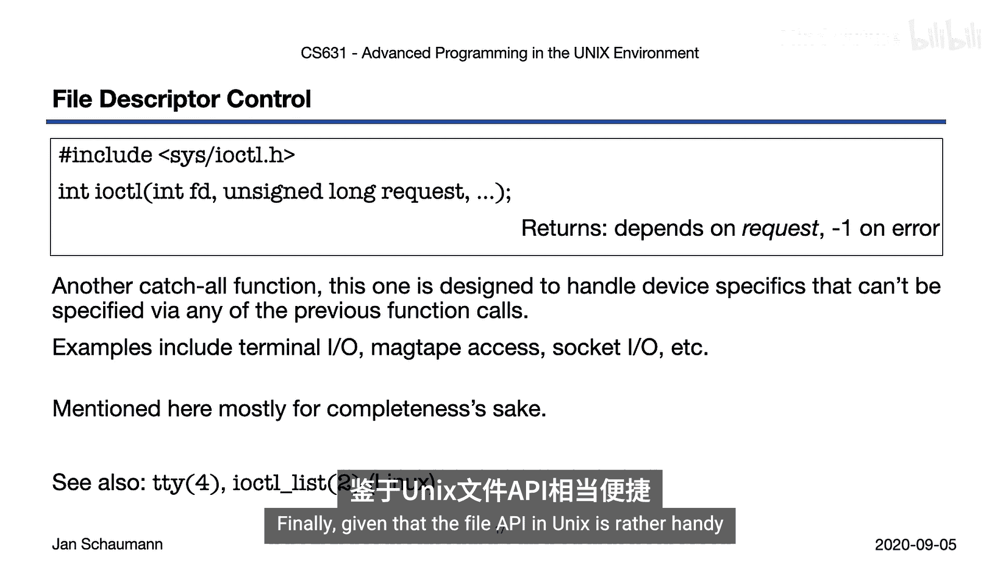

I know it seems like an inception kind of thing， doesn't it？Anyway。

 many UniX versions support the dev standard in， dev standard out and dev standard U devices in the file system to let you access。

 standard in standard out and send error respectively。On our reference platform。

 these are represented as character devices and can be used in place of a regular file。

This allows you to write a program that processes files as well as standard input， for example。

 by specifying Dev standardend in as the pass name to open。To illustrate this。

 let's create two files and TK to display this in an input in between those two files like so。

Here we see that CA processes files。In order from left to right， first。

 displaying the contents of the first file， then contents of defaf standard in。

 which it now gets from the pipe， then contents of the file third。

An alternative way of referencing send it in by our path name。Maybe the use of slash depth slash Fd0。

Another path name representation of P descriptto0。冇。What do those things look like？

Let's look under DFD。Similar to def standard that In。

 there are character devices connected to your terminal。So far so good。

Let's compare two other Uni versions once more。First， Meko S again。On this system， deton it in， etc。

Are siblingbls to death 50，1 and 2 respectively。But what does D50 look like？Here。

 the FFD represents the open file descriptors of the current process。

 so of course we expect to see FD 0，1 and2 to be connected to the terminal。

But we also see two additional physcriptors。Of type directory。Let's find out what those are。

Let's look at the ine number of the currentbro directory。As well as that of DFD。

Then let's look again at the contents of D50， but this time。

 also display the inode numbers of the files shown there。Note that F0。

1 and2 are all the same Iode they are connected to the same thing， our terminal。

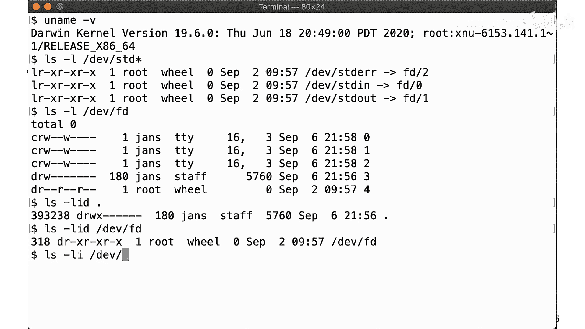

Phi thescriptor 3 is connected to Ine number 393238。

 which appears to be the current working directory。And P descriptor 4， inote 318。

Is the directory deathft D。All of this makes sense。

 since every process has a current working directory， which it has a handle on。

We asked the LS command to list the contents of DFD， so of course it has a file handle on that too。

Now， what happens when we create a pipeline？Looks like we have just about the same filescriptor is open。

 but this time filescriptor 1 standard out as of type 54， a named file named pipepe。

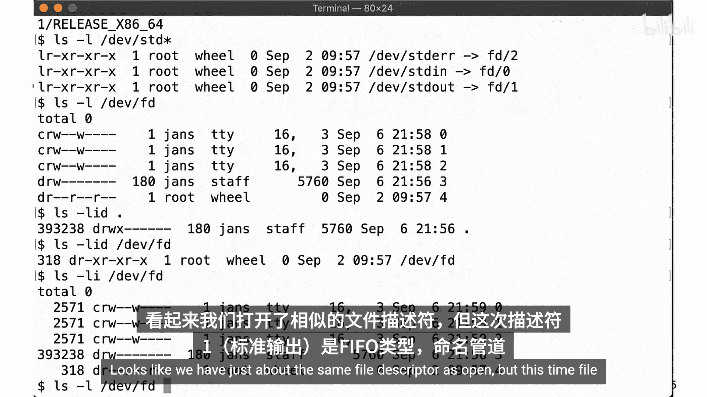

If we redirect， send an Er into the pipe as well。Then we should not be surprised to also see FD2 become a PIFO。

Which appears to be how this operating system happens to implement the shell pipe。Okay， next。

Let's take a look at Linux again。Here， defsin the etc are also some links。

 but do something called slashproc self FD。Slash Proc is the main point for ProcFS。

 a pseudo file system that allows for a number of process specific properties to manifest in the file system。

To confirm death ofD。Points to proc self FD as well。In it， we find fire descriptors。

When we list them。In it， we find fire descriptors 0，1 and 2， pointing to terminals。

 and another entry pointing at ProC 8461 FD with 8461 being the process ID of the LS command。

What happens if we use a pipe here？Look at that， file as crypto 1 becomes a socket。

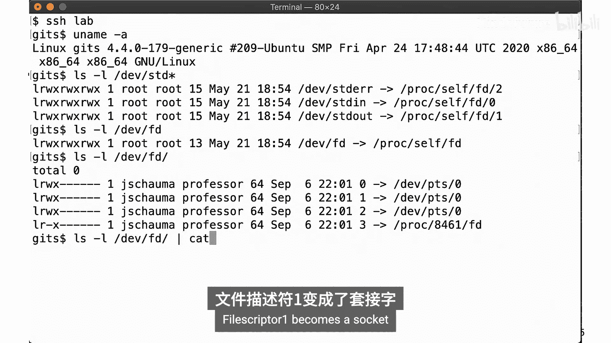

Looks like this operating system implements the shell pipe as a socket or a socket pair。

Well see those together with five0 pipes and electron enterprise communication again in a much more detail。

Now notice that the process indeed changed in between invocations。

 which is expected as every command gets its own process。

Where is the process idea of our current shell？8450 So let's look at this shell's currently open file descriptors。

As before， F0， 1 and 2 are connected to the terminal。And then。

Looks like this shell has a file handle open to a shell history file。Many shells， by default。

 log all commands entered into a history fire。 So it's no surprise that the shell has that file handle open。

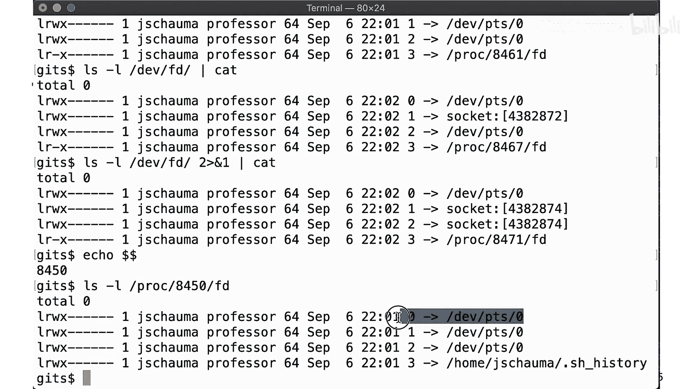

Now， finally， let's take a look at why it might matter how a shell implements a pipe。Previously。

 we were able to use the path name， Devtenenain， to fill in when processing files in a pipeline。

Deef50， which deaths than at endpoint do， behave as expected when connected to a terminal。

But when we try to use it in a pipe。

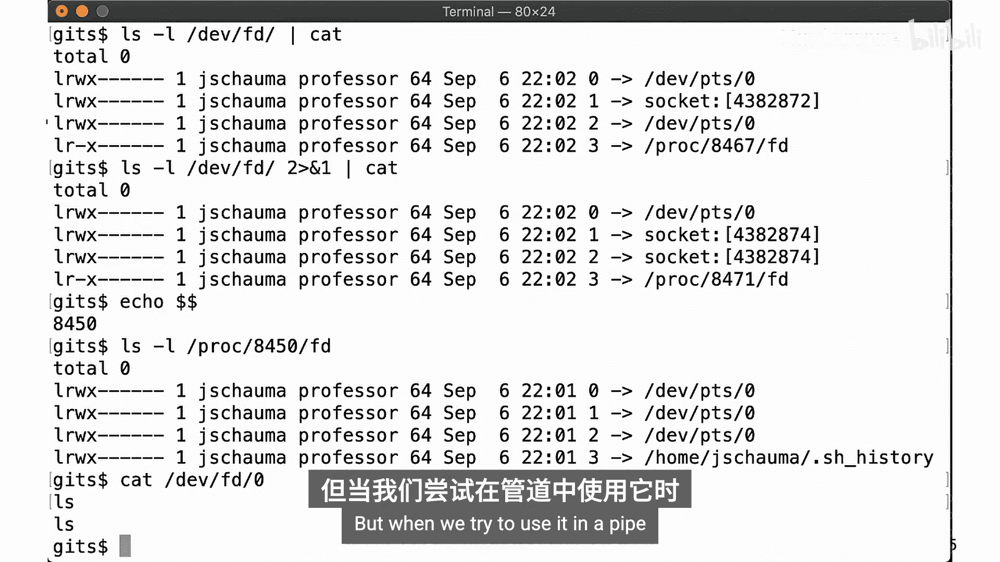

We get a weird error， deafin in， no such device or address。This is because， as we saw above。

 Linux appears to implement the pipe using sockets。But you can't open a socket。

We have other system calls for handing sockets。But the cat command knows nothing about sockets。

It's been given a path name Devafended in and tries to open that path name， which now fails。

This is a reminder that even though different Uni systems behave similarly and ought to follow the same semantics。

 sometimes things break or behave in unexpected ways based on how somebody chose to implement a certain feature。

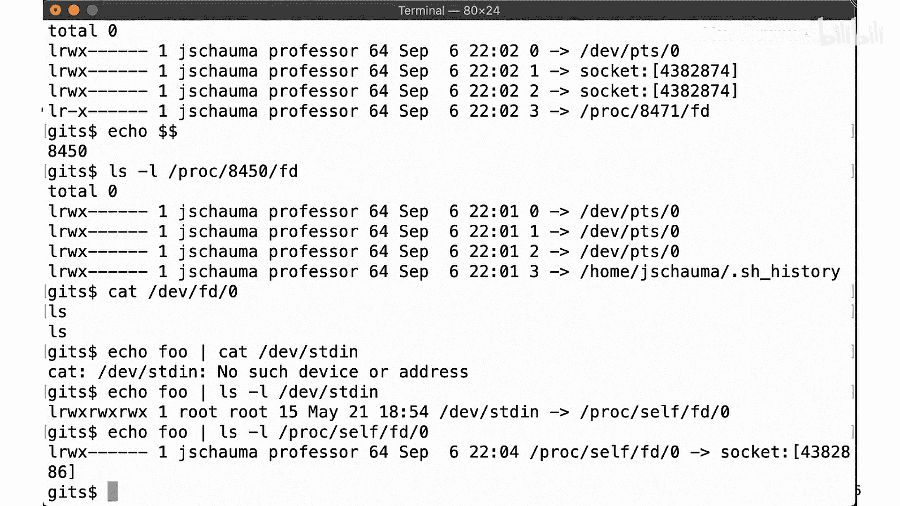

All right。 This finally gets us to the end of our week two materials In this series。

 a video segment we've covered in some detail all of the five cis used for almost all Uni file I O。😊。

We've run a number of code examples to clarify our understanding and illustrate certain perhaps surprising aspects。

There are a few additional links in the PDF of these slides。

 so please do make sure to check those out。But with all this。

 you're now more than ready to finally put your knowledge to the test and I've posted the first homework assignment linked here。

We'll discuss the assignment in more detail in class。In our next lecture。

 we'll move on to Fton directories。 and will spend a fair bit of quality time with our new friend。

 the Strtad。Until then， thanks for watching。Cheers。

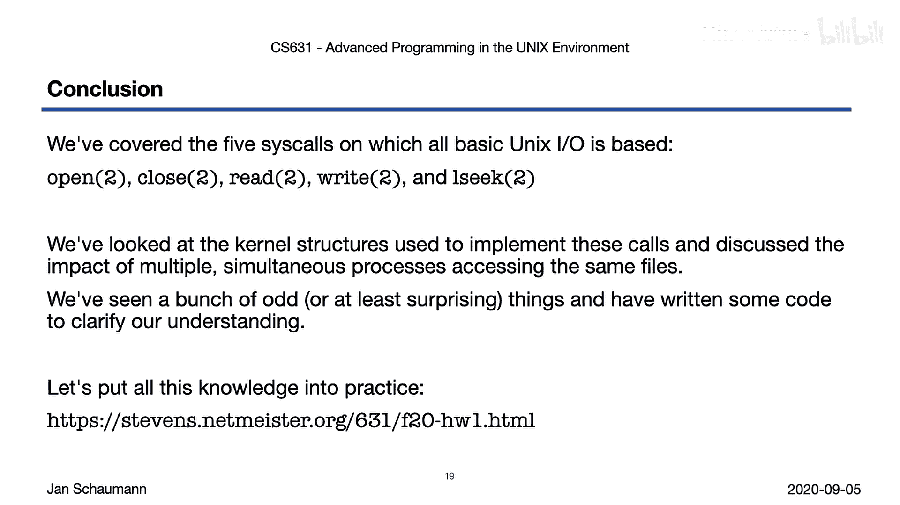