# UNIX高级编程-p10-P10-Week-03,-Segment-1---All-about-stat(2)--BV1hPuVz8EWS_p10-

Hello and welcome to CS631 Advance programming in the UniX Environment Week3。

In our previous segments， we focused on file descriptors。

 but in the process we encountered a number of properties of files。

 such as the optimal file IO block size when we looked at boosting the efficiency of a simple cat cloneown。

We will revisit these different properties in much more detail in this and immediately following sessions。

So get ready to meet your new best friend， thestructt。

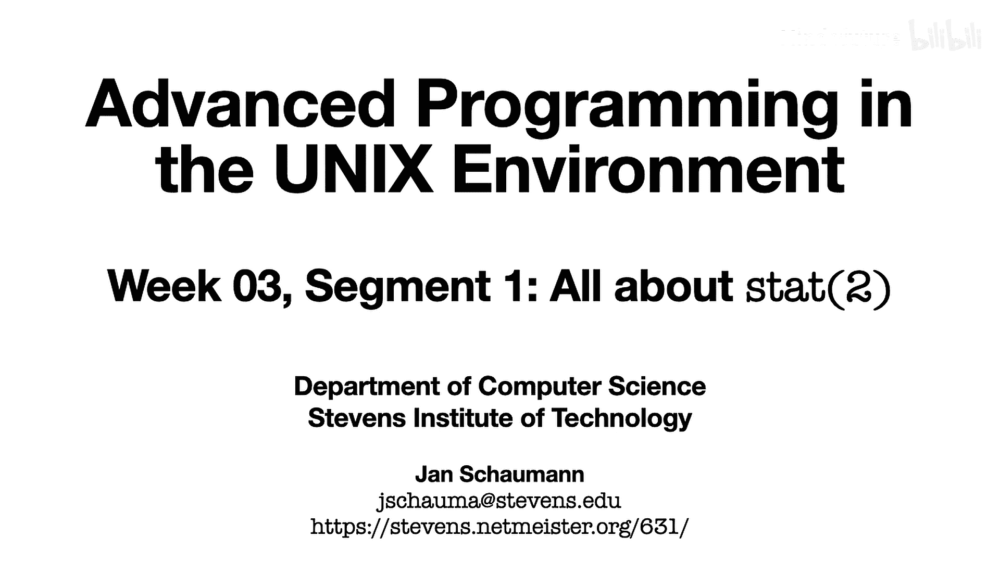

To obtain information about a file， that is to get all the meta information。

 not the contents of the file， we introduced the sta family of system calls。

As we will see with the related cico to be covered within the context of files and directories。

 Stat comes in three flavors， Stat， Lstt and Ftt。The Fstead version differs from the others that it accepts a file descriptor。

 which falls in line with our previous discussions of most I hope being done on file descriptors。

But in order to get file descriptor， one the first has to open a fire。

As we will see in a future lecture， the fire data， the fire met data are well separated in the standard Unix file system。

 and it often is useful to be able to get information about a fire without opening it。

So to obtain information about a fire， we pass a pass name to stat。

 as well as appointed to a struck stat， which this hisco will then fill in。

As we saw in our discussion of the open system call。

 there's also a need to allow for atomically accessing relative path name outside of the current working directory。

So the F that at Su called meets this need similarly to open it。

 taking an additional file descriptor referencing the directory as an argument。As usual。

 the return code of sta is 0 and success， negative1 on error with Erno set to indicate the nature of the error。

Yes。We are interested in getting all the meta information about a fine。

The idiomatic way for a function to efficiently provide complex information。

 as well as follow the convention of a simple， meaningful error code is to take as input appointed to a data structure that the call then fills in。

In this case， the data structure in question is strtt。And so often。

 the details of the struckstead are always version specific。

 with the lowest common denominator being the fields defined by Posss and shown here in this slide。

Of course， your particular Uni version may support additional fields， so altogether now。

 check your manual page for details。The fields required by projects shown here all help describe the file in detail and expose important information used by many tools。

 Most notably， of course， the Ls command。I promise youll get very familiar with all of them in the near future。

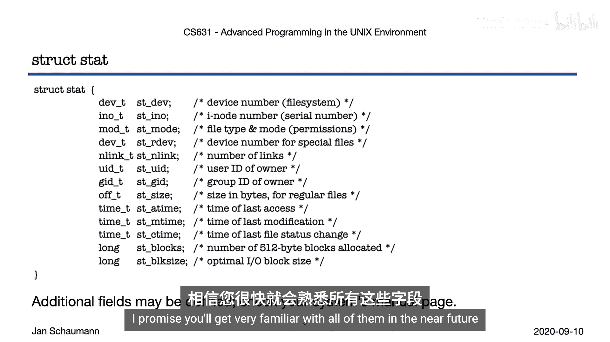

Before we look at thestruct that information， let us create a small second disc for RVM to play around with。

We use this disc throughout the next few video segments to better understand the fiist。Of course。

 you can use the virtual box U I to add a new disc， but where's the fun in that。

 We'd like to use the command line。 So here we go。Let us create a new medium of type disk using the VMDK format。

We make it 50 megs in size and place it into the directory alongside our VMs rootdes called in disk 2。

It's a small disk。 so that goes fast。Next， we attach the new disc to our VM as an IE drive。

The attached on port0 as the second device device1。

And specify the path to our newly created disk image。And that's it。

 we effectively plug in a new hard drive into our server。So let's start our VM。Okay。

 once we have it booted up and log in。We need to create a new file system on the disc。To do that。

 we use the new FS command and we specify a block size of 4096 bytes。Next。

 we mount the new disk under mount。And then we change the ownership to our user。

 so we don't need super user privileges to write data to the new disk。

Let's take a look at the available space。And finally。We create a simple one megaby file。

LSL then displays the file and the output that we used to。

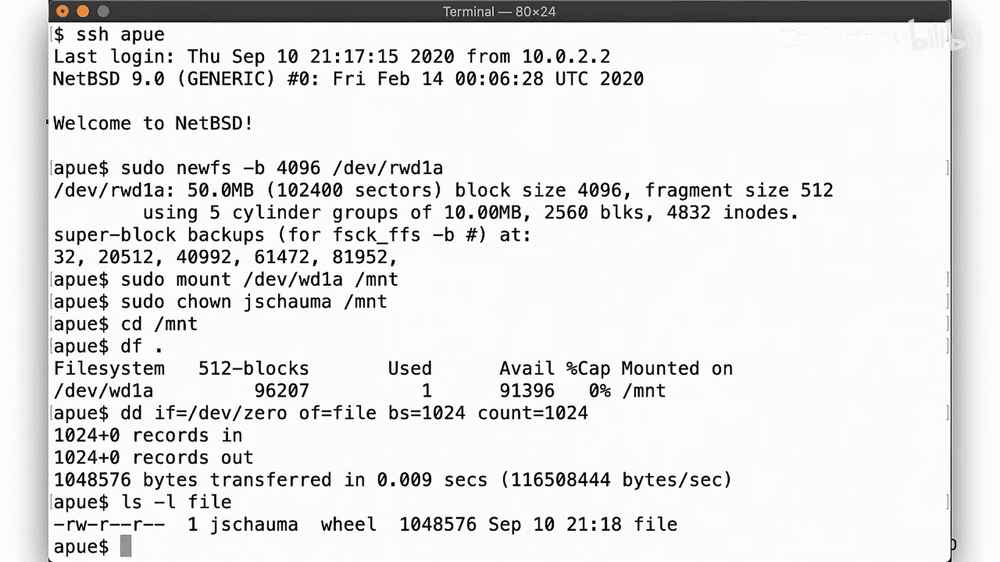

Okay， so let's take a closer look at the output of LL。

Each of the fields in the output is derived from the information in the strict state that we saw earlier。

There is L call sta， and then displayplace the data in the given format。

The permission string on the left side is derived from the ST mode field。

Next comes the number of links for this file。 that is the number of names that exist for a file associated with this particular iNotode。

After that comes the owner of the file。A symbolic username shown here that is derived from the S U I field。

Just like the group owner names derived from the S T Getfield。Next。

 LS shows us the file size and bytes， as found in the ST size field。

The data shown here on the right finally is the last modified time step。

 convenient formatted in human friendly form by L from the STM time field。

And all the way on the right is， of course， the fi name， which。

Is not found anywhere in the strutstead at all。We'll get back to this in our next lecture。

 But for now， let's remember that the fire name is not a property of the file。

 Theres a mapping found in the directory。As we've seen。

 the output of the LS command includes a lot of information from thestruct set。But as often。

 there's more than one way to do it。Specifically， most UniX versions nowadays have a stat command that allows you to retrieve and inspect the fullstruct sta。

 including the fields not exposed by LS。Although we should mention that this that command is not part of politics。

As a result， the output and usage of the sta command differs quite a bit between different Uni versions。

Okay， so here we see the sample output of the stainvocation on the previously displayed file。

By default， instead displays the information in human friendly output。

 The dash R flag changes the display to show us the actual values。Specifically， as shown here。

 the default output displays the ST devF， ST Ino， ST mode， STN link， UI， Git， Ref size。

 A time M time， C time， bread time， block size blocks， and ST Fl fieldss。

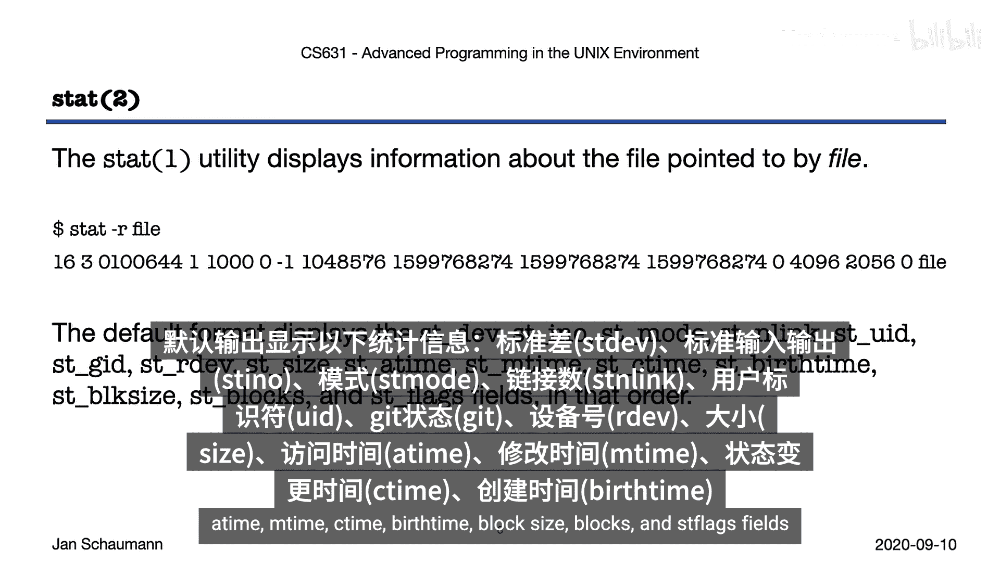

The S T Defield identifies the device I D the file resides on。 I either disk。

Together with the in number， this uniquely identifies a file across all mount points in the files list。

The E mode encodes the file type， as well as the permissions。

 which you may recognize here in the familiaroc display。The link count， S N link， the numeric U I。

 SD U I and group I， S T good we've already seen。STRF is only used for certain devices。

 which is why we see it set as negative one for regular file， as in this case。S the size。

 the South expplanatory， comes next。The STA time， M time。

 and C time represent the file's last access， modification， and file status change time respectively。

As we described in our early lecture， times like these are kept a second since the epoch。

We'll get back to the meaning of these three times stamps in a future video segment。

The S birth time is another time step， which is not required by Posss。

 It may not be supported by all Uni or file system versions。

 it represents the time of Ioded creation。In this case。

 the fire system we created on our extra disc mounted under flash mountund is of type FFS V1。

 which does not support an Eod birth time。If you were to run the SD command in your VM on a file。

 another root file system， which was created with system default as an FFSV2 file system。

 you should see an actual timestamp here。The next two fields。

 ST block size and ST blocks we've already seen。The final S Fl field encodes additional Firefls that we'll see in the future。

 although you may already take a peek at the Fls manual page and the dash O flag for Ls。

 if you're curious。Now， as we mentioned， the ST mode includes not only the file permissions。

 but also the file type。 so let's take a closer look at what types of file we might encounter。Now。

 obviously， they are regular filess。This is really what most of us mean when we say， a fire。

A file is merely a way of stationing a bunch of bys onto disk。

 And it's important to remember that Ex does not care what you do with those bys。 That is。

 there is no difference between a binaryry， an image file， a spreadsheet。

 an email attachment or shared library。 As far as the file system is concerned。

 they are all regular files without any particular meaning。

It is up to the application to interpret the sequence of bytes found on disk。Next。

 there are directories， which is to say that yes， a directory is a file is a special type of file。

 one that map symbolic names， strings， which humans tend to find awfully convenient to in numbers。

 allowing the file system to find the file meta information and data blocks associated with that string。

Any such directory entry， such a mapping between an in and a string is known as a link or a heart link。

 and on any file system or even within one directory。

 there may be many such mappings of strings to a particular in。

We'll learn more about directories in the later segment and we'll look at some file system implementation aspects in the next week's topics。

Next， there are devices which are represented as files usually under the slash dev directory in the root of the file system。

These devices come as either character special devices， terminals， for example， and block devices。

 disks。Next， theres a type of file called a Pfo， also known as a named pipe。This isnt a nutshell。

 an inter process communication endpoint， and like the shell pipe that is manifested in the file system to allow unrelated processes to communicate with one another。

Similarly， there are files of type socket， which are likewise used as rendezvous points for unrelated processes on the same system for inter process communication。

Note that these files of type socket are different from network sockets。

 although the APIs for communications used here are the same。

We'll revisit both of those as well in the future lectures。And finally， there are symbol wall links。

 which are interesting in that there are files that contain us their sole contents。

 the past name of another file and which， when accessed， simply say， oh， don't look at me。

 Look at this file over here instead。😊。

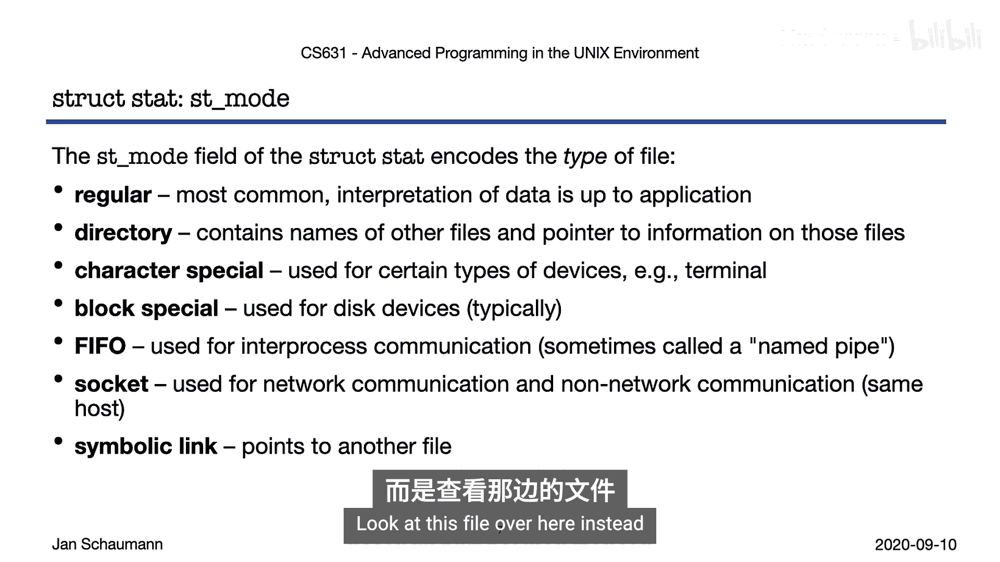

Let's take a look at some of the different file types when we encounter them on our file system。

Remember our low power clone of Ls from week1。All it did was open the directorctory and iterate over the entries and print out the names of the file it encountered。

Let's improve this program to tell us what type of file it is。To do that。

 we make the following changes。First， we change our current working directory to the target so that we can then call Stat simply by passing the file name and obviate the need to construct an absolute path name。

Then as we loop over the directory entries， we call Stat and have it fill in the Str sta buffer here。

Based on the information in thestructstead， we then determine the fire type。

Our I get type function uses the S underscore is macros on the S mode field to identify the type of file。

 returning a descriptive string for each file type， including accounting for an unknown file type。

 because， hey， you never know。 And we want to write defensive， robust code。

After we have identified the fire type， we then call Ltt。Ett behaves just like Stet。

 but if the filing question is of type slink， we get the information about the s。Remember。

 a simple link is a file that says nope go look at that file over there。 So when we call stat。

 it will look at that file over there。 Ie whatever a file the sibling points to。

So if we want to identify the simlink and determine say the file ownership et sea of the simlink。

 we need Lt。Okay， now before we run this program， let's create a bunch of files of the different file types。

First， and directory。Then symbolic linked to a character special device。

As well as one to a block special device。And one to a directory why not。Let's create a 54。

As well as as link to a file of type socket。Next， we create a second hard link for file called file 2。

And finally， a some link to a fire that doesn't even exist。Okay， let's see what this looks like。

Let's run LSL。Here we see the type of file identified by the first character on the left。

L for symbolic link， D for directory， etc。P for files of type 54 as they are a named pipe。

 hences the P。Regular files don't carry the character。

 and we observe that both file and file2 of identical size and have identical last modified timets。

Now， let's run our simple e though。

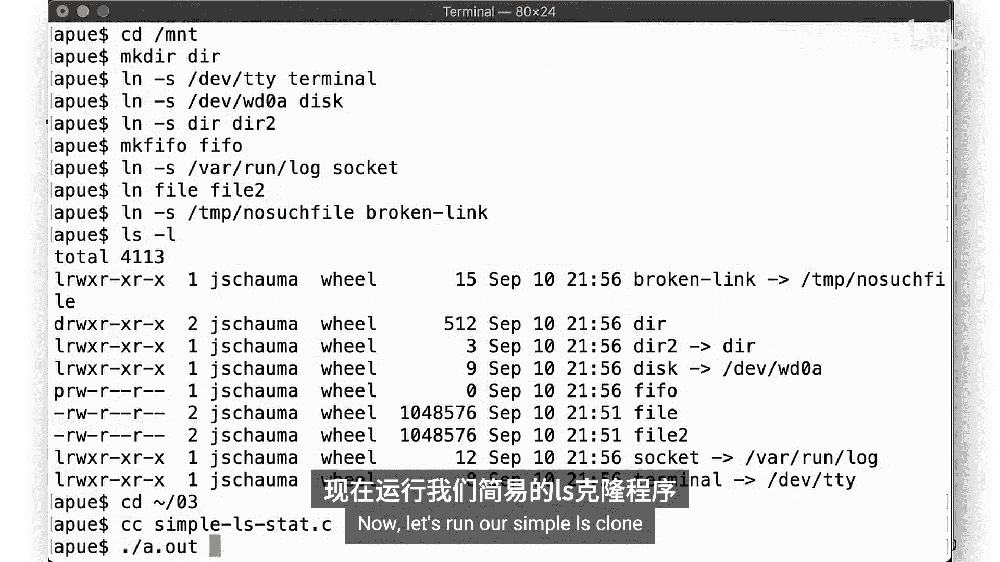

As expected， we get the file type correctly identified as type directory or regular file and files that are ss to something else get identified by Ltt as ss by regular stat as whatever the file the sending points to。

We note that we can have broken simlinks。 That is a s that points to a path name that doesn't exist。

 In that case， Statt failed， but Elst succeeded， which is why we get the output slink to unknown。Now。

 the cool thing about Ss is that you can unbreak them simply by creating the target。

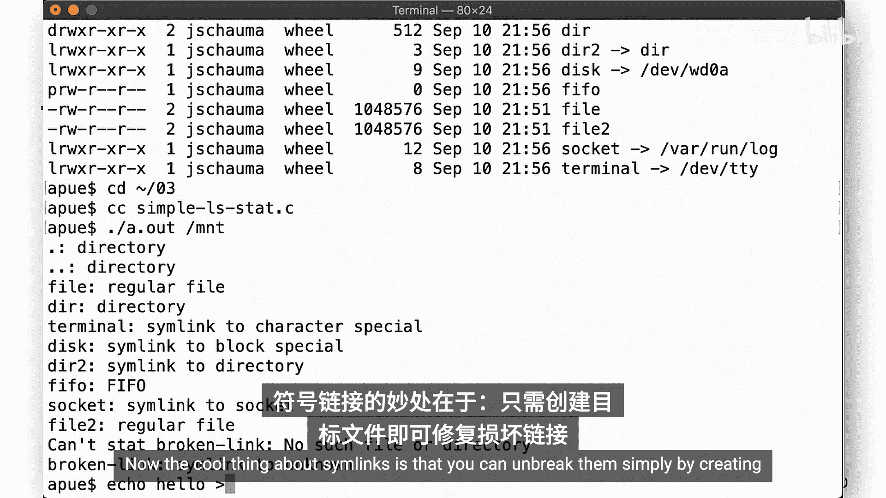

No need to make any changes to the simlink itself。

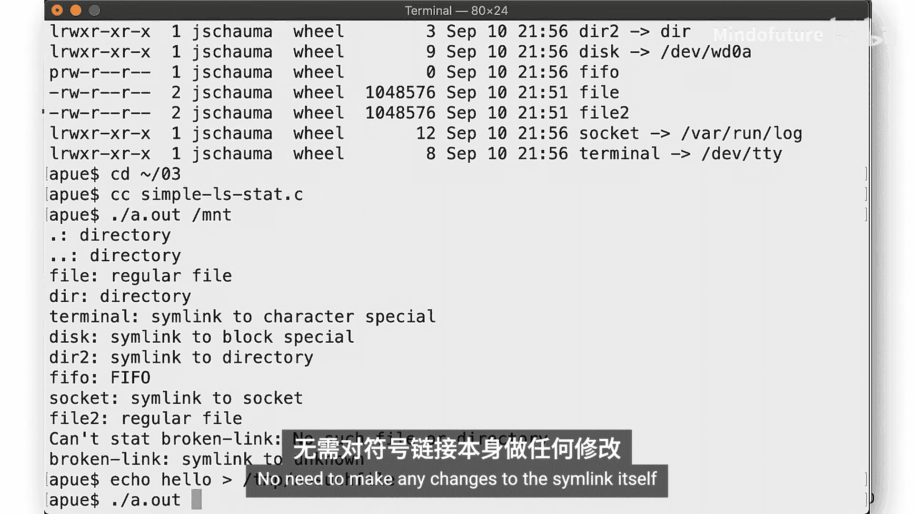

As soon as the target exists， the program will be able to start it via the Sim。

So now let's get back to the other type of link， the heart link。As we showed a minute ago。

File and file to look identical。And we manipulated one file。For example， by truncating it。

And then writing the string foo into it。Then fire two。Is changed， as well。

We note that the S link count for file and file2 is shown to be2。That is。

 there are two things pointing to the single file that now contains fool。

Let's ask Els to show us the inode numbers of the files。

Here we see that both files have the inode number3， meaning they really aren't two files。

 they are one in the same file。Let's read some data into the fire。Maybe 10 K should be sufficient。

If we wanted to read the file as efficiently as possible， we'd want to read it in 4K chunknks。

 as shown in the S block size member of the Strtt。Remember， when we created the fire system。

 we explicitly specified the block size of 4K。 so this number should not come as a surprise here。

We can also look at how many actual disc blocks are used by this 10 K file via the dash S flag4 unless。

In this case， we see that file uses 20 blocks。But weight，20 blocks and the block size of 4K。

That's more than 10 K total data。Let's quickly check what Man ala has to say about block sizes。Okay。

 here we are。S displays blocks in units of 512 by or block size from the environment。

That is the 20 blocks reported here are 2512 byte blocks。Which adds up nicely to exactly 10 gay。

But our file system uses 4K blocks。So how many of those does fire take up？Martha's heart。

 so has quickly set the block size environment variable so that Ls can tell us。And there we have it。

3 blocks。 Well， technically，10 K would require 2。5 blocks， but we can't use half a block。

 So our 5 would require 3。4 blocks。Note that the default of displaying information in 512 pipe blocks is all over the system。

 such as when running the D F command。But with consistency， a key part of the Unix environment。

 these tools can often also account for the same environment variables。

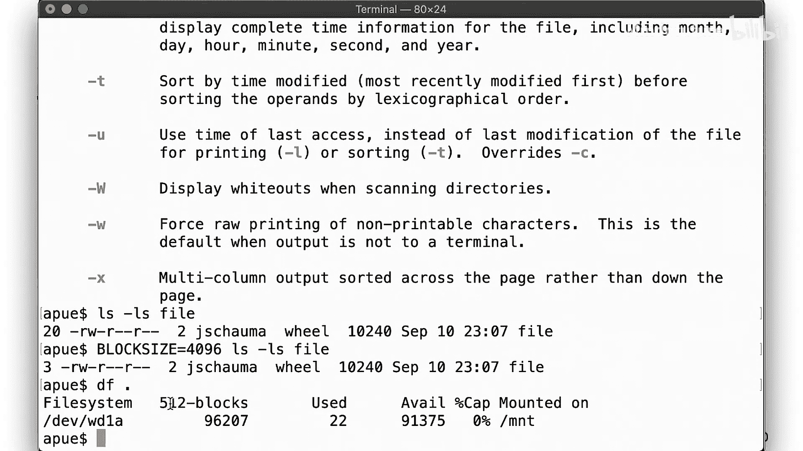

So running Df with a block size set to 4K will cause it to display the information in those size chunks。

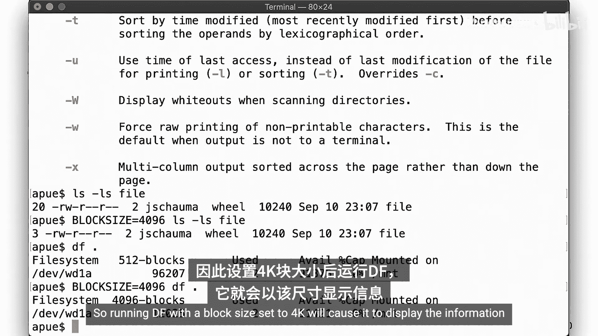

There's more in block sizes on disk versus in the P system coming away in future lectures。Lucky you。

All right。Let's part at this point。 We've already covered a good bit。 We've met our new best friend。

 the Strtt。 Trust me， you get intimately familiar with it and all the other fields in the very near future。

We've also seen how the LS command makes use of thestruct that information。

 as well as how the Stat command provides the remaining fields。

It's a useful exercise to compare the implementations of this command。

We've revisited the ST Block and ST block size members from our discussion on IO efficiency。

And we've improved our simple LS clone to show us what type of pilot encounters。

Including accounting for symbolic links。Not bad for our first segment， but as so often。

 we've just scratched the surface。 and there's a whole lot more to come。

 So stay tuned for our next segment， and we dive deep into file ownership and permissions。😊。

Thanks for watching and make sure to reproduce all the command exercises shown here on your own systems。

Until next time， yes。

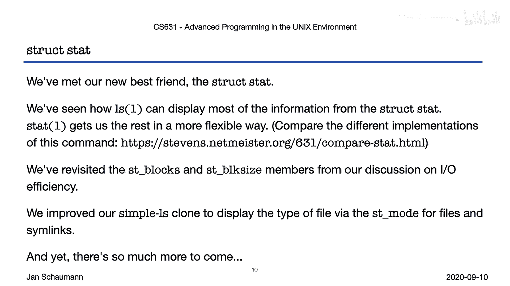