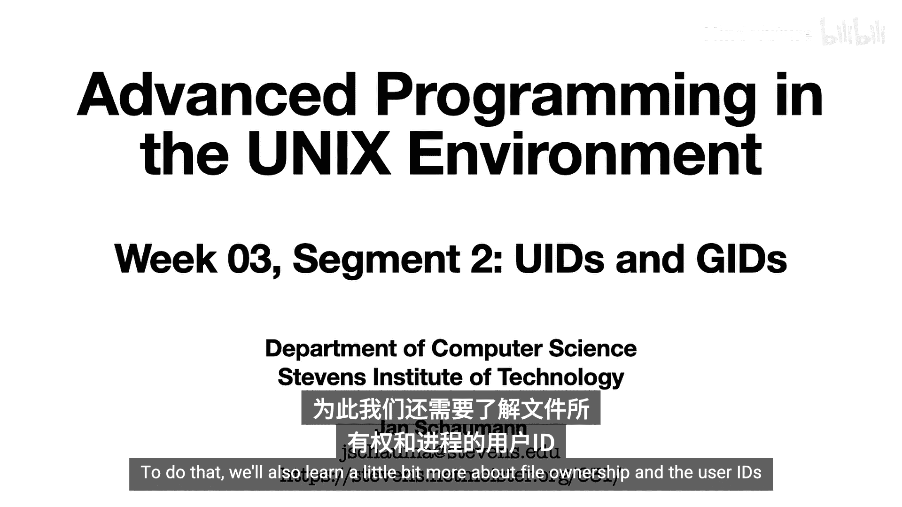
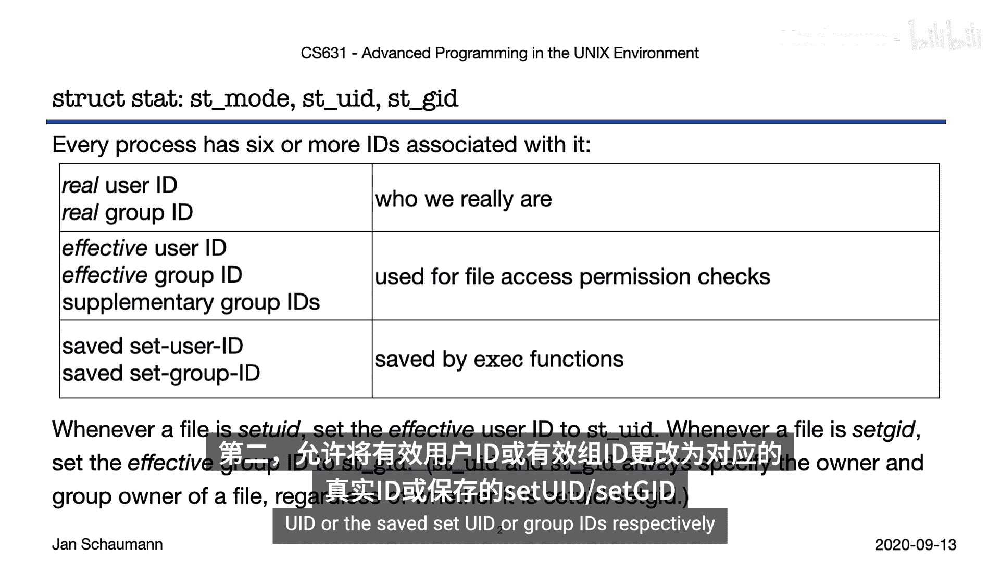
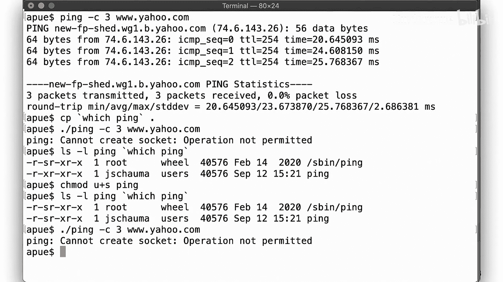
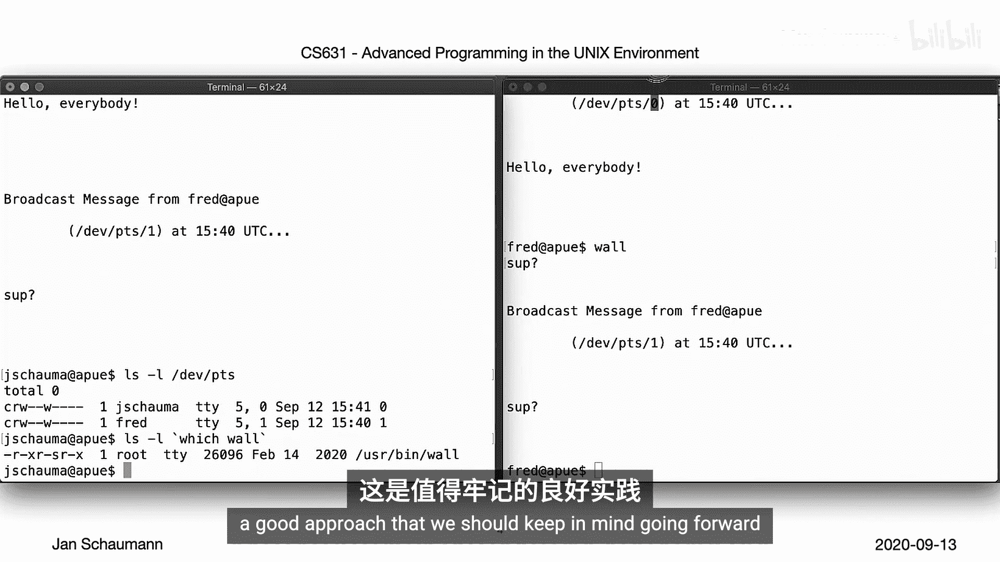
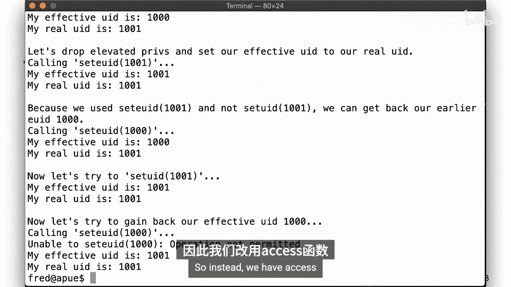
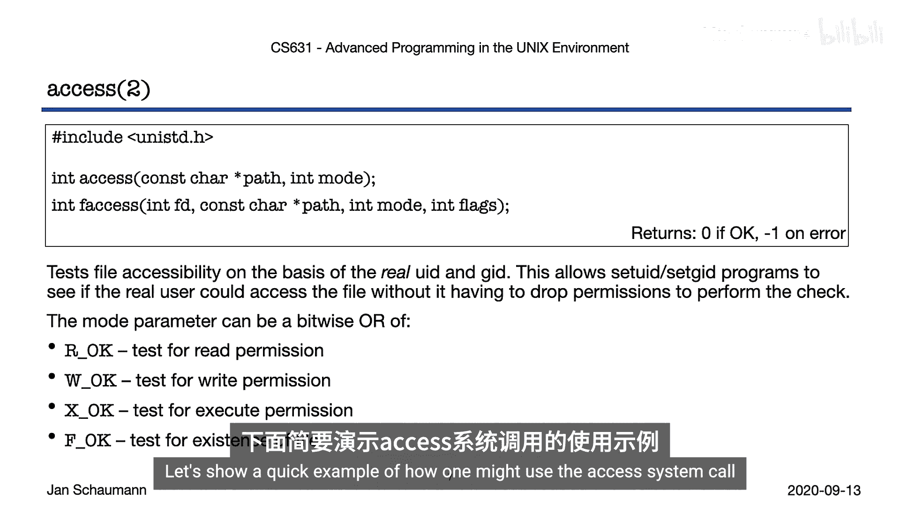
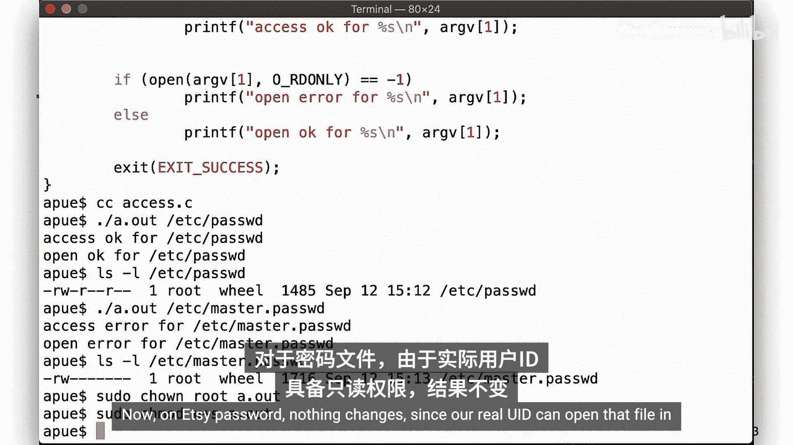
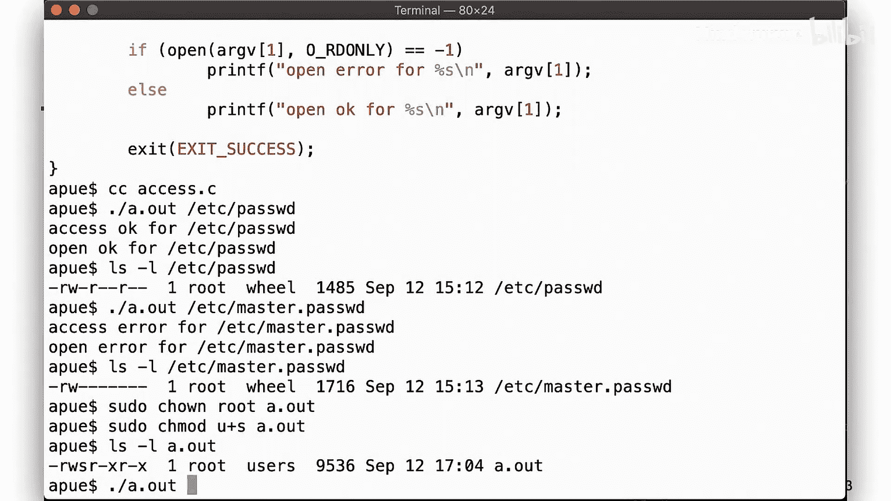
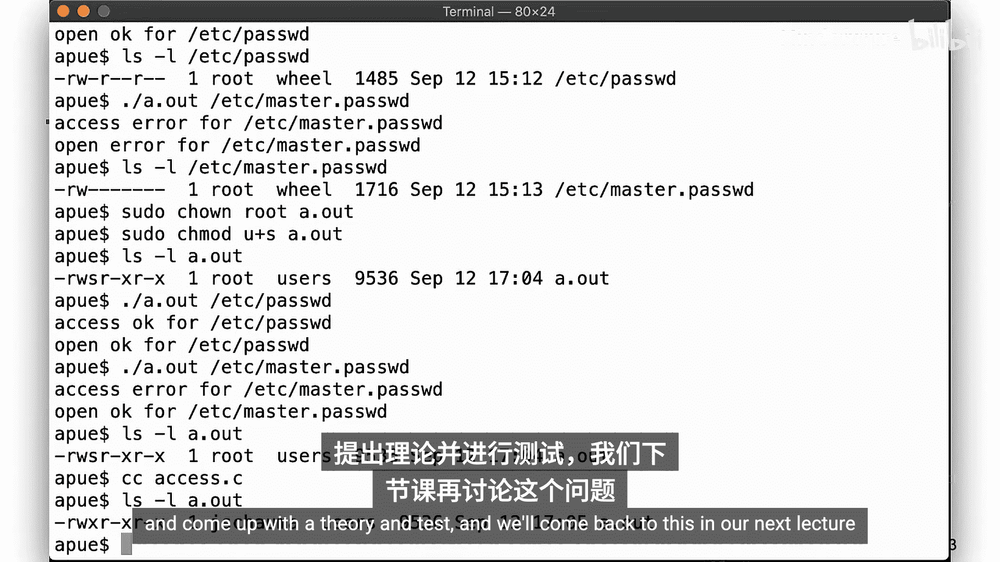
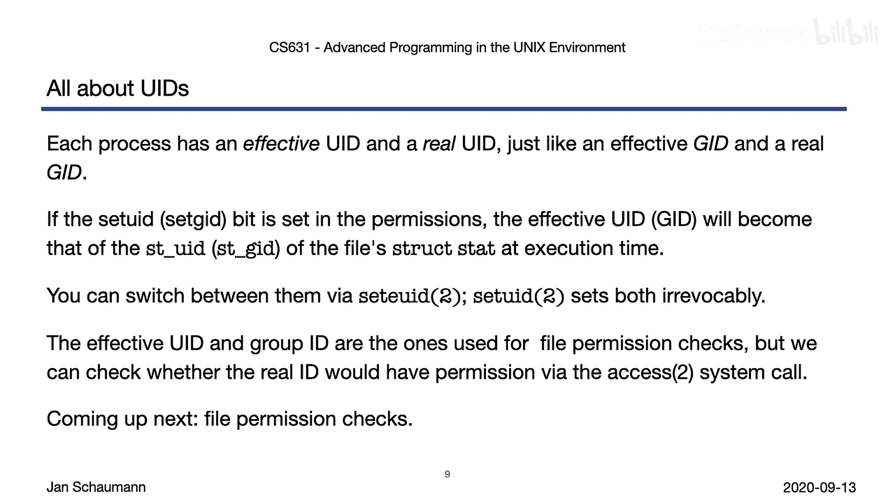

# UNIX高级编程-p11-P11-Week-03,-Segment-2---UIDs-and-GIDs--BV1hPuVz8EWS_p11-

Hello and welcome back to CS631 Advanced programminging in the UniX Environment。

This is week three segment two， and we're getting even more close up and personal with the str sta which we met in our last segment。

In the next few sessions， we focus primarily on the ST mode member。

 and we will discuss how five permissions are set and applied。To do that。

 we'll also learn a little bit more about file ownership and the user I of a process。

 the focus of this video segment。

Okay， let's begin。Every process running on a Uni system has six or more UIDs associated with it。

They are shown here。For starters， there's the real user I D and the real group I D。

 They represent who we really are。 This is important since the process may change the I that it would like the system to consider when granting permissions。

For that， the system uses the process's effective user ID and group ID。For group permissions。

 a process may further have additional secondary or supplementary group ideas associated with it。Now。

 in most cases， the effect UID and the real UID are identical。

 just like the effective gi and the real gi are likely identical。However。

 in some cases it is useful to allow an executable to be run with changed， often elevated privileges。

 including even those of root。In that case， we set a special bit on the file ST mode。

 the set UID bit， and the system will set the effective UID or EUUID to that of the owner of the executable。

The real UI will remain that of the user。Similarly。

 the same can be done using group ownership and the said Gitbit。

 We'll shown an example in just a second。When a set UI process is exact。

 the socal Sa set user ID is set to the effective user ID。

 This is important a call to change the effective user ID later will only be allowed if it is to change the E UI to the current real UI or the saved set UI。

By using and allowing the Sa set UID， a program is then able to toggle its effective UID between the elevated privileges and the privileges of the real user。

The behavior and semantics of these safety Us is a bit confusing as the historical behavior was inconsistent between the BSD and system 5 derived systems。

I have some links in the code examples for you to read up on if you're interested。

 but the important takeaway here is that one exec sets the Sa set UI and saved Se Git。Two。

 changing the effective UID or effective group ID is allowed to either the real UID or the Sa set UID or group IDs respectively。

Let's illustrate the need for the ability to assume another US。 privileges by example。

As you probably know， the PI command sends out ICNP Echo request packets to the destination。

 awaitvaing echocho reply packets in return。But sending ICMP packets requires the program to open a network socket in raw mode。

 which in turn requires super user privileges。Without the ability to elevate privileges。

 only Ru could p hosts。This is what that would look like。No good。

The only difference here is that the set U ID bit on the executable。

 as indicated by the S in the permission string， Let's take a look。Okay。

 so if that is the only difference， maybe we can try to fix it by changing our copy of Ping to also be set UI。

Well， it looks the same。But no surprise， that's not good enough。Remember。

 the set UD bit says when a user executes this file。

 set the effective UD to that of the owner of the file。But we already are user J Shaalma。

 So our effective UID already is the one that this set U Ibit would enforce。In other words。

 the C UID bit is only meaningful when the SDUI field and thestruct sta of the executable is different from the EUUID of the user executing the command。

Now， while the setu ID bit is a commonly used mechanism and can if the program in question is not written with particular care due to serious security issues。

 the concept also applies to group IDs again let's illustrate by example。In this case。

 we have two different users logged into our system。

 user J Xma on PTS0 in the left hand terminal window and user F on PTS1 in the right hand terminal。

When you have a multi user system that sometimes is necessary or desirable to be able to send a message to all currently logged in users for this。

 our Uni system comes with a wall command that allows any user to send a message to all other users to be displayed on the terminal。

Here， let's say hi to everybody。As a result， we see the broadcast message displayed on all users terminals。

 including the senders。Fred， over here on the right。

Is delighted to have received such a kind message。And replies in kind。

As the broadcast message indicatess， the communication happens via the pseudoterminal。

 PTs0 and PTs1 in this case。Let's look at that。For each logged in user in the system。

We create a pseudo terminal， messages written to this device and displayed on the user's terminal。

But for hopefully obvious reasons， we can't just let every user write to everybody's terminal。

 and the file permissions shown here reflect that。But we notice that these devices do have a group right permission set。

And that the war program will not set U idea route。Is said Git and has a group owner of TTY。

Let's take a look。That is when this command is executed。

 no matter by whom then it will run with the effective gi of TTY。

 and since the group TTY can write to the terminals of the logged in users。

 the wall command succeeds。This， by the way， is also a good illustration of the concept of least privilege。

 A process should only be given and use the privileges it needs， not more。

Of course we could have made the wall command set UID Ro， and it would have worked just as well。

However， now if there was some sort of vulnerability fund in the War command。

 you suddenly have a root code execution vulnerability。

By using a dedicated group and setting wall set bit instead， we limit the potential risk here。

 a good approach that we should keep in mind going forward。

Okay， so how does Se UI work？In order to change the real end or effective UIs of a process。

 we can call the Se UID and set EUuIs as called。To determine what the current UID or EUuI is。

 they are the get UID and get EUuI system calls。As we mentioned a few minutes ago。

 calling set EUUID will succeed if the argument given as either the current real UID or the Sa set UID。

 and it will only set the EUuID。Set UID， on the other hand。

 will always set both the real UID as well as the EUuID， as well as the saved set UI。

This means that after a call to set UID， you can no longer regain any possible elevated privileges you may have had before。

This is by design and intent。It is often useful to allow a process temporary elevated privileges to access a certain resource。

 but it's undesirable for that process to retain the elevated privileges for the duration of its execution。

For example， consider a web server only processes with super user privileges are able to bind to a port below 1024。

 but we wouldn't want a web server to then run with route privileges while it serve in content。

So the right thing to do here is to elevate your privileges at program startup， buy into the port。

 and then drop your privileges permanently。Again， an example of the principle of least's privilege。

Here's our code and command example to show set UID and set EUID in action。Our program， My Uid。C。

 has a function that will display the current real and effective UIDs。If those are identical。

 then there's nothing special going on and we can just exit。Otherwise。

 we will try to drop our elevated privileges by changing the effective UID to the real UID where you are call to set EUID or UID。

If this succeeds， then our effective UID is now the same as our real UID。

 meaning we no longer have elevated privileges。But we are still able to gain back the elevated privileges in the next step。

After that， we can you I D。Not set E UID， which will set our real effective and safe set UID to the current unprivileged real UID。

There's no turning back from that now， our next call to set EID should fail。Let's run it。Okay。

 nothing special here。 right， Of course， our real and effective UIs will reflect who we are U ID 1000。

O app permissions on the executable are normal， and the file is owned by the current user。

Now what happens when another user executes this program？Let's ask Fred。Fred had UI 1001。

 but since the permissions on the program include read and execute for others。

 Fred can run this program and the output will again show both effective and real UIs to be in sync。

1001。ok。Now back to the owner of this file， let's change it to be set U I D。Again。

 if we run this as J Shaalmer， then there's no difference since we already have EU UID and real UI 1000。

 right？But for Fred， things are a bit different now。When Fred executes the program。

 it was set the effective UI to that of the owner of the fire， J。 Shaalmer。And so。

We find that the effect of UID is 1000， J Shama， Real UID 1001， Fred。

Dropping privileges to get EUuID and RUID 1001 succeeds。And because we used set EUuI， not set UI。

 we are able to get back our elevated privileges。And become EU UID 1001 again。Next。

 let's call a CU ID。After this call。We are EUUID and RUID 1001， Fred。

But now with no more way to gain back our E U I D 1000。

 Any attempt to regain these privileges will fail。Al right， so with set EUID。

 we can change our effective UID and then possibly gain access to resources we normally wouldn't have。

But we also may encounter situations where we are running with elevated privileges。

 but need to determine whether or not our real UID would be allowed to access a resource。Normally。

 doing that would mean dropping privileges， trying the action， noting whether it fails or not。

 and then raising privileges again， which is a conmbersome and B， not atomic。So instead we have。

Access。Given the path name and the mode we're interested in testing。

 access will tell us whether the real UID would be able to perform the Act。

Consistent with the other calls we've seen。This call also comes in the F variant， again。

 resolving relative paths under the directory file descriptor passed as the first argument。

Let's show a quick example of how one might use the access system called。

The program is about as simple as you can imagine。We perform the exit check。

 then we try to open the given file。We expect both to succeed or fail if EUUID and real UID are the same。

 but to give possibly different results when they are different。Let's give it a go。First。

 we try it out against the file we know we have permission to read and see password。No surprise here。

Next， we try out a file that we know we do not have permission to read et see master password。So far。

 so obvious。Now let's make it more interesting by changing the ownership on the executable to route and then setting the set UI bit。

Now an Etsy password。Nothing changes since there a real UI can open that file and read on mode。

But for Esy master password。We now see the value of the access system call。

The program can tell us that the real UID would not be allowed to open this file even though our EUUID can and thus succeed。

quickick side note here， know that the file8ed out is now owned by Ro and the setU ID。

What happens if we try to compile our program again？That should try to overwrite the existing file。

But the user J Shama， should not be allowed to write to the fire。

Imagine it could if this user could write to the C UID root on file。

 then it could replace the binary of anything they liked， including a root shelf， for example。

 that doesn't sound good。So let's try。HThe compiler did not complain and it did write a new8 out。

 so how did it do that？Tell you what， why don't you think about this and come up with a theory and test and we'll come back to this in our next lecture。

 okay？

Alright， time for a break， let's recap our process has an effective user ID as well as a real user ID。

 just like an effective group I as well as a real group ID。

If the set Gibit is set in the permissions， the effective UI。

Or group ID will become that of the SDU ID or SD Group ID of the filestructs that at execution time。

You can switch between these using the set EUuID system call， but once you call set UID。

 you can't go back。The effective UID and group ID are the ones used for five permission checks。

 but we can check whether the real ID would have permission via the access system calls。

With that in mind， we'll move on to the details of F permission checks in our next video segment。

Stay tuned。

