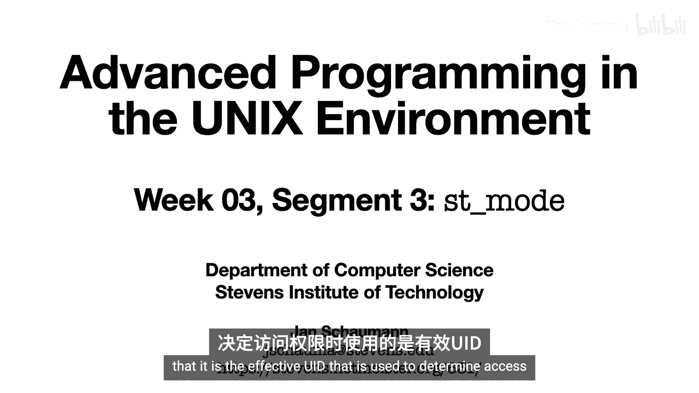
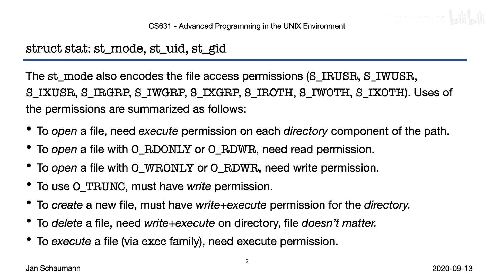
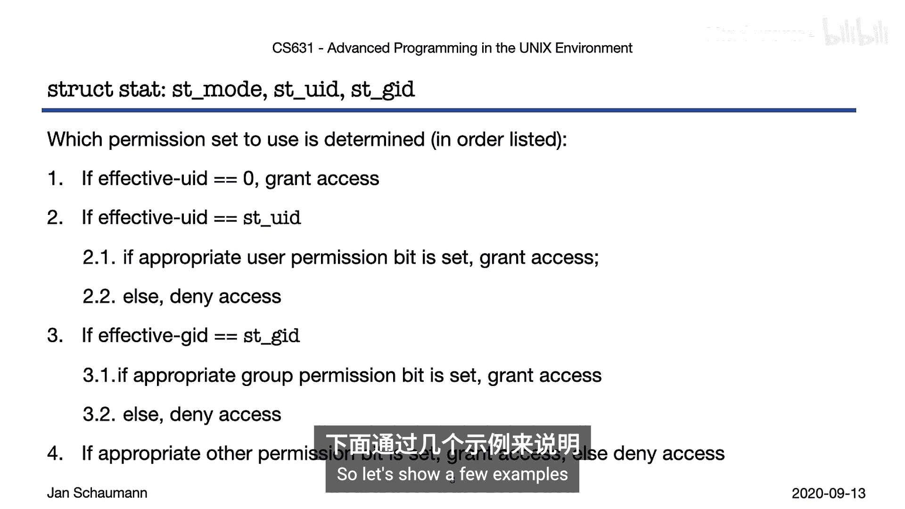
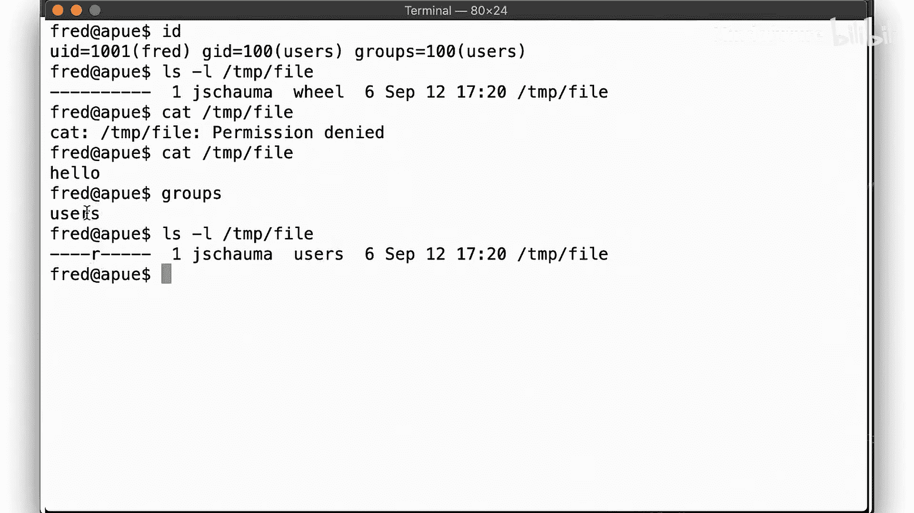
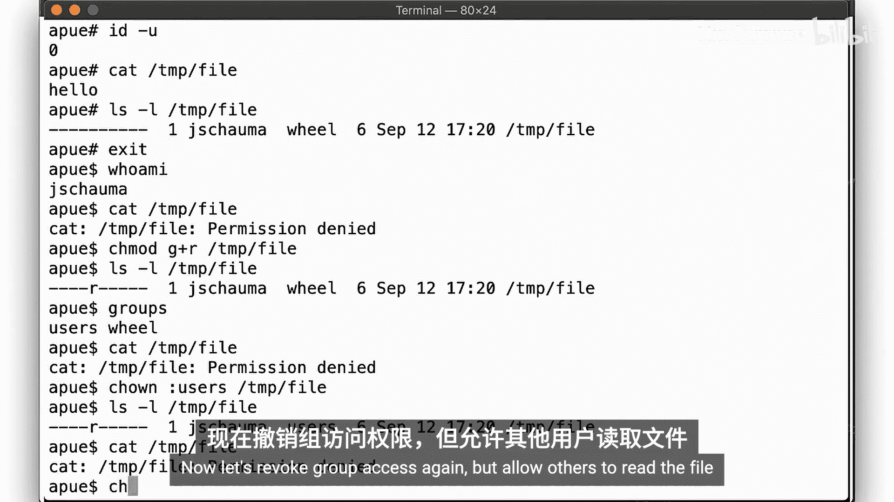
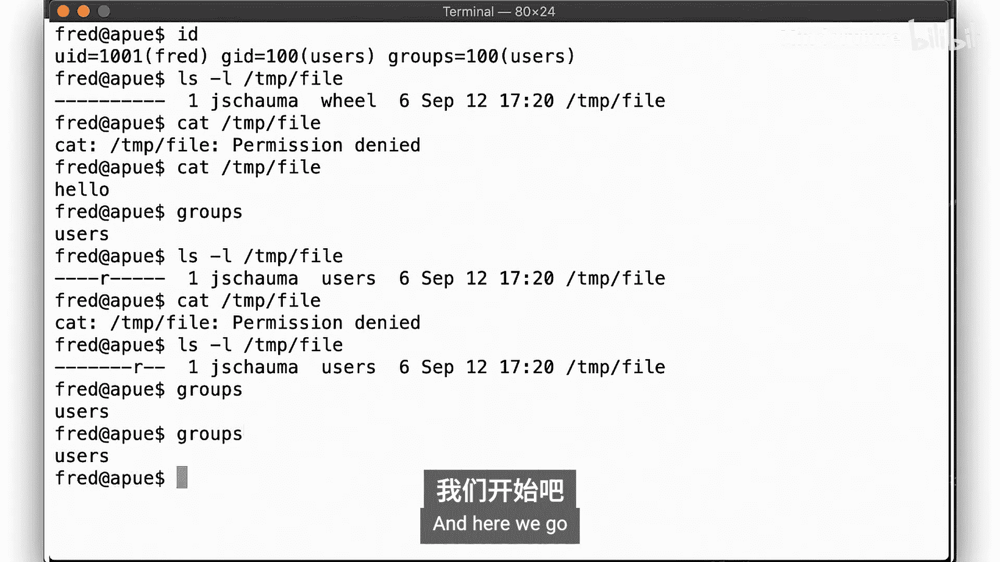
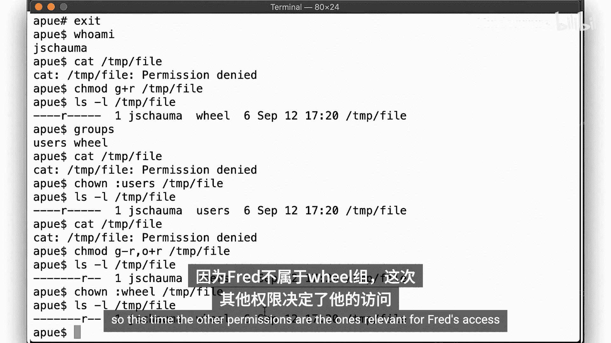
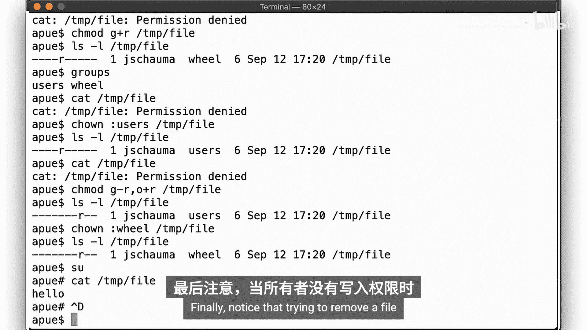
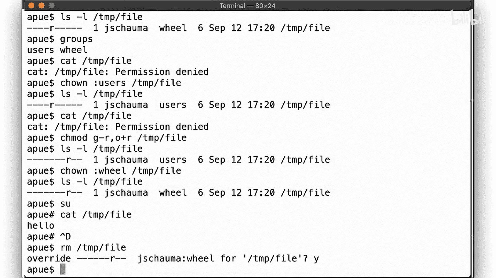
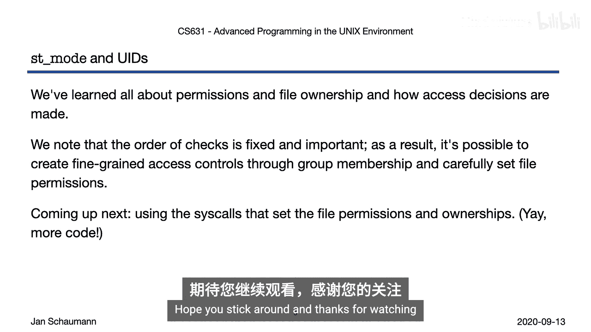

# UNIX高级编程-p12-P12-Week-03,-Segment-3---st_mode-and-permissions--BV1hPuVz8EWS_p12-

Hello and welcome back to CS631 Advanced programming in the UniX Environment。

This is week 3 segment 3， where we're looking at how the permission is defined in thestructstead as t mode are applied。

Remember from our previous segment that the process has both in effective as well as a real UID and an effective as well as a real good associated with it。

 and that we said that it is the effective UID that is used to determine access。

So let's take a closer look at the order in which permission checks are done。

The permissions of a file are incurred in thestruct stats as T mode。

 and as you know they are broken down into three groups， owner or user， group and other。

So in order to open a file， you need。First of all， execute permissions on the directory the file is in。

This is because in order to open a file， you need to find the mapping of the file name to Inode。

 which we said earlier is stored in the file of type directory。

Performing this lookup requires execute permissions on the directory。

 read permissions of a directory are required only to list the contents of the directory to iterate over each entry。

Note also that you need exit permissions on all directories on the path specified when opening the fire。

This makes sense since to open a full path name， say slash v s1 slash du。

You need to first open slash v and hence require execute permissions on slash。

 then temp under slash var and so on and so on。Verify that this holds by creating a directory containing multiple deeper subdirecties。

Change into that directory and create a fire， then remove execute permissions from your parent directory。

Can you still open the file you created。Try both a relative and an absolute path name。Anyway。

 so you need to be able to execute the directory the files in to open a file。Next。

 to open a file in read or read writer mode， you require read permissions。

 and to open a file in write or readr mode， you need write permission seems fair。To use OT。

 you need white permissions since truating a file modifies it。To create a new file。

 you need write and execute permissions on the directory in which you're creating this file。

This should make sense since creating a file requires you to add an entry in the directory to write into this directory。

To delete a file， the same holds true， and this is perhaps somewhat counterintuitive。

 The permissions on the file itself do not matter。This is because deleting a fire does not really change the fire and changes the directory the fire is in。

All you're doing when deleting a fire is editing the directory and removing the link inside the directory。

This is why overly permissive modes such such as 7，7，7 in the directory are so disastrous。

 Any user can remove any file in such a directory and then recreate it。

 regardless of the permissions on the file itself。We'll get back to this in our next lecture on file systems。

 but it's a good idea to confirm this for yourself by creating a directory like that and adding and removing files as different users。

Finally， to execute a file， you need execute permissions， but not read permissions。

You can verify this for your compiler executables， change permissions to remove read access to all users。

 then try to run the program。Note though that for programs that are written in an interpreted language such as Shell scripts or Python programs。

 you do need read permissions， because executing those programs actually means you are executing the interpreter binary and then feed the file's input to the interpreter。

Give that a try as well。

Anyway， knowing which permissions we need， we can now look at the order of consideration of the EUUI and Egi。

 which will influence which permissions set user group or other are going to take effect。

Note that this decision tree here is ordered。 That is the first condition that applies to sides they are。

If your process has EUuID0， then access is granted。That's it。

Note that this is irrespective of the permissions on the file。

 they are simply not considered if you are rude， you get to do whatever you want。Next。

 if the effective UID matches the ST UID on the filing question。

 then the system looks at the user permission bits。If those allow access， then you're good。

If those do not allow access， you lose。Of interest here is that this ends the decision making process。

 your group membership or the permissions for others are simply not considered。

If you are not rude and your EUuI does not match the STU ID。

 then we go on and look at the effective Kup ID。If that matches the ST good and the group emissions and questions are set。

 you can access， if not， you lose。And finally， if you are neither rude。

 nor EUUID matches the SDUID field， nor your EGIt matches the SD good。

 then and only then do we look at the other permissions and grant a the access based on those？

This first matched decision making can lead to some possibly unexpected results for people not used to UniX permissions and ownership。

So let's show a few examples。

First。Let's note our UIDN groups。Next， we create a file and remove any and all permissions from it。

Like so。To illustrate that root can do whatever they want， let's become the super user。Okay。

 well rude。As we can see here， even though fire permissions prohibit any read access from anybody。

 route can still access and read the file。The owner， however。Cannot。

This is because the owner permission bids are not set。User Fred is in the group users and of course。

 cannot display the file that has no permission set at all。

Let's change the group permissions on the file。User Jay Shama is in the group wheelhe。

File is owned by the group wheel。And group permissions allow reading。But。

User J Shama will still not be able to display the file。This is because J Shama is the owner。

 and as explained before， once the UID check is met。

 the system doesn't care about the group permissions。

User permission deny access to any user with EUUI equal to STU ID。

Let's change the group ownership to users。Now for J Shama， this doesn't make a difference。

We still can read it。But for user Fred， there is a difference。

Because Fred is in the group users and group permissions allow read access。

 and Fred is not the owner of the file， so Fred is granted access。

Okay， now let's revoke group access again， but allow others to read the file。

Now， Fred can't read the file again since the merchant the group ID prevents the system from considering the other permissions。

Let's change the group ownership back to Wo。But leave the other permissions as they are。

And here we go。

Fred can read the file again because Fred is not in the group we are。

 and so this time the other permissions are the ones relevant for Fred's access。

Of course， a road can still access the fire， no surprise。Finally。

Notice that trying to remove a file where the owner does not have right access。

 yield's a prompt here。

This is merely a nicety of the RM command， however， a way to ask， are you sure？

The system called to unlink the file does not require any confirmation。

Okay， time for another break。We've run through a number of examples that illustrate the order of checks performed by the system to determine whether or not to grant access to the file。

Make sure to go back and run these examples yourself just watching these videos is not going to be as helpful to your understanding as running them yourself。

And when you do， play around with the permissions and ownerships。

 change things around and make sure the outcomes are what you expected。In our next segment。

We look at the cis calls to make the various smo and shown changes we've seen。In fact。

 after the next video segment， you should be able to implement those command yourself for the most part。

Hope you stick around and thanks for watching。

