# UNIX高级编程-p13-P13-Week-03,-Segment-4---chmod(2)-and-chown(2)--BV1hPuVz8EWS_p13-

Hello and welcome back to CS631 Advance programming in the UniX Environ。This is week three。

 segment four。In our previous video segment， we saw a lot of examples of creating files。

 changing their ownership， changing their permissions， and how that affects who can access them。

In this segment， we focus on the system calls that are used to implement the commands we used in the previous segment。

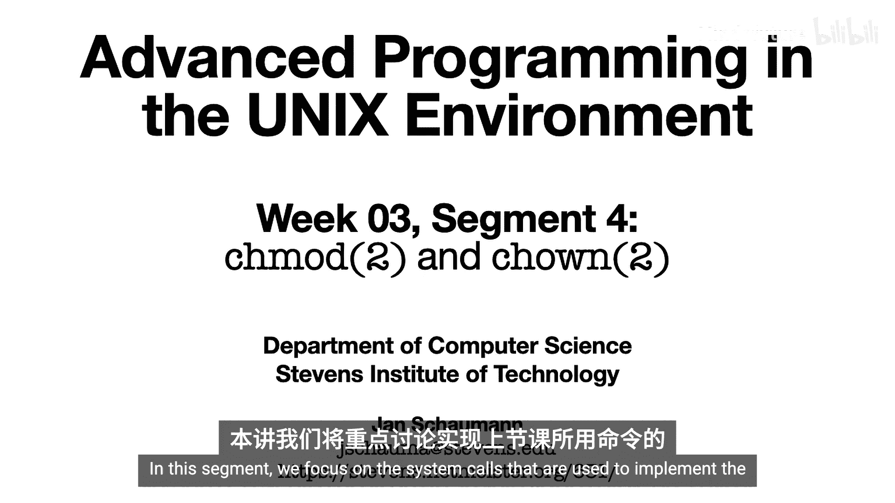

In particular， in our previous command examples， we've seen many calls to the Smart command。

 so it comes as no surprise that this command is implemented by the Schmart family of system calls。

Likewise， it should be no surprise that the core comes in the same familiar flavors as before。

 Chimo to act on the fire and indirect thes， L gmod to act on the s itself。

 Fchmod to act on the file descriptor and Fchm add to handle relative path names all as usual。

Chaining the permissions on the file requires that you are either EUuI0 Ro can do whatever they want。

 or your EUuI matches the STUI of the file。The permissions you are able to set are those we've already seen。

 as well as a few additional ones。 The one outlier we've not discussed yet is the so called sticky bit。

 Aka A save text bit。We'll get back to the details of the sticky bit in the future lecture。Nowadays。

 it is primarily of interest if set on directories， but more on that another time。

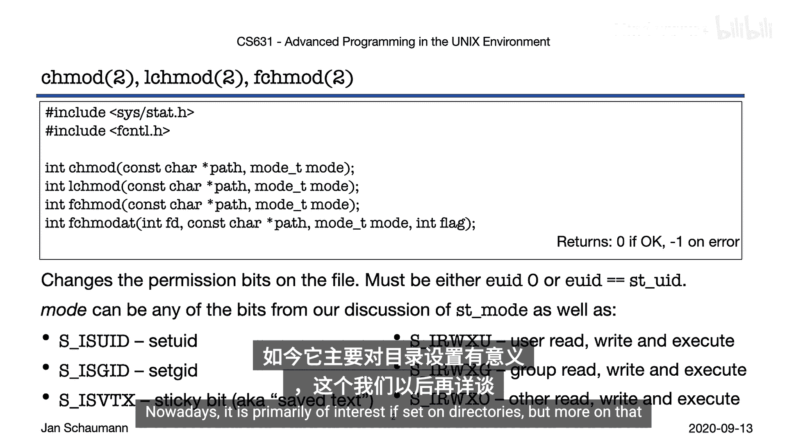

Here， let's see what Col Schmart looks like in practice。

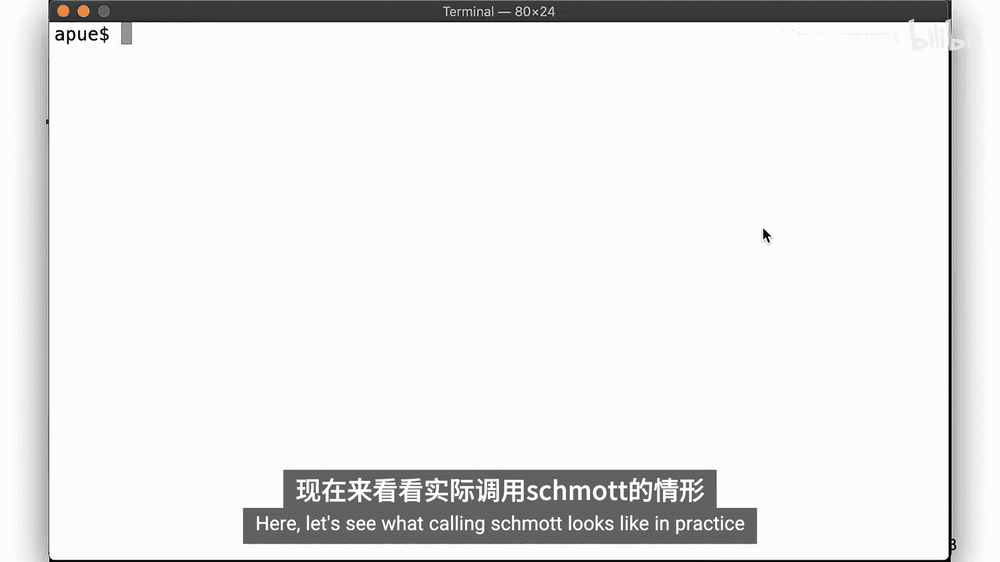

In this program， we will perform manipulation of existing permissions as well as setting permissions to an absolute value。

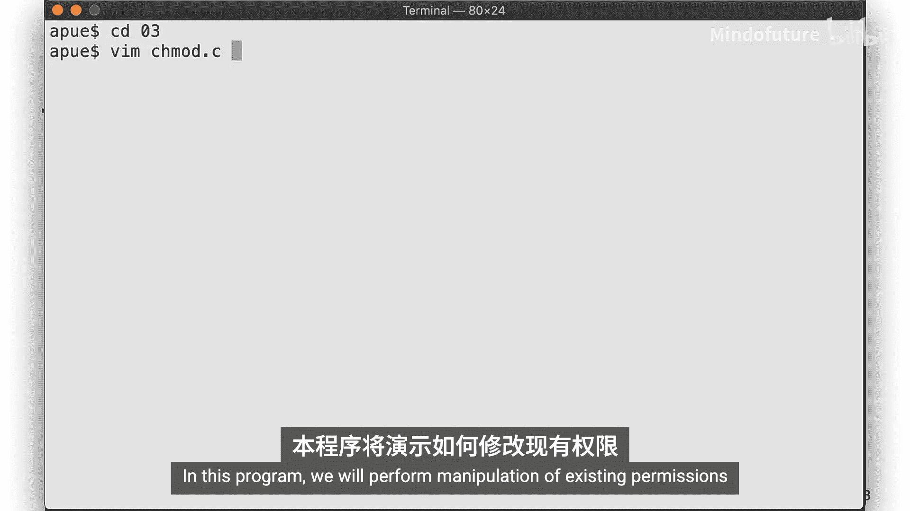

To update the existing permissions， we first have to get them， so we call stat。

Then we turn on or off the relevant bits in the ST mode bitmask。

Setting bits to an absolute value does not require us to consider the existing S mode。

 so we can just go ahead and call Smart here。Okay， let's run it。First， we create file and file one。

 here they are。

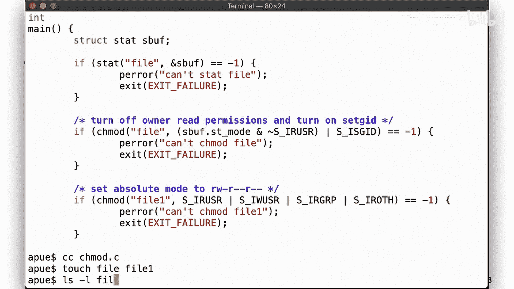

Now we run our program and。

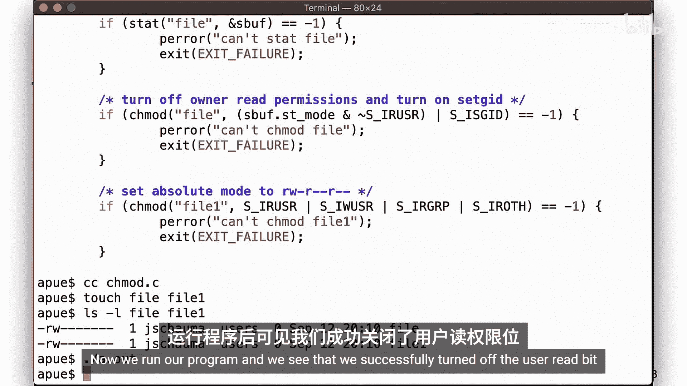

We see that we successfully turned off the user readbit and enabled the set Gitbit。Likewise。

 we set the octal 0644 mode as promised。By the way。

 note that the S for the set gi bid here is a capital S。

This is because our file is missing the group execute bit。

 so ala it's kind enough to show us this difference。Yeah， let's fix it。There， that looks more normal。

 doesn't it。

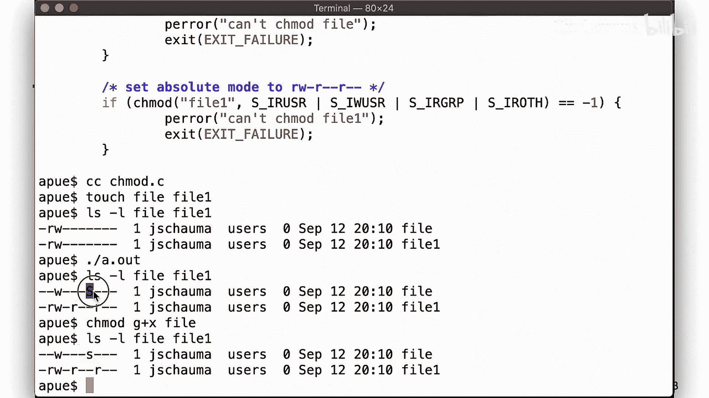

Okay， now let's look at the ci call required to change ownership of a file。Look familiar。

Same family as before。Consistency is a virtue。Okay。

 so changing a file owner is clearly something that can impact the security of the system and on most systems this action requires EUuI0。

Now， Possics dazzled allow users to change files they currently own to another user。

 which was influenced by early system 5 versions， but by and large。

 you should find that the underscore Posss Ch restricted constant is defined on most systems and shown files requires root privileges。

Changing the group ownership， however， is something that nonewood users can do if you are the owner of the file and the group you're shown the file to is either your primary or one of your supplementary groups。

We saw this a little bit ago when Jsma was able to change the group ownership of a file to real or users in our previous segment。

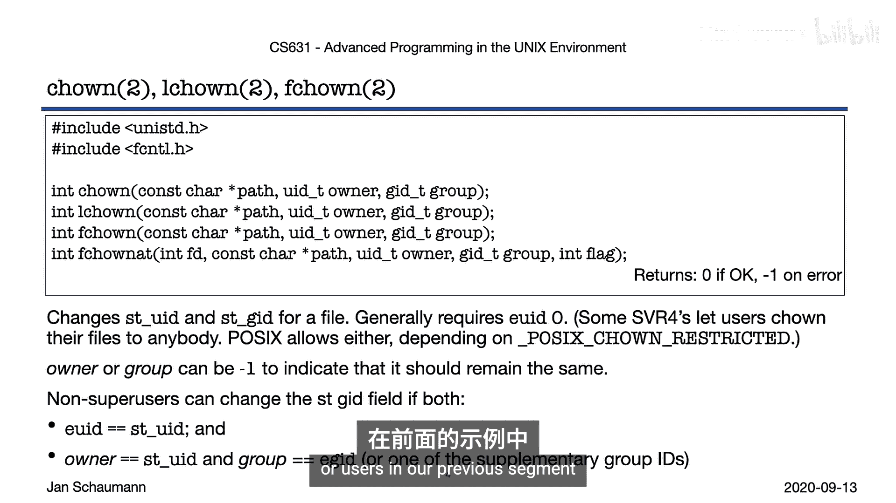

Here's our obligatory code example。First。We try to shown a file to ourselves。

This isn't really useful since either you are the owner and inll work or you're not， and it won't。

Unless， of course， you root。Passing negative one as the group ID means that we won't change the gi when calling John。

Next， we try to change the final ownership to Fred and leave the group as this。

Followed by an attempt to change the group to users and finally an attempt to change the group to TTY。

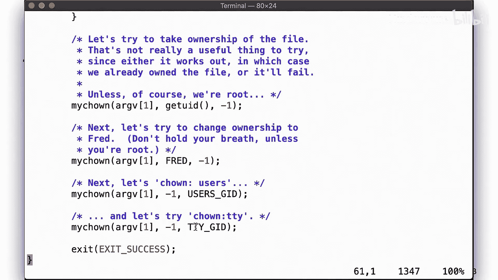

Let's give it a try。

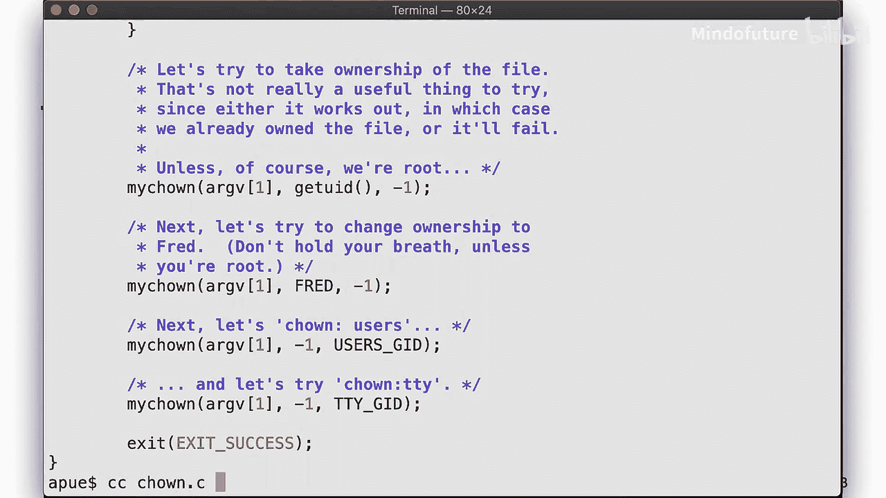

Here's a file。Owned by Jay Shama and group Wo。

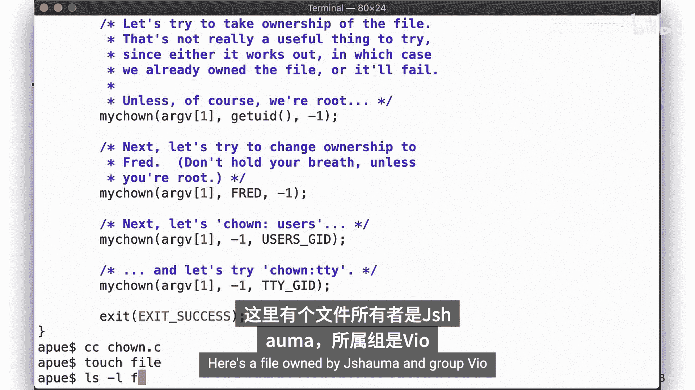

Of course， we were able to show the file owned by J Shama to J Sharma when we run the program， right？

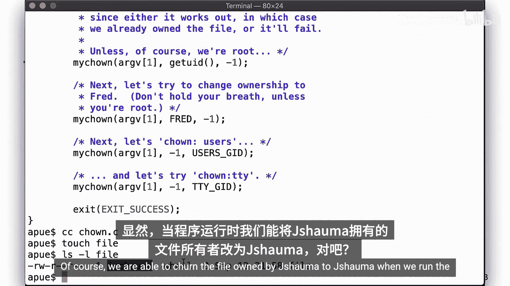

一。Chhowing it to Fred， however， UID 1001 didn't work。Then changing the group ownership to users。

Succeeded again。But trying to change it to TTY failed。LSL shows the new ownership。

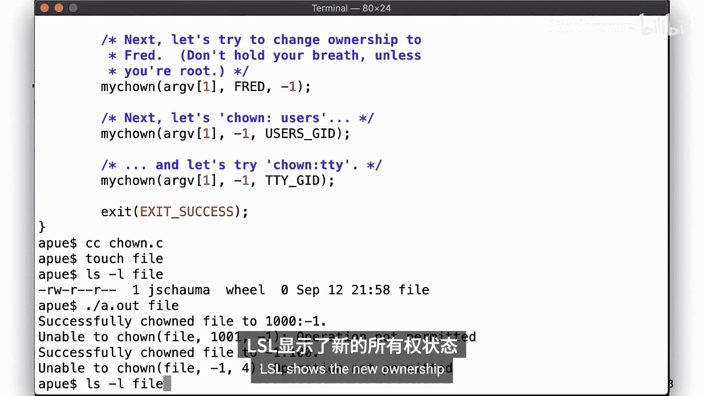

Trying to show a file we don't own， such as Esy Pass。It's going to fail on all accounts。

We'll try anyway。

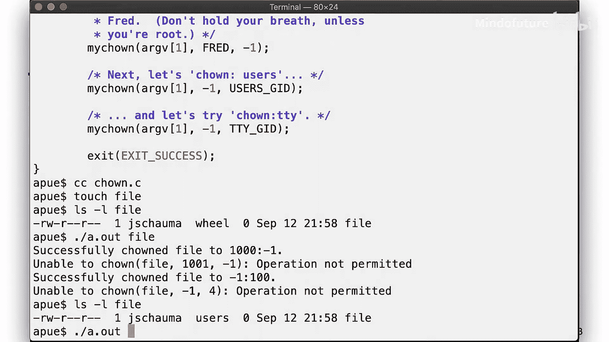

O。What if we were rude， though？Well， no surprise here。

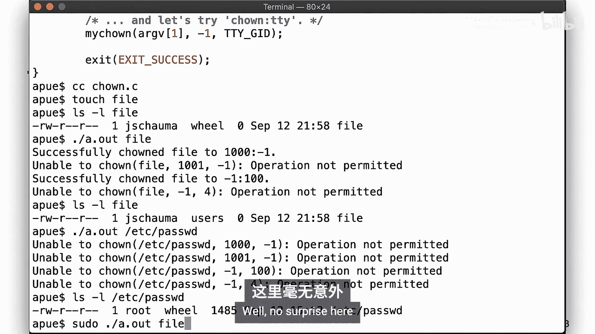

Root can do whatever they want with said。 So all the cha calls succeed。

 and our file is now owned by Fred with Group T T Y。Okay， to recap。

Smar and Cn consistently follow the semantics of the other calls we've seen。That is。

 we have different flavors allowing operation on the fire and the s on the file descriptor and atomically save on a relative path。

You don't get a whole lot of surprises here， Unix is nice that way。Next。

 only route and the owner of a file can change its permissions。Which makes sense。

Only route can change the owner of a file， but the owner may change the group ownership of a file。

 including to one of the supplementary groups。Technically。

 some systems may allow users to churn their own files to another user。

 but in practice you are unlikely to encounter this。For whatever it's worth。

 I have not seen a euchist at deauus in the last 20 years。

Changing five permissions and ownerships has significant security implications to always be careful about what kind of excess you grant。

In our next video segment， we'll take a look at the default ownership and permissions given to newly created files。

See you then and thanks for watching， cheerers。

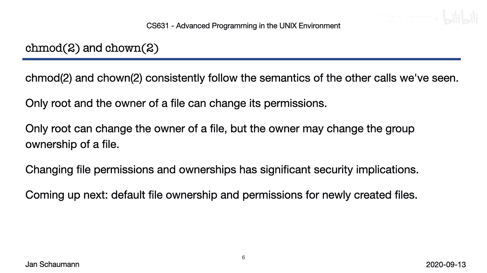