# UNIX高级编程-p14-P14-Week-03,-Segment-5---umask(2)--BV1hPuVz8EWS_p14-

Hello and welcome back to CS631 Advanced programming in the UniX Environment。This is week three。

 segment5， where we will take a look at what file ownership and permissions are applied when we create a new file。

In the process， we learn about the concept of a process's UMask and look at how the UMask shellbu is implemented。

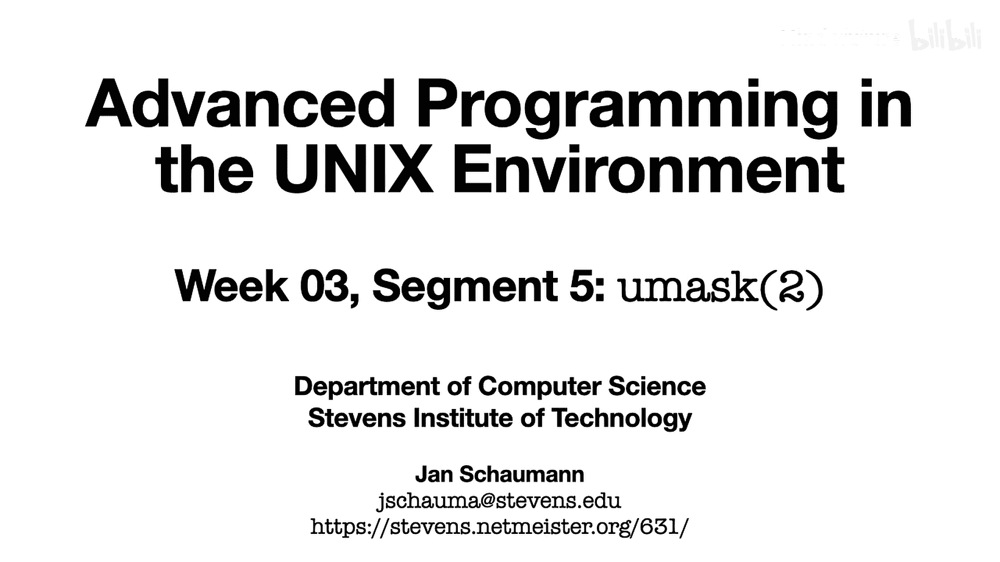

Okay， so far we've covered changing permissions and ownerships and in the process we've repeatedly created new files to work with。

But how does the system decide what file ownership and permissions new file should get？

The decision making process is a bit easier here。When the new file is created。

 the new owner of the fire is the effective UI of the process， that makes sense。

The group idea of the fine， however， may depend on the Unix version or how it is configured。

On most Linux systems， the default setting is to inherit group ownership from the effective group ID of the process。

On BSD derived systems， the default is to inherit group ownership from the directory in which the file is created。

The rationale for this behavior is that in multi user systems。

 people want to collaborate in groups in the directory owned by a gr group should employly group ownership therein。

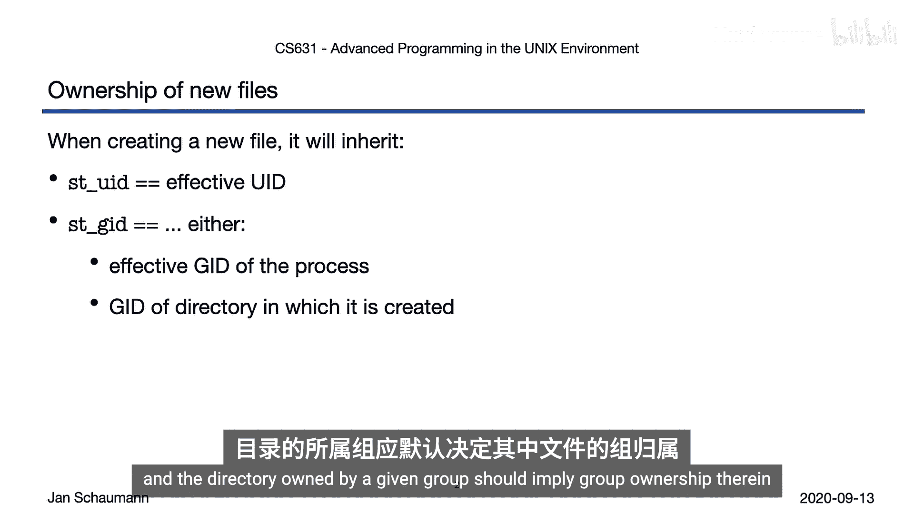

Let's observe this in practice。We create a new directory under temp。

The new directory has the group ownership of Whe， which is the group ownership of TAP。

Creating a new file under Deer should then also get a group ownership of W。Okay， looks all right。

What if we shown the directory to users？Aha now the new file is also group owned by users because the directory it was created in was too。

Of course， the previous file retained its group ownership。

But J Xma is a member of both users and Wer。 What if the directory was owned by another group one J Shema was not a member of。

 That's committed a try。

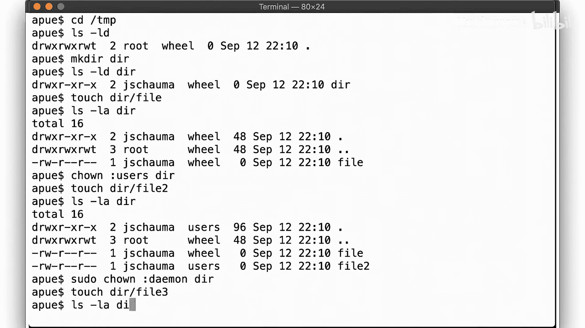

Look at that。File 3 inherited the demon group ownership from the directory。

 even though J Shama is not a member of the demon group。

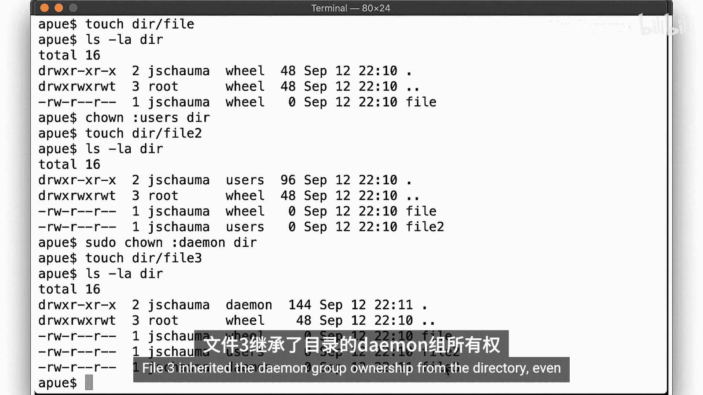

Wait， does that mean I can create files owned by groups I'm not member of。There。

Now I have a program that's owned by demon。

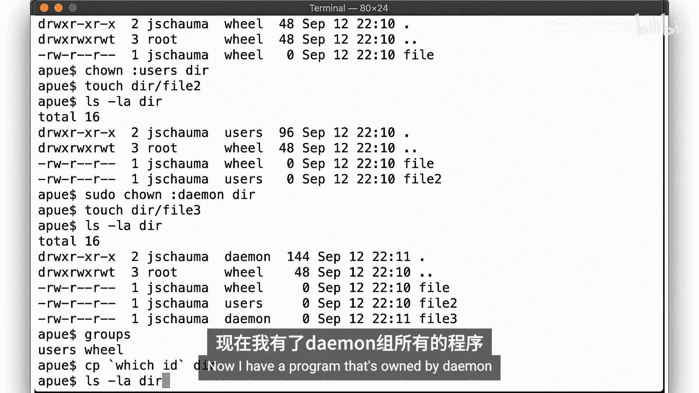

And I'm the owner of that file， so I should be able to change the permissions。

 Doesn't it mean I could escalate my privileges to those of the demon group。

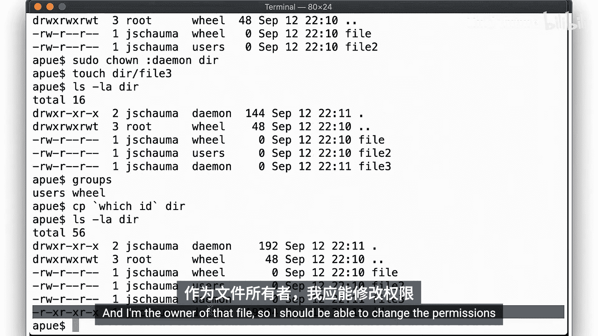

Few， fortunately， that doesn't work。Our small permissions， as discussed earlier， still apply。

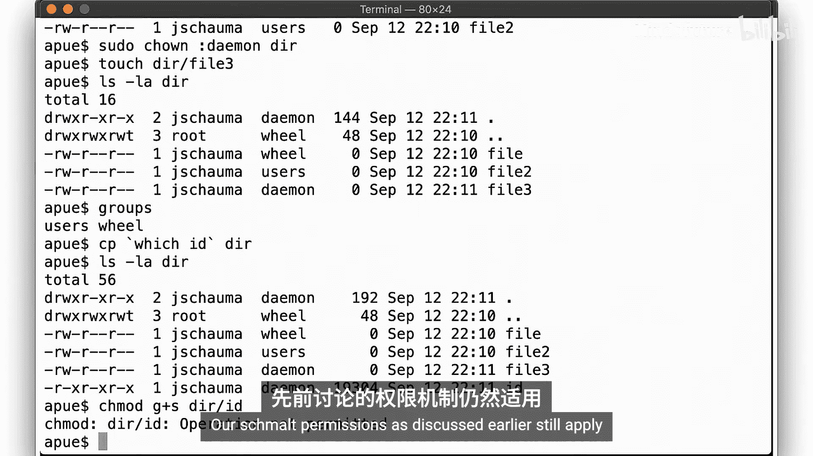

All right， now let's see what this looks like on the Linux system。Here we have my home directory。

And micro groupss。The new directory has the same group ownership as the current directory。

 which also happens to be my primary group。If we create a new file。It gets the same group owner。

Does this system then also inherit group ownership from the directory？

Let's change the group ownership to now。AhaThe new file does not inherit group ownership of the directory。

 but will always get the group ownership from the primary group ID of the process it looks like。

As I mentioned， different systems behave differently。

 and it's important to know the difference when administistering them。But okay。

 that covers default ownership。

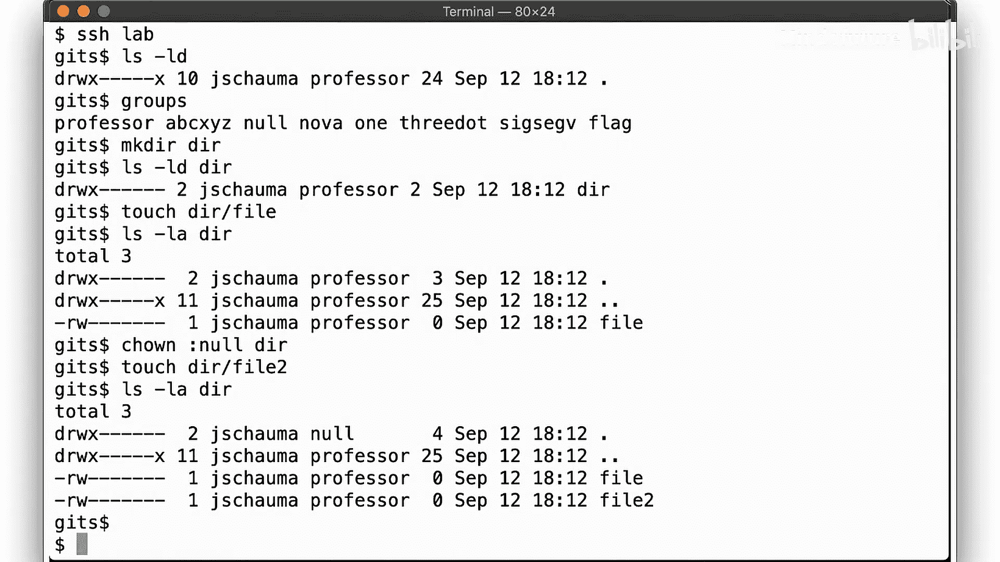

What about permissions？For that， we have the U mask。

A U mask is the file creation mode mask in which any bits togggged on are turned off when creating a file。

You can set a U mask in your process to ensure that any files created later on will have certain default permissions。

To do that， you call the U Ci。Note that the U mask only applies to the current process。

 the system may have a default U mask set for new processes that differs from yours。

While many of you have probably used the UMas shellllBuild。

 let's run through our last command examples in this video segment to illustrate how it works。

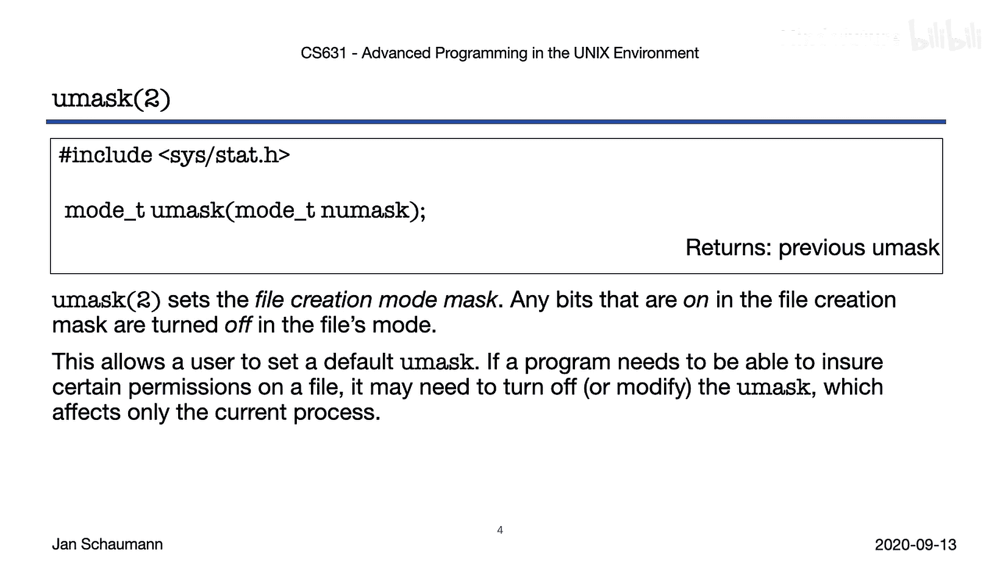

Here's our program。 U mask dot see。In it， we have a call to open that will create a new file with permissions as specified。

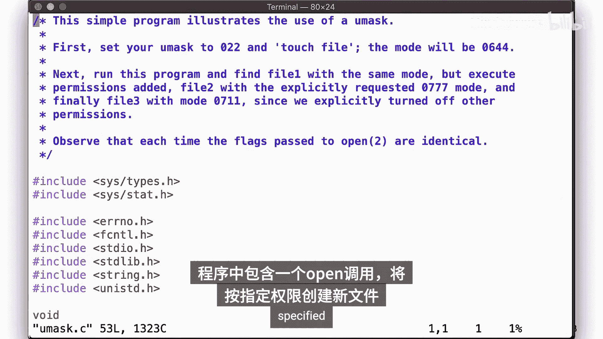

Read write Ex for the user， group， and others。Re called from our earlier lecture that the permissions specified here are subject to the process's current U mask。

 meaning bits in the Um are turned off at fine creation time， even if open specified them。

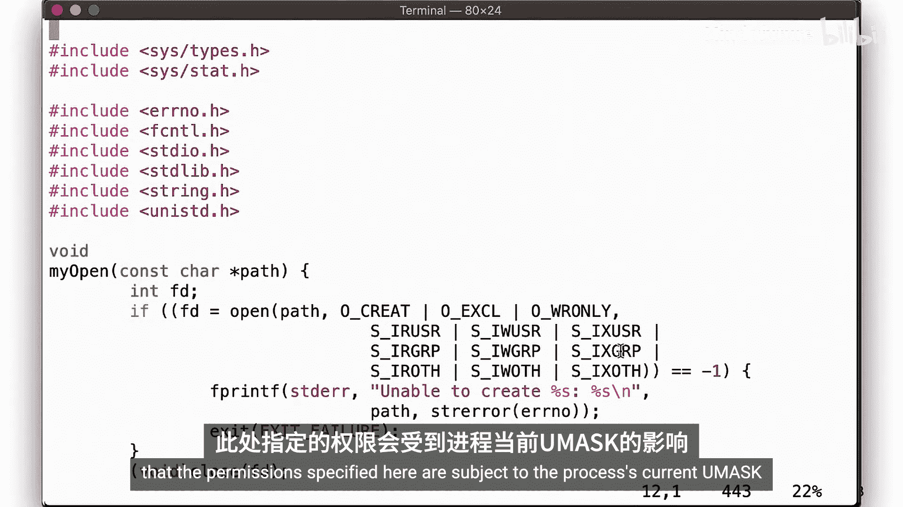

So the first time we call this function we will have whatever luus we inherited from the shell。

Then we explicitly turn off all bits in the Umaask。

 meaning we will allow the permissions the open call has specified。Prior to the third call。

 we said a U should turn off group and other permissions。Let's run it。Our current you mask。It's 0，0。

2，2。Meaning， we want to turn off by default， group and other right permissions。

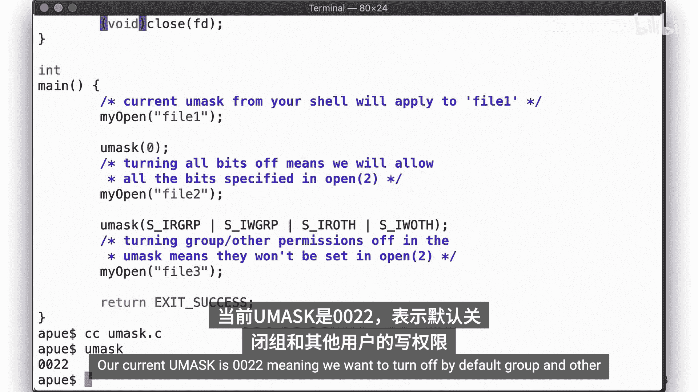

When we create a new file， it is created with mode 644， allowing read and write access to the user。

 but only read access to groups and others。Now， we run our program。The resulting file looks like so。

Recall that our open call requested read write exact permissions for all user group and others each time。

The first fire。Fiile 1 or UMama turned off the right bits for file 2。

 we explicitly turned off the Uma and that's got all the permissions open requested。For file3。

 returned of group and other readri permissions， but left exact permissions in place。

Let's change our U mask to a different value， 0，7 and 7 and try again。0，7。

7 means that be disabled by default， read， write and exact permissions for group and others。

And so our newly created file。Only gets mode0，600， and our programme will create filess almost identical to the first time around for the cases where the programme set the U mask。

 but different from where it inherited the U mask from the shell。Makes sense。If not。

 and even if play around with setting the new mask in your shell to certain values to ensure you understand the effect on newly created files。

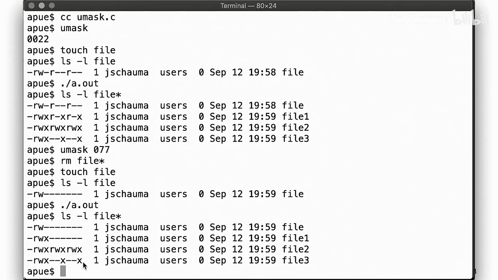

All right， we did it， we learned all about file permissions and ownerships。

 effective UIs and group IDs and changing them and how the system enforces permissions。

In this short video， we discuss the U mask and how it allows the user to influence the default permissions with which new files are created。

With all that， you should not be able to implement most of the challenge mod commands。

 as well as the sta command。In fact， come to think of it。With what we've learned so far。

 you should actually be able to write a version of their that's close to the systems L。You know what。

Let's just do that。It'll be a midm coding assignment， and I promise you it'll be fun。

Please carefully read the assignment at this URL here and we'll discuss it in our next class。

In the next video segment， we talk a bit about directories as we prepare for our week four materials。

 file systems and the number of mixed system data calls。Thanks for watching and until next time， G。

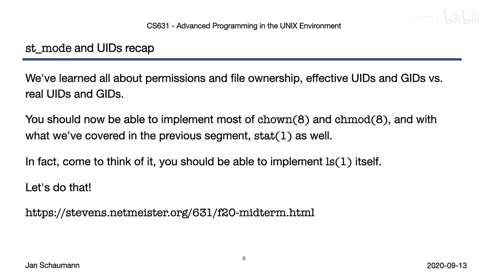