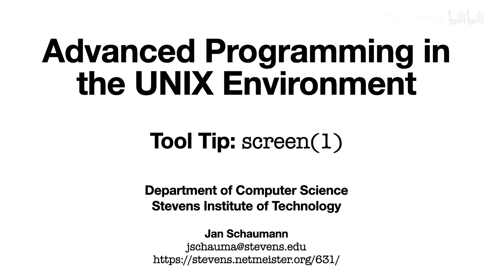
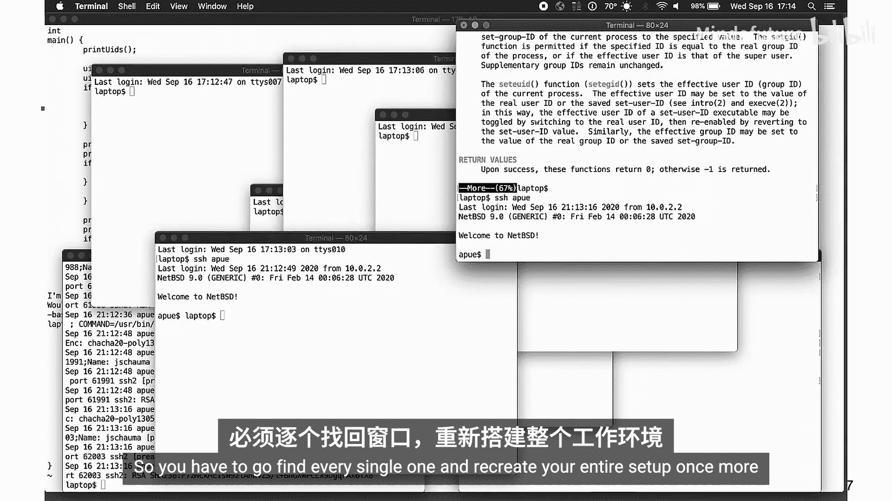
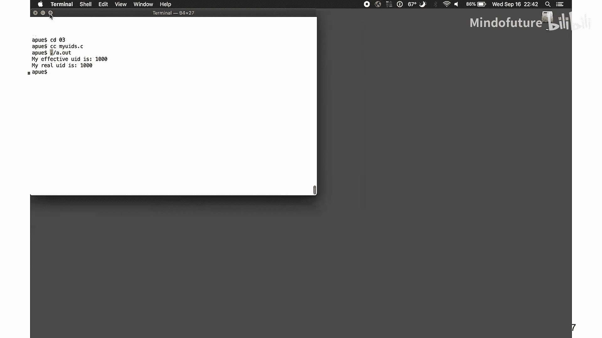
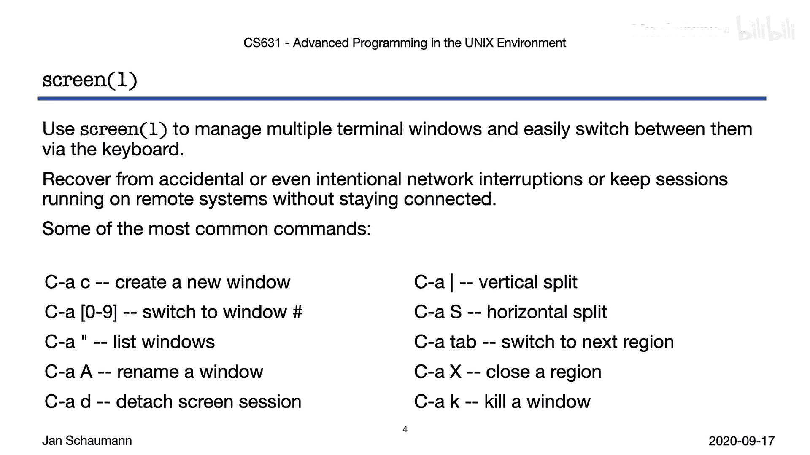

# UNIX高级编程-p15-P15-Tool-Tip---screen(1)--BV1hPuVz8EWS_p15-

Hello and welcome to another CS631 Advance programming in the UniX Environment tooltip。

This time we'll talk about the Gous Sc Win manager and terminal multiplexer。

 which can be used to a better manage multiple terminal windows via the keyboard。

 and B help protect against network interruptions or allow you to keep remote sessions without remaining connected to a system。

 letting you reattach at a later point。There are many other use cases。

 but a full tutorial on this tool would take way too much time。There are also other similar tools。

 Tms is a popular alternative， but I happen to use screen， so that's what I'll present here。

With some practice， I'm sure you'll find this tool to boost your efficiency by an order of magnitude。

Let's first take a look at what problems you may encounter while developing on a primarily remote platform。

Given that we use a virtual machine as our reference platform。

 we have to SSH to the VM for all of our work。So we start out with a single window and use SSH to connect。

Let's start coding。No。Let's suppose we want to look up the manual page for C UID。

 but we want to stay in the code， so we open a new window。SsH in and pull up the manual page。

I move the window into a convenient place。And then we go on。

But then say you also want to say tell some logs。So again。

 you have to open a new terminal window again， SSH into the system。

 move the window and run your command。And then you realize you also want to actually run the command while keeping an eye on the other windows。

 So pop another the terminal。S S H into the machine。Move the window to the right place。

Compile your program， run it， and so on。And then you end up switching back and forth between the different windows using your keyboards。

And soon enough。Youll end up creating even more windows。And more。

And then your screen looks something like this。And cycling through them becomes real pain。

You no longer remember which window contains which command where you want to go。

So you cycle and cycle back and forth。This becomes even worse if the windows are in different sizes。

 and one is covering up the other ones。So now wait， where was the manual page again， click search。

 cycle。So that'sず thing。But even worse。Suppose you're editing the file。

And you start inserting your code。Working on it as you go。And why you're writing a code？

While you not have saved your work yet， your network connection has interrupted。

 or you accidentally killed US age connection for some reason。

 or you accidentally closed out the window。Any number of bad things can happen when you're connected to a remote system。

Oh， now what？All your connections are interrupted。You lost where you were。

 and you have to recreate everything。In all of the different windows。

 you are no longer logged in on the remote system。So you have to go find every single one。

And recreate your entire setup once more。

Okay， so now let's see how we can do better here。Let's install the G news Scre program。

So what is screen？Screen。As the manual page shows us。

There's a full screen window manager that multiplees terminals。When you start screen。

 you get a shell。And then you can create additional windows and switch between them via keyboard bindings。

Here， let's start the program。So。We are in our shell inside screen。

Let's start our code editing session。Then we hit Crl A followed by C to create a second window。

Where we can now run our men command。You can then switch back and forth between these two windows via our C AA。

Now， if we want to create a previous example setup。

 we create a third window to tail the logs and the fourth window to execute the command。

 each via control A C。And because we don't need multiple windows。

 we can now maximize this window to full screen。

To switch， we can now use control a0 to go to the first window。

 control a1 to go to the second window and so on。We can list how many windows there are by a control a quote。

And then move up and down by other keys， J and K， just like in V I， to select the window we want。

But they are all listed as S H， meaning we still have to remember which window is for what。

 so let's give them more descriptive titles。For that。

 we had control a capital A and enter a new title， then move to the next window and do the same。

So that now when we cycle through them by I control a quote。

 we can easily know which one contains what。That alone is pretty neat。

 since now we can manage our terminal windows conveniently via the keyboard and don't need to start a USSH session。

Every new window is created on the remote system already。But he's the kicker。

Suppose you're in the middle of some important work and suddenly a network connection gets interrupted when time's out。

Just like we had before。While you're on screen， all your work will remain saved and all the windows will remain in place。

So if you're disconnected， now we're back on our laptop。But in this case。

We can quickly SS age back into the system。And when we do。

 we can reattach to our existing screen session， screen R。And lo and behold。

 everything is left right where it was， and no work is lost。So that's pretty awesome。

But here we are now with this really big window， would be nice if we could have the terminals side by side。

 right？I'll try control a pipe to vertically split the current window。

And use Cl A tab to move into the new region， then select the window you want to fill this region。

Controroll a tab lets you switch back and forth between the regions。But maybe this one's too big。

 Let's split it horizontally by a control a capital S。 then select the shell window。

And what we have here now looks quite a bit like a software IDE， doesn't it？

If you want to kill a region and get back your space， you can use control A X。

But note that this only kills the visual region。 The window is still there。

 you can recreate and reorganize your regions without any loss。So we split it again。

And fill in the other window in this region。So this should just give you a really quick impression of what you can do with screen。

You can organize your workspace， create terminals on a remote system。

 and remain attached to it for as long as the system is up。

 regardless of your network connection to the system。Now， of course， there's many。

 many more things you can do with screen This little toolt was intended only to give you a quick introduction to at your appetite。

In addition to what we've seen here， you can also use screen to share a screen session with multiple users。

 allowing them to observe or even interact with your terminal。

You can copy and paste outputs on the terminal between the windows， keep or write a log， etc， etc。

Search the intended for tutorials onNew Scre， there are a million out there。Learn to use it。

 And those keys will quickly become muscle memory。 As you soon will say to yourself。

 how did I ever live without this？Well， that's it for today。

 hope you found this useful until next time and thanks for watching。Theers。

