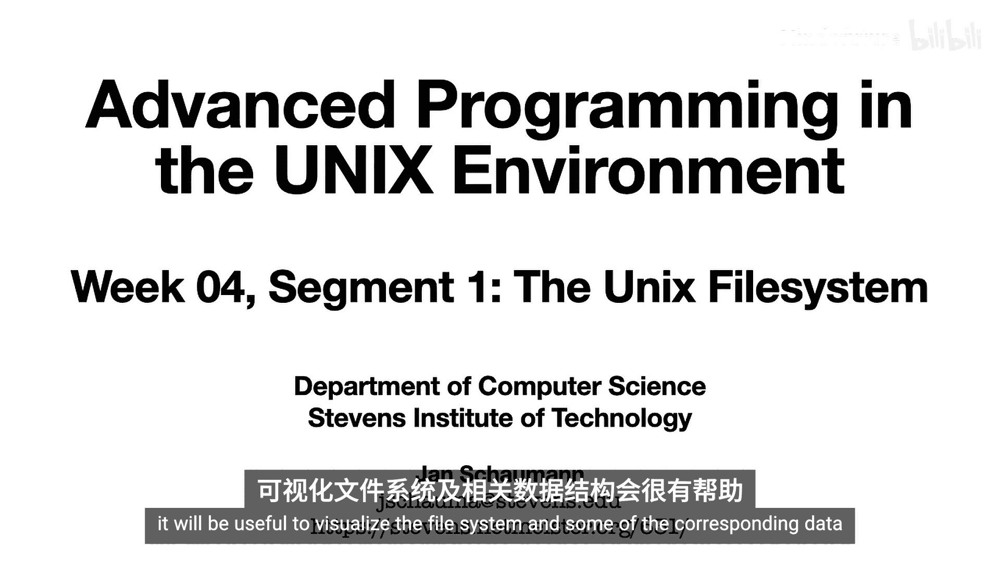
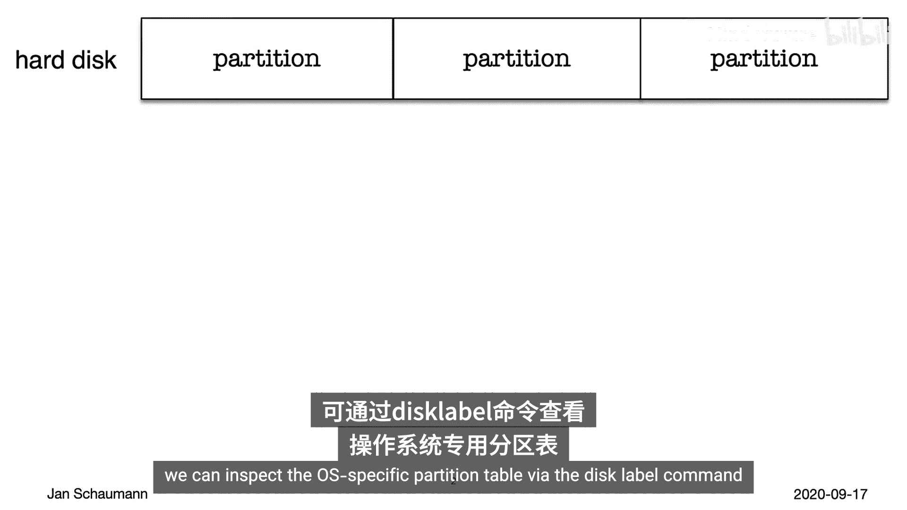
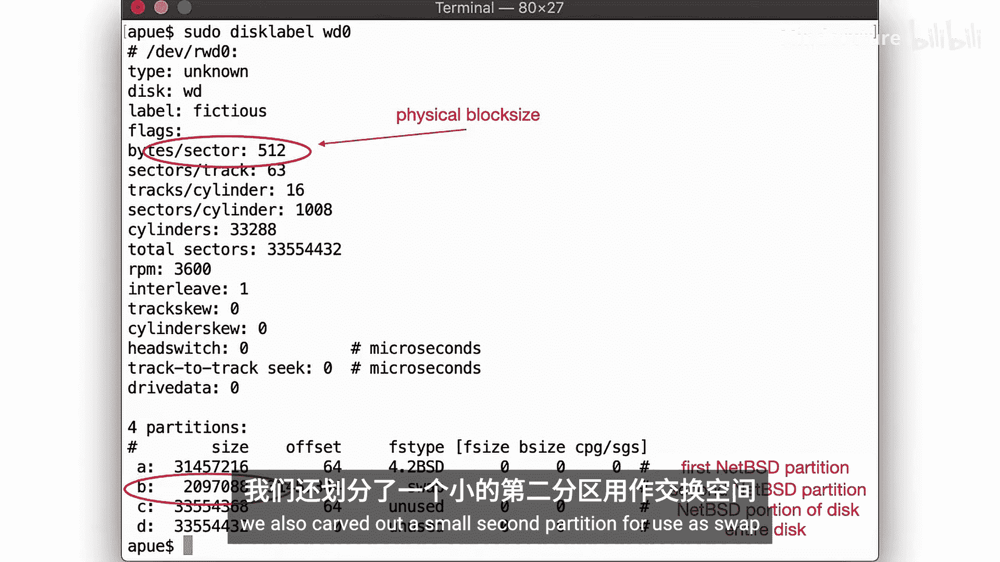
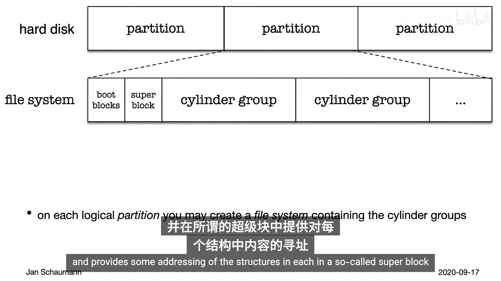
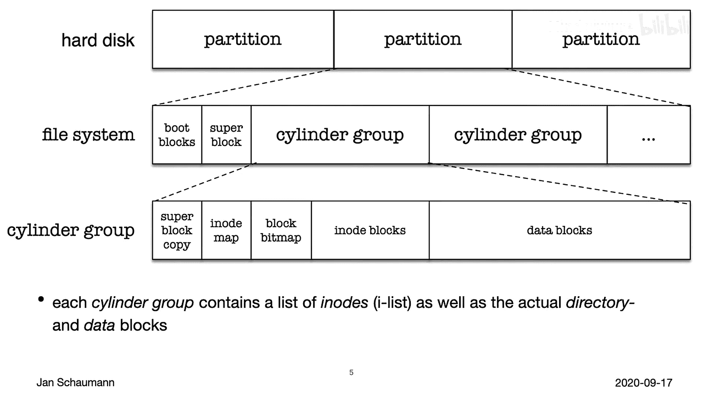
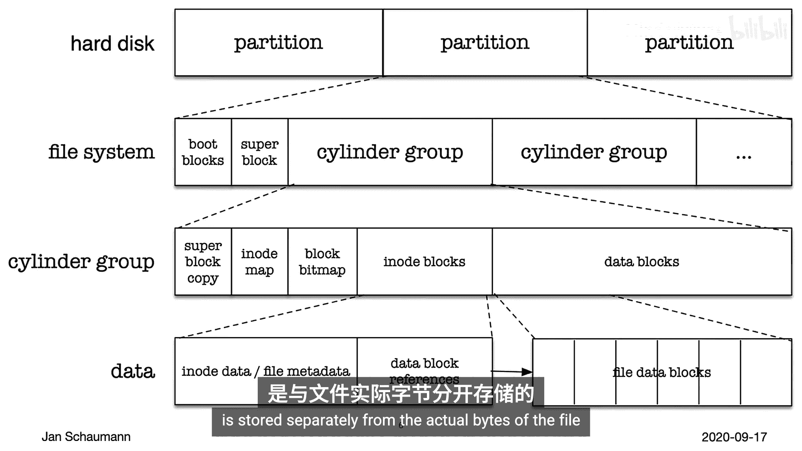
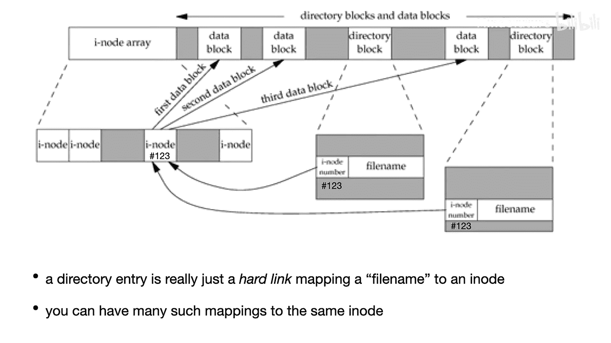
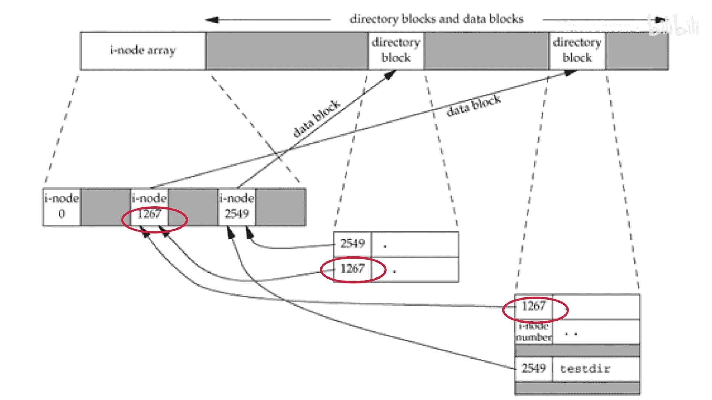
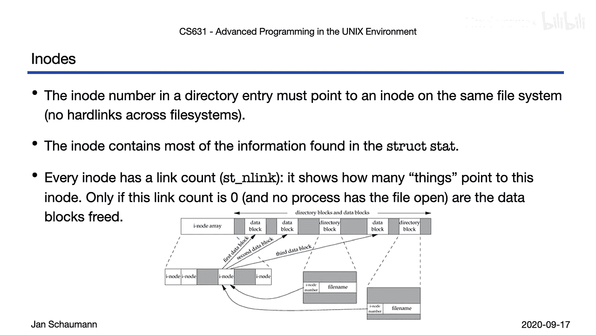
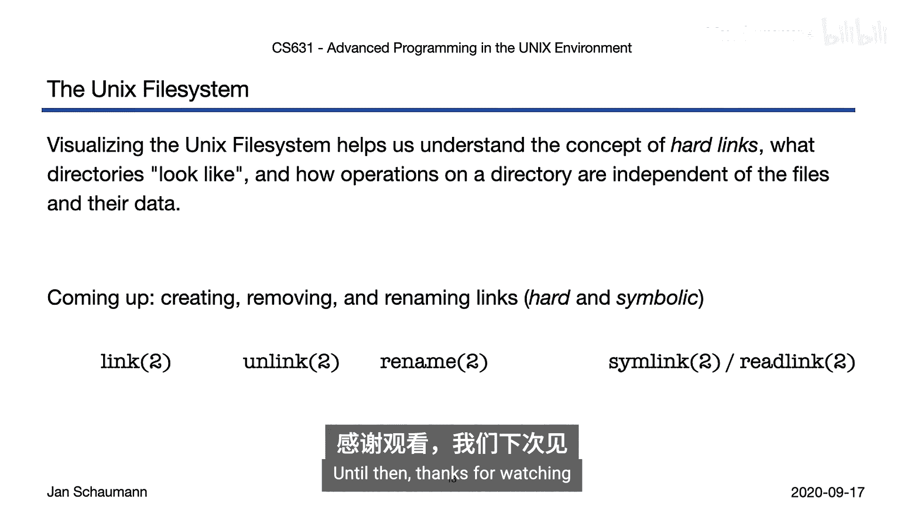

# UNIX高级编程-p16-P16-Week-04,-Segment-1---The-Unix-Filesystem--BV1hPuVz8EWS_p16-

Hello and welcome back to CS631 Advance programming in the UniX Environ。With this video segment。

 we are starting the material for week four， diving deeper into file systems and directories。

 as covered in the W Richard Stevens APU ebook， chapters 4 and 6。

As we've seen in our previous discussions， certain file system properties and concepts are encountered on a regular basis。

 and to better understand them， it will be useful to visualize the file system and some of the corresponding data structures。

Let's take a look。In the beginning， there was a disc。 Well， any storage medium really。

 But let's consider a hard disk。A heart disk can be divided into smaller parts。

While there are different types of partitions， byers partitions say the operating system specific partitions for all purposes。

 the distinction doesn't matter much。On our reference Vm running that PSD。

 we can inspect the OSA specific partition table via the disc La command。

Here we see a description of the physical disc。Well， it's a virtual disc。

 but the OS doesn't know that it thinks there's an naturalphys device there。

 so it tries best to describe what that looks like。

One of the factors of the physical disk that we have seen before is the physical block size shown here to be a very not surprising 512 bys。

Further down， we see how the disc is divided into partitions。

There is one partition describing the entire disc， starting at off Saro and ending at the very last sector。

Then theres a petition describing the portion of the disk set for use by the Net BSD operating system。

 starting at offset 64， leaving the first sector available to the bios Partition table。

The root partition where we create our entire file system on partition A。

And we also carved out a small second partition for use swab。

So once we've created our partition table， we can then create a file system on each partition。Or not。

 as in the case of our swapb partition， where we use the raw disc as a place to stash memory when needed。

The fire system organizes the various cellularlinar groups and provides them an addressing of the structures in each in a so called super block。

Now each cylinder group in turn contains the actual data blocks。

 the parts where we store the actual bytes that make up our files。

 as well as a list of i notess and blocks set aside for the metada associated with the i notess。

 the in blocks。Since the entire structure of the file system is written in the super block。

 it would be pretty disastrous if you lost this one block。

 so the file system replicate the super blocklock and cylinder groups。

 thereby allowing recovery of the file system from a corrupted super block。

Finally， the actual data that we discuss when we talk about files and directories are stored in different groups of data blocks。

 the INO data blocks and the file data blocks。Here we see how the metadata about the fire。

 all the information that we are now so familiar with from our discussion of the Str sta is stored separately from the actual bites of the fire。

Here's another view of this consider a regular file identified by Inode number 123。

 pointing to a number of data blocks somewhere on the disk。

Let's recall from our previous lecture that the data stored in the in does not include the file name。

F names are stored as directory entries only， remember。Such a directory entry。

 mapping a fire name to an iNot is known as a heartlink， and we can visualize it as shown here。

Note that the heartlink is not a different name for an existing file。

 the name of the file is itself the heartlink。And so it's entirely possible to have multiple such links to a given eye note。

😊，Such links may exist in the same directory where they would then have to have a different file name or another directory elsewhere this disk。

 as shown here。In this case， the name of the link in that second directory could be the same as the name of the link in the first directory。

The passing to each would be different， however。

Okay， so let's take a look at directories。Here we see two directories， one at In 1267。

 the second one at in 2549。The UniX file system may store the contents of a directory and reserve directory data blocks for efficiency reasons possibly kept separate from the data blocks used for regular files。

 but for all purposes that is an implementation detail we need not care about。Now。

 if you create an empty directory and you look at the output of LSA。

 you will note that it contains two entries already， dot and dot dot。

Dot refers to the current directory。That is inside of every directory。

 there's a mapping referencing the directory itself。Dot。At the same time。

 there's another entry called dot dot， which refers to the parent directory。

These two entries are present for every directory and allow you to maneuver the file system hierarchy via relative paths。

Now， any directory must also have another name。What we would usually call its real name。

That name is the mapping found in a directory's parent and directory。

 since every directory has to exist somewhere。This illustration here may help make this a little less confusing。

On the right hand side。We see a directory and INote number 1267。

We don't know what this directory is called。The entry dot in this directory points to Iodee number 1267。

 the directory data blocks of which point to the disk where we find the entries。

The entry dot dot here has an In number not shown in this image。

 which would be this directory's parent directory。Now in this directory at INote number 1267。

Has a third entry in addition to dot and dot dot， a file of type directory named Tester。

 pointing at Iode number 2549。The directory blocks for this directory are shown over here。

This directory known as Tester in the directory with in number 1267 has two entries， dot。

 In number 2549， and dot dot In number 1267， which points to the parent directory at INot number 1267。

 which contains the Tester link。

Seeing how these heartlings are mappings between INot and directory entries and looking back at our illustration of the file system on the given partition。

 we understand that such heartlings can only exist within the same file system。

If this doesn't seem obvious， consider that you might have more than one partition in use in that case you'd have a second file system on the second partition。

The second file system would also have an in map， and logically you might have， for example。

 an iNot with number 1，234 on the first file system， just like you have an in with number 1。

234 on the second file system。So as noted in our previous discussions。

 this is why the ST dev field is required to， in combination with the STI Note field。

 uniquely identify a file。Okay， we already know that the in contains all the information from thestruct stat。

And with the illustration at hand， we can also understand what the meaning of the ST link count。

Field is the number of hard links that exist for this particular file。

This count can be used to determine when the data blocks associated with the file can be freed。

Only if the number of things pointing to this iNot is zero and no other processes open file handle for this iNot。

 can you mark the blocks as available？Note also that based on this illustration。

 you can see that the STN link count for any directory must be at least two。

 since every directory has two names， dot and whatever the name is that exists in its parent directory。

The next thing that this illustration helped us understand is that moving a file within the same file system is a really fast operation since no data blocks need to be accessed。

In fact， moving a fire within the same file system really doesn't move anything。Instead。

 you simply create a new link。Temporarily yielding two simultaneous names for the same file。

And then removing the old directory entry。 And that's it。

Note how at no time did we go out to the disc blocks and copy those around。Of course。

 this only works in moving a file within the same file system。

If you were to move a file from one file system or petition to another。

 you'd have to actually first copy the file to the other partition， then remove the old entry。

You can verify this for yourself by creating a large file and renaming it on a single file system and then observing how long it takes to move it to another file system。

All right。Let's take a break here。Having the UniX fighter system visualized as we did should help us understand the concept of heartlinks and directories in some of the operations involved。

We show more practical examples in our next video segment。

 but perhaps start playing around in your terminal with a make dear touch and of course LS commands to inspect the inode numbers and link counts of various files and directories you create。

Think about edge cases too， for example， if every directory must have a parent directory。

 what's the parent directory of the root of the file system s。

What are the i notess of dot and dot dot there？Well， more on that next time。

 when we also look at the system calls used to create。Remove。And rename directories and links。

Including symbolic links。Until then， thanks for watching。

Justes。