# UNIX高级编程-p17-P17-Week-04-,-Segment-2---Hardlinks-and-Symlink--BV1hPuVz8EWS_p17-

Hello and welcome back to CS631 Advanced programminging in the UniX environmentvironment。

After we visualized how the fire system handles directories and links in our last video segment。

 we'll now take a look at the system calls used to create。

 remove and rename both hard and symbolic links。

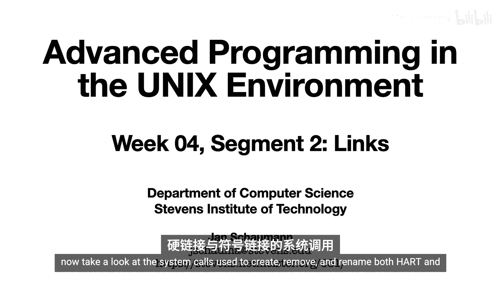

Okay， so to create a new heart thing， we can call the linksx call。

Note that this takes us arguments to pass names， not file descriptors。

 it is in this way a bit different from the other ososis calls we discussed in week 2。

This makes sense， though， since we established that hardlinks are a mapping between a file name and an nine node。

 more explicitly， a hardlink as a directory entry， and so is independent of a file descriptor。

 which references a given file and which is independent of the file name by which it may have been opened。

Secondly， note that in oil to create a heart link， the source file must exist。After link completes。

 it increments the link count of the filing question。

Consistent with the various other Ci we've already seen。

 we also have the linknk at variant to handle relative path names outside of the current working directory atomically。

Note that on the UniX file system creating a new link maps a file name to an ine number。

 as we've seen in our last video segment， ine numbers are file system specific。

 and so we cannot have a heartling that points to another file system。

 as that would require a mapping or file name to device plus iNote number。Now。

 Poss does allow for this， but most Uni systems have not implemented hardings across file systems。

This serves as a reminder that not all the things of standard allows， but not prescribes。

 unnes implemented everywhere。It also may simply not make a whole lot of sense。Secondly。

Note that creating a harding to a directory is not permitted unless the effective UI is 0。

The reason for this is that multiple heartlings are indistinguishable of in traversing the file system。

 and a heartling to a directory might cause a file system hierarchy loop。

 which could lead to file system corruption。These last two bullet points here are part of the reason why symbolic links were invented to overcome these limitations。

 and the behavior of symbolic length is rather different from heart links。

We'll observe this in a few minutes。Okay， now we know how to create heartlinks。

 how do we delete them？😊，Removing a heartlink is done via the unlink system call。

Just like link incrementalcrement to link count， so does unlink decremental link count。

As demonstrated in our last video segment， this link on helps the system determine when the file data box can be released or marked as available by the file system。

Since we can have multiple names in various places on the file system pointing to the same in。

 we cannot allow the system to overwride the data blocks until we are certain they are no longer needed。

This is done by checking whether the link under0， that is no more directory entries exist that point to this INot。

But that alone is not sufficient。 A process P could have opened the file。

 after which the directory entry was removed by this or another process。 Now。

 the link count of the file would be 0。 But if you allow the data blocks to be overwritten and the I O operations on the file descripted that process P has opened could be inconsistent。

Therefore， the system will only release the data blocks when both the link count as0 and no process has open file handled to this file。

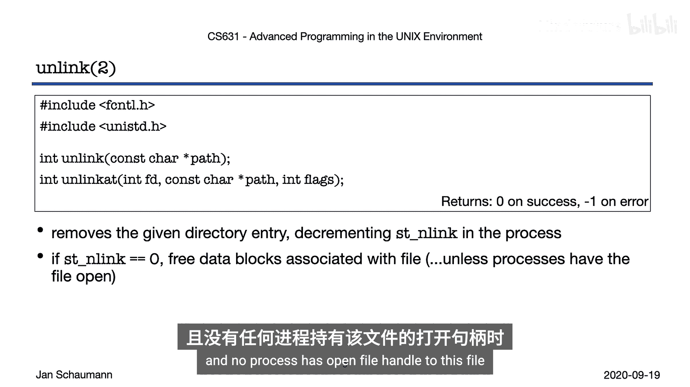

Here， let's demonstrate what this looks like in practice。

Here we have a program that will show the available disk space as we add and remove heart links。

And we begin by showing the currently available space。Then we're creating a 500 magg file。

And showing the change in disk space。And then we are creating a second heart link to this newly created file。

We inspect the output of LSLI and again report on the available disk space。

Then we open the file and immediately unlink it。At this point。

 we have a file handle open for the file that was unnamed。We again show the disk space afterwards。

And then。We will unlink the second name for this file。We again run earth and D earth。And finally。

 closed the open file as scriptpor。Which we have kept still。Okay， let's run it。Okay。

 so we now see the available text space here。Next， be creating the 500 maggF and see the change in disk space。

We use up 3% more of the total space。

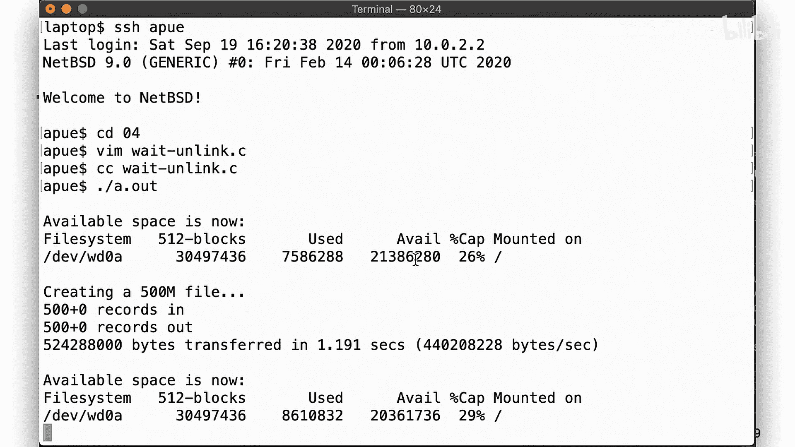

Then we create the second heart link， and Llis LI shows us that the two files are identical。

 say my node number and the link count of two。The available disk space has not changed。

 even though it looks as if we had a second 500 mag file here。Next。

 we opened full on file scripture 3。And unlinkedful。Ellla's Eli shows full gun and bar still present。

With the same I number， but now a link count of one and the same amount of disk space remaining available as before we unlinked for。

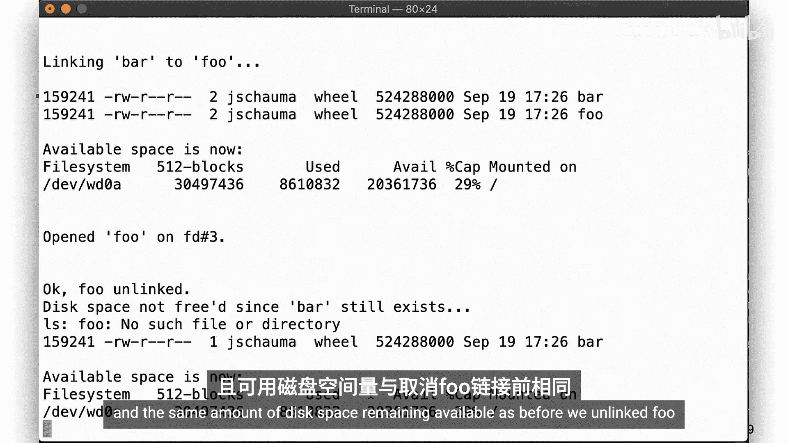

Okay， now with unlinked bar， neither fo nor bar exists， S LS confirms。

But the amount of disk space available hasn't changed。

 The data box have not been freed yet because we still have F3 open。Finally， after we close F3。

 we see the data blocks being released。

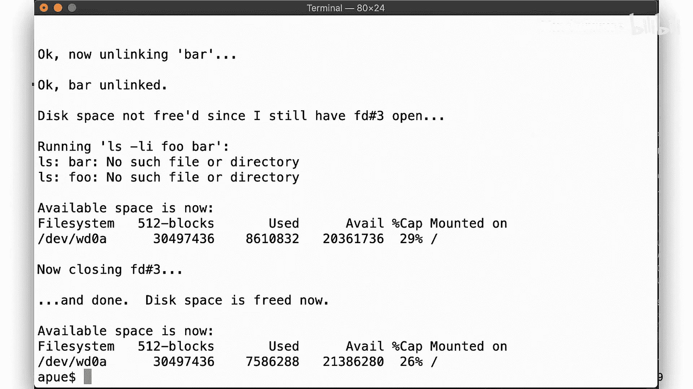

Here's what this looked like in our illustration from before。

Note that at no time even after we are done did we actually remove the data on the data blocks。

 that is the term remove that we usually use really only applies to the directory entry。

 we never really remove a file， we remove a link to a file。

This is why even if you accidentally remove the directory entry。

 the data is not lost and can oftentimes still be found and recovered from the disk。But okay。

 let's see here we have two file names。We remove one and obviously the data on disk remains available via the second file name。

If we remove that second link。Then the link account is now 0。

And if no other process has the file open， the file system can release the data blocks by removing the mapping of inode to data blocks。

And the Iode becomes available to be reused。Okay， now with this illustration in mind。

 we also remember how we talked about renaming a file within the same file system in our last video segment。

For that， we use the Rename system call， which behaves reasonably like one would expect。

If from is a file and two does not exist， then it's easy， we simply create a new link name to。

 and then unlink from， although these operations are performed atomically。

If two exists and as a file，2 is unlinked， from is linked to two， and from is unlinked。

If were trying to rename a file to a directory， we get an error。

 that is the behavior of the MV command whereby moving a file into a directory creates a file under the directory is a nicety of the program to meet user expectations。

 not part of the rename Cis call。For hopefully obvious reasons。

 we need to have right permissions in the directories we're making changes in。

 unlinking a file and creating a new link both modifies the directory。If we're renaming a directory。

 things behave in much the same way。We can rename a directory to another directory if that directory is empty。

 if it contains entries， we get errorer。Renaming a directory to a file makes no sense。

 so it yields an error。Just like before， we need ride permissions on the affected directories。

But with a directory， we have one more edge condition。

 you cant rename a directory to become a prefix of itself。

Let's take a look at the different error scenarios。

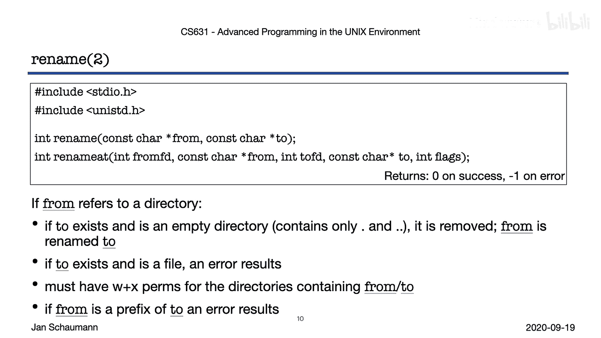

He is the world's simplest Mvicomet， and quite literally consisting of a call to the renamed Cisco。

Let's see。Renaming a nonexistent file doesn't work， no surprise。Renaming an existing file。Works。

 as expected。Now， renaming a file to itself。Works。This may seem confusing。

 but makes sense in the sequence of calls executed。

Renaming a file to a directory will fail as promised。

Renaming a file into a directory by specifying the correct destination file name。

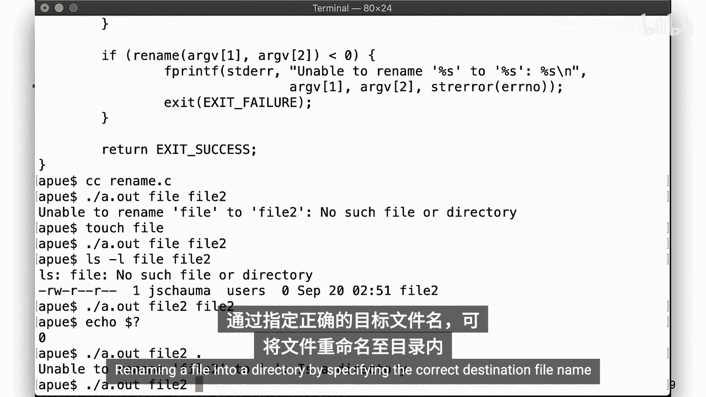

Will work。Now， renaming a directory。Even one that has files in it。Willll work。

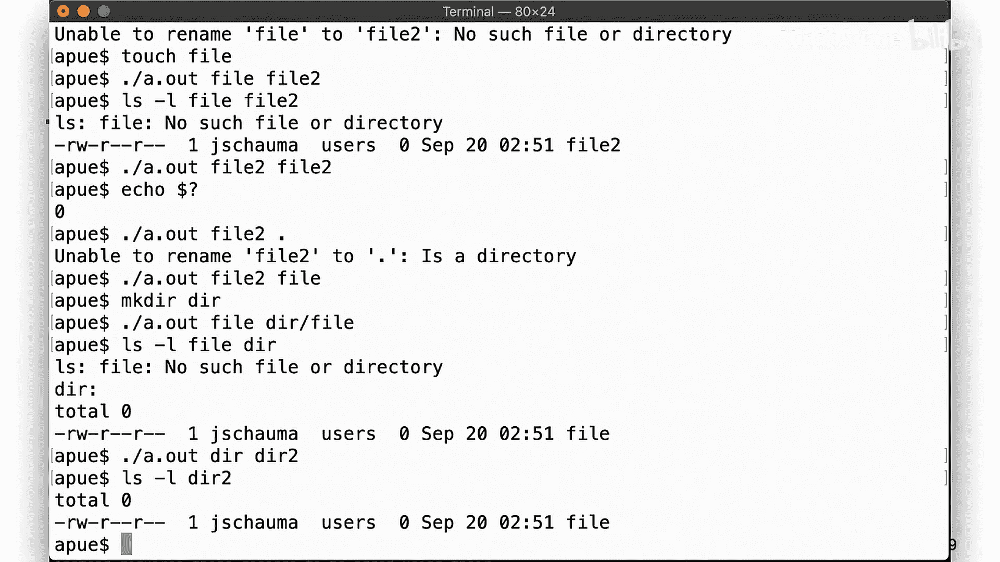

But renaming a directory to a non empty directory does not work。

But we can rename a directory to replace an empty directory。We cannot rename a directory to a file。

And now let's play around with deeper nest directories。

We cannot rename a directory to its parent directory。

Because that directory contains an entry for the directory you're trying to move， so it's not empty。

And we can't rename a directory into itself， which makes no sense。

We also can't use Rename to cross file systems。Remember， s temp is a separate system。

 a memoryory file system in our reference Vm。And finally， of course。

 we do need right permissions on the directories we're operating on。

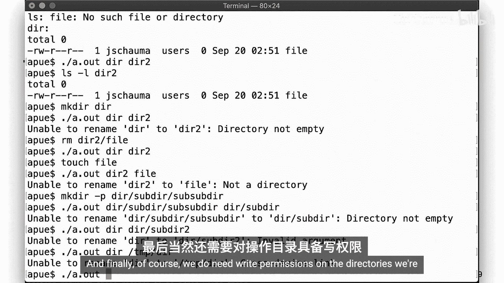

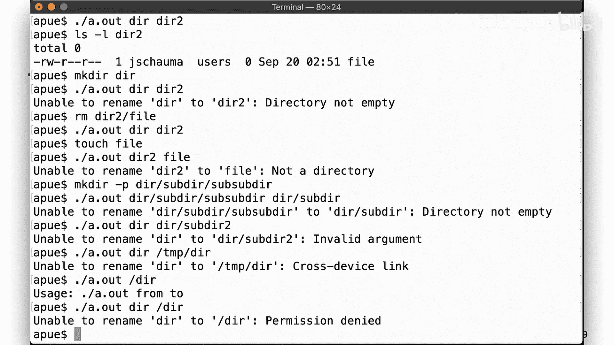

Okay， so you've seen some of the limitations of heart links。

 we can't link across file systems and implementation limitation。

 and we can' create links to directories， but sometimes it's useful to just do those things。

 which is why we have the Simlink let's call。Simlink creates a symbolic link。

 a file that contains as its only contents， the past name of another file and which an operatoron says。

 hey， don't look at me， look at that guy。The neat thing about S is that you can create symbolic links to any type of file。

 including those that do not exist， or that are directories， for example。

When you want to get information about the Sic itself。Instead of the path name it references。

 you'd use the L family of functions， Ltt， Eljon， Egemod， etc。

 as we've discussed in previous lectures。

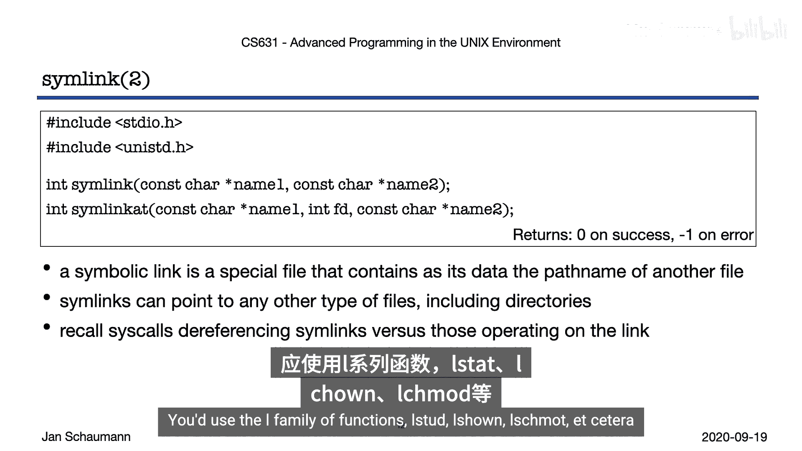

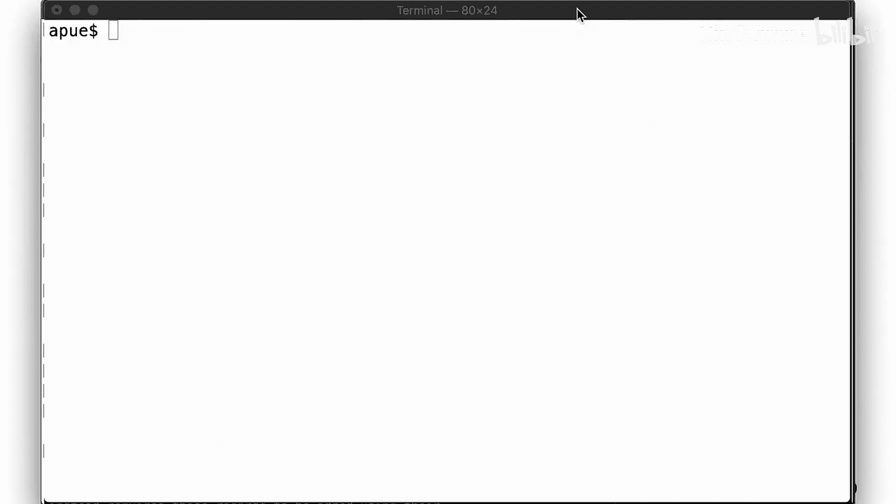

Here， let's implement the world's most trivial LND S command。

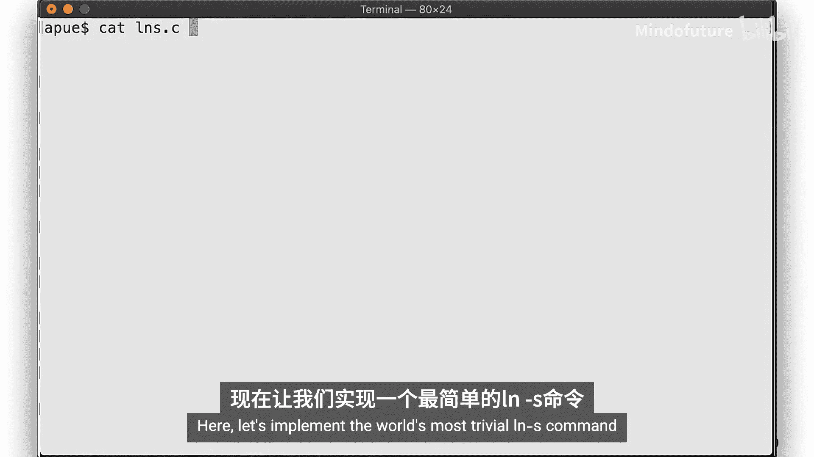

Okay。So we can create a symbolic link to a file that doesn't exist。The succeeds。

Operations on file2 will then tell us that the filing question doesn't exist as it redirects to file。

But as soon as we create the destination of the Slink， caing file2 will work。

Symbolic links can point to anything， including another symbolic link。

And the interaction will follow through on this。But this， of course。

 means that it's possible to create cyclical chains of ss。Where file 3 now points to file2。

 file2 points at file， and file points back and file 3。Fortunately。

 the file system detects this and errors out rather than going into infinite dereferencing loops。

 nice。You can have symbolic links to subdirecties。Which then also might lead to we files it controversial。

Like so。But again， the file system at the shell may be smart enough to detect this。

But directory expansion or tap completion may start to look weird。Now here。

 why are the dot dot s into the parent？We really only created ase into the current directory。

But it contains a very long path name， pointing ultimately to。Oh， well， not this fire。Rather。

 the file endure。And told you this can get confusing。Let's try to fix it。Here， create the file under。

And our assume link with a weird long name will work again。

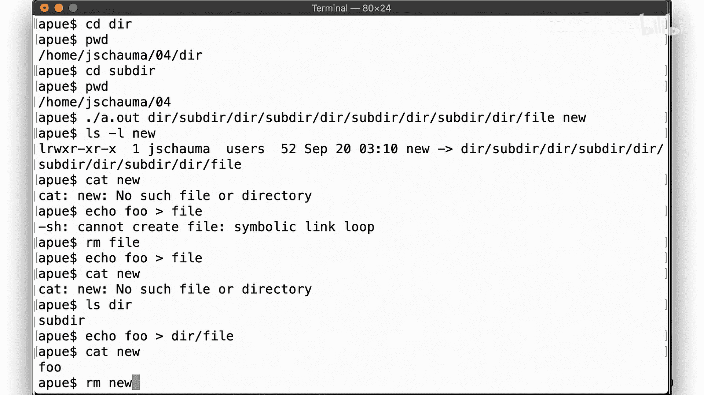

Unlike heartlings。You can create eming links across file systems。

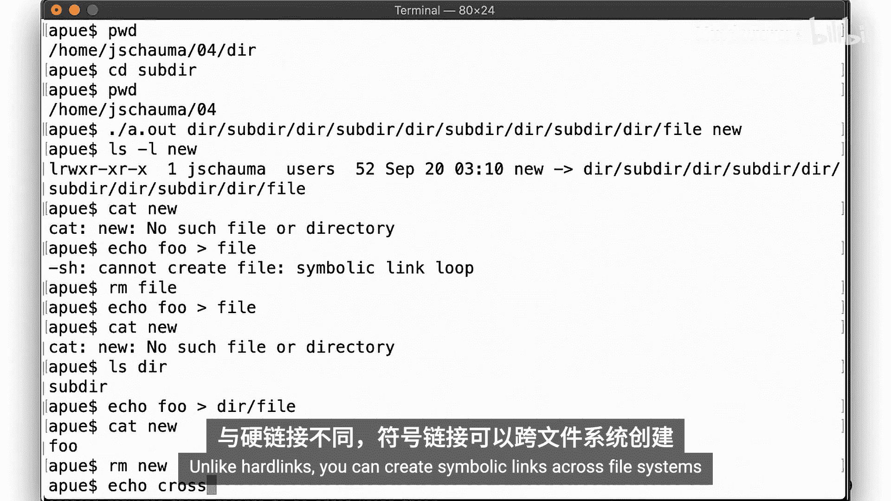

Since the siblinglink really only contains a pass name， nothing else。Now。

 maybe we've seen how operations on the symbol always de referenceence the target。

 but we've also seen how L D L can tell us what the link points to。

How does it do that calling open on the sibling won't work since that D references the target。

 and there's no L open call。

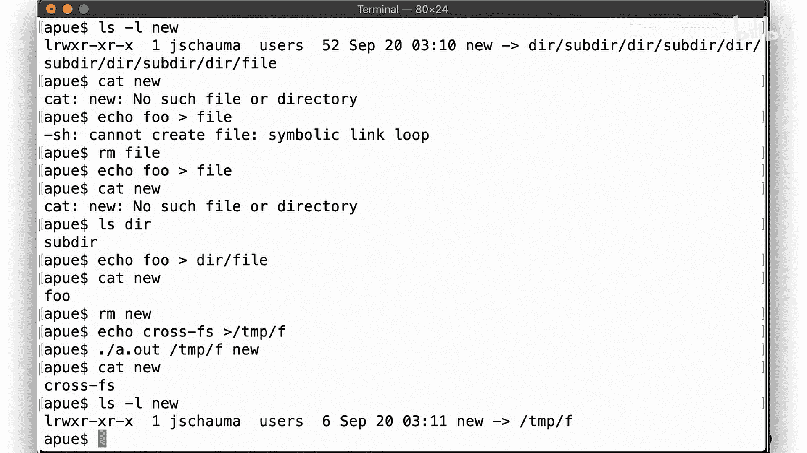

So instead， we have a special C call to get you the contents of a file of typey Slink。

 the Readlinknk source call。You handle the buffer of an appropriate size and tell it to fill in the buffer。

But note that this buffer is not nu terminated， meaning you have to ensure proper handling yourself。

So if you were to implement， say the LS command and want your dash L flag to print the destination of a file of type zimlink。

 then this would be the way to do it。All right， time for another break here。

 enough with all the siblings and hardings already。By looking back at the last few segments。

 you should now be able to implement several more of the common UniIX commands， LN， MV。

 and RM in particular。We' keep in mind how the link count allows us to decide when we can free update data our blocks。

And we understand how moving files within the file system is trivial and fast。

 independent of the data blocks but crossing file system boundaries will require copying of data。

We've seen how symbolic links can reference any files。

 and we've played around trying to create loops in the file system， Try for yourself。

 try to be more creative and find clever ways to abuse siblings to trigger unexpected behavior or output。

In our next video segment， we'll do a deeper dive into the structure of a directory and how we might go about creating and removing those。

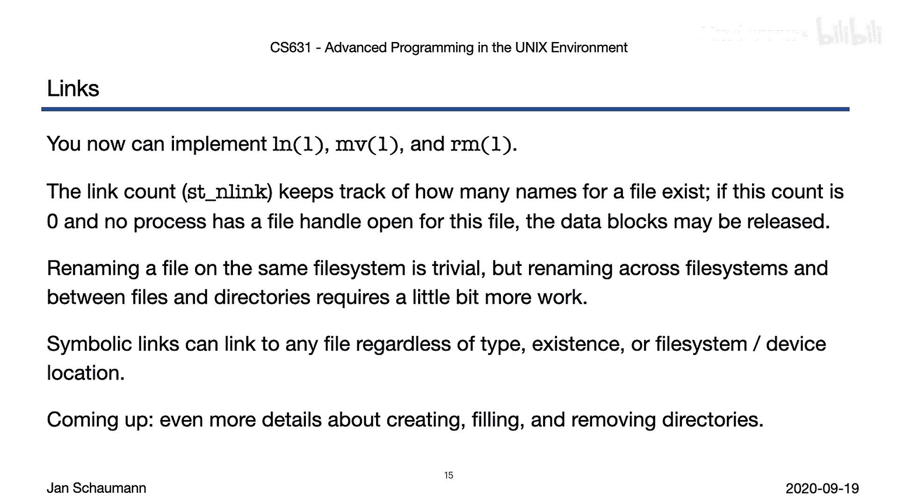

Thanks for watching until next time， cheer。