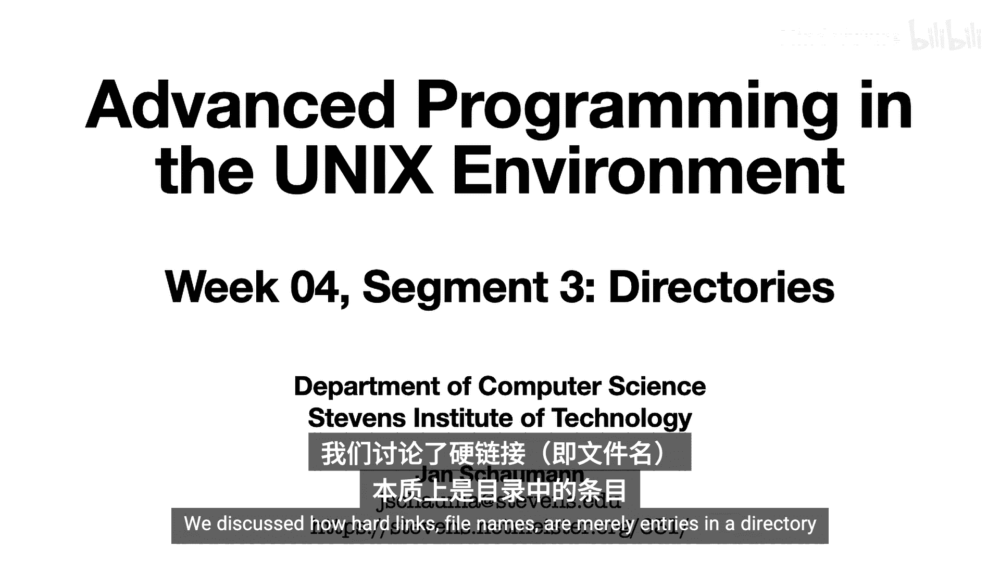
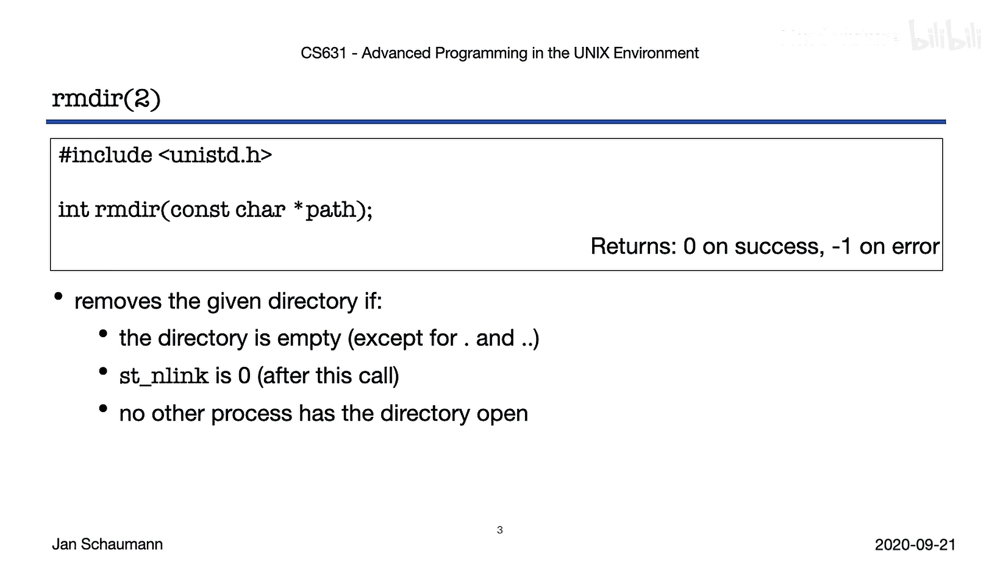
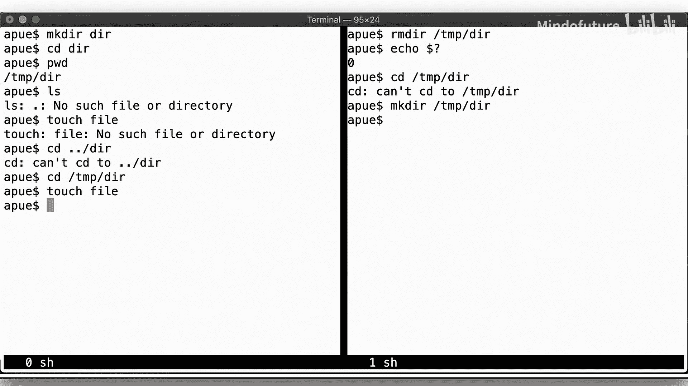
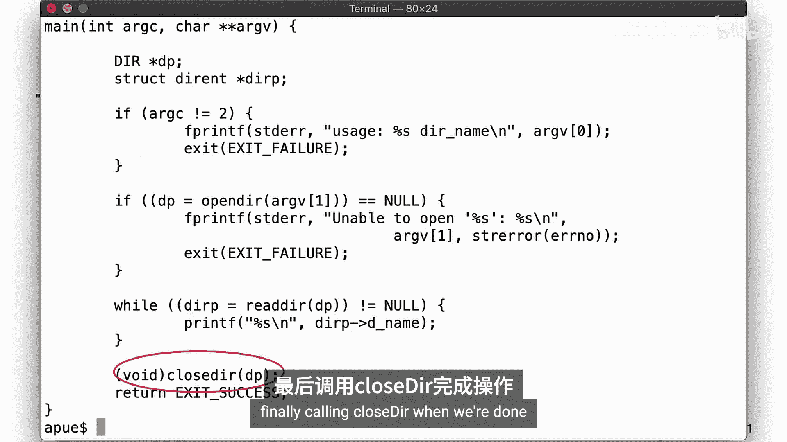
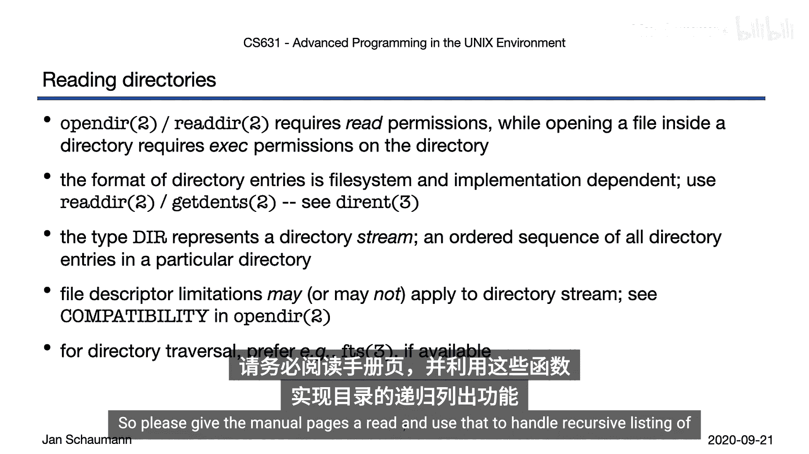
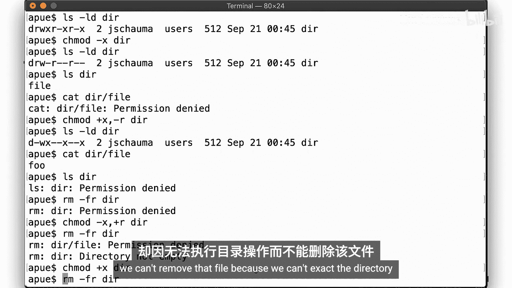
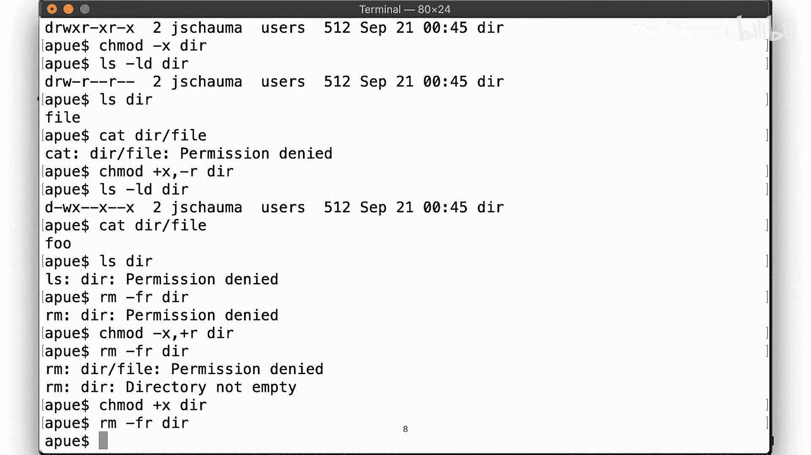
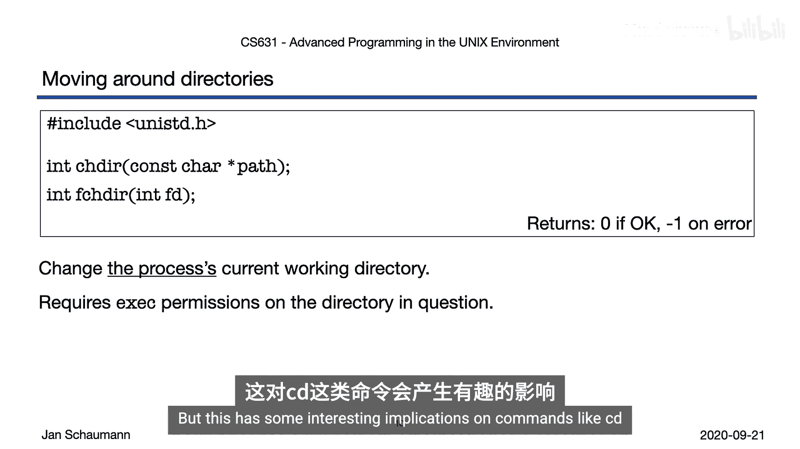
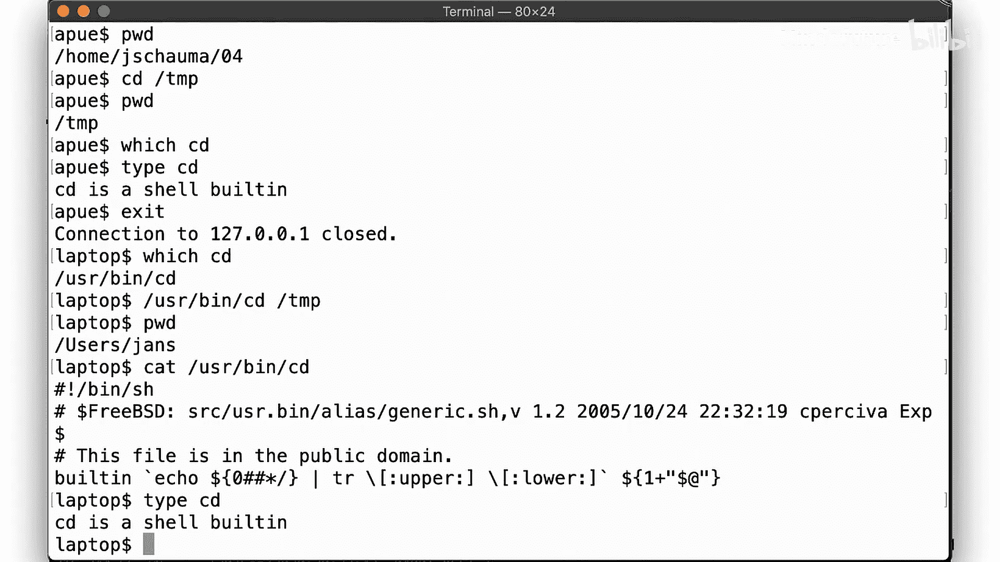
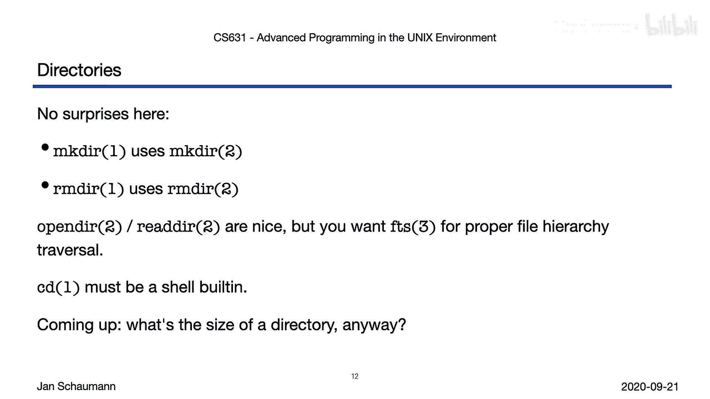

# UNIX高级编程-p18-P18-Week-04,-Segment-3---Directories--BV1hPuVz8EWS_p18-

Hello and welcome back to CS631 Advanced programminging in the UniX Enronment。In our last segment。

 we looked at creating links， both hard links and symboling links。We discussed our heartlings。

 fire names， a merely entries in a directory， so now let's take a look at how we create directories。

It's really quite straightforward。 you simply call make。Which will create a new directory。

 which is empty containing only the necessary entries dot and dot dot。

The permissions on the new directory are similar as we to create a new file as specified by the Mot argument。

 but modified by the process's current U mask， as we illustrated in the previous video segment。

Similarly， ownership of the new directory follows the same semantics as we also previously discussed and based on the version of Unix in question。

Likewise， removing a directory is not very complicated either， call Arer。

Armer removes the given directory if it is empty， the is it only contains dot and dot dot。If so。

 then it is removed and the S inlink count is decremented。

If that link account is now zero or rather will be zero after this call。

Aint no other process has the directory open。Then the directory is removed。

Now， with directories， there's also the issue of a process having it open as a current working directory and removing such a directory can lead to confusing situations。

Here we create a directory and change into it。Then from another terminal。

We yanked the directory out under our feet。Which works just fine since the directory is empty。

With our existing process， still thinks that Temp Di is its current working directory。

But if we try to list its contents， that is， we try to open it and iterate over the entries。

That fails。And creating a new file in the directory can't work either。

Since the directory doesn't really exist anymore。Now， if we recreate the directory。

 we won't magically be back in it。 we'll have created a brand new directory。

And trying to access the entries can't work either since dot dot， for example。

 is still in the directory which doesn't exist。An absolute path， however， does work。

And all operations now behave as expected。

Reading directories is something that should look familiar from our simple Ls clone from our very first lecture。

First， we call Opener to open a new handle on the directory。

Then we iterate over the entries found in the directory by calling Re repeatedly， finally。

 calling closed when we're done。

The system called looked like so。One thing to note here is that the order in which we get entries from the directory is opaque to us。

The entries are not sorted in any way， or if they are in a five and implementation dependent way that we cannot rely on。

Okay， so opening directories and listing its contents requires read permissions on the directory。

That accessing any files inside the directory will， as we discussed in the previous segment。

 require exactec or search permissions on the directory。

Reading a directory should always be done using Read or getd since the implementation of the directory entries is file system dependent。

The structures involved are documented in the Durant manual page。When you open the directory。

 you get back a door handle， which represents the directory as a stream。

 meaning the entries are returned to you in an ordered fashion。

But you must not make the assumption that this happens in order you can predict。

 such as albetic or by directory entry creation。 The ordering inside the directory is opaque to you。

Whether or not an open directory comes towards the open file handler。

 a file descriptor limit is not something you can rely on。

The implementations and standards are very unclear a variable here。

See the compatibility section of the Open your manual page for more information。Finally。

 while you can perform file system hierarchy reversal with a careful sequence of open De reader and closed De。

 this gets very hairy real quick。Instead， I recommend that you look at the FTS library functions。

 especially for your LS midterm project。As you might have guessed。

 the FTS library functions do in fact， call the open des called underneath。

 but provided a lot of additional convenience。These file hierarchy traveral functions are not guaranteed to be available in all Uni versions。

 but fortunately for you， they are available on your target platforms。

 so please give the manual pages a read and use that to handle requisive listing of directories。

Yeah， let's take a quick look at some permission edge cases when hand directories。

Here's a file inside the directory。We remove， execute permissions from the directory。

But we are still able to list its contents。That is opening the directory and calling Re your works without exact permissions。

However， accessing a file inside of the directory fails。

Since we do not have permissions to exactec or search the directory。

If we' change the permissions to allow exec and remove reap permissions。

Then we can access the file inside the directory despite not being able to read the directory。

But listing the directory contents fails。Perhaps unexpectedly。

 removing the directory fails since we are unable to open it to see if there are any files in it。

And if we flip the permissions， we can open the directory， see that there's a file in it。

 but we can remove that file because we can't exact the directory。

Since we can't remove the fire， the directory won't be empty， so we can't remove it。 We her。

In other words？To recursively remove the directory， we need both read and exact permissions。

Okay， we've already seen that we may have an open file handle on the directory after we change it into it。

 which introduces the concept of a current working directory。

 which a bit earlier in the semester we had mentioned every process has。

So to get the current working directory， you can call the GetCWD to score。This is done by。

 for example， the PWD command as well。And also， by built into most shells， a special variable。

We also just saw how to change the current working directory via the C command now how does that work？

To change the current working directory of the current process， you call it Cur。As we saw earlier。

 you need to have exact permissions on the directory in question， otherwise you can change into it。

Note though that the current working directory is set on a per process basis， That is。

 if we recall a simple shell from lecture 1， when we execute commands in the shell。

 we generally fork a new process， then exact the binary and then return。

But this has some interesting implications on commands like C。

Here， let's implement CD。Not particularly difficult， right？Let's see if it works。Okay。

 changing the current working directory into temp seems to work。

Let's confirm with I PW andD and then Wade， what's that？

Why are we still in the directory started out it？Let's try something else， dot， dot。Seems to work。

Except。It didn't。But we are able to change directories when wanting C aren't we？Yeah， CD1 done。

 no problem。So what's going on here？Well， as explained a minute ago， when we run our program 80 out。

 we begin in our current working directory， home Tsoma 04。And no a shell will fork a new process。

 The new process will have a current working directory of Home J Xma4。

Then that process caused Chur and the new current working directory will be1。

There know a program exits and no a parenting process which never changed its current working directory。

 prints our command prompt again that we then run PWD， which reports the current working directory。

As I said， Chir can only influence the current process， not a parent process。

But then why does CD work？哇啊。😮，There isn't actually a C D executable。 Rather。

 the C D command is built into the shell， meaning that the shell does not fork a new process to run it。

 It is called within the current shell process。In fact， CD has to be a shell built for this to work。

But now it gets weird。Let's look at MacOS。There we do have a user BCD command， let's give that a try。

Nope， still no go， same problem。And what the hell good is this program then？Well。

 turns out that PosX requires a standalone utility named CD to exist。

So if you want to be products compliant at a trademarkm Uni， then you have to provide this command。

Even if it doesn't work and thus is completely useless。

You still have to provide a CD building in your shell so that you can actually change your current working directory however。

 but you do ship with a useless utility to a pieceless standard。Yes。

 computers stay' great because things always make sense with computers。

On that note， let's break here。To recap。To create a directory call makeD。

 to remove a directory called ArMder。To Traverse file system hierarchies。

 Open their reader can be used， but for your midterm project you should use the FTS library。

The current working directory is specific to the current process and changing the current working directory can only work within the same process。

 which is why CD must always be a shell built in and cannot be a standard on executable。

 even if your OS may ship with one。In our next segment， we'll take a look at directory sizes。

 You should find that they are a bit less obvious than you might initially think。

Thanks for watching until that， cheer。

