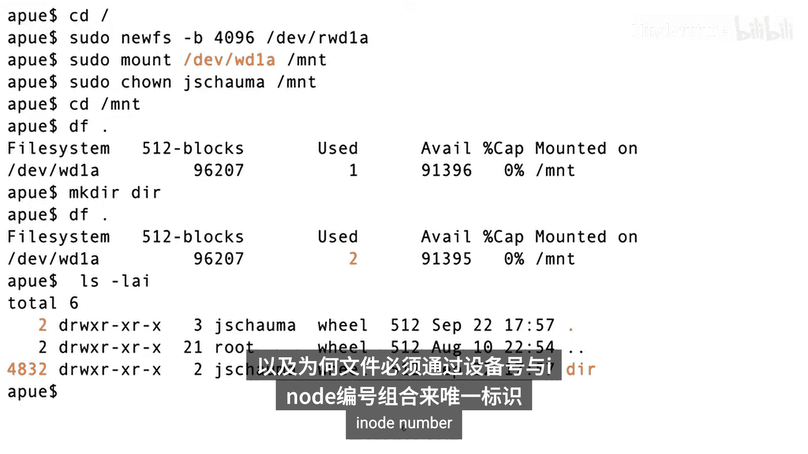
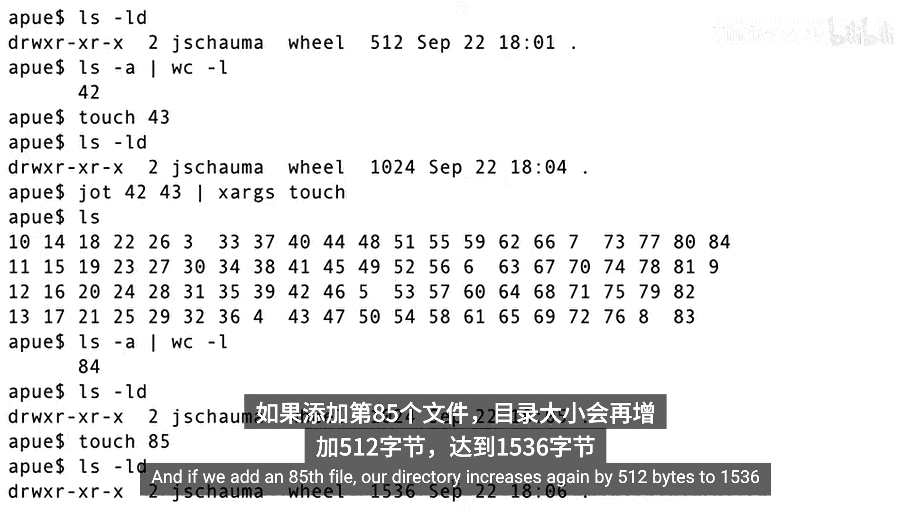
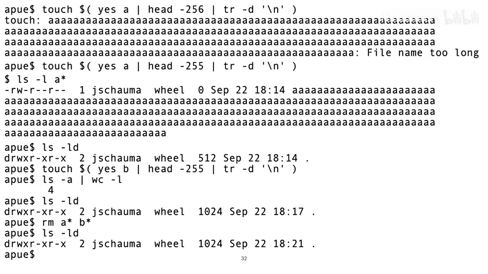
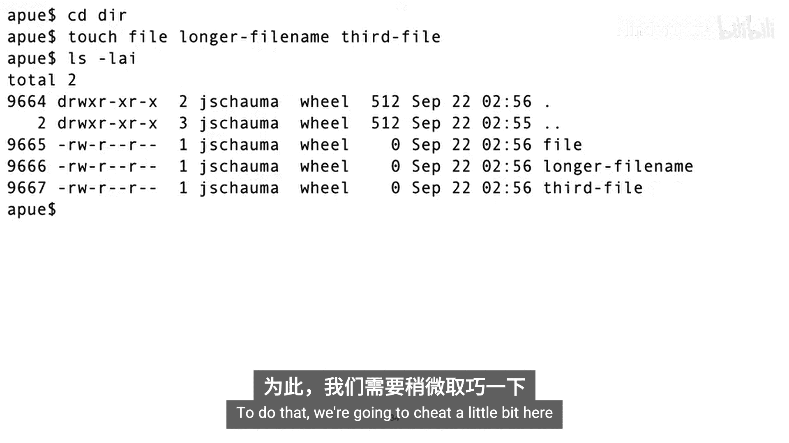
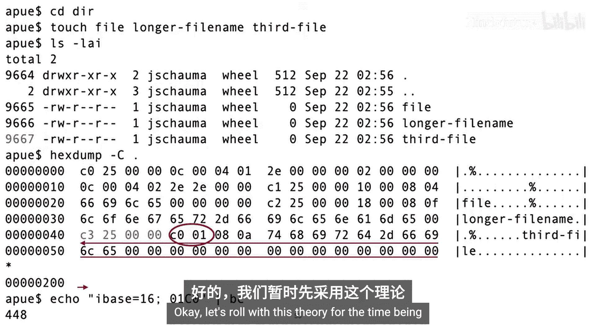
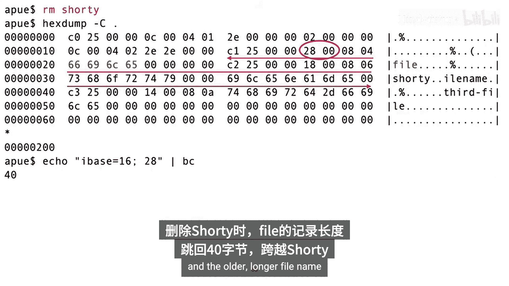
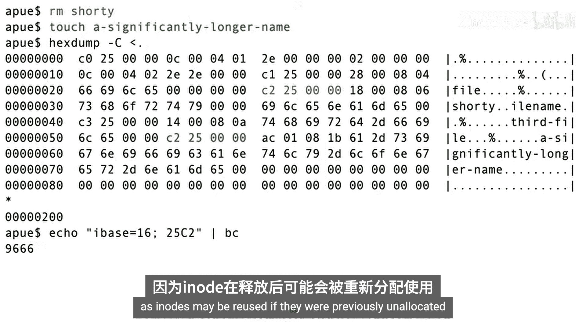
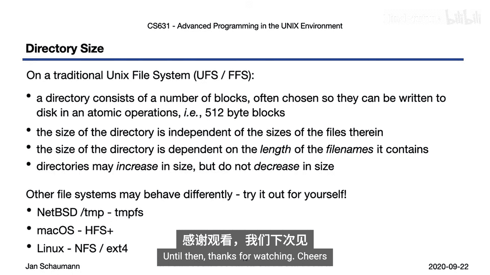

# UNIX高级编程-p19-P19-Week-04,-Segment-4---Directory-Size--BV1hPuVz8EWS_p19-

Hello and welcome back to CS631 Advanced programminging in the UniX Environment。

In our last two video segments， we talked a lot about heartlinks and we established that the heartlink is merely an entry in the directory。

We also previously looked at the members of the Str state and noted that ST size represents the size of the file。

So let's take a look at what this means for directory。

First， it's revisit what the size is for the different types of files。

The Pfo and the socket have a file size of  zero since they never contain any data。

They are used as inter processcess communications rendezvous points only。

 the kernel shuffles the data between the processes， and they never hit the disk。

A regular file is easy， just count the bytes， three ast characters and a carriage return。

The symbolic link contains as it contents the path of the target， so in this case slash wherever。

 no carriage return here， which is9。And for devices。

 LS doesn't even get a size field and instead shows us the device major and minor numbers。

So let's take a look at director reies now。To do that。

 we reuse the virtual disk we had previously edit and start fresh with a new file system。

We mounted under slashMo and shown it to a user。There's nothing on this disk yet。

 we see that it is pretty much empty with only a single 512 byte block being used。

If we create a new directory on this disc。We see that the use block count increases， we now have two。

 512 byte blocks in either。Looking at the output of the less。

 we see that directories appear to use 512 bytes。Dre at ine number 4832。

 which we created has a size of 512 bytes as to dot and dot dot。waitt。

 the disc shows that there are only two512 byte blocks used， but here we count three。 Where is that。

Well， take a look at the in numbers of dot and dot dot。It's the same。

 meaning they are the same directory， and so we really only have two512 white blocks in use。拜好啦。

How can dot and dot dot be the same？And what's even weirder。

 even though these two have the same I number two。They have different owners。

And different link counts。So they are not the same directory。

 even though they have the same I number。And this is because they exist on different devices。

Remember， we mounted a new file system under slash mount。So we have data on disk DwD1A under s mount。

 where the root directory of this file system has an in number of two。

 while the root directory of the file system mounted under s。

 the root file system has an ine number of two as well。

Hopefully this illustrates why we can't have heart linkss across file systems and why a file is uniquely identified only by the combination of the device and the id number。

Oh， and one more weird thing on the root file system。

 both dot and dot dot do point to the same MinNot。But that is the only instance of dot and dot dot pointing to the same directory。

 since only in the route do you not have a parent directory。Anyway。

 so let's get back to the directory slide。An emptyty directory uses 512 bytes。

 While it's not really empty。 it contains two entries， dot and dot dot， remember。

So if we add a new file to this directory， it would stand to reason that the directory size would increase。

Let's give it a try。嗯。Okay， so we created a third entry， but the directory size remains the same。

Likewise， if we had another file。But this isn't getting us anywhere like this。

Let's try adding a few more files a bit quicker。Okay。

 here we add 40 files to the directory that already has two entries， so we have a total of 42 files。

Yhy 42？Come on， you should know this， 42 is the answer to the big question about life。

 the universe and everything。Anyway， let's see how big is our directory now？H still 512 bytes。

But all these files are zero length and size， maybe if we create a larger file。Let's make the file 3。

1 megaby size。1 Mby is larger than 512 B， so surely our directory size has got to increase now。

And it doesn't。 still 512 bys。Okay， so maybe all directories are always 512 bys in size。

Let's just give it one more try and edit a 43rd file。

Oh look at that Now our directory is suddenly 10，24 bys in size。Can we add another 42 files？

ItLook like we can。And with 84 files， we are still within 1024 bytes。And if we add an 85th file。

 our directory increases again by 512 bytes to 1536 bytes。

So。Perhaps every filing directory takes roughly 12 bytes or so。Now。

 512 divided by 42 is not 12 even but 12。19。But 43 times 12 equals 516。

 so we can only fit 42 files into a 512 by directory， or 84 into a 1024 by directory。

Let's see what happens when we remove file number 85。Remember。

 that was the file that bumped the directory size from 1024 to 1536。

 So removing it should bring our directory size back down to。that didn't work。

 Our directory is still 1536 bys in size。Let's remove a whole bunch of files to make sure。See。

 now we only have 33 files left， thats fewer than 42s should fit into a 5 and12 by directory。

But the directory remains 1536 bytes。In fact， even if we remove all files in the directory。

 the size remains 1536 bytes。Okay， so it looks like one。

 directories can increase in size to accommodate more files than fit into it。

 but directories do not shrink in size when you remove the files。Two。

 the file size does not affect the size of the directory the file is in。And three。

 directory entry appears to always take up 12 bytes。

All the files we created so far had very short file names， even if file size doesn't matter。

 Would't it make sense for the file name length to make a difference。

That is with a directory entry that has a long file name also only require 12 bys。

Let's test this theory。Since our directory can shrink。

 we nuke it and start fresh with a new 512 by empty directory containing only dot and dot dot。

Let's try to create a very long file name。Because we're lazy and I want to have to type a really long fine name ourselves。

 we use this little pipeline here to generate a fine name that's 1024 bytes small。Oh，huh。

 that finding is too long。As I mentioned in previous lectures， all things are finite。

 all resources are limited。So it makes sense that we cant just create an infinite length file name。

 and it looks like our limit for a file name is less than 1024。😊，So by trial and error。

 we determine that we can create a file with a name that's 255 characters long。That looks like so。

And our directory size now is。512 by。Let's create a second file with such a long file name。

Then we have four directory entries， dot dot dot。A and BBB， etc ceter。 and our directory size now is。

1024。Which should make some sense， a directory entry must contain the file name。

 so if we have two file names with 255 characters each， then we are already at 510 bytes。

 not count for dot and dot dot， which at at least three mobiletes and not accounting for the additional information a directory entry must provide the inote map to the file。

Now， this also means that directory entries are not always1 twelve by its in size。

 but instead must be variable length， depending on the length of the filing。Okay。Now。

 removing these large files also doesn't shrink the directory。

 so that's consistent with the behavior we saw earlier。But why doesn't the directory shrink。

 how does the fire system actually organize the directory entries？

To inspect that， we again start from scratch with a brand new file system on our disk。Okay。

 here we create three directory entries with variable length file names， file， longer file name。

 third file， and the i notes are shown as provided by a good friend Ls。

Now let's try to take a look at the internal structure of the directory。To do that。

 we're going to cheat a little bit here。

We use the hexton utility to provide us with a hexademal representation of the bites on disk。

This works on this file system， but not all file systems lets you read a directory。

As we discussed in our last video segment， you normally should use the designated system called Re or get DNs。

Anyway， what you see here then are the bys on disk making up the directory。😊。

And you can see in it the file names。Each directory entry is made up of four bytes for the in and little Indian display。

We can use the B utility to easily convert numbers between different bases as shown here。

 so 25 C0 and hex is 9664 in decimal。Two bytes of directory entry length。Zero c hex is 12 s and1。

 meaning the next directoryantte was started by 13。

And I look at that here we have our 12 bidirecty entry size that we determined earlier for shorter files。

Let's keep an eye on the directory entry size here。

You get one byte encoding the type of file with a4 representing a file of type directory。

One bite specifying the length of the fiy。And here too。

 take note the highest value a single hexpite can have is FF， which decimo is 255。

The maximum length of a file name that we observed earlier。

So here the first directory entry has a file name length of one。

 and the next part is exactly that file name。Hex2 E is ASI dot。

So this second entry has INote number two。Is also 12 bys long。Is of type directory。

Has a file name length of two， with a file name being dot dot and the entry padded again to the4 byte boundary。

The third entry has In number 9965。But it is 16 bytes in length， not 12。Its a type regular file。

 but the four by length file name followed by nu padding again。The fourth entry has In number 9966。

Is 24 bytes long。I's of typey regular file。And has a fire name length of 15。Now。

 the last entry has I know number 9967。But this entry length is 448 bys。

Even though the finding length is only 10 bytes。That is the last entry spends the entire remainder of the directory。

And with that， we're getting an idea how the fighters manages the directory。

Use the directory entry length to identify where the next directory entry begins。

But if the final length of the entry plus pairdding is shorter than the directory entry。

 then we have space to add a new entry at this point。Okay。

 let's roll with this theory for the time being。

Now what happens when we remove a directory entry？Well here we do just that。

 Then we inspect the directory again using Hext。Note that even though we remove the directory entry。

 the file name must still there。In fact， all the bites we had previously seen for longer fire him are still in the exact same place。

But I thought we removed the entry。And so we did， but removing a directory entry doesn't have to go and erase the data inside of the directory。

All we need to do is update the previous directory entries length to spend the entry we just removed。

So here we see the directory entry length for file， which previously was 16 is now 40。

 the record was extended。Which is by our directory didn't shrink。

 The sum of the record length did not change。 Instead， the record length of fire was increased。

 but with a null patting after the fine name length， the data left in place is no longer used。Now。

 what happens when we create a new file？Here， let's use a short filing， shortly。

After we created Shorty， the record length of file shrunk again back to 16 bytes。

And the newly created directory entry was added after file。

 overruniding the data that was previously used for longer file name。In fact。

 we can still see the remainder of longer file limb left here since Short is much shorter。

The decimal entry length for shortty is now 24 decimal。Again。

 the fire name length prevents us from accidentally reading the garbage data left in place from the previous entry。

And we remove Shortly， the record length for a file jumps back up to 40 bytes。

 span shortly and the older longer filing。

So this worked out nicely because surely did fit into the space that we had between file and third file。

But now let's add another file， one with a longer file name。A significantly longer name。

As you see here， a significantly longer name doesn't fit in between name and third file so the record length of file remains unchanged。

But the record length for third file， which previously was4 at 48 bytes， now shrunk to 20 bytes。

And a significantly longer name is added at the end of the directory with its record length now span the remainder of the directory。

Note also that when we created this new file， we reused the Inode number 9666。

 it was previously used for Short， but now is used for a significantly longer name。

This is a good reminder that while an iNot does identify a file uniquely。

 you have no guarantee that a file by a given in accessed at one time is the same when access to another time as inots may be reused if they were previously unlocated。

Okay， one more round。This time we'll use really long file names here you see the 255 by length file names。

 AAAAA and BBBBBBB， etc。Since they didn't fit into the available space in between files。

 they were added。And since BBBBB bumps the total size over 512 bytes。

 the directory was extended to 1024 bytes in the size。

Now if we remove AAAAA and then create a few shorter files， let's see where they end up。

C fits into the slot of See。DDD fits right behind that one。But EEE does not fit right there。

 but we have a large hole left from AA AAA。So EEE ends up right there。

With its record length being 392 bytes and ending where BBBBB begins。So in this way。

 we see why the directory does not shrink and how it juggles the variable length directory entries。

Few， there were some fine hexts belongunking with it there，huh， let's recap。😊，For starters。

 directories are file system dependent and different file systems may implement them differently。

On the UniX file system or the BSD variant， the fat file system or FFS。

 they consist of a number of directory blocks， which for efficiency's sake are aligned on the physical block size of the disk。

The size of the directory is independent of the sizes of the files they're in。

This makes sense since it only contains the mapping of the file name to the in。

 not the file data itself。But the directory size does depend on the length of the fire names in it。

 as we've seen。And the directory may grow in size， but not shrink due to the way it juggles the different entries of varying length。

Now， other file systems may behave rather different。

 but perhaps you want to give it a try and find out how by running similar examples on the memory file system used on our reference BM410。

 on a MacA system or on a Linux system that you have access to。When you do。

 pay attention to link count and size as you add and remove files and see whether our file name length changes。

 directory entry size and those file systems too。But enough about directories Next time we'll talk about a few system functions relating to system databases like the password file。

 file times， system identification， and the like。Until then， thanks for watching。

Yeses。